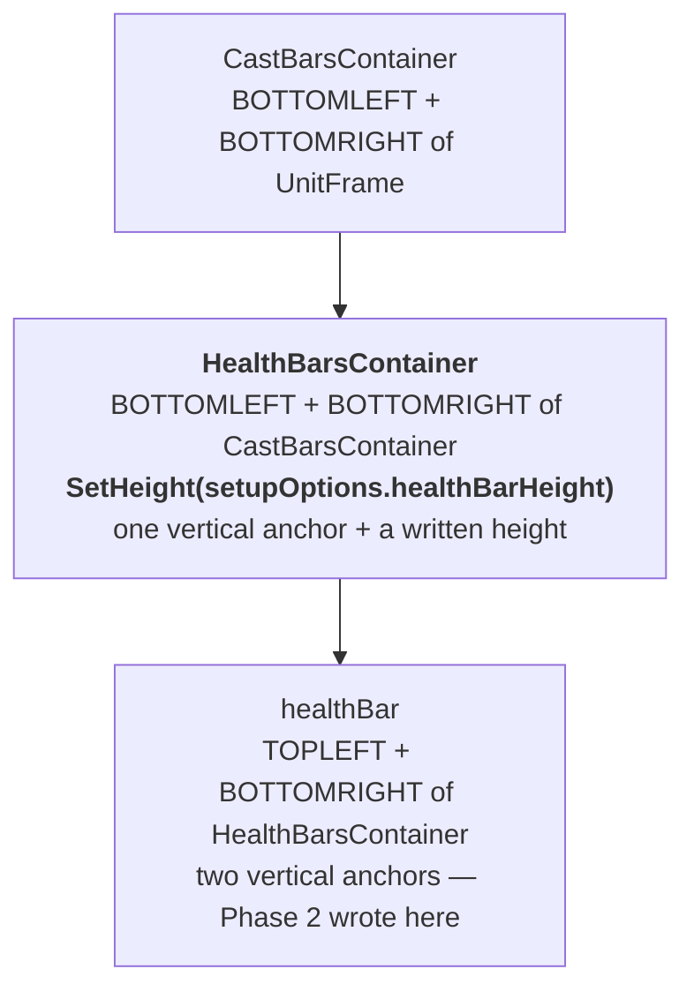
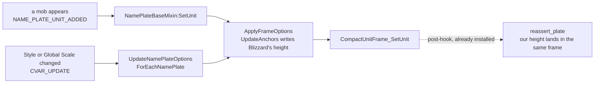

# PersonalAddon — Phase 14 Design: the nameplate health bar's height

**Date:** October 10, 2026
**API version:** 1.60.1 (WoW Forever Beta), game type `camelot`
**Client:** 1.60.1.70334, UI export 2026-10-09 21:00 — `patch_check status` reports
`UpToDate`, accepted 2026-10-09 21:20
**Supersedes:** §3 of `20261009-RoadmapProposal03.md`
**Corrects:** `20260919-Phase02.md` §4.9, which concluded that neither the health bar nor
the plate can be usefully resized on this client. The conclusion was wider than its
evidence (§2).
**Depends on:** `20260919-Phase02.md` rev 7 (restyle-in-place, the hook constraints),
`20261002-Phase09.md` (`ClientRead`, the secret-read lint)
**Revision:** 3 — audit findings applied (§15); **built**. Finding 2 changed the mechanism: the base height is read from Blizzard's options table, not from the frame. §1.2a is the gate

---

## 1. Scope

A setting for the height of the nameplate health bar. Nothing else changes.

| Item | Kind | File |
|---|---|---|
| `barHeightFraction` setting | Feature | `Features/Nameplates.lua` |
| Height re-assert, on the hook that already exists | Feature | `Features/Nameplates.lua` |
| `/pa plates` reports it | Feature | `Core/Debug.lua` |
| Four premises | Docs | `Tools/patchcheck/premises.toml` |
| Spike N deleted | Cleanup | `Spikes/BarHeightProbe.lua`, its route, its saved variable |

**This phase adds no event subscription, no hook, and no timer.** §4 is why.

### 1.1 Decisions

| # | Decision | Where |
|---|---|---|
| D1 | **Height only.** Width is out of scope | §1.3 |
| D2 | The setting is a **percentage of Blizzard's own height**, not a pixel count | §5.1 |
| D3 | It applies to **every nameplate**, not only the hostile and neutral ones this feature colours | §5.3 |
| D4 | **No style ledger.** The base height is kept on our own plate record, and Blizzard restores the bar by itself | §5.4 |
| D5 | The name, raid marker and aura icons move with the bar, and are left where Blizzard puts them | §6.2 |
| D6 | **Nothing is written into `NamePlateSetupOptions`**, although that would need no re-assert at all | §6.1 |

### 1.2 What the spike found

Spike N ran in game on 2026-10-09, build 1.60.1.70334, through
`Spikes/BarHeightProbe.lua`. The operator's report, not the addon's read-back, is the
evidence — Phase 2 §4.9's whole lesson.

| # | Question | Answer |
|---|---|---|
| N1 | Does `HealthBarsContainer` resolve on a plate? | Yes |
| N2 | Is its height readable? | Yes, `Plain` through `ClientRead`, on **every** plate |
| N3 | **Does a written height visibly shorten the bar?** | **Yes.** The gate |
| N4 | What puts it back? | A plate being recycled onto another unit. Nothing else was needed — `restore` was the only command that mattered, and leaving a mob's view reverted its bar on its own |
| N5 | Is the plate still clickable? | Yes. Mouse targeting worked at 6px; the operator plays with a controller, where it matters less |
| N6 | What else moved? | Nothing the operator noticed. A name shift of about 7px is expected (§6.2) and is subtle enough to pass unremarked |

**As shipped.** The spike answered the gate and was deleted with its route and its saved
variable, as Phase 7's, Phase 8's and Phase 12's probes were. What it established is now
mechanism:

| What the spike proved | Where it lives now |
|---|---|
| The container's height is writable and the bar visibly follows | §2, and the feature itself |
| Every plate is writable, not just the target | §5.4 — the height applies to every tracked plate |
| A recycled plate comes back at Blizzard's height | §3, and §5.5's reason for having no ledger |
| No refusal across repeated writes | §10's rule 7 row, and §6.3 |

Two readings were wrong before the run and are recorded so they are not re-derived:

- **"Only the target's bar changed."** The first run reported this, and the hypothesis was
  that `GetHeight` — which is secret-capable — reads `Withheld` for units the player is
  not targeting, as Phase 11 found for threat percentages. **False.** Repeated runs
  changed every bar in view. The first run's single plate was the only one up at the time.
- **"A written height survives until something clobbers it."** It does not need to. §4.

### 1.2a Gate: the client was patched again during the build

**Open as of 2026-10-10.** `WowB.exe` was replaced at **08:17 on 2026-10-10**, after the
export this design was written against (2026-10-09 21:00, build 1.60.1.70334). Its size is
unchanged, so it may be the same build re-shipped — but `patch_check` will not guess, and
`check` refuses while the binary is newer than the export.

| | Status |
|---|---|
| The code | Written and passing: 30 new checks, 609 across all twenty sessions, lint clean |
| The four premises | In the register, which now holds 35. `load_register` validates them, and all four `Pattern` regexes match the 70334 export at the lines §8 cites |
| `check` | **Refused.** Re-export, then run it |
| The in-game run (§11.3) | **Blocked** until that passes |

The four facts at risk are all mechanically checked, and three of them are one-line
patterns in Blizzard's source. If `PLATE-SETUP-OPTIONS-HEIGHT` moved, the feature writes
nothing and says so through `barHeightBaseWithheld` rather than guessing — so a stale
premise degrades visibly, which is the direction this design chose everywhere.

**Procedure:** export the UI again (launch with `-console`, then `exportInterfaceFiles code`
at the login screen), run `python Tools/patchcheck/patch_check.py check`, read the report,
then `accept`. Rule 11, and the third time this gate has opened mid-build — Phase 12 §1.5
and Phase 13 §1.2 are the other two.

### 1.3 Not possible, or out of scope

- **Width** (D1). `HealthBarsContainer` takes `BOTTOMLEFT` and `BOTTOMRIGHT`
  (`Blizzard_NamePlateUnitFrame.lua:714-715`) and **no `SetWidth` anywhere**: its width is
  derived from `CastBarsContainer`, which is the UnitFrame minus `insetWidth` each side.
  A `SetWidth` of ours would be discarded for exactly the reason Phase 2's `SetHeight` on
  the bar was discarded — two opposing anchors win. Changing width means **removing one of
  Blizzard's anchors and replacing it**, then re-establishing that on every layout pass.
  That is a different and much larger feature than writing a value Blizzard already writes.
- **Any CVar write.** `nameplateStyle` 6 gives a 10px bar and the whole Classic skin with
  it; `nameplateSize` scales width and every font too. Both are the user's to set in
  Blizzard's own Options, and neither is this addon's business. Unchanged from Phase 2's
  non-goals.
- **Moving the name back up.** §6.2.
- **Friendly-plate guild names.** Phase 15.

### 1.4 Types

```
Fraction        = number          # 0.3 .. 1.0, stored as a fraction, shown as a percent
Pixels          = number          # Blizzard writes fractional heights; so do we (section 5.2)
BarHeightResult = Written(from: Pixels, to: Pixels)
                | Unchanged
                | Withheld        # the client would not show the base height
                | Unavailable(reason: string)
```

Inherited, not new. `PlateRecord`, `PlateScope` and its `InScope` / `OutOfScope` /
`Unreachable` values are Phase 2 §6's, as `SCOPE` in `Features/Nameplates.lua:44`.
`reassert_colour(plate: PlateRecord) -> nil` is the existing colour re-assert, unchanged by
this phase. `Fraction` is a plain number because `ConfigSchema` stores primitives only
(Phase 1 §5.1).

**`PlateRecord` gains no field.** Revision 1 added `blizzardBarHeight` to it; §5.2 no longer
needs a per-plate base, because there is only ever one.

---

## 2. What Phase 2 got wrong, and what it got right

Phase 2 §4.9 is the most carefully written mistake in this project, and it was wrong only
in its last step.

**Right:** its probe measured the call and not the effect; writing a value back to itself
cannot distinguish an applied write from an ignored one; `healthBar:SetHeight` is accepted
and discarded, because the bar carries two vertical anchors and the next layout pass
recomputes it; `C_NamePlate.SetNamePlateSize` is accepted, reads back, and changes nothing
visible.

**Wrong:** the conclusion. "Neither the health bar nor the plate can be usefully resized
on this client" generalised from two mechanisms to all of them. There is a third frame:



The container's two anchors are **both at the bottom**, so they fix its position and not
its height; the height is a value, and Blizzard writes it
(`Blizzard_NamePlateUnitFrame.lua:716`). A write of ours to the same value is not
recomputed away. Phase 2 wrote one frame lower, where two *vertical* anchors do fix the
height.

**This is not something the patch changed.** `HealthBarsContainer` is in the patch check's
register as `PLATE-HEALTHBAR` since Phase 7, and no pre-70291 export survives to diff. The
honest claim is: a frame Phase 2 never wrote to.

---

## 3. The question the operator asked

> *is this a Blizzard issue? my only concern is if we need to have a script constantly
> running to keep the barheight set to 6. i do not want that.*

**It is not a defect, and no, it does not.** Both halves deserve a straight answer, because
the second one shaped this design.

**Why the bar reverts.** Nameplates are a recycled pool. A mob leaving view releases its
plate; another mob appearing reuses the frame, and Blizzard rebuilds its layout for the new
unit — `ApplyFrameOptions` → `UpdateAnchors` → `SetHeight(setupOptions.healthBarHeight)`.
Our height was neither lost nor rejected: the frame was handed to a different unit and
re-laid-out from Blizzard's inputs. There is therefore **no place to put this number that
stays put**, because the number is Blizzard's and it writes it afresh on every assignment.

**Why that needs no polling.** The distinction that matters:

| | |
|---|---|
| **Polling** — an `OnUpdate` or a timer that checks the height | Not used. This phase adds no timer, and the feature's existing sweep is not touched (§4.2) |
| **Re-asserting at the moment Blizzard writes** | One read and one write, inside a post-hook that already fires |

**Nothing reaches the server.** `SetHeight` is a local widget call.

---

## 4. The seam: a hook that is already installed

### 4.1 Both layout paths end in the same function

```lua
-- Blizzard_NamePlateBase.lua
function NamePlateBaseMixin:ApplyFrameOptions()
    local applyFrameOptionsFunction = function() ... end
    CompactUnitFrame_SetUpFrame(self.UnitFrame, applyFrameOptionsFunction)  -- UpdateAnchors runs here
    CompactUnitFrame_SetUnit(self.UnitFrame, self.unitToken)                -- then this
end
```

`CompactUnitFrame_SetUnit` is **already** in this feature's `HOOK_CANDIDATES`
(`Features/Nameplates.lua:610`), post-hooked once per session for the colour re-assert. And
every path that rewrites the height goes through `ApplyFrameOptions`:



So the Options case — which Roadmap 03 §3.6 expected to need a `CVAR_UPDATE` subscription
— is covered by the hook we already have. **No new event, no new hook, no timer.**

### 4.2 What this does not do

- **It does not touch the sweep.** The feature's `sweepInterval` ticker exists for colour,
  where Blizzard is a competing writer on its own schedule. Height has exactly one writer
  besides us and it announces itself through the hook, so adding a height comparison to
  the sweep would be the polling the operator declined, for no gain.
- **It does not re-assert per frame.** `CONTESTED_GRACE`, the per-frame watch the colour
  path uses for a contested plate, has no height equivalent. If a height write is ever
  observed to be contested on a schedule we cannot hook, that is a finding for a later
  revision, not something to pre-build.

### 4.3 Cost

One `ClientRead` of a height and at most one `SetHeight`, per plate, per
`ApplyFrameOptions`. In practice: once when a mob appears, and once per plate when a
nameplate option changes.

For comparison, the colour re-assert on the same hook list fires on
`CompactUnitFrame_UpdateHealthColor` and `CompactUnitFrame_UpdateHealth` — **every health
change of every plate**. The height is strictly cheaper than a feature already running.

---

## 5. The feature

### 5.1 The setting is a percentage, not a pixel count

`barHeightFraction`, a `Number` with `UNIT.FRACTION`, so Phase 12 §3.6 renders it as a
percent slider: 30% to 100%, in steps of 5%, **default 100%**. At the default the feature
writes nothing, so an existing user sees no change until they move it.

Pixels were rejected. Blizzard's own base height depends on the Style and the Global Scale
the user chose:

| Style, as Options names it | Base height | × Global Scale (0.8 … 1.6) |
|---|---|---|
| Default (`Thin`), Cast Focus | 13 | 10.4 … 20.8 |
| Large (`Modern`), Block | 20 | 16 … 32 |
| Classic, not offered on camelot | 10 | 8 … 16 |

A stored `6` would mean half the bar on one Style and under a third on another, and would
not move when the user changed Global Scale — so everything on the plate would scale
except the bar. A percentage expresses the operator's actual goal, "half as high", and
keeps the rest of the plate Blizzard's. It also needs no knowledge of which Style is
active: the base is read from the frame Blizzard just wrote.

### 5.2 Where the base height comes from, and why not from the frame

**Revision 1 was wrong here, and would have collapsed the bar.** It read the container's
current height, called that Blizzard's base, and multiplied. That is only correct if the
hook fires immediately after a layout pass. It does not:

- `CompactUnitFrame_SetUnit` has two callers in the plate code — `ApplyFrameOptions`
  (`Blizzard_NamePlateBase.lua:69`), which does run `UpdateAnchors` first, and `ClearUnit`
  (`:44`), which does not.
- Worse, `CompactUnitFrame_UpdateHealth` and `CompactUnitFrame_UpdateHealthColor` are in
  the same `HOOK_CANDIDATES` list and fire on **every health change**, with no layout pass
  at all.

So the second fire would read our own 6.5, write 3.25, then 1.6, flooring at
`MINIMUM_BAR_PIXELS` within a few health ticks. Not a corner case: a certainty, in combat,
on the first mob.

**The base is Blizzard's own `NamePlateSetupOptions.healthBarHeight`** — the very field
`UpdateAnchors` reads (`Blizzard_NamePlateUnitFrame.lua:680`, assigned at
`Blizzard_NamePlates.lua:558`). One value governs every plate, because `UpdateAnchors`
takes it from that one table for all of them. Reading it makes the write **idempotent**:
the target depends on Blizzard's setting and the operator's percentage, never on what is
currently on the frame, so the hook may fire any number of times with the same result.

**This is a read, not a write.** Rule 2 forbids writing into Blizzard's variables and
tables; §6.1 is where this phase declines to write this one. Reading a Blizzard global is
ordinary — `_G.PlayerFrame` and `_G.ContainerFrameCombinedBags` are read today — and it
goes through `ClientRead.Field`, as the threat panel reads a plate's `unitToken`.

### 5.3 Contract

```
# Brings one plate's health bar to the configured fraction of Blizzard's height.
# Called from the colour re-assert's post-hook, so it runs in the same frame as
# Blizzard's own write: a frame later would show one tall frame first.
# pre:  plate is tracked; plate.container was resolved when the plate was tracked
# post: Unchanged when the fraction is 1.0, or when the container's height
#       already equals the wanted height. A write of a value back to itself is
#       what Phase 2 section 4.9 mistook for a working resize.
#       Withheld when NamePlateSetupOptions.healthBarHeight does not read as a
#       number through ClientRead.Field: with no base there is no target, so
#       nothing is written and nothing is guessed. Noted once, counted always.
#       Written(from, to) otherwise, where
#         to = max(MINIMUM_BAR_PIXELS, base * fraction)
#       and `from` is the container's height when it could be read, or Absent
#       when it could not. A container height that will not read does NOT stop
#       the write: the target does not depend on it, so the comparison is an
#       optimisation and its absence costs one redundant write.
#       Unavailable(reason) when the container is absent or SetHeight raised.
# raises: never
function reassert_bar_height(plate: PlateRecord) -> BarHeightResult
```

**`base` is re-read on every call, never cached.** A Style change rewrites it before our
hook fires, and a cached base would apply the old Style's number to the new one. It is a
table-field read; the cost is not worth a staleness bug.

**No rounding.** Blizzard writes fractional heights itself — 13 × 0.8 is 10.4 — so
multiplying and writing matches what the client already does with this value. Snapping to
whole pixels would be a change of its own, in a phase whose premise is that nothing else
changes.

`MINIMUM_BAR_PIXELS` is 4, in `Core/Constants.lua`: 30% of the smallest base Blizzard can
produce (8px, Classic at Small scale) is 2.4px, which is a line and not a bar. It bounds
the *result*, where the fraction bounds the *intent*.

### 5.4 Every plate, not only the coloured ones

`reassert_plate` currently returns early unless the plate is `InScope` — hostile or
neutral, which is all the colour path cares about. Height applies to every tracked plate,
including friendly ones and the player's own:

```
function reassert_plate(plate: PlateRecord) -> nil:
    reassert_bar_height(plate)
    if plate.scope != InScope or not plate.styleApplied:
        return
    reassert_colour(plate)
```

`trackPlate` already records every plate in `state.byUnitFrame` before it classifies
scope, so the hook finds friendly plates too and no new tracking is needed. A bar that
were short on enemies and tall on friends would look like a defect rather than a setting.

### 5.5 No style ledger

Phase 2 §5 built `StyleLedger` so `disable` could restore what was actually there. Height
needs none of it:

- **Blizzard restores it.** Leaving a mob's view reverted its bar with no `restore`
  command, which the operator observed directly. Phase 2 §5 already sets the standard —
  "restore need only be non-permanent, not exact… once we stop re-asserting, Blizzard's own
  update path re-establishes its current values".
- **The base is not per plate, so there is nothing to record.** `UpdateAnchors` gives every
  plate the same `NamePlateSetupOptions.healthBarHeight`, so putting the bars back means
  writing that one number — read at the time, not remembered from before.

```
# Returns every tracked plate's bar to the height Blizzard's options hold now.
# pre:  none
# post: Withheld, and nothing written, when the base does not read as a number:
#       Blizzard's next layout pass restores the bars instead.
#       Otherwise each tracked plate whose container resolves is set to the base,
#       and the count of writes is returned
# raises: never
function restore_bar_heights() -> integer | Withheld
```

Phase 9 deleted the ledger's width, height and point handlers for reading Blizzard
geometry unguarded. **They are not coming back.** The two reads this phase makes —
Blizzard's base and, as an optimisation, a container's current height — both go through
`ClientRead` at the call site.

## 6. What this phase will not do, and what its write sets off

### 6.1 Writing Blizzard's options table

`NamePlateSetupOptions.healthBarHeight` is the field `UpdateAnchors` reads — and §5.2
reads it, as the base. **Writing** it is a different act, and the tempting one: Blizzard's
own layout would then apply the operator's number to every plate it lays out, so no
per-plate re-assert would be needed at all.

It would still not be "set it once". `UpdateNamePlateOptions` rewrites every field of that
table on `CVAR_UPDATE`, `DISPLAY_SIZE_CHANGED` and `VARIABLES_LOADED`, so the write would
have to be re-made whenever a nameplate option or the window size changed — less often
than per plate, but not never.

It is declined (D6), and the reason is not pedantry:

- It is a Blizzard global table (rule 2).
- Blizzard's layout code would then **read our value inside its own execution**, on a path
  that runs on every plate add. That is the taint shape rule 2 exists to prevent, and this
  project has spent three phases and a `/reload` habit on the Gamepad UI cascade it
  produces.

Roadmap 03 §5 declined it first; it is restated here because it is the obvious-looking
route and the next reader will think of it.

### 6.2 Moving the name back

Everything above the bar is anchored upward from it, so a shorter bar lowers them:

| Follows the container | On the operator's Style (Cast Focus, name above the bar) |
|---|---|
| `self.name` | drops by the height removed — about 7px at 50% of 13 |
| `RaidTargetFrame` | tracks the left edge; unaffected by height |
| debuff list, aggro highlight | follow the name and the bar |

They are left exactly where Blizzard puts them. We could not do otherwise: Phase 2 §4.7
found that `GetPoint()` on the nameplate name fails with *"Can't measure restricted
regions"*, so there is no original to record and moving it is forbidden. The operator
reported noticing nothing move, which is consistent with a 7px shift on a plate that also
got shorter.

---

### 6.3 What `SetHeight` on the container sets off

Rule 9's directive, not just its flag: treat any call that changes state other code
listens to as running those listeners inside our run, until a test shows otherwise. So:
what listens to this container's size?

**Nothing does.** Verified against the 70334 export:

| Candidate | Finding |
|---|---|
| `HealthBarsContainer` | No `OnSizeChanged`, in XML or Lua |
| `healthBar`, `TextStatusBar` | None either; `grep` over `Blizzard_UnitFrame/Shared` and `Blizzard_SharedXMLGame` finds no size script |
| The **base plate frame** | Has one — `NamePlateBaseMixin:Init` sets `OnSizeChanged` (`Blizzard_NamePlateBase.lua:7`). Our write does not reach it: the plate's size comes from C++ through `C_NamePlate.SetNamePlateSize`, and a child's height does not drive its parent's |
| The class nameplate bars | Their `OnSizeChanged` are methods, called directly from `NamePlateDriverMixin:OnNamePlateResized`, never scripts bound to our target |

And if the base plate's script did somehow fire, the path is still harmless:
`OnSizeChanged` is guarded by `self.unitToken and self:IsVisible()`, and
`OnNamePlateResized` touches only the three class power bars, and only when their parent is
that plate — the player's own. It performs layout arithmetic and calls nothing protected.

The spike's evidence agrees: repeated writes across multiple runs produced no refusal, and
`/pa blocked` gained no new function name. `PLATE-CONTAINER-NO-SIZE-SCRIPT` (§8) is what
notices if a patch adds a listener.

## 7. `/pa plates` and diagnostics

`/pa plates` gains one line: the configured percentage, the base height last read, the
height last written, and the counters.

| Counter | Means |
|---|---|
| `barHeightWrites` | heights written |
| `barHeightUnchanged` | the wanted height was already in place; no write |
| `barHeightBaseWithheld` | `NamePlateSetupOptions.healthBarHeight` did not read as a number. Nothing is written; the plates keep Blizzard's |
| `barHeightCompareWithheld` | a container's current height did not read, so the write went ahead without the comparison |
| `barHeightRefused` | `SetHeight` raised |

`barHeightBaseWithheld` is the one to watch: it means the feature cannot compute a target
at all, and should be zero. `barHeightCompareWithheld` is benign — it costs a redundant
write, because §5.2's target does not depend on the value it could not read.

---

## 8. The patch check

```toml
[[premise]]
id = "PLATE-BAR-CONTAINER-HEIGHT"
statement = "The nameplate health bar's height is an explicit SetHeight on HealthBarsContainer, whose two anchors are both at the bottom"
source = "Phase 14 sections 2 and 4.1"
consequence = "The height restyle is discarded again, as Phase 2 section 4.9's was (Features/Nameplates.lua)"
check = { kind = "Pattern", file = "Blizzard_NamePlates/Blizzard_NamePlateUnitFrame.lua", regex = 'HealthBarsContainer:SetHeight\(setupOptions\.healthBarHeight\)', expect = "Present" }

[[premise]]
id = "PLATE-OPTIONS-REACH-SETUNIT"
statement = "ApplyFrameOptions ends by calling CompactUnitFrame_SetUnit, so every layout pass reaches the hook the nameplate feature already installs"
source = "Phase 14 section 4.1"
consequence = "A height written for one plate is not re-asserted after an Options change, and the bar stays tall until that plate recycles (Features/Nameplates.lua)"
check = { kind = "Pattern", file = "Blizzard_NamePlates/Blizzard_NamePlateBase.lua", regex = 'CompactUnitFrame_SetUnit\(self\.UnitFrame, self\.unitToken\)', expect = "Present" }
```

```toml
[[premise]]
id = "PLATE-SETUP-OPTIONS-HEIGHT"
statement = "NamePlateSetupOptions.healthBarHeight holds the base height UpdateAnchors applies to every plate"
source = "Phase 14 section 5.2"
consequence = "The height feature has no base to scale and writes nothing (Features/Nameplates.lua)"
check = { kind = "Pattern", file = "Blizzard_NamePlates/Blizzard_NamePlates.lua", regex = 'NamePlateSetupOptions\.healthBarHeight\s*=\s*GetHealthBarHeight\(', expect = "Present" }

[[premise]]
id = "PLATE-CONTAINER-NO-SIZE-SCRIPT"
statement = "Only the nameplate's base frame has an OnSizeChanged script; the health bar's container and bar have none"
source = "Phase 14 section 6.3"
consequence = "A SetHeight of ours runs a Blizzard size handler inside our execution (rule 9)"
check = { kind = "Watch", files = ["Blizzard_NamePlates/Blizzard_NamePlateBase.lua", "Blizzard_NamePlates/Blizzard_NamePlates.xml", "Blizzard_NamePlates/Blizzard_NamePlateUnitFrame.lua"] }
```

All four regexes were matched by hand against the 70334 export before this document was
written — `:716`, `:69`, `:558` — and every file is in the resolved load set, so none of
the checks returns `UNKNOWN`. `PLATE-HEALTHBAR` already covers the container existing.

`HOOK_CANDIDATES` also loses `DefaultCompactNamePlateFrameSetup`, which is no longer in the
export and can never match again. The existing `type(_G[name]) == "function"` guard means
it is skipped rather than an error, so this is tidying, not a fix.

---

## 9. README

- The **Nameplates** feature gains a sentence: the health bar's height can be set as a
  percentage of the game's own, and everything else on the plate stays the game's.
- The **"Tried and not possible"** table's `Resizing nameplates` row moves out, replaced by
  a narrower one: **width** is still not possible, with Phase 14 §1.3 as the reason and
  this build as the one it failed on. The height half of that row is now a feature, and the
  row must not keep claiming otherwise.
- The `/pa plates` line in the command table is unchanged in wording.
- **"Known exceptions, kept on purpose" gains the nameplate hook.** The audit found that
  the colour re-assert has run synchronously inside a `hooksecurefunc` post-hook since
  Phase 7 without that list ever saying so, while rule 5 says work triggered by Blizzard's
  interface runs a frame later. The entry covers both the colour write and this phase's
  height write, and states the reason: re-asserting in the same frame as Blizzard's write
  is what makes it a corrected pixel instead of a visible flicker.

---

## 10. Rule compliance

| Rule | How |
|---|---|
| 1 | No new event. The write runs from a `hooksecurefunc` post-hook, which this rule names as a permitted path, and which the colour restyle has used since Phase 7 |
| 2 | Nothing **written** into a Blizzard variable or table. §5.2 **reads** `NamePlateSetupOptions.healthBarHeight`, which this rule does not forbid and which the addon already does for Blizzard globals; §6.1 is where writing that same field is declined |
| 3 | No panel involvement |
| 4 | The hook is `hooksecurefunc`, post only, installed at most once per session, already present. The added work is O(1) per plate |
| 5 | **A stated exception, now written down where exceptions live.** The write is deliberately not deferred: a post-hook on the function that follows Blizzard's own write re-asserts in the same frame, which is the difference between a corrected pixel and a visible flicker. Phase 2 §7.2 made the same trade for colour and recorded it only in its own document; the audit was right that the README's "Known exceptions, kept on purpose" list never learned of it. §9 adds it, for the colour re-assert as well as this |
| 6 | No frame is created. No frame of ours is parented to a Blizzard frame |
| 7 | No protected call. `SetHeight` on a nameplate's container is not one — the spike wrote it across repeated runs without a single refusal |
| 8 | No Blizzard panel is touched |
| 9 | Two parts. `NAME_PLATE_UNIT_ADDED` is a `SynchronousEvent`, which is why the height does not ride the event: it rides the hook that fires after Blizzard's layout, so ordering is not a question. And the rule's directive — what listens to the state we change — is answered in §6.3: nothing listens to this container's size, verified against the export and guarded by a premise |
| 10 | `GetHeight` is secret-capable in the generated docs, and the lint enforces it. Both reads go through `ClientRead`: a withheld base means nothing is written at all, and a withheld container height means the write proceeds without its comparison (§5.3) |
| 11 | Four premises, §8 |

---

## 11. Verification

### 11.1 Harness: `tests14.lua`

One session, `phase14`, plus the existing nameplate sessions, which must stay green: the
height path runs on every tracked plate, so `main`, `withheld`, `phase9-*` and `phase11-*`
all exercise it incidentally.

| Check | Asserts |
|---|---|
| Fraction 1.0 | `Unchanged`; no `SetHeight` call at all |
| Fraction 0.5 with a 13px base | `Written(13, 6.5)` |
| Fraction 0.5 with a 20px base | `Written(20, 10)` — the base is re-read, not cached |
| The base changes between two hook fires | the second write uses the new base |
| **The hook fires ten times with no layout pass** | the height is 6.5 after the first and 6.5 after the tenth. **The audit's finding 2**: revision 1 would have reached `MINIMUM_BAR_PIXELS` |
| **A fire whose container already holds our height** | `Unchanged`; no write |
| Fraction 0.3 with an 8px base | `Written(8, 4)` — `MINIMUM_BAR_PIXELS` floors it, not the fraction |
| A wanted height already in place | `Unchanged`; no write. The Phase 2 §4.9 refusal |
| `NamePlateSetupOptions` absent | `Withheld`; nothing written; noted once; `barHeightBaseWithheld` bumped |
| `healthBarHeight` reads as the secret sentinel | `Withheld`; nothing written |
| A container's `GetHeight` reads as the secret sentinel | the write proceeds; `barHeightCompareWithheld` bumped |
| `SetHeight` raises | `Unavailable`; `barHeightRefused` bumped; the plate is still tracked |
| A friendly plate, out of colour scope | the height is written; no colour record is created |
| The player's own plate | the height is written |
| An `InScope` plate | both height and colour are applied, in that order |
| `restore_bar_heights` | every tracked plate is set to the base Blizzard's options hold |
| `restore_bar_heights` with the base withheld | `Withheld`; nothing written; no error |
| `disable` | calls it, and leaves no plate at our height |
| Fraction returned to 1.0 at runtime | restores the current plates at once, not on the next recycle |
| No timer is created | the ticker count is unchanged from the colour-only baseline |

The secret-read lint runs first, as always; it is what enforces the `ClientRead` on the
base height mechanically.

### 11.2 The patch check

`check` after adding the two premises, expecting all 35 to hold on 70334.

### 11.3 In game

1. `/pa blocked clear`. Set the slider to 50%.
2. Pull two or three mobs. Every bar is half height, including friendly plates in view.
3. Let one mob leave view and come back: it comes back at half height, not Blizzard's.
4. Options → Nameplates → change Style, change it back. Every bar is still half height,
   with no reload. **This is the check that the hook covers the Options path.**
5. Move Global Scale. The bar scales with everything else, still at half.
6. Set the slider to 100%. Every bar on screen returns at once.
7. `/pa off nameplates`. Same.
8. `/pa plates` — the percentage, the base, the last written height, and
   `barHeightWithheld = 0`.
9. `/pa blocked` empty; `/pa diag` free of fault notes.

Step 4 is the one worth watching. If a bar goes tall there and stays tall until the plate
recycles, `PLATE-OPTIONS-REACH-SETUNIT` holds but the hook is firing before Blizzard's
write rather than after, and the fix is a deferral — which costs the one-frame flicker
§10's rule 5 row trades away.

---

## 12. Failure modes

| Failure | Behaviour |
|---|---|
| `NamePlateSetupOptions.healthBarHeight` stops reading as a number | Nothing is written on any plate; every bar keeps Blizzard's height; noted once and counted. No guess |
| A container's current height stops reading | The write proceeds without the comparison. One redundant `SetHeight` per fire, and the correct height on screen |
| The hook fires without a layout pass | The written height is unchanged, because the target comes from Blizzard's options and not from the frame (§5.2) |
| `SetHeight` is refused | Counted; the plate stays tracked; colour is unaffected |
| The hook cannot be installed | The height is applied once, when a plate is tracked, and not re-asserted. Bars go tall as plates recycle — degraded, visible, and already noted by the existing hook-install notice |
| `CompactUnitFrame_SetUnit` disappears from the client | `PLATE-OPTIONS-REACH-SETUNIT` breaks at the next patch check. At runtime the remaining candidates still fire |
| The feature is disabled mid-fight | `restore_bar_heights` puts the current plates back; no frame is created, so this is safe in combat |
| A fraction outside the bounds, from a hand-edited saved variable | `ConfigSchema.Validate` refuses it and names the bound; the stored value stands |
| Blizzard begins writing the height on a path we do not hook | Bars drift tall between recycles. The sweep is deliberately not used (§4.2); if this is observed, that decision is what to revisit |

---

## 13. Exit criteria

| # | Criterion | Status |
|---|---|---|
| 1 | `tests14.lua` passes, every existing session stays green, lint clean | **Met.** 30 new checks; 609 across twenty sessions; lint 0 hits |
| 2 | The register holds the four premises and they are well-formed | **Met.** 35 premises; `load_register` clean; all four patterns match the 70334 export |
| 3 | All 35 premises hold on the running client | **Blocked** by §1.2a. Re-export, then `check` |
| 4 | The in-game run of §11.3 completes, step 4 included | Blocked by criterion 3 |
| 5 | `/pa blocked` empty across the run; no fault note in `/pa diag` | Blocked by criterion 4 |
| 6 | `barHeightBaseWithheld` is zero on this build | Blocked by criterion 4 |
| 7 | The spike, its route and its saved variable are deleted, and this document holds what they established | **Met** (§1.2) |
| 8 | The README no longer claims the bar's height cannot be changed | **Met.** The row now covers width only, and the height is a documented feature (§9) |

Criteria 1, 2, 7 and 8 are settled. 3 to 6 need one re-export and one run.

**The regression the audit found is proved, not just fixed.** With revision 1's base read
restored, `H7` fails with the bar at 4px — `MINIMUM_BAR_PIXELS`, exactly the collapse
predicted — and `H8` catches the extra writes. A check written for a bug the tests missed
has to be shown to fail, which is Phase 13 §16's lesson applied.

---

## 14. Files

| File | Change |
|---|---|
| `Features/Nameplates.lua` | `barHeightFraction` setting and schema; `reassert_bar_height`, whose base comes from Blizzard's options table; `restore_bar_heights`; `reassert_plate` applies height before the scope guard; the container resolved at attach; `HOOK_CANDIDATES` loses a name that no longer exists |
| `Core/Constants.lua` | `MINIMUM_BAR_PIXELS` (4), with its derivation |
| `Core/Debug.lua` | `/pa plates` reports the percentage, the base, the last write and the four counters; the `/pa probe` route is deleted |
| `Tools/patchcheck/premises.toml` | Four premises |
| `Tools/harness/tests14.lua`, `run.py` | New session |
| `Spikes/BarHeightProbe.lua` | **Deleted**, with its TOC line and `PersonalAddonSpikeLog` |
| `PersonalAddon.toc` | The spike's line and saved variable removed; `X-Phase: 14`; version |
| `README.md` | §9: the Nameplates feature, the narrowed "Tried and not possible" row, and the nameplate hook added to the known exceptions |

---

## 15. Audit disposition

The audit is `20261010-Phase14Audit.md`, of 2026-10-10. Five findings, **all accepted**,
one extended.

| # | Finding | Disposition | Change |
|---|---|---|---|
| 1 | `InScope` and `reassert_colour` used in §5.4 and defined nowhere | Accepted | §1.4 now names what is inherited: `PlateRecord`, `PlateScope` and its values are Phase 2 §6's, as `SCOPE` in `Features/Nameplates.lua:44`; `reassert_colour`'s signature is given. `PlateRecord` gains no field at all — see finding 2 |
| 2 | The base height is read off the frame, which assumes the hook only fires after a layout pass; if not, the bar shrinks recursively to `MINIMUM_BAR_PIXELS` | **Accepted, and it is worse than stated** | The audit found one unguarded caller; there are three, and two of them are the busiest in the list. `CompactUnitFrame_SetUnit` is called by `ClearUnit` as well as `ApplyFrameOptions`, and `CompactUnitFrame_UpdateHealth` and `CompactUnitFrame_UpdateHealthColor` are in the same `HOOK_CANDIDATES` list and fire on **every health change** with no layout pass. Revision 1 would not have degraded in a corner case; it would have collapsed every bar to 4px within a few health ticks of the first pull. §5.2 takes the base from `NamePlateSetupOptions.healthBarHeight` instead — Blizzard's own field, the one `UpdateAnchors` reads — which makes the write idempotent. The per-plate `blizzardBarHeight` is gone, and so is §5.4's need to record anything |
| 3 | §6.1's opening claims writing Blizzard's table needs "no re-assert at all", then its third bullet says it would | Accepted | The opening now separates the two: writing it survives every plate assignment, and does **not** survive `UpdateNamePlateOptions`. The absolute claim is gone and the duplicated bullet with it |
| 4 | Rule 5 says work triggered by Blizzard's interface runs a frame later; neither Phase 2's hook nor this one is in the README's "Known exceptions, kept on purpose" | Accepted | The exception is real and deliberate, and the audit is right that the list never learned of it. §9 adds an entry covering the colour re-assert as well as this phase's height write, with the reason. Deferring instead was rejected: it trades a corrected pixel for a visible flicker, which is the trade Phase 2 §7.2 already weighed |
| 5 | Rule 9's directive ignored: does `SetHeight` run a size listener inside our execution? | Accepted | §6.3 is new and answers it against the export. Nothing listens to this container's size: no `OnSizeChanged` on the container, the bar or `TextStatusBar`. The only such script is on the base plate frame (`Blizzard_NamePlateBase.lua:7`), which a child's height does not resize — and were it to fire, it reaches only the class power bars on the player's own plate and calls nothing protected. `PLATE-CONTAINER-NO-SIZE-SCRIPT` is a new `Watch` premise so a patch that adds a listener is reviewed |

Findings 2 and 5 share a cause, and it is the one Phase 2 §4.9 named: **reasoning about a
value instead of about who writes it.** Revision 1 knew Blizzard wrote the height and still
took the frame's current height as Blizzard's; it knew `SetHeight` was a widget call and
did not ask what the widget tells. Findings 1 and 3 are ordinary tightening. Finding 4 is
the most useful of the five in the long run: it found an exception this project has been
relying on, undocumented, since Phase 7.

---

## Assumptions

- **The spike's "yes" is the gate, and it is answered.** Everything else in this document
  is mechanism. If the bar had not visibly shortened, none of it would be written.
- **`CompactUnitFrame_SetUnit` fires after `UpdateAnchors`** within `ApplyFrameOptions`,
  because Blizzard's own source calls them in that order. Step 4 of §11.3 tests it and
  `PLATE-OPTIONS-REACH-SETUNIT` guards it. After finding 2 this only affects *when* the
  right height appears, not *what* it is: the target no longer depends on the frame's
  current value, so a fire before Blizzard's write is corrected by the next one rather
  than compounding.
- **The operator's Style is Cast Focus** (`nameplateStyle "4"`, read from their config),
  whose base height is 13 — the same as the default Thin. So 50% is 6.5px, close to the
  6px the spike wrote. A different Style changes the base and the percentage follows it,
  which is the point of §5.1.
- **4px is the floor of a readable bar.** It is a judgement, bounding the result rather
  than the intent, and it only binds at 30% of Blizzard's smallest possible base.
- **No rounding matches Blizzard**, which writes 10.4 for Thin at Small scale. If
  fractional heights prove to blur the bar texture, snapping is a one-line change and a
  revision to §5.2 — not a redesign.
- **Friendly plates want the same height as hostile ones** (D3). If they should differ,
  that is a second setting and a scope split, not a change to this mechanism.
