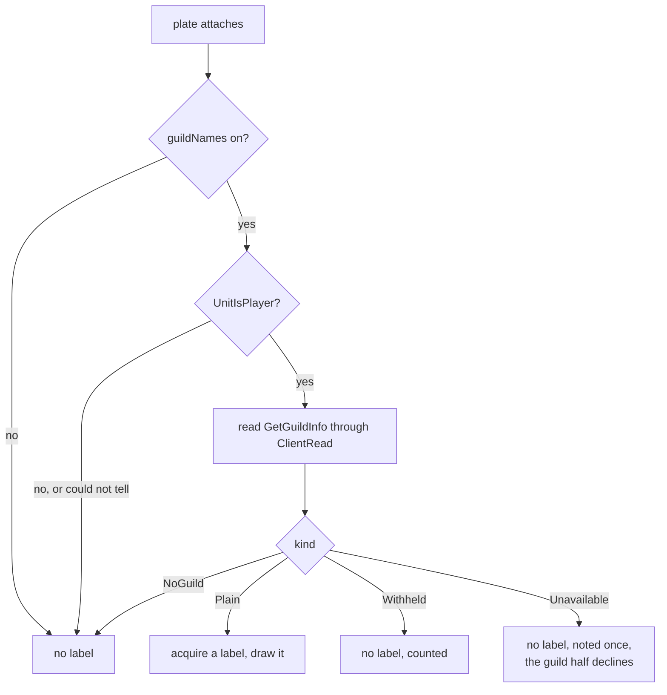

# PersonalAddon — Phase 15 Design: guild names on nameplates

**Date:** October 10, 2026
**API version:** 1.60.1 (WoW Forever Beta), game type `camelot`
**Client:** 1.60.1.70338, UI export 2026-10-10 — `patch_check status` reports `UpToDate`,
accepted 2026-10-10 11:34
**Supersedes:** §4 of `20261009-RoadmapProposal03.md`
**Depends on:** `20260919-Phase02.md` rev 7 (§4.7's restricted name region, §13's sketch of
this phase, `EscapeGuard`, `FramePool`), `20261010-Phase14.md` rev 4 (the bar's container),
`20261006-Phase12.md` rev 3 (settings pages)
**Revision:** 4 — audit findings applied (§14); built and run in game (§15). Finding 3 added an event, and the run measured how often it fires

---

## 1. Scope

A guild name under the health bar on every player's nameplate, with its own font size.

| Item | Kind | File |
|---|---|---|
| `guildNames`, `guildFontSize` settings | Feature | `Features/Nameplates.lua` |
| `PLAYER_GUILD_UPDATE`, for a guild that changes in view | Feature | `Features/Nameplates.lua` |
| The guild read, once per occupancy | Feature | `Features/Nameplates.lua` |
| An owned label per plate, from `FramePool` | Feature | `Features/Nameplates.lua` |
| `/pa plates` reports it | Feature | `Core/Debug.lua` |
| One premise | Docs | `Tools/patchcheck/premises.toml` |
| Spike G deleted | Cleanup | `Spikes/GuildNameProbe.lua`, its route, its saved variable |

**This phase adds no hook and no timer**, and one event. The label is a frame of ours
holding text of ours, so Blizzard never rewrites it and there is nothing to re-assert —
which is the whole difference between this phase and the two before it. The one event
exists because a guild can change while you are looking at someone (§3.4).

### 1.1 Decisions

| # | Decision | Where |
|---|---|---|
| D1 | **Every player's guild**, friendly and hostile. NPCs have no guild and so get nothing | §3.3 |
| D2 | **No brackets.** The faded white already reads as secondary; angle brackets add nothing | §4.3 |
| D3 | **The font size is a setting**, in points, absolute | §4.4 |
| D4 | No colour setting, no position setting. One toggle and one size | §5 |
| D5 | The text is ours on a frame of ours, parented to `UIParent`, anchored to the plate | §4.1 |
| D6 | The guild is read **once per occupancy**, and again on `PLAYER_GUILD_UPDATE`. Never on a sweep | §3.4 |

### 1.2 What spike G found

Run in game on 1.60.1.70338 in a capital city, through `Spikes/GuildNameProbe.lua`. The
report went to a saved variable because chat history does not survive a reload, and these
are its numbers, not a summary of them.

| # | Question | Answer |
|---|---|---|
| G1 | Does `GetGuildInfo(unitToken)` return a guild name for a nameplate unit? | **Yes.** Real names on real players: `OLYMPUS VllI`, `Pain and Suffering`, `Murloc Vocal Choir`, `Chung Chung`, `EIfcore`, `OLYMPUS REDEEMED`, `OLYMPUS AGARTHIANS` |
| G2 | Is the read `Plain` through `ClientRead`? | **Always, in 31 plate reads across two runs.** 10 `Plain`, 21 `NoGuild`, **zero `Withheld`** |
| G3 | Does it cost anything per call? | Nothing observable. 21 plates read in one pass with no complaint and no refusal |
| G4 | Does a font string of ours draw under the bar, and survive recycling? | **Yes to both.** The operator confirmed the names were visible and correctly placed. `nameplate1` carried `Yoko` with no guild in the first run and `Doc` of `OLYMPUS AGARTHIANS` in the second — the same token, a different unit, the right guild each time |

Three things the data settles that were not asked:

- **`NoGuild` covers two different things, and both want the same answer.** Six NPCs
  (`High Tinker Mekkatorque`, `Tinkmaster Overspark`, `Gnoarn`, `Master Mechanic Castpipe`,
  `Lomac Gearstrip`, `Boborus Overvolt`) and six guildless players
  (`Gurken`, `Stu`, `Tishy`, `Yoko`, `Gaspards`, `Tooty`) all read `NoGuild`. Nothing is
  drawn for either.
- **Guild names are adversarial text.** One in the sample is `EIfcore` — a capital I
  standing in for an l. That is a homoglyph rather than an escape sequence, but it is a
  reminder of where this text comes from: §2 is why `EscapeGuard` is not optional.
- **Two thirds of plates need no read at all.** 21 of 31 had no guild, and six of those
  were NPCs that could have been excluded by a cheaper question. §3.3.

**As shipped.** The spike was deleted with its route and its saved variable, as Phases 7,
8, 12 and 14's probes were. What it established is now mechanism:

| What the spike proved | Where it lives now |
|---|---|
| `GetGuildInfo(unitToken)` returns a guild name for a nameplate unit | §3.1, and the feature itself |
| The read is `Plain` or `ABSENT`, never `Withheld`, in the open world | §3.2's table |
| Two thirds of plates have no guild, six in ten of those being NPCs | §3.3's `UnitIsPlayer`-first order |
| A font string of ours under `UIParent`, anchored to a plate, draws correctly and survives recycling | §4.1 and §4.2 |
| No refusal across two runs | §9's rule 6 and rule 7 rows |

**And `/pa blocked` was empty.** The probe created a frame per plate under `UIParent` and
anchored each to a nameplate's container, across two runs in a crowded city, and the game
refused nothing — no entry in the block log at all, and `faults` empty in all five
diagnostics sessions. That is the display path of §4.1 exercised on the live client, and it
is the evidence behind §9's rule 6 and rule 7 rows.

**What the spike did not test**, and what this design therefore assumes rather than knows:

- **A restricted map.** Every read was in the open world. Phase 11 found this client
  withholds threat percentages in dungeons and raids, so a withheld guild read is
  plausible there. §3.2 handles it by construction; `/pa plates` counts it.
- **A hostile player.** Every unit in the sample read `isFriend = true`. The mechanism is
  the same function and the same token shape, so this is a thin extrapolation — but it is
  one, and D1 widens the feature to cover it.

### 1.3 Not possible, or out of scope

- **NPC role tags.** No `UnitSubtitle`-shaped function exists in the generated
  documentation. The only source for `<Innkeeper>` is the unit tooltip through
  `C_TooltipInfo.GetUnit`, which means an undocumented line position inside a documented
  call, a cache with a bound and an eviction rule, and a tooltip scrape per plate — on the
  nameplate path. Declined in Roadmap 03 D5 and still declined. If it is ever wanted it is
  its own phase with its own spike.
- **Guild ranks, or the player's own guild highlighted.** `GetGuildInfo` returns a rank
  name and index beside the guild name, and `C_GuildInfo.GetGuildTabardInfo(unit)` would
  give a tabard. Both are features, not this one.
- **Moving or restyling Blizzard's unit name.** Phase 2 §4.7: it cannot even be measured.
- **A guild name on the player's own plate.** The personal resource display is a different
  frame and has been out of scope since Phase 2.

### 1.4 Types

```
GuildReading = Plain(guildName: string)
             | NoGuild                      # a readable nil, or an NPC
             | Withheld                     # "could not tell" — never read as NoGuild
             | Unavailable(reason: string)   # the function is missing, or it raised

FontPoints   = integer                       # 6 .. 16
GuildLabel   = { frame: Frame, text: FontString }
```

Inherited: `PlateRecord` and `PlateScope` are Phase 2 §6's, as `SCOPE` in
`Features/Nameplates.lua`. `FramePool` is Phase 1 §8's, with `ForEach` from Phase 14 §14.
`EscapeGuard.Neutralize` is Phase 2 §9's. `ClientRead`'s `PLAIN`, `ABSENT` and `WITHHELD`
are Phase 9's. `ConfigSchema` — its `KIND`, `UNIT` and `Validate` — is Phase 6 §5's, with
Phase 12 §2's `unit`, `order` and percent-slider fields. `Dispatch.Subscribe` is Phase 1's.

**`PlateRecord` gains two fields**, both on our own table: `guild`, the name read for this
occupancy, and `label`, the pooled frame showing it.

---

## 2. Why the text has to be ours, and why `EscapeGuard` finally has a consumer

Phase 2 §4.7 settled the first half. Reading a nameplate name's anchors fails with

```
FontString:GetPoint(): Action[FrameMeasurement] failed because
[Can't measure restricted regions]
```

so Blizzard's name cannot be measured, cannot be moved, and cannot be given a second line.
There is also no guild font string on the plate to borrow: the template carries exactly one
`name` FontString (`Blizzard_NamePlates.xml:294`). The only way to put a guild name on a
nameplate is to draw it ourselves.

The second half closes a loop this project opened six phases ago. Phase 2 §13 recorded
that `EscapeGuard` had been built with no consumer, and that it

> becomes mandatory the moment any phase renders a unit name, guild name or gossip body.

This is that phase. A guild name is **player-chosen text delivered by the server**: it can
contain `|c` colour codes, `|H` hyperlinks, `|T` textures. `EscapeGuard.Neutralize` doubles
every pipe, which makes all of them inert, and it is applied at the one place the text
reaches a font string. The spike's `EIfcore` is a reminder that the people naming guilds
are not always naming them honestly.

`FramePool`, built in Phase 1 and recorded in Phase 2 §13 as speculative infrastructure
carried for two phases, gets its second real consumer here for the same reason: one owned
widget per plate is exactly the lifecycle it was written for.

---

## 3. The data

### 3.1 Nothing certifies `GetGuildInfo`, so nothing pretends to

There is no documented function that returns a guild name for an arbitrary unit on this
build. `C_GuildInfo` is player-side guild management; its one per-unit call,
`GetGuildTabardInfo(unit)`, returns tabard colours and no name — though it does take a
plain `UnitToken` with no `SecretReturns` flag, which is a modest sign that per-unit guild
data is not restricted in principle.

So the feature uses `GetGuildInfo(unitToken)`, which is:

- **undocumented**, so there is no `SecretReturns`, `SecretWhen*` or restriction flag to
  reason from, and the patch check cannot guard it with `FlagAbsent`;
- called by Blizzard **only with `"player"`**, in all seven of its own uses;
- and, on the evidence of §1.2, entirely functional with a `nameplateN` token.

**It is feature-detected at enable** and the feature declines the guild half with a stated
reason if it is gone. There is no fallback: a guild name is either read or not shown.

### 3.2 `NoGuild` and `Withheld` are not the same answer

Rule 10: *treat `Withheld` as "could not tell", never as "no".* For this feature the
distinction is the difference between a correct blank and a lie:

| `ClientRead` kind | Meaning | What is drawn |
|---|---|---|
| `PLAIN`, non-empty | this unit's guild | the name |
| `ABSENT` — a readable nil | this unit has no guild | nothing |
| `PLAIN`, empty string | likewise | nothing |
| `WITHHELD` | the client will not say | nothing, and it is counted |

The spike saw zero `Withheld` in 31 reads, all in the open world. A dungeon may differ, and
if it does the bars simply carry no guild there — which is the safe direction and is
visible in `/pa plates` rather than silent.

### 3.3 Players only, and the cheaper question first

Two thirds of the spike's plates had no guild, and six of those were NPCs. `UnitIsPlayer`
answers that for free and is not secret-capable, so it is asked first:



A unit whose `UnitIsPlayer` read is itself withheld gets no label: "could not tell whether
this is a player" is not grounds for asking about its guild.

### 3.4 Read once per occupancy, and again when a guild changes

**Revision 1 claimed "a guild does not change while you look at someone". That is false.**
A player can join a guild, leave one, be kicked from one, or have their guild renamed while
their nameplate is on screen, and a label read once per occupancy would then be wrong until
the plate recycled. In a city, a plate can sit there for minutes.

So the read happens twice: when the plate attaches, and when the client says a unit's guild
changed.

`PLAYER_GUILD_UPDATE` carries a `unitTarget` of type `UnitTokenVariant`
(`GuildInfoDocumentation.lua:650`), and Blizzard's own Calendar listens to it. It is
`SynchronousEvent`, so our handler may run inside the call that raised it — which is safe
here in a way it is not elsewhere in this feature: the handler reads a client value and
writes text to **a font string of ours**. It touches nothing of Blizzard's, so there is no
value of ours for Blizzard to read back and no protected call anywhere on the path.

The handler re-reads **every tracked plate**, not just the one the event names. Two reasons:

- the event's token is a `UnitTokenVariant`, so it need not be the `nameplateN` token our
  records are keyed by, and matching it would cost a `UnitIsUnit` read per plate anyway;
- re-reading is bounded by the client's plate cap, which Phase 2 already assumes bounds
  the tracked set.

**How often it fires is unknown**, and that is a real gap: if the client raises it whenever
a unit's guild information is *loaded* rather than *changed*, it becomes a hot path with a
read per plate each time. So `guildRefreshes` is counted and printed by `/pa plates`, and
§10.3 step 10 is where the number gets looked at. If it turns out hot, the narrowing is to
match the token first and re-read one plate — stated here so it is not re-derived.

The event is **not required**: a client that does not deliver it leaves the label
per-occupancy, which is revision 1's behaviour, noted once rather than faulted.

```
# The guild name for one unit, read when its plate attaches and when the client
# says a guild changed.
# pre:  unitToken came from the plate attach or a refresh; guildNames is on
# post: Unavailable(reason) when GetGuildInfo is missing or raised.
#       NoGuild when UnitIsPlayer is false, or when the guild read is ABSENT, or
#       when it is a readable empty string.
#       Withheld when UnitIsPlayer or the guild read is WITHHELD — counted, and
#       never reported as NoGuild (rule 10).
#       Plain(guildName) otherwise
# raises: never
function read_guild(unitToken: UnitToken) -> GuildReading

# Re-reads every tracked plate's guild and brings its label to the answer.
# pre:  runs from the PLAYER_GUILD_UPDATE handler
# post: each tracked plate whose reading changed has its label attached,
#       re-texted or released to match; a plate whose reading is unchanged is
#       not touched. guildRefreshes is bumped once per event, not per plate
# raises: never
function refresh_guild_labels() -> integer
```

So the cost is **one or two client reads per nameplate appearance**, plus a bounded sweep
of reads when a guild changes. There is no timer and no sweep participation.

---

## 4. The label

### 4.1 Ours, parented to `UIParent`, anchored to the plate

Rule 6: *we draw on our own frames, anchored to Blizzard's but never parented to them.*
Patch 01 §0.2 is the reason — the Gamepad UI's `SmartNavigation` post-hooks `CreateFrame`
and rebuilds a panel's navigation state, in whoever's code is running, when a new frame's
parent chain reaches a panel it tracks. A child of ours under a nameplate would put our
taint there.

So each label is a `Frame` under `UIParent` holding one `FontString`, acquired from a
`FramePool` bounded by the client's plate cap, anchored to the plate's
`HealthBarsContainer` and released when the plate detaches.

### 4.2 Where it sits, and what it gets for free

`TOP` of the label to `BOTTOM` of `HealthBarsContainer`, one pixel down, centred. Nothing
of Blizzard's is below the bar on any style this client offers, so there is nothing to
collide with.

Two things follow from anchoring to the container rather than to the plate:

- **It follows Phase 14's height setting with no work.** A shorter bar moves the
  container's bottom edge up, and the label with it.
- **It follows a Style or Global Scale change with no work**, for the same reason.

### 4.3 No brackets

The probe drew `<Guild Name>`, as the tooltip writes it. The operator's judgement, and this
design's: the faded white already marks the line as secondary, so the brackets are
redundant decoration on the most crowded part of the screen. The text is the guild name and
nothing else.

### 4.4 The font size is absolute, and that is not an inconsistency

Phase 14 §5.1 argued at length that the bar's height must be a **percentage** of Blizzard's
and not a pixel count. This setting is a pixel count. The difference is ownership:

| | Phase 14's bar height | This label's font size |
|---|---|---|
| Who owns the widget | Blizzard | us |
| Who else writes the value | Blizzard, on every layout pass | nobody |
| What a fixed number would fight | the Style and Global Scale the user chose | nothing |

There is no base to track because there is no competing writer. `guildFontSize` is points,
6 to 16, default 10 — which is roughly what `GameFontHighlightSmall` gave in the spike, and
what the operator approved.

The label's frame height follows the font size, so a larger size is not clipped by the
frame it sits in.

### 4.5 The scale it does not inherit

A frame takes its scale from its parent chain, not from what it is anchored to. Our label
is parented to `UIParent`, so **it does not scale with the nameplate.** Position is
unaffected — `SetPoint` resolves across differing scales — but at a non-default Global
Scale Blizzard's nameplate text grows and ours does not.

Stated rather than fixed, because the fix has a cost: multiplying the font size by
`NamePlateConstants.NAME_PLATE_SCALES[size].vertical` would mean reading a Blizzard table
and tracking the `nameplateSize` CVar, for a case the operator is not in. If the label
looks wrong after changing Global Scale, that multiplication is the change to make, and
`guildFontSize` is the control that works around it meanwhile.

### 4.6 Contracts

```
# Puts our label under one plate's health bar, for one occupancy.
# pre:  reading is Plain; plate is tracked; plate.container resolved at attach
# post: Attached when a label was acquired, its text set to the guild name passed
#       through EscapeGuard.Neutralize, its font set to guildFontSize, its frame
#       height set to fit that, anchored TOP to the container's BOTTOM and shown.
#       The label is recorded on the plate record, so detach releases it before
#       the client can recycle the plate onto another unit.
#       NotAttached(reason) when the pool is exhausted, which is noted once and
#       means the cap is wrong, or when the container is absent
# post: nothing is parented to, or written onto, any Blizzard frame
# raises: never
function attach_guild_label(
    plate: PlateRecord,
    reading: GuildReading
) -> Attached | NotAttached

# Releases one plate's label.
# pre:  none
# post: the label is back in the pool with its text cleared and its points
#       cleared, and plate.label is nil. A plate with no label is untouched
# raises: never
function release_guild_label(plate: PlateRecord) -> nil

# Applies a new font size to every label on screen.
# pre:  size passed ConfigSchema
# post: every pooled label's font and frame height carry the new size, so a label
#       released and re-acquired comes back at it too. No frame is created
# raises: never
function apply_guild_font_size(size: FontPoints) -> nil
```

`apply_guild_font_size` walks **every frame the pool has built, free and live alike** —
which is what `FramePool.ForEach` iterates (`pool.free` then `pool.live`, added in
Phase 14 §14). Revision 1 said "the pool, not the live labels", which was wrong twice over:
the live labels are in the pool, and they are the ones the user is looking at.

Both halves matter. The live labels must change so the slider is visibly live
(§10.3 step 3). The free ones must change so a label released and re-acquired does not come
back at the old size — the defect Phase 14 §14 learned about rows.

### 4.7 The one failure mode worth testing for

Our label is parented to `UIParent`, so it is not hidden when the plate is hidden. The
label's lifetime is therefore the plate's **occupancy**, and that is defined by machinery
this feature already has: `NAME_PLATE_UNIT_REMOVED`, with the stale sweep as the backstop
Phase 2 §6.2 built for exactly the case where that event is missed.

Two reasons to believe that is enough, and one reason to check:

- `UpdateBehindCamera` does **not** hide a plate — it shows an icon
  (`Blizzard_NamePlateUnitFrame.lua`), so a unit behind the camera keeps its plate and its
  label.
- No Lua in the nameplate code hides the UnitFrame; the C++ side hides a plate when its
  unit leaves nameplate range, and that is the same moment `NAME_PLATE_UNIT_REMOVED`
  fires.
- But a plate hidden **without** that event would leave a guild name floating over nothing,
  which is the most visible defect this phase could ship. §10.3 step 5 is a test for it.

**If it happens**, the fix is a shown-state read in the existing sweep — `IsShown` is
secret-capable, so it would go through `ClientRead`, one read per tracked plate per sweep.
That is polling, which the operator declined for Phase 14, so it is not built on
speculation. It is named here so the decision is not re-derived.

---

## 5. Settings

Two keys on the existing **Nameplates** page, under the feature's own switch.

| Key | Kind | Bounds | Default | Label |
|---|---|---|---|---|
| `guildNames` | Toggle | — | **false** | Show guild names |
| `guildFontSize` | Number, `UNIT.PIXELS` | 6 – 16, step 1 | 10 | Guild name size |

`guildNames` is **off by default**: it puts text on every player's nameplate, which is a
visible change to a screen the user has already arranged, and Phase 13's precedent is that
a new presentation setting starts inert.

No colour picker (D4). The six nameplate colours exist because they encode a decision —
who the monster is attacking. A guild name encodes nothing; it is a label, and one faded
white is the right amount of emphasis for it.

Changing `guildNames` to off releases every label at once rather than waiting for plates
to recycle. Changing it on reads the guild for every tracked plate, which is the one place
the read is not per-occupancy — and it is a one-off, on a user action.

---

## 6. `/pa plates` and diagnostics

One line, after the bar-height line:

```
  guild names: on, size 10; labels 4 of 16 pooled
    reads: plain=10 noGuild=21 withheld=0 unavailable=0
```

| Counter | Means |
|---|---|
| `guildReadsPlain` | a name was read |
| `guildReadsNoGuild` | an NPC, or a player with no guild |
| `guildReadsWithheld` | the client would not say. **Expected zero in the open world** |
| `guildReadsUnavailable` | `GetGuildInfo` missing or raised |
| `guildLabelsAttached` | labels drawn |
| `guildPoolExhausted` | the cap is wrong |
| `guildRefreshes` | `PLAYER_GUILD_UPDATE` arrivals. **Unknown frequency** — §3.4 |

`guildReadsWithheld` is the one to watch, and the one the spike could not test: a non-zero
count in a dungeon is this client restricting guild data on addon-restricted maps, which is
a finding for the README rather than a fault.

---

## 7. The patch check

```toml
[[premise]]
id = "GUILD-INFO-UNDOCUMENTED"
statement = "GetGuildInfo is absent from the generated documentation, so no secret or restriction flag certifies it"
source = "Phase 15 section 3.1; spike G"
consequence = "A guild read may begin returning secrets, or be restricted, with no flag to warn us (Features/Nameplates.lua)"
check = { kind = "Watch", files = ["Blizzard_APIDocumentationGenerated/UnitDocumentation.lua"] }
```

**A `Watch` is the strongest guard available here, and it is weak.** `GetGuildInfo` is a C
function in no Lua file, so there is no pattern to match and no flag to read; the check
notices only that the unit documentation changed, which is a prompt to look rather than an
answer. That weakness is why §3.2 handles `Withheld` by construction instead of relying on
the register to warn first.

The container and the unit token are already covered by `PLATE-HEALTHBAR`,
`PLATE-BAR-CONTAINER-HEIGHT` and `PLATE-UNIT-TOKEN`. Thirty-six premises after this one.

---

## 8. README

- **Nameplates** gains a bullet: guild names under the bar for every player, with a size
  setting, off until switched on, and nothing drawn for a player with no guild or for an
  NPC.
- **"Tried and not possible"** loses the `Moving nameplate names, guilds and role tags`
  row and gains a narrower one. Moving Blizzard's name is still impossible and guild names
  are now a feature, so the row must stop claiming both. The replacement covers **NPC role
  tags** only, with §1.3's reason and this build.
- **Credits** gains nothing: this is not a feature lifted from another addon.

---

## 9. Rule compliance

| Rule | How |
|---|---|
| 1 | No new hook. **One new event**, `PLAYER_GUILD_UPDATE`, which arrives on its own and whose handler touches only frames of ours (§3.4). No dropdown, no settings predicate |
| 2 | Nothing written into a Blizzard variable or table. `guild` and `label` are fields on **our** plate record |
| 3 | No panel involvement |
| 4 | No new hook |
| 5 | The attach path already runs from the feature's own `NAME_PLATE_UNIT_ADDED` handler. Nothing is written into a Blizzard frame, so there is no same-frame correction to make and no exception to claim |
| 6 | **The point of §4.1.** Every label is parented to `UIParent` and anchored to the plate. No frame of ours is created under a nameplate |
| 7 | No protected call. The spike wrote labels across two runs with no refusal |
| 8 | No Blizzard panel is touched |
| 9 | `PLAYER_GUILD_UPDATE` is a `SynchronousEvent`, so our handler may run inside the call that raised it. Safe here and nowhere else in this feature: the handler reads a client value and writes text to a font string of ours, so there is no value of ours for Blizzard to read and no protected call on the path (§3.4). Nothing we call changes state other code listens to |
| 10 | `GetGuildInfo` and `UnitIsPlayer` both go through `ClientRead`; §3.2's table is the handling, and `Withheld` is never read as `NoGuild`. `IsShown` is secret-capable, which is noted in §4.7 as the cost of the mitigation this phase does not build |
| 11 | One premise, §7, and §7 states its weakness |

**And the trust boundary.** A guild name is server-delivered, player-chosen text crossing
into a font string. `EscapeGuard.Neutralize` is applied at that crossing, every time, and
§2 is why.

---

## 10. Verification

### 10.1 Harness: `tests15.lua`

One session, `phase15`. Every existing nameplate session must stay green: the attach path
is shared.

| Check | Asserts |
|---|---|
| `guildNames` off | no read, no label, no counter moved |
| A player with a guild | `Plain`; a label attached; its text is the guild name |
| A player with no guild | `NoGuild`; no label |
| A guild name of `""` | `NoGuild`; no label |
| An NPC | `NoGuild`; **`UnitIsPlayer` answered it, and `GetGuildInfo` was never called** |
| `GetGuildInfo` returns the secret sentinel | `Withheld`; no label; counted |
| `UnitIsPlayer` returns the secret sentinel | no label; `GetGuildInfo` never called |
| `GetGuildInfo` absent | `Unavailable`; noted once; the colour path still works |
| A guild name containing `\|cffff0000red\|r` | the text reaching the font string has every pipe doubled |
| A guild name containing `\|Hitem:1\|h[x]\|h` | likewise |
| The label's parent | `UIParent`, never the plate or its unit frame |
| The label's anchor | `TOP` to the container's `BOTTOM` |
| Plate recycled onto another unit | the old label is released before the new guild is read; the new label shows the new guild |
| A plate detaching | its label returns to the pool with text cleared |
| `guildFontSize` changed | every label the pool has built carries the new size — the live ones **and** the free ones |
| A label released and re-acquired after a size change | comes back at the new size |
| `guildNames` turned off at runtime | every label released at once |
| `guildNames` turned on at runtime | every tracked plate read once |
| The pool exhausted | `NotAttached`, noted once, and the colour path unaffected |
| `disable` | every label released |
| No timer is created | the ticker count is unchanged from the colour-only baseline |
| `PLAYER_GUILD_UPDATE` with a plate whose guild changed | its label is re-texted; `guildRefreshes` bumped once |
| ...with a plate that gained a guild | a label is attached |
| ...with a plate that lost its guild | its label is released |
| ...with nothing changed | no label touched, and `guildRefreshes` still bumped |
| The client refuses the event | noted once; labels stay per-occupancy; the feature does not fault |

The pipe-doubling checks are the ones that matter most: they are the trust boundary, and a
regression there is a client-side injection of someone else's choosing.

### 10.2 The patch check

`check` after adding the premise, expecting all 36 to hold on 70338.

### 10.3 In game

1. `/pa blocked clear`. Turn `guildNames` on in Options → Nameplates.
2. A capital city. Guild names appear under the bars of players who have one, and under
   nobody else — not NPCs, not guildless players.
3. Move the size slider from 6 to 16 and back. Every label on screen follows, live.
4. Target a player, then another. The names stay with the right plates.
5. **Walk until plates disappear, and look at where they were.** No guild name may be left
   behind. §4.7 is the reason this is a numbered step rather than a glance.
6. A dungeon or a raid, with other players. `/pa plates` — is `guildReadsWithheld` still
   zero on a restricted map?
7. A battleground or any hostile player, if one can be found. A hostile player's guild
   should read exactly as a friendly one's does (§1.2's untested extrapolation).
8. Turn `guildNames` off. Every label disappears at once.
9. `/pa blocked` empty; `/pa diag` free of fault notes.
10. **`/pa plates` — what is `guildRefreshes`?** If it is in the thousands after a city
    session, `PLAYER_GUILD_UPDATE` fires on load and not only on change, and §3.4's
    narrowing is due. If it is a handful, the design is right as written.

Steps 5, 6, 7 and 10 are the four this design cannot settle offline.

---

## 11. Failure modes

| Failure | Behaviour |
|---|---|
| `GetGuildInfo` missing | The guild half declines with a stated reason; colours and bar height unaffected |
| A guild read is withheld | No label on that plate; counted; never shown as "no guild" |
| A `UnitIsPlayer` read is withheld | No label, and no guild read attempted |
| The label pool is exhausted | `NotAttached`, noted once as a wrong cap, as `FramePool`'s `SURFACE_AND_FAIL` already reports |
| A plate hidden without `NAME_PLATE_UNIT_REMOVED` | A guild name is left floating. §4.7, and §10.3 step 5 is the test |
| A label outliving its occupancy | Released at detach, before the client can recycle the plate. A visibly wrong guild name is the thing to design against, and the occupancy rule is the design |
| A guild name with escape sequences | Neutralised at the font string. The harness asserts it |
| A font size outside the bounds from a hand-edited saved variable | `ConfigSchema.Validate` refuses it and names the bound |
| Global Scale changed | The label's position follows; its text size does not (§4.5) |
| A guild changes while the plate is in view | `PLAYER_GUILD_UPDATE` re-reads and the label follows (§3.4) |
| `PLAYER_GUILD_UPDATE` is not delivered | Labels are per-occupancy: correct when a plate attaches, stale if that unit's guild changes before the plate recycles. Noted once |
| `PLAYER_GUILD_UPDATE` fires far more often than expected | A bounded read per plate per arrival. `guildRefreshes` is what makes it visible, and §3.4 names the narrowing |

---

## 12. Exit criteria

| # | Criterion | Status |
|---|---|---|
| 1 | `tests15.lua` passes, every existing session stays green, lint clean | **Met.** 31 new checks; 643 across twenty-one sessions; lint 0 hits |
| 2 | All 36 premises hold | **Met.** `check` **Pass** on 1.60.1.70338, accepted |
| 3 | The in-game run of §10.3 completes, steps 5, 6, 7 and 10 included | **Mostly met.** Steps 1–5, 8 and 9 pass; step 10 is answered (§15). Steps 6 and 7 — a restricted map and a hostile player — were not reached |
| 4 | `/pa blocked` empty across the run; no fault note in `/pa diag` | **Met for faults**, which are empty in all five sessions. `/pa blocked` holds the known Gamepad UI cascade and nothing else (§15) |
| 5 | `guildReadsWithheld` recorded for a restricted map, whatever it is | **Outstanding.** Zero in the open world; a dungeon is still untested (§10.3 step 6) |
| 6 | The spike, its route and its saved variable deleted, and §1.2 holds what they established | **Met** |
| 7 | The README's table covers NPC role tags only, and no longer claims guild names are impossible | **Met** |

Criteria 1, 2, 6 and 7 are settled offline. 3 to 5 are the in-game run, and this is the
first phase in four to reach it with no export gate open.

**Two checks were proved by mutation, not just written.** Removing `EscapeGuard.Neutralize`
from the one line that applies it fails `U7` and `U8`, with the raw `|cffff0000` visible in
the failure message — which is the trust boundary of §2 demonstrated rather than asserted.
`U7` had to be corrected first: it looked for `"|c"`, which `"||c"` contains, so it passed
on escaped text for the wrong reason. The invariant `EscapeGuard` actually guarantees is
that **every pipe is part of a pair**, and that is what it now asserts.

---

## 13. Files

| File | Change |
|---|---|
| `Features/Nameplates.lua` | `guildNames` and `guildFontSize`; `read_guild`; `refresh_guild_labels`; `attach_guild_label`; `release_guild_label`; `apply_guild_font_size`; the label pool; `guild` and `label` on the plate record; the `PLAYER_GUILD_UPDATE` subscription; release at detach and at disable |
| `Core/Constants.lua` | `GUILD_LABEL_POOL_CAPACITY`, `GUILD_FONT_MINIMUM`, `GUILD_FONT_MAXIMUM`, `GUILD_LABEL_GAP` |
| `Core/Debug.lua` | `/pa plates` reports the setting, the size, the label count and the five counters; the `/pa probe` route deleted |
| `Tools/patchcheck/premises.toml` | One premise |
| `Tools/harness/tests15.lua`, `run.py` | New session |
| `Spikes/GuildNameProbe.lua` | **Deleted**, with its TOC line and `PersonalAddonSpikeLog` |
| `PersonalAddon.toc` | The spike's line and saved variable removed; `X-Phase: 15`; version |
| `README.md` | §8 |

---

## 14. Audit disposition

The audit is `20261010-Phase15Audit.md`, of 2026-10-10. Four findings, **all accepted**,
one extended.

| # | Finding | Disposition | Change |
|---|---|---|---|
| 1 | §4.6 says `apply_guild_font_size` walks "the pool, not the live labels", while §10.1 and §10.3 say every label follows the setting live | Accepted | The sentence was wrong twice over: the live labels **are** in the pool, and they are the ones being looked at. `FramePool.ForEach` iterates `pool.free` then `pool.live`, so it covers both, and §4.6 now says why each half matters — the live ones so the slider is visibly live, the free ones so a released label does not come back at the old size |
| 2 | §3.3's flowchart has no `Unavailable` branch, though §3.4 returns one | Accepted | Added, routing to no label with the guild half declining once |
| 3 | "A guild does not change while you look at someone" is false — a player can join, leave or be kicked while their plate is on screen | **Accepted, and fixed rather than documented** | The audit offered documenting the staleness or finding an event. There is an event: `PLAYER_GUILD_UPDATE` carries a `unitTarget` (`GuildInfoDocumentation.lua:650`) and Blizzard's own Calendar listens to it. §3.4 now reads twice — on attach and on that event — and says why synchronous delivery is safe for this handler specifically: it reads a client value and writes text to a font string of **ours**, so there is no value of ours for Blizzard to read and no protected call on the path. The event is not required; without it the label is per-occupancy, which is revision 1's behaviour, noted rather than faulted |
| 4 | `ConfigSchema` referenced in §4.6 and §11 but not listed as inherited | Accepted | §1.4 now names it — Phase 6 §5's, with Phase 12 §2's additions — along with `Dispatch.Subscribe` and `FramePool.ForEach`'s provenance |

**Finding 3 is the one that mattered, and it is the second time an audit has caught the
same shape of error in this project.** Phase 14's audit found a value assumed not to change
between two points in a call; this one found a value assumed not to change between two
points in *time*. Both were written as statements of fact about someone else's system, and
both were wrong in the direction of convenience.

It also left a new unknown rather than closing one: how often `PLAYER_GUILD_UPDATE` fires.
If the client raises it when guild information is *loaded* rather than *changed*, the
handler becomes a hot path. `guildRefreshes` counts it and §10.3 step 10 is where the
number is read, which is the same evidence-first move that turned Phase 14's
`barHeightUnchanged` from a guess into a measurement.

---

## 15. The in-game run, 2026-10-10

Shipped on 1.60.1.70338 and run by the operator, who reported it "works as intended". The
counters say more than that, and one of them closes the question §14 left open.

| Counter | Value | Reading |
|---|---|---|
| `guildReadsPlain` | 15 | guild names read |
| `guildReadsNoGuild` | 15 | NPCs and guildless players |
| `guildLabelsAttached` | 9 | fewer than the reads, because a re-read of the same guild on the same plate does not re-attach (§3.4's `applyGuild`) |
| **`guildRefreshes`** | **1** | **the open question, answered** |
| `guildReadsWithheld` | 0 | nothing hidden |
| `guildReadsUnavailable` | 0 | `GetGuildInfo` answered every time |
| `guildPoolExhausted` | 0 | 48 is the right cap |

**`PLAYER_GUILD_UPDATE` fires on change, not on load.** §3.4 flagged the opposite as a real
risk — that the client might raise it whenever guild information is *loaded*, making the
handler a hot path with a read per plate each time. One arrival across a session of 209
sweeps and eleven plates settles it: **the narrowing §3.4 describes is not needed**, and the
re-read-every-plate handler stays as written. That is the third time in three phases that a
counter added for an inferred risk has turned the inference into a measurement.

`faults` empty in all five sessions. `/pa blocked` holds two
`SetPreferredGamepadInteractTarget` records at five apiece — the known Gamepad UI cascade,
Blizzard's defect, and nothing naming a Phase 15 call. No new refused function appeared.

**Still unconfirmed, and this phase does not claim otherwise.** The session was about a
minute long with eleven plates, so §10.3's steps 6 and 7 were not reached:

- **A restricted map.** `guildReadsWithheld` is zero in the open world and untested in a
  dungeon. §3.2 handles a withheld read by construction, so the failure mode is a missing
  label rather than a wrong one, and the counter is what will say so.
- **A hostile player.** Still the extrapolation §1.2 recorded.

Neither blocks the feature: both degrade to drawing nothing, and both are visible in
`/pa plates` the first time they happen.

**The bar height's tolerance also held up**, three sessions on: `barHeightUnchanged` of 8,
116 and 53 against writes of 221, 2299 and 1984. Phase 14 §17.1's reading stands.

---

## Assumptions

- ~~**A guild does not change while a plate is in view.**~~ **Retired by the audit
  (§14).** It can, and `PLAYER_GUILD_UPDATE` is the answer (§3.4). What remains assumed is
  that the event fires on change rather than on load; §10.3 step 10 measures it.
- **A hostile player's guild reads as a friendly player's does.** Every unit in the spike's
  sample was friendly. Same function, same token shape, so the extrapolation is thin — but
  §10.3 step 7 is what confirms it, and D1 depends on it.
- **A restricted map may withhold the guild read.** Untested. §3.2 handles it by
  construction and §6 counts it, so the feature degrades to drawing nothing rather than
  guessing.
- **`UnitIsPlayer` is cheap enough to ask before every guild read.** It is not
  secret-capable and it is answered from data the client already has for the plate.
- **One label per plate is bounded by the client's plate cap**, which Phase 2 already
  assumes bounds the tracked set. `GUILD_LABEL_POOL_CAPACITY` is set from the same cap the
  threat panel's row pool uses, and exhaustion is reported as a wrong cap rather than
  absorbed.
- **10 points is the right default**, because it is what `GameFontHighlightSmall` gave in
  the spike and the operator approved that look. The setting exists because that is a
  judgement about one screen at one resolution.
- **Nothing of Blizzard's sits below the health bar** on any style this client offers, so
  the label has the space. If a future style puts something there, the label overlaps it
  and the anchor is what changes.
