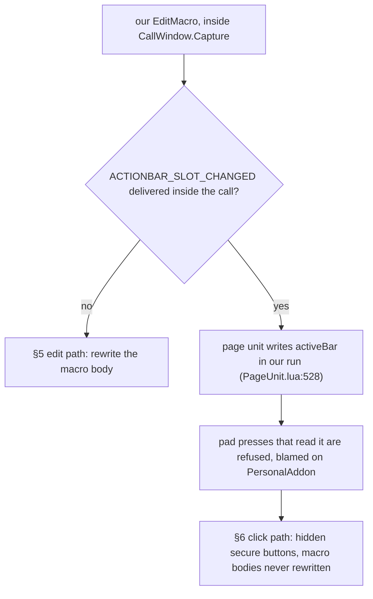

# PersonalAddon — Phase 16 Design: consumable and bandage macros

**Date:** October 11, 2026
**API version:** 1.60.1 (WoW Forever Beta), game type `camelot`
**Client:** 1.60.1.70338, UI export 2026-10-11 — `patch_check status` reports `UpToDate`,
accepted 2026-10-11 09:47
**Supersedes:** Part B's on-hold status (`20261006-Phase12.md` §1.1, §9.4, §9.5) and §2 of
`20261011-RoadmapProposal04.md`
**Depends on:**
- `20261006-Phase12.md` rev 3 — §2 (the schema's text bounds), §6 (classification and
  ranking), §7 (the edit path), §8 (the click path), §9 (spike S), §10 (`/pa consumables`),
  §11 (premises), §20 (what DrinkBot and AutoPotion bear on this design);
- `20261002-GAPBugs01.md` §2.2 and §2.9 (who writes the Gamepad UI's state; `activeBar`);
- Phase 8 §4.5 and §8 (`CallWindow`, the spike method);
- Phase 9 §2 (`ClientRead`), §3 (`Diagnostics`);
- Phase 10 §4 (the premise register);
- README "Rules for future development".
**Revision:** 6 — **S6 failed and D16 settles the write path**: `/click` cannot reach our frames (§6.1), and the `activeBar` write the edit path was ruled out over is conditional and measured secure, so the edit path ships with a taint guard (§2.9, §5.4). Spike S1's events are now expected rather than fatal. Revision 5: spike S1 answered (§2.9): `EditMacro` on a macro that sits on an action slot runs Blizzard's page unit and action buttons inside our call. A slotted macro is no longer rewritten; §6 is the way forward and waits on S6. The second in-game run (§2.6, §2.8): the classifier found no food, so D14 changes the food and water signal and D15 flips `skipBuffFood`. Premises 49–50. The first in-game run (§2.6, §2.7): the probe's report was lost to chat, and the write gate could never open. D12 and D13 follow from it. Audit dispositions applied (§16). From Roadmap Proposal 04 and the decisions of question round 1,
2026-10-11 (§1.1). Phase 17 (quest tooltips and nameplate markers) is a separate document.

---

## 1. Scope

Four character macros that always use the best consumable the character carries, rewritten
only out of combat and only when the body would actually change.

| Kind | Default name | What it uses |
|---|---|---|
| Healing | `PA Heal` | A healthstone, then a healing potion on the next press |
| Bandage | `PA Bandage` | The best bandage, on a living friendly target or on you |
| Food | `PA Food` | Conjured food first, then the highest required level you meet |
| Water | `PA Water` | The same, for water. Only on characters that use mana |

This revives Phase 12 Part B, whose design is taken as read except where §1.1's decisions or
§1.3 change it. Part B's write path was never chosen, because spike S never ran (§2).

### 1.1 Decisions

Roadmap Proposal 04 §1.1 carried four decisions from an earlier round. Question round 1 of
2026-10-11 settled four more, three of which overturn what the proposal had written.

| # | Question | Answer (2026-10-11) |
|---|---|---|
| D1 | The bandage macro | Its own macro, `PA Bandage`, `/use [help,nodead][@player] item:<id>` |
| D2 | A combined Rest macro | No. Food and water stay separate |
| D3 | Conjured and summoned items | Used first, even when weaker |
| D7 | Delivery | Phase 16 (macros), then Phase 17 (quests) |
| D8 | How spike S is settled | The passive check of Phase 12 §9.5 produced no evidence (§1.5). Spike S runs as Phase 16's opening gate, and the design branches on it (§2) |
| D9 | Ranking | **Required level**, with the cost accepted: on Forever a lower-tier item can restore more, and this will sometimes pick the weaker one (§4.5) |
| D10 | The bandage usability gate | **None.** No API exposes a bandage's required First Aid rank, and neither a hardcoded table nor a tooltip parse is wanted. The macro may name a bandage the character cannot use; pressing it raises the client's own message (§4.4) |
| D11 | AutoPotion and DrinkBot | Both disabled on 2026-10-11, before this phase is built. Their macros are deleted by the user once Phase 16 is in place. The in-game run measures Phase 16 alone (§14) |
| D12 | **The write gate is the Macros window, not the event** | The first in-game run wrote nothing: Terminal registers `UPDATE_MACROS` for the whole session, so §5.4's "any frame not ours" check could never open (§2.7). The gate now asks whether `MacroFrame` is shown, and accepts that another addon's handler may run inside our write (§5.4) |
| D14 | **Food and water are found by subclass, then split by the tooltip's restore line** | The use-spell name does not identify Forever's food (§2.8). Subclass 5 covers both, and the client's own words for health and mana — `HEALTH` and `MANA`, which Blizzard labels its character pane with — say which. A subclass-5 item whose tooltip will not read is `CouldNotTell`, never guessed (§4.1) |
| D16 | **The edit path ships, guarded by the taint reading, and the click path is dead** | `/click` cannot reach a frame of ours: the handler gates on `HasAccessConstraints` and `ForbiddenAspect.ScriptedInput` (§6.1), which an addon button driven from a macro trips — confirmed in game, silently, as the code predicts. And the harm the event stood proxy for is conditional: the slot-change handler reaches the `activeBar` write only `if (actionBarToActivate)` (`PageUnit.lua:600`), and S9 measured `activeBar` still secure right after one. So the two action-bar events become expected, and `issecurevariable` on `activeBar` after every write is the gate (§5.4) |
| D15 | **`skipBuffFood` ships off** | Every food S5 saw grants Well Fed as part of eating, so on by default would mean the food macro never picked anything. Phase 12's decision was taken on Classic food; the switch stays for anyone who wants it (§7) |
| D13 | **The 16-character name bound is ours, not the client's** | S7 came back: an 18-character name was accepted and stored verbatim, and no macro-name field in `Blizzard_MacroUI.xml` declares a limit. 16 is kept as a deliberate choice — a short name reads better under an action button — and recorded as ours (§7) |

D9 and D10 both trade accuracy for a design with no text parsing in it. §4.5 and §4.4 state
what each costs, so neither reads later as an oversight.

### 1.2 What ships

| Item | Kind | Section | File |
|---|---|---|---|
| Spike S, and its probe, deleted after | Investigation | §2 | `Spikes/MacroProbe.lua` |
| Schema: text bounds, `distinctFrom` | Substrate | §3 | `Core/ConfigSchema.lua`, `Core/ConfigStore.lua` |
| Classification, ranking, bodies | Feature | §4 | `Features/ConsumableMacros.lua` |
| The edit path, if S1 clears it | Feature | §5 | the same |
| The click path, if S1 does not | Feature | §6 | the same |
| Four toggles, four names, two policies | Feature | §7 | `Core/Constants.lua`, `Features/SettingsPanel.lua` |
| `/pa consumables` and its counters | Command | §8 | `Core/Debug.lua`, `Core/Diagnostics.lua` |
| Premises 37–47 | Tooling | §9 | `Tools/patchcheck/premises.toml` |
| `stubs16.lua`, `tests16.lua` | Tooling | §12 | `Tools/harness/` |
| README; TOC `1.6.0`, `X-Phase: 16` | Housekeeping | §10, §15 | `README.md`, `PersonalAddon.toc` |

### 1.3 What the proposal said, corrected

Roadmap Proposal 04 §2 differs from Phase 12 Part B in seven places. Five are regressions on
a design the Phase 12 audit had already corrected, and are not taken up.

| Proposal §2 | Correction | Why |
|---|---|---|
| Bandage is "spell 1195 **or** subclass `Bandage`" | Subclass only (§4.1) | `Enum.ItemConsumableSubclass.Bandage` is 7 and arrives in `GetItemInfoInstant`'s `subClassID`: instant, locale-free, and the classifier already calls that function first. Spell 1195 adds a locale-dependent path for nothing |
| The cooldown re-sequence is "monitored via `BAG_UPDATE_COOLDOWN`" | That event, **and** a timer at the earliest cooldown end (§5.7) | `BAG_UPDATE_COOLDOWN` fires when a cooldown starts. Without the timer, a healthstone used out of combat keeps leading the sequence until some unrelated bag event arrives. Phase 12 §6.4 had the timer |
| The diff is "the planned body matches `GetMacroInfo(index)`" | Resolve the index by name, compare the third return (§5.4) | `GetMacroInfo` returns `name, icon, body`. A name change is §5.6's rename, not a body diff |
| The state machine has `Pending → Retrying` on a foreign listener only | Phase 12 §7.2's machine entire (§5.2) | The proposal's diagram drops the `GaveUp` leg (Phase 12 audit findings 6 and 7), the `CombatUnknown → Retrying` leg (finding 8) and the `Faulted` terminal. All three were audit corrections |
| Ranking is `conjured > requiredLevel > itemLevel > itemId` for every kind | The same, except that the healing macro orders by cooldown first (§4.3) | `conjuredFirst` putting a healthstone ahead of a ready potion is exactly AutoPotion's defect, which the proposal's own §2.1 gives as a reason to replace it: "a stone on cooldown stalls the sequence until the fight ends" |
| "Replaces AutoPotion and DrinkBot" with no step that does | D11: both disabled before the build | While AutoPotion is loaded it rewrites five macros 0.5 s after every fight, so "`/pa blocked` is empty across 3 dungeon runs" would measure AutoPotion, not us |
| Spike S's report listed under Documentation | Spike S is §2, the gate (D8) | §5 and §6 are branches of its answer, not a design plus a report |

### 1.4 Types

Used as earlier documents define them:

| Types | Defined in |
|---|---|
| `FeatureId`, `ConfigKey`, `ConfigValue` | Phase 1 §5–§6 |
| `ConfigSchema`, `ConfigKind`, `SchemaViolation` | Phase 6 §5 |
| `ClientRead<T>`, `Counters` | Phase 9 §2.2; Phase 11 §1.4 |
| `InlineEvents`, `ListenerReport` | Phase 8 §8.2 |
| `QualifiedName`, `Premise` | Phase 10 §4 |
| `SettingsPage`, `ValueUnit` | Phase 12 §1.4 |

Defined here, extending Phase 12 §5's set with the bandage kind. Audit finding 1 added
every type a contract below names; findings 4, 10 and 15 changed three of them.

```
type ItemId      = integer
type MacroIndex  = integer
type Quantity    = integer
type Seconds     = number

type ConsumableKind = Food | Drink | HealingPotion | Healthstone | Bandage
type MacroKind      = HealMacro | BandageMacro | FoodMacro | WaterMacro

type ConjuredReading = Yes | No | CouldNotTell
type BuffFoodReading = Yes | No | CouldNotTell

# The localized strings the classifier compares against, read once per UI load.
# An Absent field disables only what needs it (section 4.1).
type ReferenceNames = {
    food:        Optional<string>,
    drink:       Optional<string>,
    healingPotion: Optional<string>,
    wellFed:     Optional<string>,
    conjured:    Optional<string>
}

type Classification =
      NotConsumable
    | Consumable(kind: ConsumableKind, conjured: ConjuredReading, buffFood: BuffFoodReading)
    | CouldNotTell(reason: string)

type Candidate = {
    itemId:          ItemId,
    kind:            ConsumableKind,
    count:           Quantity,
    requiredLevel:   integer,
    itemLevel:       integer,
    conjured:        ConjuredReading,
    buffFood:        BuffFoodReading,
    readyInSeconds:  Seconds
}
type CandidateSet = { byKind: Map<ConsumableKind, List<Candidate>>, couldNotTell: integer }

type ConsumableSettings = {
    healMacro:        boolean,
    bandageMacro:     boolean,
    foodMacro:        boolean,
    waterMacro:       boolean,
    conjuredFirst:    boolean,
    skipBuffFood:     boolean,
    healMacroName:    string,
    bandageMacroName: string,
    foodMacroName:    string,
    waterMacroName:   string
}

type MacroBody = string

# A planned macro, with the candidates it was planned from. chosen is in press
# order: one entry for use bodies, two for the healing castsequence, none when
# nothing was found. Audit finding 4: schedule_cooldown_replan needs the cooldowns,
# and a macro body cannot be parsed back into item IDs.
type MacroPlan = {
    kind:   MacroKind,
    name:   string,
    body:   MacroBody,
    chosen: List<Candidate>
}

type MacrosKnown = Known | NotYet | GaveUp

# LevelUnknown is audit finding 12: a level the rebuild could not read.
# The two window reasons are decision D12. They replaced ListenerPresent and
# ListenersUnknown, which asked who was registered for UPDATE_MACROS -- a question
# a third-party addon can answer "me, all session" (section 2.7). Audit finding 15's
# rule survives in MacroWindowUnknown: a state we could not read is never "no".
type DeferReason =
      InCombat | CombatUnknown | LevelUnknown
    | MacroWindowOpen | MacroWindowUnknown

type MacroWrite =
      Unchanged
    | Written(index: MacroIndex)
    | Created(index: MacroIndex)
    | Renamed(index: MacroIndex, previousName: string)
    | Deferred(reason: DeferReason)
    | NotCreated(reason: string)
    | NotMaintained(reason: string)
    | Refused(reason: string)

# may_create's success arm carries nothing: the caller only needs to know it may.
type Allowed = unit

# What resolve_macro found. AccountMacro is audit finding 9: indices up to
# MAX_ACCOUNT_MACROS (120) are account-wide and are never adopted.
type MacroLookup =
    Found(index: MacroIndex, currentName: string) | AccountMacro(index: MacroIndex) | Absent

# Audit finding 10: a secure button has no macro index, so the click path has its
# own result rather than widening MacroWrite.
type Button      = opaque
type ButtonWrite = ButtonUnchanged | ButtonPointed | ButtonDeferred(reason: DeferReason)

type CooldownTimer = NotNeeded | Scheduled(atSeconds: Seconds)

type ActiveBarTaint = Secure | Tainted(blamed: string) | Unavailable(reason: string)

# Everything the feature carries between rebuilds. Audit findings 3, 7, 8 and 14
# each added a field: a rename needs the name the client still holds, the two
# timers must be cancellable, and /pa consumables must be able to say why a macro
# was not created.
type MacroState = {
    phase:            Waiting | Idle | Pending | Held | Retrying | Faulted,
    known:            MacrosKnown,
    dirty:            boolean,
    enteredWorldAt:   Optional<Seconds>,

    maintainedName:   Map<MacroKind, string>,
    collidedWith:     Map<MacroKind, MacroKind>,
    notCreatedReason: Map<MacroKind, string>,
    createdThisLoad:  Map<MacroKind, boolean>,
    missingThisLoad:  Map<MacroKind, boolean>,
    adoptedThisLoad:  Map<MacroKind, boolean>,

    rebuildToken:     Optional<TimerToken>,
    retryToken:       Optional<TimerToken>,
    retryCount:       integer,
    cooldownToken:    Optional<TimerToken>,
    macrosEventToken: Optional<SubscriptionToken>,

    faultReason:      Optional<string>
}
```

- **`maintainedName`** holds the name the client's macro actually carries for each
  kind — the name of the last successful write, not the configured name. A rename reads it
  to find the macro (§5.4, finding 3).
- **`collidedWith`** records a kind whose configured name an earlier kind already holds, so
  §5.4 can refuse to maintain it rather than fight over the body (finding 5).
- **`notCreatedReason`** is what `/pa consumables` prints per kind (§8, finding 14).
- **`macrosEventToken`** exists so §5.3's `UPDATE_MACROS` subscription can be dropped at
  `GaveUp` and at disable (finding 7); the two timer tokens so §5.2's retry and §5.7's
  cooldown timer can be (finding 8).

### 1.5 Gate: the passive evidence never existed

Phase 12 §9.5 replaced spike S with a consequence test on DrinkBot and AutoPotion: put their
macros on pad action slots, `/console taintLog 1`, fight three times, and read `taint.log`
for an origin at `PageUnit.lua:546–547`. The user ran it on 2026-10-11 and reported that
`taint.log` was not updated, copying the file to `BlizzardBugLogs/taint-macros.log`.

That file is not evidence:

| Fact | Reading |
|---|---|
| `taint-macros.log` and `taint-optionsclose.log` are both 36,993 bytes with digest `256f0a386d2f70e4545ee0d4d68f18e8`, dated 2026-10-03 12:22 | The copy is October 3's options-close log, not a new one |
| `Logs/` holds no `taint.log` at all, while every other log in it carries 2026-10-11 10:25–10:35 timestamps | The client wrote no taint log for any session that day |
| `taintLog` appears nowhere in `WTF/Config.wtf`, written 10:34 the same day | Logging was not on |

At level 1 an ordinary session always writes something — October 3's run produced 349 lines
from the same client. So the correct reading is "logging was off", not "no taint occurred",
and Phase 2 §4's rule applies: a question the procedure never reached is `NotTested`, never a
pass.

The route is now closed for good. D11 disabled both addons, so no third party is left
rewriting macros after every fight. §9.5's two caveats would have applied anyway: BugGrabber
keeps only the first refusal per addon per session, and a macro on no pad slot raises no slot
change, so the test was vacuous unless the slots were occupied.

---

## 2. Spike S — the gate

### 2.1 What is being asked, and why it decides the phase

`EditMacro` on a macro that sits on a pad action slot may deliver `ACTIONBAR_SLOT_CHANGED`
before it returns. The event is `SynchronousEvent`
(`ActionBarFrameDocumentation.lua:1068`), the
Gamepad page unit is registered for it whenever the Gamepad UI is on
(`PageUnit.lua:255`), and its handler chooses the active bar again and writes `activeBar`
(`:248` → `:528`). `activeBar` is read at `:546–547`, and GAPBugs01 §2.9 traced refused pad
jumps to exactly that read. If the event arrives inside our call, the page unit writes
`activeBar` in our execution and pad presses are refused in our name until a clean execution
writes it again.

Every citation above was re-read on the 70338 export. The only drift from Phase 12 rev 3 is
the handler itself, `:247` → `:248`.



### 2.2 Questions

Phase 12 §9.1's set, narrowed by D9 and D10: S5 no longer has to report restore rates, and
no question asks about First Aid.

| # | Question |
|---|---|
| S1 | Is any event delivered while `EditMacro` changes the body of a macro that sits on a pad action slot? And of one that sits on no slot? |
| S2 | For each S1 event, which frames are registered for it at that moment? |
| S3 | Is any event delivered while `CreateMacro` adds a character macro, and which frames are registered for it? |
| S4 | When can this character's macros be read: at `PLAYER_LOGIN`, one frame after `PLAYER_ENTERING_WORLD`, or at the first `UPDATE_MACROS`? On a login and on a `/reload`? Does that `UPDATE_MACROS` arrive with no Lua caller on its stack? |
| S5 | For every item in the bags: the four reference names and `ITEM_CONJURED` as read; each item's `classID`, `subClassID`, use spell, required level, item level, conjured and Well Fed lines, and the kind §4.1 gives it. Is any event delivered while the tooltip is read? |
| S6 | Only if S1 or S3 rules out the edit path: does a `/click` macro on a pad slot use the item our hidden button points at, and run its castsequence `macrotext`? |
| S7 | What does `CreateMacro` do with a 17-character name: shorten it, refuse it, or raise? |
| S8 | Only if S6 passes: does `SetMacroItem` deliver any event inside the call, and does it change the button's icon? |
| S9 | Does `issecurevariable(GamepadMainActionBarFramePageUnit, "activeBar")` report the field secure before the write and after it? |

A question the procedure never reached reads `NotTested`, never a pass (Phase 2 §4).

### 2.3 The instrument: ask the variable, not the log

Phase 12 §9.2 answered S1 through `CallWindow.Capture`'s event list, and §9.5 proposed
`taint.log` as a cheaper substitute. §1.5 shows why the log is the weakest of the three. A
third instrument is already proven on this client and is stronger than both:

- `/pa taint` establishes that `issecurevariable` exists and answers here
  (`Core/Debug.lua:509–527`). Its suspect list already names the page unit's three action
  bars, so the mechanism is in use.
- The page unit is a named global. `MainActionBarFrame.xml:12` declares
  `<Frame name="$parentPageUnit" parentKey="PageUnit">` under `GamepadMainActionBarFrame`,
  so the frame is `GamepadMainActionBarFramePageUnit`.
- Taint attaches to the variable, so the question can be put to `activeBar` directly, before
  and after the write, in the same execution that made it.

The three instruments answer different things and the probe uses all three:

| Instrument | Answers | Blind spot |
|---|---|---|
| `CallWindow.Capture` | which events arrived inside the call (S1, S3), and which frames listen (S2) | not whether harm followed |
| `issecurevariable(pageUnit, "activeBar")` | whether the carrier is now tainted, and who is blamed (S9) | not which event carried it |
| A refused pad press | that the taint reached a protected path | needs a person pressing a pad, and BugGrabber hides the dialog |

`CallWindow.Capture` plus `issecurevariable` is deterministic, needs no fight, and costs one
command. §5.4's listener check depends on the event list, which only `CallWindow` gives, so
neither replaces the other.

```
# The page unit's active-bar field, and who tainted it.
# pre:  none; the Gamepad UI need not be on, because taint attaches to the
#       variable whether or not it holds a value today
# post: Secure when issecurevariable reports the field secure;
#       Tainted(blamed) with the addon name the client blames;
#       Unavailable(reason) when issecurevariable is absent, when the frame is
#       not a table, or when the call raised. Unavailable is never read as Secure
# raises: never
function read_active_bar_taint() -> ActiveBarTaint
```

### 2.4 Procedure

1. Confirm AutoPotion and DrinkBot are disabled (D11), then `/pa blocked clear`.
2. **Baseline.** `/pa probe macros taint`. It prints S9's reading before anything is written.
   A reading that is already `Tainted` here means something else in the session got there
   first, and the run is restarted after a `/reload`.
3. **Create.** On the warlock, `/pa probe macros create`. It creates "PA Probe" inside a
   capture window, prints S3 and S7, then prints S9 again. `/reload`.
4. **Edit.** Put "PA Probe" on a pad action slot with the action bar editor.
   1. `/pa probe macros edit`. It edits that macro, then a second one on no slot, each
      inside its own window, and prints S1, S2 and S9 after each.
   2. `/reload`.
5. **Login timing.** `/pa probe macros login`. Log out and back in, then `/reload` once. Five
   seconds after entering the world the probe prints S4 for each.
6. **Classification.** `/pa probe consumables` for S5: on the warlock carrying a healthstone,
   a potion, food, water and two tiers of bandage; then on the mage carrying conjured food
   and water.
7. **Click path, only if §2.5 says so.** `/pa probe click`, then S6 from a pad slot, then S8.
8. **Record.** Copy the report into §2.6. The probe and its route are then deleted.

- **The `/reload` after each write** discards any state a delivered event could have tainted.
  A refusal BlockWatch records between a write and its reload is that question's answer, not
  a new defect.
- **The probe is `Spikes/MacroProbe.lua`,** the internal feature `macroProbe`, off by
  default, behind `/pa probe macros` and `/pa probe consumables`. It makes no client call
  until one of its commands is typed. Phase 8's and Phase 15's probes followed this pattern.

### 2.5 Decision rule

| Result | Consequence |
|---|---|
| S1 delivers nothing, and S9 stays `Secure` | §5 edit path |
| S1 delivers `UPDATE_MACROS` only, S2 lists no frame with the Macros window closed, and S9 stays `Secure` | §5 edit path, with §5.4's listener check on `UPDATE_MACROS` |
| S1 delivers `ACTIONBAR_SLOT_CHANGED` for the macro on a slot, **or** S9 turns `Tainted` and blames PersonalAddon | §5 ruled out. §6 click path if S6 passes. If S6 fails, no kind ships from our code: `/pa consumables` prints all four bodies to make by hand, and the README records why. Food, water **and bandage** all need a body our code writes, so none of them survives S6 failing (audit finding 11) |
| S1 delivers anything else that has listeners | Review: the probe prints the frames for the user to judge, as Phase 8 §8.5 did |
| S3 delivers `ACTIONBAR_SLOT_CHANGED` | Neither path creates macros from our code. `/pa consumables` prints each name and body to make once in the Macros window, and the feature maintains them by name |
| S4 | Picks §5.3's rule |
| S5 disagrees with what the bags hold | The reference IDs, the healthstone list or the subclass check change before the build. Nothing is guessed |
| S7 | Sets `maximumLength` (§3) |
| S9 `Unavailable` | Not a pass and not a failure: S1 and S2 decide alone, and §2.6 records that the second instrument was absent |
| Any question `NotTested` | Undecided: finish the procedure |

### 2.6 Results

**Run 2026-10-11. S3, S7 and the two edits completed; S1, S2 and S9's readings were
lost.** The probe printed its whole report to chat, and chat is not a record:
BetterForeverChat persists only its General tab's own lines, so nothing of the probe
survived the session. What could be recovered after the fact:

| Question | Answer | From |
|---|---|---|
| S3 | `CreateMacro` created `PA Probe` at character index 10, body intact | `WTF/.../Levi-Warloc/macros-cache.txt` |
| S7 | **An 18-character name is accepted and stored verbatim** — `"PA Probe Seventeen"` is in the cache unshortened. No macro-name field in `Blizzard_MacroUI.xml` declares a limit, so Phase 12 §6.5's 16 was never the client's (D13) | the same |
| S1 (partial) | Both edits ran: `PA Probe` holds `/use item:159` and `PA Probe2` holds `/use item:1179`. **Which events they delivered is unrecorded** | the same |
| S9 | **Unrecorded.** `issecurevariable`'s verdict on `activeBar` went to chat only | — |
| Side evidence | No PersonalAddon error in BugGrabber session 294; `PersonalAddonBlockLog` holds only G1's two `SetPreferredGamepadInteractTarget` records; no `taint.log` was written | `!BugGrabber.lua`, `PersonalAddon.lua` |

**The probe now writes to `PersonalAddonSpikeLog` as well as to chat,** which is what
Phase 15's probe did and what this run should have done. `/pa probe macros show`
prints it, `/pa probe macros clear` empties it, and the lines survive a quit.

#### Second run, 2026-10-11 15:24–15:26, with the report saved

`PersonalAddonSpikeLog` survived this time. What it holds:

| # | Answer |
|---|---|
| S9 | **`activeBar` secure at baseline, and still secure after a `CreateMacro`.** Three readings, all `Secure` |
| S3 | **`CreateMacro` delivers `UPDATE_MACROS` and nothing else**, and does not taint `activeBar`. The create of `PROBE_MACRO` itself was skipped — it already existed from run one — but the long-name create is a `CreateMacro` under the same window, so the question is answered |
| S2 | `UPDATE_MACROS` is registered by **two frames, both unnamed** (`1ebc0754280`, `1ebc06d5ee0`). Neither is Blizzard's, which would answer to `MacroFrame`. Terminal registers that event in both `Providers/Macros.lua` and `Providers/Spells.lua` — exactly two. **§2.7's diagnosis confirmed from the other side** |
| S7 | Reported "SHORTENED to 'PA Probe'". **That report is wrong** — the probe's own defect, fixed below. Two macros named `PA Probe Seventeen` now exist in the cache, 18 characters each, stored verbatim. 18 is accepted (D13) |
| S1, S2 for `EditMacro` | **`NotTested`.** `/pa probe macros edit` was not run, so no `EditMacro` was measured |
| S4 | **`NotTested`.** The watch was armed at 15:25:36 and no report followed, so no logout happened while it was armed |
| S5 | Run, and it found a defect in §4.1. See §2.8 |

**Two defects of the probe's own, both fixed:**

- `commandCreate` skipped S3 entirely when `PROBE_MACRO` already existed, while the
  report still read as complete. It now creates a name stamped with the clock, so no
  leftover can make the question disappear.
- The name-length test inferred its answer by searching for prefixes of the long
  name. A leftover `PA Probe` matched, so an 18-character name that had been stored
  **in full** was reported as shortened to 8. It now builds a name of an exact
  length and reads the stored name back from the index `CreateMacro` returned, so
  the answer is a measurement.
- `/pa probe macros clean` deletes every `PA Probe*` macro, which the first two runs
  left five of.

**What still gates the phase: S1.** `CreateMacro` making a macro that sits on no
action slot cannot raise a slot change, so S3's clean result says nothing about the
hazard. The hazard is `EditMacro` on a macro that **is** on a pad slot (§2.1), and
that is the one measurement not yet taken.

### 2.9 S1, answered: the edit path is ruled out

**Third run, 2026-10-11 15:43.** The feature wrote a macro that sat on an action bar
and its own capture window caught this:

```
EditMacro delivered ACTION_RANGE_CHECK_UPDATE, ACTIONBAR_SLOT_CHANGED
inside the call, which spike S did not clear
```

Both events are `SynchronousEvent` and both have Blizzard listeners:

| Event | Blizzard listeners | What runs in our execution |
|---|---|---|
| `ACTIONBAR_SLOT_CHANGED` | The page unit, registered in `InitializeGamepad` with no condition beyond the Gamepad UI being on (`PageUnit.lua:255`) | `RefreshActionBarVisibilities()` → `SetActiveActionBar` → the `activeBar` write (`:248` → `:528`), read at `:546–547`. This is the carrier GAPBugs01 §2.9 traced refused pad jumps to |
| `ACTION_RANGE_CHECK_UPDATE` | The classic action buttons (`ActionBar/Shared/ActionButton.lua:380`), the Gamepad action buttons (`GamepadActionBars/ActionBarButton.lua:1055`), the pet flyout | Each button's range handler |

§2.5's third row applies: **§5's edit path is ruled out.** The capture window did its
job — it caught the hazard on the first write that triggered it, faulted the feature
and told the user to reload, rather than letting the taint pass quietly. That is what
rule 9 asked for and it is why the window stays whatever path ships.

**What the same run confirmed works.** The user reports the healing and bandage
macros behaving correctly through a long fight: correct bandage tier, and the
healthstone-then-potion castsequence in order. So §4's classification, §4.3's
cooldown ordering and §4.4's bodies are right. Only the *rewrite* is unsafe.

#### What changed: the guard asks about the harm, not the event

The event list was standing proxy for a harm, and the proxy was wrong in both
directions. Reading the page unit's own code:

- `OnEvent("ACTIONBAR_SLOT_CHANGED")` calls `RefreshActionBarVisibilities()` and
  `ActionBarModKeyDownStateCheck()` (`PageUnit.lua:248–249`).
- `RefreshActionBarVisibilities` — which Phase 12 §7.1 named as the carrier — only
  **reads** `self.activeBar` (`:663`). It never writes it.
- The write is in `SetActiveActionBar` (`:528`), reached from
  `ActionBarModKeyDownStateCheck` only **`if (actionBarToActivate)`** (`:600`).

So the write is conditional, and S9 measured `activeBar` **still secure** immediately
after one of these very writes. Phase 12's `:248 → :528` was an inference, not a
trace, and it was too strong.

D16 therefore moves the gate (§5.4):

| Gate | Question | Still faults? |
|---|---|---|
| The capture window's event list | did an event arrive that spike S never measured? | Yes — that is the window's original job, and `WRITE_INLINE_EVENTS` is now the measured set of three |
| `issecurevariable(pageUnit, "activeBar")`, after every write | did the write actually taint the carrier a refused pad press reads? | Yes, and this is the one that matters |

`Tainted` blaming PersonalAddon faults the feature and stops every further write that
session. `Tainted` blaming someone else is said once and not faulted over — it was not
ours and writing again cannot worsen it. **`Unreadable` faults**: with a page unit
present and no `issecurevariable`, the harm is invisible and must not be risked.
**`NotApplicable` proceeds**: with no Gamepad page unit at all there is no Gamepad
action bar to taint, which is not the same as "could not tell".

What this costs, stated plainly: if a write ever does taint `activeBar`, the taint has
already happened when the guard reads it. One pad press may be refused before the
feature stops, and a `/reload` clears it. That is the risk the user accepted (D16)
against a feature that otherwise stops following the bags the moment a macro is
placed. `macroActionSlot` is kept for `/pa consumables`, which names the slot each
macro sits on, so the macros carrying the risk are visible.

### 6.1 The click path is dead on this client

§6 cannot be built, and not for the reason §2.9 first supposed. `/click` never reaches
a frame of ours:

```lua
if ( button and button:IsObjectType("Button")
     and not button:HasAccessConstraints()
     and not button:HasAnyForbiddenAspects(Enum.ForbiddenAspect.ScriptedInput) ) then
    button:Click(mouseButton, down);
end
```

`SlashCommands.lua:739`. `ForbiddenAspect.ScriptedInput` is value 64, documented as
*"Restricts APIs that trigger synthetic input interactions on objects from Lua
scripts"* (`ForbiddenAspectConstantsDocumentation.lua:19`) — an addon's button, driven
from a macro, is exactly that. The `if` does not fire, so nothing happens and no error
is raised, which is precisely what the 2026-10-11 16:02 run saw: the button was
created, its attributes were set with no inline events, and the press did nothing.

S6 therefore fails before `RunMacroText`'s restriction is even reached, so premise 53
is now about a question that cannot be asked rather than one that was answered. Both
premises are kept: if either gate is lifted by a patch, the click path becomes
possible again and the edit path's residual risk no longer has to be carried.

**What this leaves.** §5's edit path, with §5.4's guard, is the only path on this
client. §6 stays in this document as a design that was measured and ruled out, which
is more useful than deleting it.

### 2.8 S5 found the food signal does not work on this client

The classifier ran against the warlock's bags. Bandages and healing potions came out
right; food did not, and the feature's own output confirms it end to end — the
macros it wrote on login were:

```
PA Bandage   /use [help,nodead][@player] item:2581     correct
PA Heal      /use item:929                             correct: 929 beat 858 on required level
PA Food      #showtooltip                              nothing found, with two foods in the bag
PA Water     #showtooltip                              none carried, so untested
```

**Why food fails.** §4.1 classifies food by "the item's use-spell name equals the
client's name for spell 433". The references read correctly — spell 433 is `"Food"` —
but the items' use spell is not that spell:

| Item | Subclass | Use spell |
|---|---|---|
| 2681 Roasted Boar Meat | 5 (`Fooddrink`) | **`Nutritious Food`** |
| 6290 Brilliant Smallfish | 5 (`Fooddrink`) | **`Nutritious Food`** |
| 929 Healing Potion | 1 (`Potion`) | `Healing Potion` — matches spell 439 |
| 2581 Heavy Linen Bandage | 7 (`Bandage`) | `First Aid` — matched by subclass, so the name is not used |

So the proxy holds for potions and not for food. Phase 12 §20 had already warned that
Forever's food is not Classic's; this is that warning arriving as a defect.

`Enum.ItemConsumableSubclass.Fooddrink` is 5 and both foods carry it, so the subclass
is a working signal — but it is one subclass for **both** food and water, so it
cannot tell the food macro from the water macro on its own. No water was carried, so
what water's use spell is on this client is still unknown, and that is the missing
piece.

**A second finding, from the same tooltips.** Both foods say *"If you spend at least
10 sec eating, you will become well fed"*. If that is standard on Forever rather than
a property of special buff food, then `skipBuffFood` — on by default — excludes
**every** food, and the food macro could never pick anything even once it is
classified. Two samples is not proof, which is why it is a question and not a change.

### 2.7 What the first run did settle: the listener gate could never open

The run wrote no macro at all. The counters say why:

```
session 1:  consumableMacros = { rebuilds = 4, deferredListener = 16 }
session 2:  consumableMacros = { rebuilds = 3, deferredListener = 12 }
faults = {}
```

16 is 4 rebuilds × 4 macros and 12 is 3 × 4: **every write deferred with
`ListenerPresent`, and nothing faulted.** The cause is a third party:

- `Terminal/Providers/Macros.lua:50` declares `events = { "UPDATE_MACROS" }`, and
  `Terminal/Core/Core.lua:179` registers a provider's events at `RegisterProvider`
  — at load, for the whole session, not while a window is shown.
- Blizzard registers that event only in the Macros window while shown
  (`Blizzard_MacroUI.lua:112`, `:121`). **Premise 40 holds exactly as written.** The
  design was wrong about who else might be listening, not about Blizzard.

Premise 40's own consequence line had predicted this: *"The listener check may stop
seeing the window; add an explicit check of it."*

The generic check was guarding two different hazards, and only one of them is about
a listener at all:

| Hazard | Does a third-party listener cause it? |
|---|---|
| Blizzard's code running inside our call (rules 1, 9) | **No.** Terminal's handler is another addon's. Both of us are insecure already, so running it in our execution taints nothing of Blizzard's. Its macro provider reads `GetNumMacros` and `GetMacroInfo` and marks itself dirty; it writes no Blizzard state, so our taint reaches nothing of Blizzard's through it |
| The Macros window's save-on-hide overwriting our body, or ours overwriting an edit in progress (premise 41) | **Yes, and only the window causes it.** That is one named frame, not a question about who listens |

So D12 narrows the gate to the answerable question (§5.4). The residual risk is
stated rather than removed: in our tainted execution another addon's handler runs,
and if that handler wrote Blizzard state the write would carry our taint. It is
checkable — Terminal's does not — and the alternative is a feature that can never
write a macro on a setup that has any macro-reading addon.

---

## 3. Schema additions

Phase 12 §2 specified text bounds and `distinctFrom`; Phase 12 §19 item 3 held them back for
want of a consumer, and the four macro-name keys are that consumer. `ConfigKind.TEXT` exists
today (`Core/ConfigSchema.lua:25`) but `Validate` has no branch for it and falls through to
`return candidate`, so a name of any length and any duplicate is accepted now.

`distinctFrom` compares against the feature's other stored values, which `Validate` cannot
reach. Its one caller already holds them (`Core/ConfigStore.lua:209`, inside the function
that owns `featureConfig.settings`), so the values are passed in rather than fetched.

```
# A text value for a key that declares Text.
# pre:  declaration.kind == Text; current holds the feature's stored values, and is
#       empty for a caller that has none, never nil
# post: WrongKind when candidate is not a string, or holds a line break;
#       BelowMinimum ("must be at least 1 character") when it is empty;
#       AboveMaximum ("must be at most <maximumLength> characters") when
#       maximumLength is declared and the string is longer; with no maximumLength,
#       any length of one or more passes this step;
#       NotDistinct ("must differ from <key>") when a key named in distinctFrom
#       holds the same text in current, compared without case;
#       Accepted(candidate) otherwise
# raises: never
function validate_text(
    candidate: ConfigValue,
    declaration: ConfigSchema,
    current: Map<ConfigKey, ConfigValue>
) -> Result<ConfigValue, SchemaViolation>
```

- **`Validate` gains a fourth parameter,** the feature's current values. One call site
  changes, and every other kind ignores it.
- **Line breaks are rejected** because a macro name holding one cannot be matched by
  `GetMacroIndexByName` and cannot be typed back.
- **Case-insensitive comparison,** because `GetMacroIndexByName` finds a macro whatever its
  case, so two names differing only in case would collide at the client.
- **A hand-edited saved file can still hold two equal names.** `distinctFrom` guards
  `/pa set`, not the file. §5.5 catches it at enable.

---

## 4. What counts as the best consumable

### 4.1 Signals

| Fact | Signal | Read |
|---|---|---|
| Is it a consumable at all | `classID == Enum.ItemClass.Consumable` | `C_Item.GetItemInfoInstant` |
| Bandage | `subClassID == Enum.ItemConsumableSubclass.Bandage` (7) | the same call, same return |
| Food | The use-spell name equals the client's name for spell 433 | `C_Item.GetItemSpell`; `C_Spell.GetSpellName` |
| Drink | The same, for spell 430 | the same |
| Healing potion | The same, for spell 439 | the same |
| Healthstone | The item ID is one of the 15 Classic healthstones: 5512, 19004, 19005; 5511, 19006, 19007; 5509, 19008, 19009; 5510, 19010, 19011; 9421, 19012, 19013 | none |
| Conjured | A tooltip line equals the `ITEM_CONJURED` global string | `C_TooltipInfo.GetItemByID` |
| Well Fed food | A tooltip line contains the client's name for spell 19705, without case | the same |
| How good | Required level, then item level | `C_Item.GetItemInfo` |
| Ready | Cooldown remaining | `C_Container.GetItemCooldown` |

- **The class and subclass check comes first,** and answers both "is it a consumable" and
  "is it a bandage" from one instant read of the client's own item data, which requests
  nothing. Phase 12 audit finding 4 put the class check first for cost; the subclass arrives
  in the same return, so the bandage kind is free.
- **Names come from the client, in the player's locale.** Only the four spell IDs, the
  healthstone list and the subclass value are ours.
- **Bandages are classified by subclass, not by spell 1195.** A subclass is a number, so it
  needs no locale and no spell lookup.
- **No load is ever requested.** `ITEM_DATA_LOAD_RESULT`, `SPELL_DATA_LOAD_RESULT` and
  `SPELL_TEXT_UPDATE` are all `SynchronousEvent`, and the last has Blizzard listeners. The
  classifier calls neither `RequestLoad*` nor `GetSpellDescription`, and reads the tooltip
  instead. `TOOLTIP_DATA_UPDATE` is `UniqueEvent`
  (`TooltipInfoDocumentation.lua:1391–1394`, re-read on 70338), so it cannot arrive inside
  our call; S5 still wraps the tooltip read in `CallWindow.Capture`.
- **Every read goes through `ClientRead`** (rule 10). A withheld or missing read is
  `CouldNotTell`, never `No`.

### 4.2 Contracts

```
# The localized names the classifier compares against, read once per UI load.
# pre:  none
# post: each field is the client's name for its reference spell (Food 433,
#       Drink 430, Healing Potion 439, Well Fed 19705), or the ITEM_CONJURED
#       string, read through ClientRead. A field whose read is not Plain is
#       Absent, which disables what needs it and is noted once
# raises: never
function reference_names() -> ReferenceNames

# What one item is, from the client, cached per item ID for the UI load.
# pre:  references came from reference_names()
# post: NotConsumable, uncached, when GetItemInfoInstant's classID is not
#       Enum.ItemClass.Consumable.
#       Bandage when its subClassID is Enum.ItemConsumableSubclass.Bandage;
#       Healthstone when itemId is in HEALTHSTONE_ITEMS; Food, Drink or
#       HealingPotion when GetItemSpell's name equals that reference name;
#       NotConsumable, cached, otherwise.
#       conjured is Yes when a tooltip line equals the conjured line, No when the
#       tooltip was read and none does, CouldNotTell when it could not be read;
#       buffFood likewise, for a line containing the Well Fed name. Neither is read
#       for a Bandage, which is never conjured and never Well Fed.
#       CouldNotTell(reason), uncached, only when the item is not loaded yet:
#       GetItemInfo returned nothing. An item that IS loaded and simply has no use
#       spell -- GetItemInfo answered, GetItemSpell did not -- is NotConsumable and
#       IS cached, so it is asked once per UI load rather than once per rebuild
#       (audit finding 13).
#       The cache holds consumable-class items only, at most
#       CLASSIFICATION_CACHE_CAPACITY (128), and is emptied when full
# raises: never
function classify(
    itemId: ItemId,
    references: ReferenceNames,
    counters: Counters
) -> Classification

# The candidates in the backpack and the four bags, by kind, counts summed per item.
# pre:  out of combat
# post: one Candidate per classified item ID, readyInSeconds from GetItemCooldown
#       and 0 when ready; an item that could not be told is counted in couldNotTell
#       and left out
# raises: never
function scan_bags(references: ReferenceNames, counters: Counters) -> CandidateSet

# The best usable candidate of one kind.
# pre:  candidates came from scan_bags in this rebuild; playerLevel was read as
#       Plain by the rebuild, which defers when it was not (section 5.2)
# post: only candidates with requiredLevel <= playerLevel; for Food with
#       skipBuffFood, only buffFood == No, so "could not tell" never eats food the
#       player is saving; with conjuredFirst, conjured == Yes outranks the rest for
#       Food and Drink only (section 4.3); then requiredLevel, itemLevel and itemId,
#       each highest first. Absent when none qualifies
# raises: never
function best_of(
    kind: ConsumableKind,
    candidates: CandidateSet,
    playerLevel: integer,
    settings: ConsumableSettings
) -> Optional<Candidate>

# The plan for one macro: its body, and the candidates the body names.
# pre:  candidates came from scan_bags in this rebuild; playerLevel is Plain
# post: body is section 4.4's table, at most 255 characters. chosen holds the
#       candidates the body names, in press order: two for a healing castsequence,
#       one for a use body, none when nothing was found. name is the configured
#       name for the kind
# raises: never
function plan_macro(
    kind: MacroKind,
    candidates: CandidateSet,
    playerLevel: integer,
    settings: ConsumableSettings
) -> MacroPlan
```

**An unreadable player level defers the rebuild** (audit finding 12). The rebuild reads the
level once, through `ClientRead`, before it plans anything; a reading that is not `Plain`
goes to `Retrying` with `LevelUnknown`, exactly as an unreadable lockdown does, and no macro
is planned or written that pass. Ranking against a level we could not read would name an item
the character may not be able to use, which rule 10 forbids reading as "no".

The audit gave secrecy as the cause. That part is wrong: `UnitLevel` carries only
`SecretArguments = "AllowedWhenUntainted"` and no `SecretWhen*` or `SecretReturns` flag
(`UnitDocumentation.lua:2474–2487`), so a withheld level is not a path on this client. A
non-`Plain` reading is still reachable through `CALL_FAILED` and `UNEXPECTED_TYPE`, which is
why the branch is specified.

### 4.3 Which item each macro picks

| Macro | Picks |
|---|---|
| Food | `best_of(Food)` |
| Water | `best_of(Drink)`. Well Fed applies to food only, as decided |
| Bandage | `best_of(Bandage)`. No conjured step and no Well Fed step |
| Healing | `best_of(Healthstone)` and `best_of(HealingPotion)`, ordered by §4.4 |

**`conjuredFirst` does not reach the healing macro.** The order of the two healing items is
the cooldown order and nothing else: the one with less cooldown left goes first, and on a tie
the healthstone. A healthstone is summoned, so letting `conjuredFirst` put it first
unconditionally would stall the sequence on a stone that is on cooldown until the fight ends
— which is the AutoPotion defect Roadmap Proposal 04 §2.1 gives as a reason to replace it
(Phase 12 §20). The tie-break already satisfies D3 whenever both are ready.

### 4.4 Bodies

| Case | Body |
|---|---|
| Food, water or bandage found | `#showtooltip` ⏎ `/use item:<id>`, and for the bandage `/use [help,nodead][@player] item:<id>` |
| A healthstone and a potion | `#showtooltip` ⏎ `/castsequence reset=combat item:<first>, item:<second>` |
| One healing item only | `#showtooltip` ⏎ `/use item:<id>` |
| Nothing found | `#showtooltip` |

- **`/castsequence` takes items on this client.** `CreateCanonicalActions` recognises `item:`
  entries (`CastSequenceManager.lua:18`), and a `reset=combat` sequence restarts on
  `PLAYER_REGEN_ENABLED` (`:101–102`). Both re-read on 70338.
- **The bandage's target conditional resolves at press time, in the client's own code.**
  `/use` is `SecureCmdOptionParse(msg)` for the action and the target, then
  `SecureCmdUseItem(name, bag, slot, target)` (`SlashCommands.lua:378–385`). Clause
  `[help,nodead]` yields no target override, so the current target is used; clause
  `[@player]` is unconditional and yields `"player"`. So a living friendly target is bandaged
  and anything else bandages the player. No Lua of ours runs then.
- **The icon** is 134400, the question mark, as the Macros window's own default. With
  `#showtooltip` the button shows the chosen item, its count and its cooldown.
- **Length.** A body is at most 255 characters — the edit box declares `letters="255"`
  (`Blizzard_MacroUI.xml:123`) — and the longest here is under 80.
- **When nothing is found** the button shows a question mark: the player is out.

**What D10 costs.** A bandage's required First Aid rank is exposed by no item API. With no
gate, `best_of(Bandage)` can name a bandage the character has the level for but not the
skill for, and the press raises the client's own message. The ranking still prefers the
highest tier the character's **level** allows, so the gap only shows on a character whose
First Aid lags their level — and carrying a bandage one cannot use is itself unusual.
`/pa consumables` prints the chosen bandage and its required level, so the cause is visible
without a tooltip parse (§8).

### 4.5 Ranking, and what required level costs

`requiredLevel`, then `itemLevel`, then `itemId`, each highest first, after the conjured step.

Phase 12 §20 recorded that this proxy is weaker on Forever than on Classic: DrinkBot's
Forever fixtures carry new recipes, decimal restoration (243.6 health over 21 s) and
percentage restoration (5 % per second for 20 s), and a lower-tier item can restore more than
a higher-tier one. Phase 12's Assumptions therefore said a revival should rank by restore per
second. D9 declines that, because the only way to read a restore rate is to parse the tooltip
text, in every locale, for three forms.

So this is a known limitation, not an oversight:

- On a character carrying two Forever consumables whose restore rates do not follow their
  required levels, the macro picks the higher required level and may restore less.
- It is recorded in the README's "Tried and not possible" and in `/pa consumables`, which
  prints each candidate's required level and item level so the chosen item can be checked
  against what the player knows.
- Nothing in the design depends on required level meaning anything beyond "the highest tier
  the character may use". If the ranking is revisited, `best_of` is the only function that
  changes.

---

## 5. The edit path, if S1 clears it

### 5.1 What a macro write sets off

| Event | Flag | Blizzard listeners on this client | What runs there |
|---|---|---|---|
| `UPDATE_MACROS` | `SynchronousEvent` (`UIMacrosDocumentation.lua:68`) | The Macros window, only while shown (`Blizzard_MacroUI.lua:110–112`, `:119–121`) | It rebuilds its list and selects again. When hidden, it saves its edit box into the selected macro (`:122`) |
| `ACTIONBAR_SLOT_CHANGED` | `SynchronousEvent` (`ActionBarFrameDocumentation.lua:1068`) | The page unit, always while the Gamepad UI is on (`PageUnit.lua:255`); the classic action buttons; the spell book and talents while shown | The page unit chooses its active bar again (`:248` → `:528`), writing `activeBar` each time |

S1 and S9 together decide whether this path is built at all (§2.5).

### 5.2 When a rebuild runs

Phase 12 §7.2's machine, with one added trigger (§5.7's cooldown timer was in Phase 12 §6.4
and is named here as a trigger so it cannot be dropped again).

```mermaid
stateDiagram-v2
    [*] --> Waiting
    Waiting --> Waiting: any trigger; recorded as dirty, nothing runs
    Waiting --> Pending: macros known, or gave up after 60 s (section 5.3)
    Idle --> Pending: bag change, cooldown change, cooldown timer, level up, setting changed
    Pending --> Idle: a frame later, out of combat; plan, then write each macro.<br/>Unchanged, Written, Created, Renamed, NotCreated and NotMaintained all land here
    Pending --> Held: a frame later, lockdown reads true
    Held --> Pending: PLAYER_REGEN_ENABLED
    Pending --> Retrying: lockdown or player level could not be read;<br/>the Macros window is open or unreadable
    Retrying --> Pending: after 2 s, doubling to 30 s, at most 20 times
    Retrying --> Idle: tries used up; the next trigger starts again
    Pending --> Faulted: a write Refused
    Faulted --> [*]
```



- **No rebuild runs in Waiting.** A trigger there only marks the feature dirty. Leaving
  Waiting always schedules one rebuild, so nothing that happened meanwhile is lost.
  `write_macro` is never called in Waiting, so it has no "not known" outcome.
- **A refusal to act is not a deferral** (audit finding 6). `NotCreated` — at 30 macros, on a
  non-mana class, under `GaveUp` — and `NotMaintained` (finding 5's name collision) are
  settled answers: nothing will change until a setting or the macro list does, so the rebuild
  finishes and the state is `Idle`. Only a reading we could not take, or a listener in the
  way, goes to `Retrying`.
- **Every deferral has its own path.** Lockdown read as true goes to Held, which
  `PLAYER_REGEN_ENABLED` ends. Lockdown that could not be read is `CombatUnknown`, and a
  player level that could not be read is `LevelUnknown` (finding 12); both can happen out of
  combat where no `PLAYER_REGEN_ENABLED` will come, so both go to Retrying. `MacroWindowOpen`
  and `MacroWindowUnknown` join them (D12): the window closing raises no event we subscribe
  to, so the only way back is to look again.
- **The rebuild reads lockdown once,** before its first write. Lockdown cannot begin inside
  one execution, so the per-write guard in §5.4 only protects a caller that skipped the
  rebuild.
- **Events.** `BAG_UPDATE_DELAYED` and `BAG_UPDATE_COOLDOWN` are `UniqueEvent`.
  `PLAYER_LEVEL_UP`, `PLAYER_REGEN_ENABLED` and `PLAYER_ENTERING_WORLD` are
  `SynchronousEvent` but each arrives on its own: the server or the loading screen raises it,
  never a Lua call. `Dispatch` already registers `PLAYER_REGEN_ENABLED`.
- **Handlers only record and schedule.** The rebuild runs a frame later, on our timer
  (rule 5), coalesced to one per frame however many events arrived.
- **`UPDATE_MACROS` is not subscribed after login.** The Macros window's own edits raise it
  inside Blizzard's call, so our handler would run inside Blizzard's execution (rule 1). A
  macro the player edits or deletes is seen at the next rebuild, found by name.
  - **The login subscription is dropped on every exit, not only on delivery** (audit
    finding 7). §5.3's second branch subscribes from `PLAYER_LOGIN` and unsubscribes at the
    first delivery — but if the event never arrives, `macros_known` reaches `GaveUp` and the
    handler would stay registered for the rest of the session. Then the first macro the
    player edits by hand raises `UPDATE_MACROS` inside Blizzard's call and runs our handler
    there, which is the rule 1 breach the subscription was meant to avoid. So
    `state.macrosEventToken` is released at whichever comes first: the first delivery, the
    `GaveUp` timeout, or `disable`.
- **Every timer this feature holds is cancellable, and `disable` cancels all of them**
  (audit finding 8). `state.rebuildToken`, `state.retryToken` and `state.cooldownToken` are
  released in `disable`. A retry timer left running would fire into `Pending` and rebuild a
  feature that is off.
- **Retries back off without jitter.** One client is involved, so nothing competes.
- **Tidy bags and Sell junk need no special handling.** Their bag changes plan the same
  bodies and end as `Unchanged`: no client write.

### 5.3 Login: before macros are known, nothing is created

Creating a macro before the client has this character's macros risks a duplicate. S4 picks
the rule:

| S4 finds | Rule |
|---|---|
| `GetNumMacros` reports the character's macros one frame after `PLAYER_ENTERING_WORLD`, on a login and on a `/reload` | Known then. No subscription |
| It does not, and the first `UPDATE_MACROS` of the UI load arrives on its own with no Lua caller on its stack | Known at that event. The feature subscribes from `PLAYER_LOGIN` and unsubscribes at the first delivery. The handler only records |
| Neither | Never known. Existing macros are maintained by name, none is created, and `/pa consumables` says so |

```
# Whether the client has this character's macros yet.
# pre:  none
# post: Known by section 5.3's rule, as spike S4 fixed it; NotYet before it holds;
#       GaveUp MACROS_KNOWN_TIMEOUT (60 s) after PLAYER_ENTERING_WORLD without it,
#       noted once. Known and GaveUp both leave Waiting (section 5.2). After GaveUp,
#       macros found by name are maintained and none is created
# raises: never
function macros_known(state: MacroState) -> MacrosKnown
```

### 5.4 The write

```
# Brings one macro to its planned body.
# pre:  runs in a rebuild, on our own timer, a frame after the event that scheduled
#       it; state.known is Known or GaveUp (section 5.2: no rebuild runs in Waiting)
# post: NotMaintained(reason) when state.collidedWith names this kind, before any
#       client read or write: an earlier kind owns that name (section 5.5);
#       Deferred(InCombat) when lockdown reads true; Deferred(CombatUnknown) when it
#       could not be read;
#       Deferred(MacroWindowOpen) when MacroFrame exists and reads shown;
#       Deferred(MacroWindowUnknown) when it exists and its shown state could not be
#       read -- never read as closed (D12);
#       Unchanged when resolve_macro found a macro whose name equals plan.name and
#       whose body equals plan.body, with no client write, under Known and GaveUp
#       alike;
#       Renamed when resolve_macro found it under state.maintainedName instead, and
#       EditMacro(index, plan.name) ran; the body is then brought to the plan in the
#       same rebuild;
#       Written when the body differed and EditMacro(index, nil, nil, plan.body) ran;
#       Created when none was found and CreateMacro ran;
#       NotCreated(reason) when none was found and may_create refuses, which it
#       always does under GaveUp. The reason is kept in state.notCreatedReason;
#       every write ran inside CallWindow.Capture and delivered only events in
#       WRITE_INLINE_EVENTS;
#       Refused(reason) when the call raised, or delivered any other event: the
#       feature faults through Registry.Fault and makes no further write this UI load
# raises: never
function write_macro(plan: MacroPlan, state: MacroState) -> MacroWrite

# Which macro, if any, this kind already owns, and under which name.
# pre:  none
# post: Found(index, currentName) for the first of these that GetMacroIndexByName
#       answers: plan.name, then state.maintainedName[plan.kind] when it is set and
#       differs. Absent when neither is held.
#       An index of MAX_ACCOUNT_MACROS (120) or less is an account macro and is
#       never adopted: AccountMacro(index) is returned instead (section 5.5)
# raises: never
function resolve_macro(plan: MacroPlan, state: MacroState) -> MacroLookup
```

- **A colliding kind is refused before anything is read** (audit finding 5). `may_create`
  gates creation only, so an existing macro would otherwise be edited by both kinds on every
  rebuild, each overwriting the other's body. The collision is settled once, at enable, and
  `state.collidedWith` makes `write_macro` return `NotMaintained` without touching the
  client.
- **A rename is found by the name the client still holds** (audit finding 3). Changing
  `healMacroName` makes `GetMacroIndexByName(plan.name)` answer nothing, because the macro
  still carries its old name. `resolve_macro` therefore falls back to
  `state.maintainedName[kind]`, the name of our last successful write, and the result is a
  rename rather than a second macro. Without the fallback the lookup would miss, `may_create`
  would allow, and `CreateMacro` would make a duplicate — which is exactly what check M26
  forbids.
- **`state.maintainedName[kind]` is set on every `Created`, `Renamed`, `Written` and
  `Unchanged`,** so it always holds a name the client answered to. It is cleared when the
  kind is turned off, so a macro the player then renames by hand is not recaptured.
- **The diff is on the body alone.** `GetMacroInfo(index)` returns `name, icon, body`; only
  the third return is compared. The name is handled by `resolve_macro`, the icon never.
- **`WRITE_INLINE_EVENTS`** is the set S1 and S3 saw delivered. Under this path it is at most
  `UPDATE_MACROS`.
- **The gate is the Macros window, asked before every write** (D12, and §2.7 for why it is
  not the event). `MacroFrame` is a named global in a LoadOnDemand addon
  (`Blizzard_MacroUI.xml:25`), so it is `nil` until the player first opens the window and
  the common case costs one global read. Open, or a shown state we could not read, defers;
  `nil` is clear. Waiting keeps the window's save-on-hide from overwriting our body, and ours
  from overwriting an edit in progress (premise 41) — which was always the hazard worth
  waiting for.
- **A shown state we could not read counts as open.** `Deferred(MacroWindowUnknown)`, noted
  once and routed to `Retrying`. This is where audit finding 15's instinct now lives: tidy
  bags decides the same way about its own unanswerable question
  (`Features/AutoSortBags.lua:131–136`), and rule 10's "never read 'could not tell' as 'no'"
  is the same rule applied to a frame instead of a value. Finding 15's original subject —
  `CallWindow.Listeners` returning `nil` — no longer arises, because the write path does not
  ask that question any more.
- **Another addon listening for `UPDATE_MACROS` no longer holds a write back.** That is the
  whole of D12, and §2.7 records what it costs.
- **The capture window is unchanged.** Every write still runs inside
  `CallWindow.Capture`, and anything outside `WRITE_INLINE_EVENTS` still faults the feature.
  D12 changed which deferral is asked for, not whether the write is watched — so spike S's
  measurement is untouched.
- **A body edit passes no name and no icon,** as the Macros window does
  (`Blizzard_MacroUI.lua:364`). The macro's name and icon stay as they are.

### 5.5 Creating and adopting

```
# Whether a missing macro may be created now.
# pre:  out of combat
# post: Refused("the client never reported this character's macros") when
#       macros_known is GaveUp. Otherwise Allowed when the kind is on; its name is
#       not also held by an earlier kind (this section); no macro of that name
#       exists; the feature has neither created it nor found it missing earlier in
#       this UI load; the character has fewer than
#       Constants.MacroConsts.MAX_CHARACTER_MACROS (30) character macros; and, for
#       the water macro only, UnitPowerType("player") reads MANA through ClientRead.
#       Refused(reason) otherwise
# raises: never
function may_create(
    kind: MacroKind,
    settings: ConsumableSettings,
    state: MacroState
) -> Result<Allowed, string>
```

- **Creation** is `CreateMacro(name, 134400, body, true)`, a character macro, as the Macros
  window does it. It goes through §5.4's gate. `MAX_CHARACTER_MACROS` is 30
  (`MacroConstantsDocumentation.lua:11`, re-read on 70338); four macros fit comfortably.
- **The bandage macro has no class or profession gate.** First Aid is learnable by every
  class, and D10 removed the skill check, so `PA Bandage` is maintained on every character
  like food. Only the water macro is gated, on mana.
- **A druid who logs in shapeshifted** reads Rage or Energy, so their water macro waits for a
  login in caster form. The five-second rule already makes the same read.
- **A macro the player deletes stays deleted** until the next login or reload. It is then
  created again, unless its kind is off.
- **Only character macros are adopted** (audit finding 9). `GetMacroIndexByName` finds an
  account macro too, and Phase 12 §7.5 accepted either. That is wrong for a per-character
  feature: an account macro is one body shared by every character on the account, so two
  characters carrying different consumables would overwrite each other's on every login, and
  the macro would name an item the character logging in does not hold.
  - Account macros occupy indices 1 to `MacroConsts.MAX_ACCOUNT_MACROS`, which is **120**
    (`MacroConstantsDocumentation.lua:11`); character macros follow at 121 and up. So
    `resolve_macro` returns `AccountMacro(index)` for any index of 120 or less.
  - `write_macro` then returns `NotMaintained("a macro of that name is account-wide")`,
    writes nothing, and the reason is said once and kept for `/pa consumables`. The player's
    own account macro is never touched.
  - This is the one place Phase 16 reverses a Phase 12 Part B decision outright. It also
    removes the only way our four names could have collided with AutoPotion's or DrinkBot's,
    both of which create account macros (Phase 12 §20).
- **A character macro that already carries the configured name is adopted.** Its body is
  ours from then on, and the first adoption in a UI load says so in chat.
- **Two kinds never share one macro.** A hand-edited saved file can hold two equal names
  despite §3. At enable, the feature maintains only the first kind in the order **heal,
  bandage, food, water** that holds each name, records every later kind in
  `state.collidedWith`, and says once which kind it left alone. §5.4 reads that map before
  any client call, so a colliding kind never writes (audit finding 5).

### 5.6 Names, and turning it off

- **Renaming.** Changing a name renames the existing macro at the next write,
  `EditMacro(index, newName)`, through the same gate. If a macro already carries the new
  name it is adopted and the old one is left alone.
- **Turning a kind off, or the whole feature, leaves the macro as it is.** Nothing is
  deleted: deleting a macro clears its slot on the bar
  (`ActionBarEditFrame.lua:783–785`). A delete would also go through the same gate.
- **AutoPotion's and DrinkBot's macros are not touched.** D11 leaves them for the user to
  delete. Our four names differ from theirs, so nothing of theirs is adopted by accident.

### 5.7 The cooldown timer

A healthstone or potion whose cooldown ends out of combat should lead the sequence at the
next fight. `BAG_UPDATE_COOLDOWN` fires when a cooldown **starts**, so it cannot be the only
trigger.

```
# Schedules the next re-plan at the earliest cooldown end among the planned items.
# pre:  the plans were made in this rebuild; out of combat
# post: NotNeeded when the healing plan named no item, or when every candidate in
#       its chosen list reads readyInSeconds == 0. Otherwise
#       Scheduled(atSeconds) for the smallest positive readyInSeconds among those
#       candidates, plus COOLDOWN_TIMER_SLACK (0.2 s), replacing
#       state.cooldownToken so at most one is outstanding. The timer is ours and is
#       cancelled when the feature is disabled
# raises: never
function schedule_cooldown_replan(plans: List<MacroPlan>, state: MacroState) -> CooldownTimer
```

**The cooldowns come from the plan, not from the body** (audit finding 4). An earlier draft
passed only `MacroPlan { kind, name, body }`, which holds the item IDs as text inside a
`/castsequence` line and the cooldowns nowhere at all — so the function could not have done
what its post-condition claimed without parsing a macro body back into item IDs. `MacroPlan`
now carries `chosen: List<Candidate>` (§1.4), and each `Candidate` already holds
`readyInSeconds` from the same `GetItemCooldown` read the plan was made from. No second read,
and no parsing.

- **Only the healing macro needs it.** Food, water and bandages are ordered by level, not by
  cooldown, so their bodies do not change when a cooldown ends.
- **One timer at a time,** replaced on each rebuild, so a bag change during a cooldown does
  not accumulate timers.
- **It fires into the same queue** as every other trigger (§5.2), so it is coalesced with
  anything else pending that frame.

---

## 6. The click path, if S1 rules out the edit path

Phase 12 §8's design, with a fourth button. Built only on §2.5's third row.

- **Four buttons of ours**, from `SecureActionButtonTemplate`, parented to `UIParent`
  (rule 6), named `PersonalAddonHealButton`, `PersonalAddonBandageButton`,
  `PersonalAddonFoodButton` and `PersonalAddonWaterButton`.
- **Four macros that never change after creation.** Each body is
  `/click PersonalAddon<Kind>Button`, written once. No later rewrite means no
  `ACTIONBAR_SLOT_CHANGED` from our code, which is the whole point of this branch.
- **The plan moves to the button's attributes, not to a macro body.**

```
# Points one of our buttons at the planned item.
# pre:  the button exists; the plan was made in this rebuild
# post: ButtonDeferred(InCombat) in combat lockdown, with nothing written;
#       ButtonUnchanged when the attributes already match;
#       otherwise ButtonPointed, after setting this kind's attributes from the table
#       below on our own button and nothing else
# raises: never
function point_button(plan: MacroPlan, button: Button) -> ButtonWrite
```

**Its result is not a `MacroWrite`** (audit finding 10). A secure button has no macro index,
so `Written(index: MacroIndex)` cannot describe pointing one. §1.4 gives the click path its
own three-variant `ButtonWrite` rather than widening `MacroWrite` with an index-free arm that
only one caller could return.

**Attributes per kind** (audit finding 11 — the bandage row was missing):

| Button | `type` | Attributes |
|---|---|---|
| `PersonalAddonFoodButton` | `item` | `item` = `item:<id>` |
| `PersonalAddonWaterButton` | `item` | `item` = `item:<id>` |
| `PersonalAddonBandageButton` | `macro` | `macrotext` = `/use [help,nodead][@player] item:<id>` |
| `PersonalAddonHealButton` | `macro` | `macrotext` = `/castsequence reset=combat item:<first>, item:<second>` |

- **The bandage button cannot use the `item` attribute.** An `item` attribute names what to
  use, not whom to use it on, so it cannot express D1's `[help,nodead][@player]` redirect.
  Like the healing button it carries `macrotext`, and the same `SecureCmdOptionParse` path
  resolves the target at press time (§4.4, premise 46).
- **The healing button carries `macrotext`** because a castsequence cannot be expressed as an
  item attribute either. S6 confirms a `/click` macro runs it.
- **The icon follows `SetMacroItem`,** if S8 is clean: without it the button shows a question
  mark whatever the item.
- **What this branch loses.** The macro's icon and tooltip no longer follow the chosen item
  unless S8 passes, and a macro on a pad slot shows `/click` text rather than the item. That
  is the price of not writing a macro body, and the README records it.
- **If S6 fails, no kind ships from our code.** Every one of the four needs a body our code
  writes — the two `macrotext` kinds through a button, the two `item` kinds likewise — so
  there is no subset that survives (§2.5).

---

## 7. Settings

The `Consumables` page registered in Phase 12 Part A. Four toggles, two policies, four names.

| Key | Default | Kind | In Settings |
|---|---|---|---|
| `healMacro` | true | Toggle, "Healing macro"; description "A healthstone, then a healing potion on the next press. Restarts when combat ends" | Yes |
| `bandageMacro` | true | Toggle, "Bandage macro"; description "Bandages a living friendly target, or you" | Yes |
| `foodMacro` | true | Toggle, "Food macro" | Yes |
| `waterMacro` | true | Toggle, "Water macro"; description "Only on characters that use mana" | Yes |
| `conjuredFirst` | true | Toggle, "Conjured food and water first"; description "Even when weaker than what you carry" | Yes |
| `skipBuffFood` | true | Toggle, "Never use Well Fed food" | Yes |
| `healMacroName` | `PA Heal` | Text, 1–16 characters | No, `/pa set` |
| `bandageMacroName` | `PA Bandage` | Text, 1–16 characters | No, `/pa set` |
| `foodMacroName` | `PA Food` | Text, 1–16 characters | No, `/pa set` |
| `waterMacroName` | `PA Water` | Text, 1–16 characters | No, `/pa set` |

- **`conjuredFirst`'s label names food and water only,** because §4.3 keeps it out of the
  healing macro. A label that said "consumables" would promise otherwise.
- **The four names each declare `distinctFrom` the other three.**
- **The feature registers as `consumableMacros`,** on by default, page `Consumables`.
- **Its description:** "Keeps character macros that use the best food, water, bandage and
  healing item you carry. They change only out of combat. Put them on your bar with the
  action bar editor."
- **No text fields in Settings.** A text control needs a function Blizzard calls (Phase 12
  §1.3), so names stay on `/pa set`.
- **`maximumLength` is 16, and that is our choice** (D13). S7 showed the client accepts an
  18-character name and stores it verbatim, and no macro-name field in
  `Blizzard_MacroUI.xml` declares a limit. 16 is kept because a short name reads better
  under an action button, and all four defaults fit inside it. Phase 12 §6.5 had it as a
  client limit pending the spike; it is not one.

---

## 8. `/pa consumables` and diagnostics

**`/pa consumables`** prints:

- the write path (§2.5's outcome), whether macros are known, whether the player is in combat,
  any pending or deferred reason, and the listeners it names;
- for each of the four macros: its name, whether it exists, its planned body, whether the
  current body matches, and the item chosen with the reason — conjured, required level, item
  level, and for the healing macro the cooldown order;
- for each kind that is not being maintained, **why, in words** — read from
  `state.notCreatedReason[kind]` for a `NotCreated`, and from `state.collidedWith[kind]` for
  a `NotMaintained` (audit finding 14). The counters are scalars and cannot answer "why", and
  §12.3 step 7 asks the command to say why a warrior has no `PA Water`;
- the best three candidates of each kind with their required and item levels, so §4.5's
  limitation can be checked against what the player knows;
- how many items could not be told;
- the outstanding cooldown timer, if any;
- the counters.

**Counters,** in `PersonalAddonDiagnostics` under `consumableMacros`:

- `rebuilds`, `writes`, `unchanged`, `created`, `adopted`, `renamed`;
- `deferredInCombat`, `deferredCombatUnknown`, `deferredLevelUnknown`,
  `deferredWindowOpen`, `deferredWindowUnknown`, `retriesExhausted`;
- `notCreated`, `notMaintained`, `accountMacrosRefused`;
- `cooldownReplans`;
- `couldNotTell`, `refused`, `rebuildFaults`.

A counter per deferral reason, rather than one `deferred`, because §13's failure modes are
told apart by which one is climbing.

Like the threat panel, it keeps only the first fault message.

---

## 9. The patch check

Phase 12 §11 specified eight Part B premises as 30–37. They were never added, and the
register now holds 36, so they are numbered **37–44**. Three more follow for facts this phase
newly relies on.

All eleven were matched against the 70338 export before this document was written, and the
"Matched at" column holds where each one landed. Every file named is in the load set, which
`Pattern` requires (`Tools/patchcheck/premises.py:136–137`) — `ItemConstantsDocumentation.lua`
included, so premise 45's target is legal.

| # | Id | Statement | Check | Matched at |
|---|---|---|---|---|
| 37 | `SLOT-CHANGED-SYNCHRONOUS` | A slot change can arrive inside the call that caused it | `FlagEquals`: event `ACTIONBAR_SLOT_CHANGED`, `SynchronousEvent`, `true` | `ActionBarFrameDocumentation.lua:1068` |
| 38 | `PAGEUNIT-REPICKS-ON-SLOT-CHANGE` | The page unit chooses its active bar again on every slot change | `Pattern` present in `Blizzard_GamepadActionBars/PageUnit.lua`: `"ACTIONBAR_SLOT_CHANGED"\) then\s*\n\s*self:RefreshActionBarVisibilities\(\)` | `PageUnit.lua:248` |
| 39 | `MACROS-SYNCHRONOUS` | `UPDATE_MACROS` can arrive inside the call that caused it | `FlagEquals`: event `UPDATE_MACROS`, `SynchronousEvent`, `true` | `UIMacrosDocumentation.lua:68` |
| 40 | `MACRO-WINDOW-LISTENS-WHILE-SHOWN` | The Macros window registers `UPDATE_MACROS` when shown | `Pattern` present in `Blizzard_MacroUI/Blizzard_MacroUI.lua`: `function MacroFrameMixin:OnShow\(\)[^\n]*\n[^\n]*\n\s*self:RegisterEvent\("UPDATE_MACROS"\)` | `Blizzard_MacroUI.lua:110` |
| 41 | `MACRO-WINDOW-SAVES-ON-HIDE` | Closing the Macros window saves its edit box | `Pattern` present in the same file: `function MacroFrameMixin:OnHide\(\)[\s\S]{0,200}?self:SaveMacro\(\)` | `Blizzard_MacroUI.lua:119` |
| 42 | `CASTSEQUENCE-TAKES-ITEMS` | `/castsequence` accepts item entries | `Pattern` present in `Blizzard_ChatFrameBase/Shared/CastSequenceManager.lua`: `C_Item\.GetItemInfo\(action\)` | `CastSequenceManager.lua:18` |
| 43 | `CASTSEQUENCE-RESETS-AFTER-COMBAT` | A `reset=combat` sequence restarts when combat ends | `Pattern` present in the same file: `"PLAYER_REGEN_ENABLED" \) then\s*\n\s*reset = "combat"` | `CastSequenceManager.lua:101` |
| 44 | `TOOLTIP-UPDATE-UNIQUE` | A tooltip data update never arrives inside a call | `FlagEquals`: event `TOOLTIP_DATA_UPDATE`, `UniqueEvent`, `true` | `TooltipInfoDocumentation.lua:1391` |
| 45 | `BANDAGE-SUBCLASS` | A bandage's consumable subclass is 7 | `Pattern` present in `Blizzard_APIDocumentationGenerated/ItemConstantsDocumentation.lua`: `\{ Name = "Bandage", Type = "ItemConsumableSubclass", EnumValue = 7 \}` | `ItemConstantsDocumentation.lua:314` |
| 46 | `USE-PARSES-TARGET` | `/use` resolves a target conditional and passes it to the item use | `Pattern` present in `Blizzard_ChatFrameBase/Shared/SlashCommands.lua`: `local action, target = SecureCmdOptionParse\(msg\);[\s\S]{0,200}?SecureCmdUseItem\(name, bag, slot, target\)` | `SlashCommands.lua:379`, the `USE` block |
| 47 | `PAGEUNIT-NAMED-GLOBAL` | The Gamepad page unit is reachable as a named global | `Pattern` present in `Blizzard_GamepadActionBars/MainActionBarFrame.xml`: `name="\$parentPageUnit" parentKey="PageUnit"` | `MainActionBarFrame.xml:12` |
| 48 | `MACRO-WINDOW-NAMED-GLOBAL` | The Macros window is the named global `MacroFrame`, parented to `UIParent`, in a LoadOnDemand addon | `Pattern` present in `Blizzard_MacroUI/Blizzard_MacroUI.xml`: `<Frame name="MacroFrame" mixin="MacroFrameMixin"[^>]*parent="UIParent"` | `Blizzard_MacroUI.xml:25` |

What each one costs if it stops holding:

| # | If it stops holding |
|---|---|
| 37 | Re-read §5.1; S1's answer may change |
| 38 | §5.1's hazard may be gone or moved. Run S1 again before relaxing anything |
| 39 | §5.2's reason for not subscribing; re-read it |
| 40 | Nothing, since D12: the write path no longer asks who listens. Kept because it is the fact that made §2.7's diagnosis legible — Blizzard listens only while the window is shown, so a permanent listener is always a third party |
| 41 | Re-read §5.4's reason for waiting |
| 42 | The two-item healing body fails; it becomes `/use` of the first item |
| 43 | The healing macro stays on the potion after a fight; re-read §4.4 |
| 44 | §4.1's tooltip read could run GameTooltip's handler in our call; repeat S5's window |
| 45 | §4.1's bandage signal breaks silently and no bandage is ever found. Fall back to the use-spell name |
| 46 | §4.4's `[help,nodead][@player]` stops redirecting; the bandage macro bandages the current target only |
| 47 | §2.3's second instrument has no target; spike S falls back to `CallWindow.Capture` alone |
| 48 | The write gate has nothing to ask. Falling back to the listener check is not an option: §2.7 is what that costs |

- **Already watched.** `G1-PATH`'s watch list includes `PageUnit.lua`, so premise 38 names
  the exact fact this phase relies on inside a file already under `Watch`.
- **Event flags.** Premises 37, 39 and 44 are the register's first `FlagEquals` on an event
  entry, and get the fixture test Phase 12 §11 deferred (§12.2).
- **Premise 47 is about our own tooling, not a feature.** It guards §2.3's instrument. Once
  spike S is recorded and the probe deleted, the premise can be retired with it — unlike the
  other ten, which outlive the spike.
- **`EditMacro` and `CreateMacro` are undocumented** — they appear in no
  `Blizzard_APIDocumentationGenerated` file, so no flag exists to check and no premise can
  stand in for spike S. That is itself a reason the spike is the gate.

---

## 10. README

- **Features, a new group, Consumables.**
  - *Consumable macros.* Four character macros that always use the best food, water, bandage
    and healing item you carry: conjured first for food and water, then the highest level you
    can use, and never Well Fed food.
  - The healing macro uses a healthstone, then a potion on the next press, whichever was
    ready when it was last written going first.
  - The bandage macro bandages a living friendly target, or you if you have none.
  - The macros change only out of combat. Put them on your bar with the action bar editor.
  - Their names are `PA Heal`, `PA Bandage`, `PA Food` and `PA Water`; change them with
    `/pa set`.
- **Commands.** Add `/pa consumables`.
- **Rule 9's confirmed list** gains `EditMacro` and `CreateMacro`, with spike S's results.
- **Tried and not possible.** Two entries:
  - "Ranking consumables by how much they restore: on Forever that is only in the tooltip
    text, so the macros rank by the highest required level you meet and can pick a weaker
    item" (§4.5).
  - "Checking First Aid before naming a bandage: no API gives a bandage's required skill, so
    the macro can name one you cannot use yet" (§4.4).
- **Known exceptions** is unchanged: this phase adds none.

---

## 11. Rule compliance

| Rule | How Phase 16 meets it |
|---|---|
| 1. Blizzard's Lua never calls ours inline | Our own event handlers only, each recording and scheduling. `UPDATE_MACROS` is not subscribed after login (§5.2), because the Macros window's edits raise it inside Blizzard's call |
| 2. Never write into Blizzard's variables or tables | Writes go to client macro slots through `CreateMacro`/`EditMacro`, to our own buttons' attributes on the §6 branch, and to `PersonalAddonDB`. No fields on Blizzard frames, no registry entries |
| 3. Stay out of the panel system | No panel interactions |
| 4. Hooks are secure post-hooks | No hooks of any kind |
| 5. Defer work one frame | Planning and writing run on `C_Timer.After(0)` from our own queue, coalesced to one rebuild per frame (§5.2). The cooldown timer is ours and cancellable (§5.7) |
| 6. Own frames parented to `UIParent` | §5 creates no frames. §6's four secure buttons are parented to `UIParent` |
| 7. Never call protected functions | Every write is out of combat, gated on `PLAYER_REGEN_ENABLED`, with lockdown read through `ClientRead` and a withheld read counted as in combat |
| 8. Panel changes need a test first | No Blizzard panel changes |
| 9. A call of ours can run Blizzard's handlers | Spike S is that test (§2). Every write runs inside `CallWindow.Capture`, and a write that delivers an event outside `WRITE_INLINE_EVENTS` is `Refused` and faults the feature (§5.4) |
| 10. A client value may be secret | Bag contents, item data, cooldowns, player level, combat lockdown and `UnitPowerType` all read through `ClientRead`; `CouldNotTell` is never read as `No` (§4.1, §4.2) |
| 11. Premises recorded | §9, premises 37–47 |

---

## 12. Verification

### 12.1 Harness: `stubs16.lua`, `tests16.lua`

No macro API is stubbed today, so Phase 16 adds a session rather than extending `stubs12.lua`.

**`stubs16.lua`** adds `CreateMacro`, `EditMacro`, `GetMacroInfo`, `GetMacroIndexByName`,
`GetNumMacros`, `C_Item.GetItemInfoInstant` with `classID`/`subClassID`,
`C_Item.GetItemSpell`, `C_Container.GetItemCooldown`, `C_TooltipInfo.GetItemByID` and
`Constants.MacroConsts`, each able to return a withheld value and to raise.

| # | Check |
|---|---|
| M1 | A healthstone and a potion, both ready: `/castsequence reset=combat item:<stone>, item:<potion>` |
| M2 | The stone on cooldown, the potion ready: the potion leads |
| M3 | Only a potion: `/use item:<potion>` |
| M4 | Neither: `#showtooltip` alone |
| M5 | `conjuredFirst` on, a conjured and a vendor food: the conjured one is chosen |
| M6 | `conjuredFirst` on, a stone on cooldown and a ready potion: the potion still leads (§4.3) |
| M7 | `skipBuffFood` on, a Well Fed food whose tooltip could not be read: it is skipped |
| M8 | Two bandages: the higher required level is chosen, with no skill read attempted (D10) |
| M9 | A bandage body is `/use [help,nodead][@player] item:<id>` |
| M10 | An item whose `subClassID` is `Bandage` but whose use spell is absent is still classified `Bandage` |
| M11 | A planned body equal to the current body makes no client write |
| M12 | A planned body differing only in case still writes |
| M13 | Lockdown true: `Deferred(InCombat)`, nothing written, `Held` entered |
| M14 | Lockdown withheld: `Deferred(CombatUnknown)`, `Retrying` entered with backoff |
| M15 | A foreign listener on `UPDATE_MACROS` does **not** hold a write back, and the planned body is written (D12) |
| M16 | A write that delivers an unexpected event: `Refused`, the feature faults, no further write that UI load |
| M17 | `GaveUp`: an existing macro is maintained, `may_create` refuses every creation |
| M18 | 30 macros already present: `NotCreated`, named in `/pa consumables` |
| M19 | A non-mana class: no water macro created, the other three created |
| M20 | `UnitPowerType` withheld: no water macro created, counted, not an error |
| M21 | Two name keys set equal in the saved file: only heal keeps the name, said once |
| M22 | A 17-character name through `/pa set`: `AboveMaximum`, naming the bound |
| M23 | An empty name: `BelowMinimum` |
| M24 | A name holding a line break: `WrongKind` |
| M25 | A name equal to another key's, differing only in case: `NotDistinct`, naming the key |
| M26 | A renamed key renames the existing macro, not creating a second |
| M27 | A trigger in `Waiting` marks dirty and runs nothing; leaving `Waiting` runs exactly one rebuild |
| M28 | Three triggers in one frame produce one rebuild |
| M29 | A healing plan with a cooldown outstanding schedules one timer; a second rebuild replaces it rather than adding one |
| M30 | Every planned item ready: no timer scheduled |
| M31 | The feature disabled: the timer is cancelled and no macro is deleted |
| M32 | 128 consumables classified, then one more: the cache empties rather than growing |
| M33 | A non-consumable is answered from `GetItemInfoInstant` and never cached |

Added by the audit:

| # | Check | Finding |
|---|---|---|
| M34 | A consumable that is loaded but has no use spell is cached `NotConsumable`, and a second scan makes no further `GetItemSpell` call; `couldNotTell` does not climb | 13 |
| M35 | An unloaded item is `CouldNotTell`, is **not** cached, and is asked again on the next scan | 13 |
| M36 | A rename where the client still holds the old name resolves through `maintainedName`, returns `Renamed`, and creates no second macro | 3 |
| M37 | A rename when no macro is held under either name returns `Created`, once | 3 |
| M38 | Two kinds sharing a name: the later kind returns `NotMaintained` with no client read or write, and repeated rebuilds never write for it | 5 |
| M39 | A macro of the configured name at index 120 or less returns `NotMaintained`, writes nothing, and bumps `accountMacrosRefused`; the same name at 121 is adopted | 9 |
| M40 | `NotCreated` and `NotMaintained` leave the machine in `Idle`, not `Retrying` | 6 |
| M41 | A window whose shown state cannot be read gives `Deferred(MacroWindowUnknown)` and `Retrying`, and nothing is written | 15, via D12 |
| M42 | A player level that reads non-`Plain` gives `Deferred(LevelUnknown)` and `Retrying`; no macro is planned that pass | 12 |
| M43 | `disable` while `Retrying`, with a cooldown timer and the login `UPDATE_MACROS` subscription outstanding, releases all three; no later rebuild runs | 7, 8 |
| M44 | `GaveUp` releases the `UPDATE_MACROS` subscription; a later `UPDATE_MACROS` runs no handler of ours | 7 |
| M45 | `schedule_cooldown_replan` reads `plan.chosen`, never the body text, and schedules the smallest positive `readyInSeconds` | 4 |

Added by the build:

| # | Check | Why |
|---|---|---|
| M46 | `/pa set consumableMacros foodMacroName PA Rations` keeps both words, and the macro is renamed to it | `/pa set` passed only the fourth word of the line (`Core/Debug.lua`, `commandSet(words[2], words[3], words[4])`). Every default macro name contains a space and §7 keeps text fields out of Settings, so the one documented way to rename a macro could not express its own default. The command now takes the whole rest of the line |
| M47 | `/pa set` with no value at all still says `usage:` rather than refusing an empty name | Joining the rest of the line makes "nothing given" an empty string instead of nil, so the guard checks both |

**Secret-read lint:** 0 violations, with the five allowlisted entries unchanged and none
stale.

### 12.2 The patch check

- Premises 37–47 added in the same change as the design (rule 11).
- The first `FlagEquals` on an event entry gets its fixture test: an entry carrying the flag,
  one lacking it, and one where the flag's value differs.
- `check` run before the build, and again before the commit.

### 12.3 In game

Run with AutoPotion and DrinkBot disabled (D11), so the log measures Phase 16 alone against
Phase 12 §14.4's G1 baseline.

1. Spike S, §2.4's procedure. Its answer is recorded in §2.6 before anything else is built.
2. Log in on the warlock carrying a healthstone and a health potion. `PA Heal` holds
   `/castsequence reset=combat item:<stone>, item:<potion>`.
3. Press it: the first press uses the stone, the second the potion. End combat and press
   again: the stone.
4. Use the stone out of combat, wait for its cooldown to end without touching the bags. The
   macro re-sequences on the timer alone (§5.7).
5. Target a damaged party member and press `PA Bandage`: they are bandaged. Target a hostile,
   then nothing: the player is bandaged both times.
6. On the mage, carrying conjured and vendor food and water: the conjured ones are chosen.
7. Log in on a warrior: no `PA Water` is created, and `/pa consumables` says why.
8. Change `healMacroName` with `/pa set`: the macro is renamed, not duplicated. Set it equal
   to `foodMacroName`: refused, naming the key.
9. Open the Macros window and change a bag. No write happens while it is open; closing it
   lets the next rebuild through.
10. Bag changes in combat wait for `PLAYER_REGEN_ENABLED`.
11. Three dungeon runs with the macros on pad slots. Pass is G1's baseline: nothing in
    `/pa blocked` beyond G1's signature, classified with the hint, cleared by `/reload`, and
    no error of ours.

---

## 13. Failure modes

| Mode | Behaviour |
|---|---|
| Spike S rules out the edit path | §6's branch ships. The macros' icons stop following the item unless S8 passes, and the README records it |
| Spike S rules out both paths | `/pa consumables` prints each name and body to make by hand, and the feature maintains them by name. Nothing is created |
| The client never reports this character's macros | `GaveUp` after 60 s. Existing macros are maintained, none created, said once |
| A reference name could not be read | The kinds that need it are disabled, noted once. The others still work: a missing Food name does not stop the bandage macro |
| The tooltip could not be read | `conjured` and `buffFood` are `CouldNotTell`. With `skipBuffFood` on, a food that could not be told is never chosen; with `conjuredFirst` on, it ranks below a known conjured item, not above |
| A write delivers an unexpected event | `Refused`, `Registry.Fault`, no further write this UI load. The macro keeps its last body |
| The Macros window stays open | Writes defer with `MacroWindowOpen` and retry with backoff, up to 20 times, then wait for the next trigger |
| Lockdown cannot be read out of combat | `CombatUnknown` → `Retrying`, so the rebuild is not lost waiting for a `PLAYER_REGEN_ENABLED` that will not come |
| The bag holds a bandage the character lacks the skill for | It may be chosen (D10). The press raises the client's own message; `/pa consumables` shows which bandage and at what required level |
| A Forever consumable restores more than a higher-tier one | The higher required level is chosen (§4.5). Recorded in the README |
| 30 macros already exist | `NotCreated`, named in `/pa consumables`. Nothing of the player's is deleted to make room |
| A macro of the configured name is account-wide | `NotMaintained`, nothing written, said once. The player's account macro is never touched (§5.5) |
| Two kinds are configured with one name | The earlier kind in the order heal, bandage, food, water keeps it; the later returns `NotMaintained` on every rebuild without a client call (§5.5) |
| The Macros window is open | Every write defers with `MacroWindowOpen` and retries, so neither of us overwrites the other (§5.4) |
| The window's shown state cannot be read | `MacroWindowUnknown` → `Retrying`. Never read as closed (§5.4) |
| Another addon listens for `UPDATE_MACROS` | Nothing. Since D12 it no longer holds a write back; before it, it wrote nothing at all for a whole session (§2.7) |
| The player level cannot be read | `LevelUnknown` → `Retrying`. Nothing is planned against a level we could not read (§4.2) |
| The feature is turned off | Macros are left exactly as they are; the rebuild, retry and cooldown timers and the login `UPDATE_MACROS` subscription are all released (§5.2) |

---

## 14. Exit criteria

1. **Spike S run and recorded** in §2.6, with the write path fixed by §2.5. No question
   reads `NotTested`.
2. **Offline:** `tests16.lua` passes, its 47 numbered checks making 94 assertions in the
   `phase16` session; every earlier harness session passes, `tests12.lua`'s A1 updated
   because the Consumables page now holds a feature; the lint reports 0 violations with no
   stale allowlist entry; the patch check passes and all 47 premises hold, with T20 added
   for Phase 16's eleven and T18's register count corrected.
3. **In game**, §12.3's eleven steps, with AutoPotion and DrinkBot disabled:
   - the four macros hold the planned bodies, and an unchanged body produces no write;
   - the healing sequence is stone then potion, restarting when combat ends, and re-sequences
     on the cooldown timer alone;
   - the bandage macro bandages a friendly target and otherwise the player;
   - no write happens in combat or while the Macros window is open;
   - `/pa blocked` carries nothing beyond G1's signature across three dungeon runs;
   - no error of ours in BugGrabber.
4. **The probe and its route deleted** after §2.6 is written.

---

## 15. Files

| File | Change |
|---|---|
| `Features/ConsumableMacros.lua` | New. §4, §5 or §6, §7, §8 |
| `Core/ConfigSchema.lua` | `validate_text`, `maximumLength`, `distinctFrom`, `NotDistinct` (§3) |
| `Core/ConfigStore.lua` | Passes the feature's current values to `Validate` (§3) |
| `Core/Constants.lua` | The four macro names, `CLASSIFICATION_CACHE_CAPACITY`, `MACROS_KNOWN_TIMEOUT`, `COOLDOWN_TIMER_SLACK`, `HEALTHSTONE_ITEMS`, `ACTION_SLOT_MAXIMUM` |
| `Features/Nameplates.lua` | Its login chat line removed; the hook list moved to `/pa plates` |
| `Core/Debug.lua` | `/pa consumables`; `/pa probe macros` and `/pa probe consumables` while the spike runs; `/pa set` now takes the whole rest of the line (checks M46, M47) |
| `Core/Diagnostics.lua` | The counters of §8 |
| `Features/SettingsPanel.lua` | The six controls on `Consumables` (§7) |
| `Spikes/MacroProbe.lua` | New, deleted after §2.6 |
| `Tools/harness/stubs16.lua`, `tests16.lua` | New (§12.1) |
| `Tools/patchcheck/premises.toml` | Premises 37–47 (§9) |
| `Tools/patchcheck/tests/test_patch_check.py` | T20 for Phase 16's premises and for event-flag checks; T18's register count corrected from 29 to 47 — it had rotted through Phases 13–15 |
| `Tools/harness/tests12.lua` | A1 now expects four pages: Consumables holds a feature from this phase |
| `Tools/harness/run.py` | The `phase16` session, and `stubs16.lua` in the stub chain |
| `PersonalAddon.toc` | `1.6.0`, `X-Phase: 16`, the two new files |
| `README.md` | §10 |

---

## 16. Audit disposition

The audit is `20261011-Phase16Audit.md`, of 2026-10-11. Fifteen findings, **all accepted**;
finding 12 is accepted with its stated cause corrected.

| # | Finding | Disposition | Change |
|---|---|---|---|
| 1 | Seven types used in contracts are neither defined nor imported | Accepted | §1.4 defines `ReferenceNames`, `ConsumableSettings`, `MacroState`, `CooldownTimer`, `ActiveBarTaint`, `Allowed`, `Button`, and adds `MacroLookup` and `ButtonWrite` for findings 9 and 10. `ConsumableSettings` carries the bandage toggle and name |
| 2 | §2.3 cites "§7.4", §5.5 cites "section 7" for the kind order | Accepted | Both were Phase 12's section numbers carried through unedited. Corrected to §5.4 and to §5.5 itself |
| 3 | A rename makes `GetMacroIndexByName(plan.name)` miss, so the write creates a duplicate instead of renaming, contradicting M26 | Accepted | `state.maintainedName` holds the name of the last successful write per kind, and the new `resolve_macro` falls back to it. §5.4 returns `Renamed`. Checks M36, M37 |
| 4 | `schedule_cooldown_replan` cannot see any cooldown: `MacroPlan` holds only text, and `CandidateSet` is not passed | Accepted | `MacroPlan` gains `chosen: List<Candidate>`, which already carries `readyInSeconds`. `plan_body` becomes `plan_macro` and returns the whole plan. Check M45 |
| 5 | `may_create` gates creation only, so two kinds sharing a name overwrite each other's body on every rebuild | Accepted | The collision is settled once at enable into `state.collidedWith`; §5.4 reads it first and returns `NotMaintained` with no client call. Check M38 |
| 6 | §5.2 has no transition for `NotCreated` | Accepted | `NotCreated` and `NotMaintained` are settled answers, not deferrals, so both land in `Idle`. Stated in §5.2 and drawn on the diagram. Check M40 |
| 7 | The login `UPDATE_MACROS` subscription is never released on `GaveUp` or disable, so a later hand edit runs our handler inside Blizzard's call — a rule 1 breach | Accepted | `state.macrosEventToken` is released at the first delivery, at `GaveUp`, or at `disable`, whichever comes first (§5.2, §5.3). Checks M43, M44 |
| 8 | A retry timer left running fires into a disabled feature | Accepted | All three timers — rebuild, retry, cooldown — are tokens on `MacroState` and are released in `disable` (§5.2). Check M43 |
| 9 | Adopting an account macro contradicts "four character macros" and makes every character on the account fight over one body | Accepted | `resolve_macro` returns `AccountMacro` for any index of 120 or less (`MAX_ACCOUNT_MACROS`, confirmed on 70338), and §5.4 returns `NotMaintained`. This reverses Phase 12 §7.5 outright, and is the one place Phase 16 does. Check M39 |
| 10 | `point_button` returns `Written(index: MacroIndex)`, but a secure button has no index | Accepted | The click path gets its own `ButtonWrite` rather than widening `MacroWrite` with an arm one caller could return (§1.4, §6) |
| 11 | §6 omits the bandage button's attributes, and §2.5's S6-failure row omits bandage | Accepted | §6 gains a per-kind attribute table: bandage and heal use `type` `macro` with `macrotext`, food and water `type` `item`. An `item` attribute cannot express `[help,nodead][@player]`. §2.5 now says that if S6 fails no kind ships, because all four need a body our code writes |
| 12 | No behaviour is defined for an unreadable `playerLevel` | **Accepted, cause corrected** | The branch was missing and is now specified: a non-`Plain` level reading is `Deferred(LevelUnknown)` → `Retrying`, and nothing is planned that pass. But the audit's reason is wrong — `UnitLevel` carries no `SecretWhen*` or `SecretReturns` flag (`UnitDocumentation.lua:2474–2487`), so a *withheld* level is not reachable on this client. `CALL_FAILED` and `UNEXPECTED_TYPE` are, which is what the branch covers. Check M42 |
| 13 | A loaded consumable with no use spell is `CouldNotTell`, uncached, so every rebuild re-queries it and `couldNotTell` climbs for ever | Accepted | `classify` now separates the two: `GetItemInfo` nil is "not loaded yet" and stays uncached; `GetItemInfo` answered with `GetItemSpell` nil is `NotConsumable` and is cached. Checks M34, M35 |
| 14 | `NotCreated(reason)` is returned but nowhere retained, so §12.3 step 7's "`/pa consumables` says why" has no source | Accepted | `state.notCreatedReason: Map<MacroKind, string>` and `state.collidedWith`, both printed per kind by `/pa consumables` (§8) |
| 15 | §5.4 does not say what a nil `CallWindow.Listeners` means | Accepted, then **overtaken by D12** | It became a `ListenersUnknown` deferral: noted once, routed to `Retrying`, nothing written. The in-game run then removed that question from the write path altogether (§2.7), so the rule the finding was really about — a state we could not read is never "no" — now lives in `MacroWindowUnknown`. Check M41, rewritten. The finding was right about the gap; D12 moved where it applies |

Findings 3, 4, 5, 9 and 14 share one cause: §5.4's write contract was carried over from
Phase 12, where there were three kinds, no rename fallback and no per-kind state. The write
now reads a lookup and a collision map it does not compute itself, and `MacroState` owns
everything that has to survive between rebuilds.

Findings 7 and 8 share the other: every timer and subscription the feature takes out is now a
token on `MacroState`, and `disable` releases all of them.

---

## Assumptions

- **Spike S is Phase 16's gate, not a report.** §1.5 shows the passive evidence never
  existed, and the user authorized a spike on that finding. §5 and §6 are both written so
  that whichever branch S1 picks is already specified; only one is built.
- **`issecurevariable` is a sound second instrument.** `/pa taint` already proves it answers
  on this client, and `GamepadMainActionBarFramePageUnit` is a named global
  (`MainActionBarFrame.xml:12`). An `Unavailable` reading is recorded, never read as a pass
  (§2.5).
- **Required level is the measure of "best", with the cost accepted** (D9). On Forever a
  lower-tier consumable can restore more, and this design will sometimes pick the weaker one.
  §4.5 and the README say so. `best_of` is the only function that changes if this is
  revisited.
- **Bandages have no usability gate** (D10). The macro can name a bandage the character's
  First Aid cannot use. No API exposes a bandage's required rank, and neither a hardcoded
  table nor a tooltip parse was wanted.
- **`conjuredFirst` does not reach the healing macro** (§4.3). D3 asks for summoned items
  first, and a healthstone is summoned, but obeying that literally would stall the sequence
  on a stone on cooldown — the AutoPotion defect Roadmap Proposal 04 §2.1 cites as a reason
  to replace it. The tie-break satisfies D3 whenever both are ready. If the literal reading
  was meant, §4.3 is the one place to change.
- **"Both disabled" means both addons.** The user named "AutoPotion and FoodBot"; `FoodBot`
  is DrinkBot's macro, and the question named the two addons, so this reads as the AutoPotion
  and DrinkBot addons being disabled. Their account macros stay until the user deletes them,
  and our four names collide with none of theirs.
- **The bandage macro is maintained on every character.** First Aid is learnable by every
  class, so there is no gate to apply; only water is gated, on mana.
- **`Validate`'s fourth parameter is cheap.** One call site today
  (`Core/ConfigStore.lua:209`), inside the function that already holds the feature's stored
  values.
- **A macro body an addon wrote runs as securely as one typed by hand.** The client parses
  the body when the button is pressed and no Lua of ours runs then. Every macro addon rests
  on this. §12.3 step 11 confirms no refusal follows.
- **The four reference spell IDs and the 15 healthstone IDs are Classic's,** and this client
  keeps them. S5 confirms the rest.
- **`UnitPowerType("player")` reads MANA for mana users outside a shapeshift form,** as the
  five-second rule already relies on.
- **The bag scan is cheap:** about 100 slots, out of combat only, with classifications cached
  per item ID and non-consumables answered from an instant read.
- **Retries need no jitter:** one client, and nothing contends for the write.
- **The 70338 export describes the running client.** `patch_check status` reports `UpToDate`,
  accepted 2026-10-11 09:47. Every Blizzard line cited here was re-read on it; the only
  drift from Phase 12 rev 3's citations is the page unit's slot-change handler, `:247` →
  `:248`.
- **Four macros fit.** `MAX_CHARACTER_MACROS` is 30, and AutoPotion's and DrinkBot's are
  account macros, which do not compete for character slots.

---

## Revision history

| Revision | Change |
|---|---|
| 1 | From `20261011-RoadmapProposal04.md` §2 and the decisions of question round 1, 2026-10-11 (§1.1, D8–D11). Phase 12 Part B revived with a fourth macro kind. §1.3 records the seven places the proposal differed from Phase 12 and why five are not taken up. §1.5 establishes that §9.5's passive evidence never existed, and §2 makes spike S the gate, with `issecurevariable` as a second instrument. §4.5 and §4.4 record what D9 and D10 cost. Premises renumbered 37–44 and extended to 47 |
| 6 | The fourth run of 2026-10-11 (§6.1). `/click PersonalAddonProbeItemButton` did nothing: the handler refuses a button with access constraints or `ForbiddenAspect.ScriptedInput`, so §6 is dead on this client and S6 fails before `RunMacroText` is reached. Re-reading `PageUnit.lua` then showed the `activeBar` write is conditional (`:600`) and that `RefreshActionBarVisibilities` only reads it — Phase 12 §7.1's carrier claim was an inference. With S9 measuring `activeBar` secure after a slotted write, D16 ships the edit path with `issecurevariable` as the gate and the three measured events as expected. The food report was the feature having faulted and disabled itself, not a classification failure. Premises 54–55. Checks M53–M56 rewritten |
| 5 | The third run of 2026-10-11 (§2.9). The feature's own capture window caught `EditMacro` delivering `ACTION_RANGE_CHECK_UPDATE` and `ACTIONBAR_SLOT_CHANGED` inside the call, on a macro that was on a bar, so §2.5's third row fires and §5 is ruled out. Creation still writes a body (`CreateMacro` was measured clean, and a new macro is on no slot); a macro on an action slot is refused with the slot named, and the feature no longer faults for it. §6 stays unbuilt because `C_Macro.RunMacroText` is `HasRestrictions`, which S6 must settle for heal and bandage. Premises 51–53. The login chat lines from this feature and from nameplates are gone, and the nameplate hook list moved into `/pa plates`. Checks M53–M57 |
| 4 | The second run of 2026-10-11, with the report saved (§2.6). S9 `Secure` through a `CreateMacro`, which delivered `UPDATE_MACROS` alone; S2 named two unnamed frames, confirming §2.7 from the other side; S1 for `EditMacro` and S4 still `NotTested`. §2.8: the classifier found no food at all, because Forever's food uses `Nutritious Food` rather than spell 433 — D14 moves the signal to subclass 5 plus the tooltip's restore line, D15 ships `skipBuffFood` off. Premises 49–50; two probe defects of its own fixed, and `/pa probe macros clean` added. Checks M48–M52; `tests16.lua` is 111 assertions |
| 3 | The in-game run of 2026-10-11. §2.6 records what survived and what did not: S3 and S7 answered from the macro cache (an 18-character name is kept verbatim, so D13 makes the 16 bound ours), S1, S2 and S9 lost because the probe printed only to chat. §2.7 diagnoses the run writing nothing at all: Terminal registers `UPDATE_MACROS` for the whole session, so §5.4's listener gate never opened. D12 narrows the gate to the Macros window; premise 48 added and premise 40 demoted. The probe now writes `PersonalAddonSpikeLog`. Checks M15, M15b, M41 and M41b; `tests16.lua` is 101 assertions |
| 2 | Audit dispositions (§16): fifteen findings, all accepted, finding 12 with its cause corrected. §1.4 gained nine types; `MacroPlan` carries the candidates it was planned from, and `MacroState` the names, collisions, reasons and tokens the write needs. §5.4 gained `resolve_macro`, a rename fallback, a collision gate and two new deferrals; §5.5 now refuses account macros, reversing Phase 12 §7.5. §6 gained the bandage button's attributes and its own result type. Checks M34-M45. Built the same day: the feature, the schema's Text kind, the probe, premises 37-47 and `tests16.lua` (47 checks, 94 assertions). M46 and M47 came from the build, which found `/pa set` could not express a name with a space in it |
