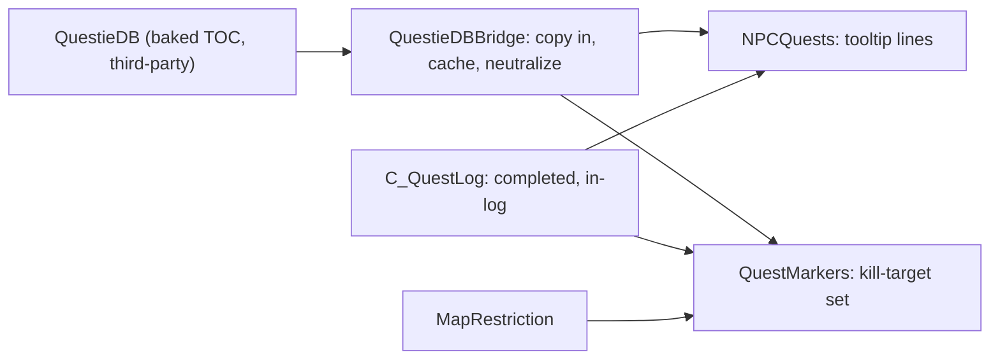

# PersonalAddon — Phase 17 Design: quests on NPC tooltips and nameplates

**Date:** October 11, 2026
**API version:** 1.60.1 (WoW Forever Beta), game type `camelot`
**Client:** 1.60.1.70338, UI export 2026-10-11 — `patch_check status` reports `UpToDate`,
accepted 2026-10-11 09:47
**Supersedes:** §3 of `20261011-RoadmapProposal04.md`
**Implements:** the quest half of Roadmap Proposal 04, with the decisions of two question
rounds (§1.1):
- which quests an NPC has for you, on its mouseover tooltip;
- a marker on the nameplate of any monster an active quest names.

**Depends on:**
- `20261011-Phase16.md` rev 6 — §2.3's instruments, and what the four in-game runs taught
  about measuring a hazard rather than inferring it;
- `20261010-Phase15.md` rev 4 — the plate record, its occupancy lifecycle, `FramePool`,
  `EscapeGuard`;
- `20261010-Phase14.md` rev 4 — `HealthBarsContainer`, the frame with a stable height;
- Phase 9 §2 (`ClientRead`), §3 (`Diagnostics`), §4.2 (`MapRestriction`);
- Phase 8 §4.1 (`Dispatch.SubscribeCallback`), §4.5 (`CallWindow`);
- Phase 7 §6.4 (what subscribing to a synchronous quest event cost last time);
- `QuestieDB` 1.0.5, the addon — **not** Questie;
- README "Rules for future development".
**Revision:** 5 — SQ1 answered and the marker question traced to the database by decoding the baked TOC offline (§10.7): the data is complete and the extraction correct; "Worgen in the Woods" is a four-quest chain wanting a different mob at each step. Revision 4 — the second in-game run (§10.6): `targetsFound = 3` for a whole quest log, because §4.2 excluded item objectives on the grounds that an item has no nameplate — while the creatures that drop it do. Four objective sources now, not two. Revision 3 — the first in-game run (§10.5): the tooltip works, the markers drew once and the counters could not say why. Three defects fixed, the worst of them plates that predated the feature never being offered. Revision 2 — audit dispositions applied (§14): nineteen findings, all accepted. Findings 2, 4, 12 and 13 changed mechanisms, not just wording

---

## 1. Scope

Two features over one new piece of substrate.

| Feature | What you see |
|---|---|
| `npcQuests` | Mousing over an NPC adds an **Available Quests** block to its tooltip: the quests it has that you can accept now, with their level, coloured by difficulty |
| `questMarkers` | A monster that an active quest names carries a marker above its nameplate |

Both read from `QuestieDB`, through one bridge that owns every call into it.

### 1.1 Decisions

Roadmap Proposal 04 §1.1 settled four of these. Question round 1 of 2026-10-11, after
Phase 16 shipped, settled four more.

| # | Question | Answer |
|---|---|---|
| D4 | Where quest data comes from | `QuestieDB` at runtime. Questie itself stays unloaded. No database of ours |
| D5 | Which quests the tooltip lists | Only ones you can accept now |
| D6 | What the nameplate marker covers | Monsters an active quest names. Tooltips stay out of it |
| D7 | Delivery | Phase 16 first, then this |
| D8 | Scope of this phase | **Both features in one phase**, with the bridge |
| D9 | Markers on a restricted map | **Stand down, and say so once.** No markers in dungeons or raids; `UnitGUID` is withheld there and a missing marker must never mean "not a quest mob" (§4.3) |
| D10 | Quests you cannot take yet | **Not listed.** D5 as written: every line in the tooltip is actionable now (§3.4) |
| D11 | A marker when the objective is full | **No progress read at all.** The marker means "an active quest names this mob". It stays until the quest leaves your log (§4.2) |

D11 is the decision that most shapes this phase. It removes `C_QuestLog.GetQuestObjectives`,
the per-kill update and the progress sweep, and leaves one map rebuilt only when the quest
log changes. §4.2 states what it costs.

### 1.2 What ships

| Item | Kind | Section | File |
|---|---|---|---|
| The bridge over `QuestieDB` | Substrate | §2 | `Core/QuestieDBBridge.lua` |
| Available quests on NPC tooltips | Feature | §3 | `Features/NPCQuests.lua` |
| Quest markers on nameplates | Feature | §4 | `Features/QuestMarkers.lua` |
| Two call-outs from the plate lifecycle | Feature change | §4.1 | `Features/Nameplates.lua` |
| A marker pool and its constants | Substrate | §4.4 | `Core/Constants.lua` |
| The `Quests` settings page | Feature | §5 | `Core/Constants.lua`, `Features/SettingsPanel.lua` |
| `/pa quests` and its counters | Command | §6 | `Core/Debug.lua`, `Core/Diagnostics.lua` |
| Premises 56–62 | Tooling | §7 | `Tools/patchcheck/premises.toml` |
| `stubs17.lua`, `tests17.lua` | Tooling | §10 | `Tools/harness/` |
| README; TOC `1.7.0`, `X-Phase: 17` | Housekeeping | §8, §13 | `README.md`, `PersonalAddon.toc` |

### 1.3 What the proposal said, corrected

Roadmap Proposal 04 §3 was written from memory of Questie's internals rather than from the
installed addon. Its bridge contract names an API that does not exist. Everything below was
read out of `Interface\AddOns\QuestieDB\` on 2026-10-11.

| Proposal §3 | What is actually there |
|---|---|
| `npcData[npcId].starts` | `NpcDB.questStarts(npcId) -> QuestId[]?` (`Types/Npc.t.lua`) |
| `QuestieDB.preQuestSingle` as a table | `QuestDB.preQuestSingle(questId)`, a named getter; every field is one (`src/meta/questMeta.lua:95–97`) |
| `quest.requiredLevel` | `QuestDB.requiredLevel(questId)` |
| "race and class bitmasks from `QuestieDB`" | `QuestDB.requiredRaces` / `.requiredClasses`, compared against `LibQuestieDB.Enum.factionRaceMasks` (`src/api.lua:60–64`) |
| `ContractMismatch` by probing for fields | `LibQuestieDB.RequireContract(3) -> ok, message` (`src/api.lua:88`), a **range** check so a newer QuestieDB passes |
| `GetActiveQuestKillObjectives` returning objective status | There is no such call. Kill targets come out of `QuestDB.objectives`, and from **two** of its six slots (§4.2) |
| "Memory isolation: PersonalAddon only queries lookup keys" | True, but the opposite of the real cost: **every table read allocates a fresh deep copy** (§2.4) |
| Hook is `AddTooltipPostCall` **or** a secure post-hook, running "post-draw" | There is no post-hook alternative, and it runs **before** `Show()`, which is why it works (§3.1) |
| `npcId = select(6, strsplit("-", guid))`, unguarded | `UnitGUID` is `SecretWhenUnitIdentityRestricted`; a `strsplit` on a withheld value raises in our code and the lint fails the file (§4.3) |

### 1.4 Types

Used as earlier documents define them:

| Types | Defined in |
|---|---|
| `FeatureId`, `ConfigKey`, `ConfigValue` | Phase 1 §5–§6 |
| `ConfigSchema`, `ConfigKind`, `SchemaViolation` | Phase 6 §5 |
| `ClientRead<T>`, `Counters` | Phase 9 §2.2; Phase 11 §1.4 |
| `MapReading` | Phase 9 §4.2 (`Restricted | Unrestricted | Unreadable`) |
| `PlateRecord`, `FramePoolHandle` | Phase 15 §1.4, §4.6 |
| `SettingsPage`, `ValueUnit` | Phase 12 §1.4 |

Defined here. Audit findings 1, 6 and 14 each added a type; finding 9 changed what
`QuestFacts` is allowed to hold.

```
type NpcId     = integer
type QuestId   = integer
type Seconds   = number
type UnitToken = string

# What the bridge is able to do right now. Checked once per UI load; never assumed.
type BridgeState =
      Available(contract: integer, mode: string, flavor: string)
    | ProviderMissing
    | ContractMismatch(message: string)
    | WrongFlavor(found: string)
    | Errored(reason: string)

# The player facts every tooltip filter needs, read once per evaluation through
# ClientRead (audit finding 3). Absent in any field disables the filters that need
# it, and section 3.3 says what that does.
type PlayerFacts = {
    level:     Optional<integer>,
    raceMask:  Optional<integer>,
    classMask: Optional<integer>
}

# One quest's facts, as the bridge caches them (audit finding 1). The id lists are
# COPIES of what QuestieDB handed over, not references to it (audit finding 9).
type QuestFacts = {
    questId:          QuestId,
    name:             Optional<string>,
    questLevel:       integer,
    requiredLevel:    integer,
    requiredMaxLevel: integer,
    requiredRaces:    integer,
    requiredClasses:  integer,
    preQuestSingle:   List<QuestId>,
    preQuestGroup:    List<QuestId>,
    exclusiveTo:      List<QuestId>
}

# One quest as the tooltip draws it. Returned by offered_quests (section 3.3).
type QuestSummary = { questId: QuestId, name: string, level: integer }

# Why a quest is not offered. Kept so /pa quests can say, and never drawn (D10).
type QuestRejection =
      AlreadyCompleted
    | InLog
    | BelowRequiredLevel(required: integer)
    | AboveMaximumLevel(maximum: integer)
    | WrongRace
    | WrongClass
    | PrerequisiteMissing(questId: QuestId)
    | ExclusiveTaken(questId: QuestId)
    | Unreadable(reason: string)

# What resolving the NPC behind a tooltip produced. Its own type, because
# ClientRead<T> has no NotAnNpc arm and overloading it would be a lie about what
# Core/ClientRead.lua returns (audit finding 14).
type NpcResolution = Resolved(npcId: NpcId) | NotAnNpc | Withheld | Absent

# Every NPC id an active quest names as a kill target. A set, not a map, because
# D11 removed progress from the design. questsSeen and questsExpected are how
# section 4.2 tells a short read from an empty log (audit findings 11 and 15).
type KillTargetSet = {
    byNpcId:         Map<NpcId, true>,
    npcCount:        integer,
    questsSeen:      integer,
    questsExpected:  integer,
    builtAt:         Seconds,
    complete:        boolean
}

# Whether markers can mean anything on this map at all. Separate from the per-plate
# reading, which is what MarkerReading is for (audit finding 6).
type MarkerCapability = Capable | StoodDown(reason: string)

# What one plate's marker did.
type MarkerReading = Shown | NotATarget | Released | Withheld | StoodDown(reason: string)
```

- **`QuestFacts` holds the three id lists, and that is deliberate** (audit finding 9).
  An earlier draft said the cache kept "scalars only", which contradicted §3.1's claim
  that a second mouseover costs a table lookup: tests 7–9 of §3.3 need
  `preQuestSingle`, `preQuestGroup` and `exclusiveTo`, all of them `QuestId[]`. The
  invariant that actually matters is the one §2.4 states — **nothing QuestieDB handed
  us is retained by reference** — and copying three short id lists satisfies it.
- **`QuestSummary` is now returned by something** (audit finding 1). It is the
  tooltip's shape: the three things §3.4 draws, and nothing else.
- **`PlayerFacts` exists because the filters need the player** and the audit found no
  path specified for reading them (finding 3).

### 1.5 Not possible, or out of scope

| Wanted | Why not |
|---|---|
| Markers in dungeons and raids | `UnitGUID` is withheld on a restricted map, so the NPC behind a plate cannot be identified. D9 stands the feature down there rather than drawing markers that mean nothing |
| A marker on a quest object or a herb | An object has no nameplate, so there is nothing to mark. **An item is different**: the creatures that drop it do have nameplates, and §4.2 marks them |
| A marker that tracks 7/10 | D11. It would need a progress read per quest and a plate sweep per kill |
| Quests on the tooltip that you cannot take yet | D10 |
| Moving Blizzard's own nameplate text to make room | A restricted region that cannot even be measured (Phase 2 §4.7) |
| Quest icons on the world map or minimap | Not asked for. It is also what Questie is for, and D4 keeps Questie unloaded |
| Anything written back into `QuestieDB` | Read-only by contract (§2.5). `LibQuestieDB.RegisterCorrection` exists and is not called |

---

## 2. The bridge: `Core/QuestieDBBridge.lua`

### 2.1 What `QuestieDB` is on this machine

Read on 2026-10-11, from the installed copy:

| Fact | Value |
|---|---|
| Version | 1.0.5 |
| `X-Contract-Version` | 3 |
| `X-Mode` | `baked` |
| `X-Flavor` | `Forever` |
| `## Interface` | 16001 — this client |
| `## Dependencies` | none, so it loads without Questie |
| Enabled | `QuestieDB: enabled` in `WTF/Account/<acct>/<realm>/<char>/AddOns.txt` |
| Questie itself | Not loading: its saved variables were last written 2026-10-10, while PersonalAddon's were written 2026-10-11 16:52 |

`src/api.lua` is explicit that this is a supported arrangement: *"Questie is the first
consumer, but nothing here assumes it."*

**Baked mode matters.** The entity data lives in the TOC as `##` metadata and is read back
through `C_AddOns.GetAddOnMetadata` plus `C_EncodingUtil` CBOR (`src/read/baked.lua:26–48`).
That is why the `_Camelot` TOC is 14.9 MB and 113k lines. Nothing of ours touches that path;
it is the reason §2.4's caching matters.

### 2.2 The surface, as it exists

```
_G.LibQuestieDB          the library table
_G.QuestDB               entity: quests
_G.NpcDB                 entity: NPCs
_G.ItemDB, _G.ObjectDB   not used by this phase
```

Created in `src/api.lua:23–31`. Fields are **named getters**, one per field, generated
from the schema:

| Call | Returns | Used for |
|---|---|---|
| `NpcDB.questStarts(npcId)` | `QuestId[]?` | which quests this NPC offers (§3.3) |
| `NpcDB.name(npcId)` | `string?` | `/pa quests` only |
| `QuestDB.name(questId)` | `string?` | the tooltip line |
| `QuestDB.questLevel(questId)` | `number?` | the `[level]` and its colour |
| `QuestDB.requiredLevel(questId)` | `number?` | the level filter |
| `QuestDB.requiredMaxLevel(questId)` | `number?` | quests that expire |
| `QuestDB.requiredRaces(questId)` | `number?` bitmask | the race filter |
| `QuestDB.requiredClasses(questId)` | `number?` bitmask | the class filter |
| `QuestDB.preQuestSingle(questId)` | `QuestId[]?` | any one of these satisfies |
| `QuestDB.preQuestGroup(questId)` | `QuestId[]?` | all of these must be done |
| `QuestDB.exclusiveTo(questId)` | `QuestId[]?` | taking one locks the others out |
| `QuestDB.objectives(questId)` | `QuestieDBObjectives?` | the kill targets (§4.2) |
| `LibQuestieDB.RequireContract(n)` | `ok, message?` | the version gate |
| `LibQuestieDB.readMode`, `.flavor` | `string`, table | `/pa quests`, and §2.3's gate |

**The mask tables, which audit finding 2 found named wrongly.** An earlier draft said
`LibQuestieDB.Enum.factionRaceMasks` carried per-race keys and said nothing about
classes. It carries exactly two entries — `Alliance` and `Horde`, built in
`src/api.lua:61–64` — and is no use for a single race. The tables this phase needs
are:

| Table | Keyed by | Gives |
|---|---|---|
| `LibQuestieDB.Enum.raceMaskById[raceId]` | Blizzard's **race ID**, the third return of `UnitRace` | that race's single-bit value in `requiredRaces` |
| `LibQuestieDB.Enum.byExpansion[flavor.expansion].classKeys[name]` | the class **file name**, the second return of `UnitClass` (`"WARRIOR"`, `"MAGE"`) | that class's bit in `requiredClasses` |

`raceMaskById`'s own comment says it is *"Shared with consumers; read-only by
contract"*, so this is a published surface and not an internal reached into.

**The masks must be tested arithmetically, not with `bit.band`.** QuestieDB's
`expansions.lua:33` records why in its own words: *"Adding distinct bits avoids
truncating Forever's bits 32/33 through the client's 32-bit bit library."* Forever
assigns race IDs 95 and 96 to bits 32 and 33 — values 4294967296 and 8589934592 —
and `bit.band` on this client truncates at 32 bits, so a Skyborne character would
test as not matching every quest restricted to them. The test is therefore:

```
# Whether one bit is set in a QuestieDB mask.
# pre:  mask and bit are Plain non-negative integers; bit is a power of two
# post: true when the bit is set. Done with division and a remainder rather than
#       bit.band, because Forever's race bits 32 and 33 exceed what the client's
#       bit library preserves (QuestieDB's expansions.lua:33 says so)
# raises: never
function mask_holds(mask: integer, bit: integer) -> boolean
```

Also present and deliberately unused: `Get`, `GetByIndex`, `GetAll`, `GetRaw`,
`Exists`, `GetAllIds`, `InvalidateCache`, `RegisterCorrection`, `GetProvenance`.

**`IdsByName` and `BuildNameIndex` are never called.** The first call to either runs a
full synchronous pass over every entity name in the database
(`src/read/shared.lua`, `buildNameIndex`). `BuildNameIndexAsync` exists but needs a
caller-owned coroutine. Nothing in this phase needs a name lookup, and §4.3 explains
why the one place that might — a withheld GUID — does not get one either.

### 2.3 Two gates, not one

```
# What the bridge can do, resolved once per UI load.
# pre:  none
# post: ProviderMissing when _G.LibQuestieDB, _G.QuestDB or _G.NpcDB is not a table.
#       ContractMismatch(message) when RequireContract(REQUIRED_CONTRACT) returns
#       false; the message is QuestieDB's own, which names both versions.
#       WrongFlavor(found) when LibQuestieDB.flavor.name is readable and is not
#       REQUIRED_FLAVOR.
#       Errored(reason) when any of those reads raised.
#       Available(contract, mode, flavor) otherwise.
#       Every read goes through ClientRead; nothing is indexed outside it, so a
#       QuestieDB that loaded halfway cannot raise here
# raises: never
function bridge_state() -> BridgeState
```

- **`RequireContract` is a range check**, not equality (`src/api.lua:88`, and its own
  comment says why): a consumer written against contract 3 keeps working across additive
  releases down to `minSupportedContract`. So asking for 3 does not break when QuestieDB
  reaches 4.
- **The flavour gate is ours, and it is the one `RequireContract` cannot do.** The user
  could install any of QuestieDB's seven TOCs — `_Cata`, `_Mists`, `_Wrath` and the rest are
  all in the folder. A Cata-flavoured database answers every call with a straight face and
  gives wrong quest levels and wrong prerequisites. `X-Flavor` is `Forever` here, and
  `LibQuestieDB.flavor` carries it at runtime.
- **A bad state is not a fault.** Both features check the state at enable and disable
  themselves with a notice, because a missing or mismatched data provider is a
  configuration, not a defect of ours.

### 2.4 Every table read allocates, so the bridge owns the cache

`src/read/shared.lua` is explicit: *"Table reads return a fresh, mutable, deeply
independent copy on every read."* A Baked producer decodes retained CBOR bytes per
call; Source and Correction producers deep-copy. Scalars are cheap; tables are not.

So `NpcDB.questStarts(npcId)` and `QuestDB.objectives(questId)` **allocate every time
they are called**, and both sit on a path that runs often. **Every call into QuestieDB
goes through one of the three functions below** — audit finding 8 found
`build_kill_targets` reaching past the bridge straight into `QuestDB.objectives`,
which would have deep-copied a full objectives tuple for every quest in the log on
every quest-log update.

```
# The quests one NPC starts, cached for the UI load.
# pre:  state is Available
# post: a list we own, copied once from QuestieDB and reused on every later call for
#       that npcId. An NPC QuestieDB does not know, or whose read raised, caches an
#       EMPTY list and returns it -- a negative answer is an answer, and most of the
#       world's NPCs start no quest, so not caching it would defeat the cache on
#       every critter, guard and vendor hovered (audit finding 18).
#       The cache holds at most QUEST_BRIDGE_CACHE_CAPACITY (256) NPCs and is
#       emptied when full, as the consumable classifier's is
# raises: never
function quests_started_by(npcId: NpcId) -> List<QuestId>

# One quest's facts, cached for the UI load.
# pre:  state is Available
# post: a QuestFacts whose id lists are copies, never QuestieDB's own tables
#       (audit finding 9); numeric fields default to 0, which is QuestieDB's own
#       "no restriction". Absent when QuestDB does not know the id, and that is
#       cached too
# raises: never
function quest_facts(questId: QuestId) -> Optional<QuestFacts>

# The NPC ids one quest names as kill targets, cached for the UI load.
# pre:  state is Available
# post: the ids section 4.2's table extracts from objective slots 1 and 5, copied
#       into a list we own. The objectives tuple QuestieDB returned is read once and
#       dropped; it is never retained and never read again for that quest.
#       An empty list for a quest with no creature objective, cached (audit
#       finding 18's reasoning again: most quests in a log are not kill quests)
# raises: never
function kill_targets_for_quest(questId: QuestId) -> List<NpcId>
```

- **The cache is keyed by id and never invalidated.** QuestieDB's data is static for a
  UI load: it is baked into a TOC. `InvalidateCache` exists for consumers that register
  Corrections, and we register none.
- **Negative results are cached** (audit finding 18). Hovering a critter asks QuestieDB
  once per UI load, not once per mouseover.
- **Nothing QuestieDB returns is retained by reference.** Every table read is copied
  into a structure of ours on the way in, so a later `SetOverlay` or `InvalidateCache`
  by another consumer cannot change what we hold, and we cannot corrupt what it holds.
  This is the invariant; "scalars only" was an earlier and wrong statement of it.

### 2.5 Its strings are third-party data

Quest names and NPC names from QuestieDB are drawn into a tooltip and, potentially, onto our
own frames. They are not Blizzard's strings and they are not the player's:

- `LibQuestieDB.RegisterCorrection` and `SetCorrection` are public, so **any other addon can
  inject or change a quest name** at runtime, and a composed read returns it.
- The database itself is a file the user installed, updated independently of this addon.

Phase 15 established `EscapeGuard.Neutralize` for a guild name on exactly this reasoning — *a
guild name is text other players chose, so its escape codes are made inert before it is
drawn*. A quest name is more reachable than that, not less. **Every string that leaves the
bridge passes through `EscapeGuard.Neutralize` before it is drawn**, including in
`/pa quests`.



---

## 3. NPC tooltips: `Features/NPCQuests.lua`

### 3.1 The hook is rule 1-clean and a rule 5 exception

`TooltipDataProcessor.AddTooltipPostCall(Enum.TooltipDataType.Unit, handler)`. There is
no `hooksecurefunc` alternative: `GameTooltip:SetUnit` is generated from an accessor
map (`TooltipDataHandler.lua:582`) and routed through
`TooltipDataHandlerMixin:ProcessInfo`, which is itself `securecallfunction`'d
(`:241–242`). A post-hook on `SetUnit` would sit outside that isolation rather than
inside it.

**Why it satisfies rule 1.** This is Blizzard's own registry for insecure callbacks,
and it is built as a taint firewall:

1. `AddCall` sees `issecure()` is false for us, wraps our function in a closure that
   calls `forceinsecure()` first, and hands it to an attribute delegate — a frame that
   is `SetForbidden()` (`:107–124`, `:180–192`).
2. The wrapper lands in a **file-local** table, not a public Blizzard registry. Nothing
   of ours is stored anywhere we could reach, which is what rule 2 asks.
3. At dispatch, `ProcessTooltipPostCalls` hops to the delegate by `SetAttribute` and
   calls each insecure callback under `securecallfunction` (`:61–68`, `:141–149`).

So our taint cannot reach the tooltip's execution. Blizzard's own
`TooltipDataRules.HealthBar` uses the same door (`TooltipDataRules.lua:140`).

**Why it is a rule 5 exception.** Our code runs **inline** inside the tooltip build,
not a frame later. It has to: `ProcessTooltipPostCalls` runs after `ProcessLines` and
**before** `self:Show()` (`:284–300`), which is exactly what makes `AddLine` work and
the tooltip size itself correctly. Deferring by a frame would draw into a tooltip that
had already been shown and sized, or into the next unit's.

This is the phase's one new entry in the README's "Known exceptions, kept on purpose",
and the reason it is acceptable is that rule 5's purpose — keeping our execution out of
Blizzard's — is already served by the `forceinsecure` / forbidden-delegate /
`securecallfunction` sandwich, by Blizzard's own construction rather than by our
discipline.

**The registration is permanent, and that shapes enable and disable** (audit
finding 10). `TooltipDataHandler.lua` publishes four `Add*` functions and **no
`Remove*`**: once a callback is in, it is in for the UI load. So:

- The call is made **at most once per UI load**, behind a module-level
  `registered` flag, not once per enable. Without that, switching the feature off and
  on again would register a second copy of the handler into Blizzard's table and the
  tooltip would grow two identical blocks.
- `disable` therefore cannot unregister. It clears the feature's state and sets
  `enabled` false; the handler returns immediately on that flag, which is the only
  teardown available.
- `/pa quests` prints whether the handler is registered, so a permanent registration
  that is doing nothing is visible rather than mysterious.

```
# Adds the Available Quests block to a unit tooltip. Registered at most once per UI
# load (never per enable), and silent whenever the feature is off.
# pre:  runs as an insecure tooltip post-call, so inside Blizzard's tooltip build
#       and behind forceinsecure
# post: nothing when state.enabled is false, when the bridge state is not Available,
#       when tooltip is not a table, when the NPC does not resolve (section 3.2), or
#       when offered_quests is empty.
#       Otherwise a blank line, a header, and one line per summary in section 3.4's
#       form, each name neutralized. Returns nothing: a post-call's return is read
#       only for the terminating pre-call variety
# raises: never -- every client read goes through ClientRead, and the body runs
#       inside pcall so a defect of ours cannot break the tooltip for the consumers
#       behind us in Blizzard's list
function on_unit_tooltip(tooltip: Frame, tooltipData: table) -> nil
```

### 3.2 Getting the NPC

The idiomatic path, which Blizzard's own `Blizzard_PTRFeedback_Tooltips.lua:100–120` uses
from a Unit post-call:

```
# The NPC id behind a unit tooltip.
# pre:  called from on_unit_tooltip
# post: Resolved(npcId) when tooltip:GetUnit() gives a unit, UnitGUID reads Plain
#       through ClientRead, and the GUID's type field is Creature or Vehicle.
#       NotAnNpc when the GUID's type field is Player.
#       Withheld when the GUID read is not Plain -- counted, never parsed.
#       Absent when no unit could be resolved, or the GUID held no id
# raises: never
function npc_id_for_tooltip(tooltip: Frame) -> NpcResolution
```

- **Its own return type, not `ClientRead<NpcId>`** (audit finding 14). `ClientRead<T>`
  has exactly five arms — `Plain`, `Absent`, `Withheld`, `Unavailable`, `CallFailed`
  (`Core/ClientRead.lua:30–35`) — and `NotAnNpc` is none of them. Overloading it would
  have meant the document saying `Core/ClientRead.lua` returns something it does not.
  §1.4's `NpcResolution` is the four answers this question actually has.
- **The GUID is read through `ClientRead` before any string operation.** `UnitGUID` carries
  `SecretWhenUnitIdentityRestricted` (`UnitDocumentation.lua:1241–1244`), and `strsplit` on
  a withheld value raises in our code (rule 10). The secret-read lint fails any file that
  reaches a GUID without going through `ClientRead`.
- **`tooltipData.guid` is not used.** It exists and Blizzard reads it
  (`TooltipUtil.lua:13–14`, `TooltipComparisonManager.lua:14`), but `TooltipData` is not a
  documented structure, so no flag certifies it — the situation Phase 15 recorded as
  `GUILD-INFO-UNDOCUMENTED`. `tooltip:GetUnit()` plus `UnitGUID` is documented at both ends,
  and the GUID's secrecy flag is then one we can reason about.
- **The type field is checked, not assumed.** A GUID is `Creature-0-…-npcId-…`; the first
  field says what it is. A player's GUID has no NPC id, and a pet's belongs to its summoner.

### 3.3 Which quests are offered

**The player is read first, once per evaluation** (audit finding 3). The filters need
the player's level, race and class, and an earlier draft named them without saying
where they came from or what an unreadable one does.

```
# The player facts the filters compare against.
# pre:  none
# post: level from UnitLevel("player"); raceMask from
#       LibQuestieDB.Enum.raceMaskById[raceId], where raceId is the third return of
#       UnitRace("player"); classMask from
#       byExpansion[flavor.expansion].classKeys[fileName], where fileName is the
#       second return of UnitClass("player").
#       Each field is Absent when its read is not Plain through ClientRead, or when
#       QuestieDB has no mask for that race or class id -- a Forever race QuestieDB
#       has not catalogued is Absent, not zero
# raises: never
function player_facts() -> PlayerFacts

# Which of an NPC's quests are offered, and why the rest are not.
# pre:  bridge state is Available
# post: one QuestSummary per quest that passes every test below, in the order
#       QuestieDB lists them; and a QuestRejection for each that does not, kept for
#       /pa quests and never drawn (D10)
# raises: never
function offered_quests(
    npcId: NpcId,
    player: PlayerFacts
) -> List<QuestSummary>, Map<QuestId, QuestRejection>
```

For each id from `quests_started_by(npcId)`, in this order:

| # | Test | Rejection | If the player fact is Absent |
|---|---|---|---|
| 1 | `C_QuestLog.IsQuestFlaggedCompleted(questId)` is false | `AlreadyCompleted` | — |
| 2 | `C_QuestLog.GetLogIndexForQuestID(questId)` gives nothing | `InLog` | — |
| 3 | `player.level >= facts.requiredLevel` | `BelowRequiredLevel` | **reject**, `Unreadable` |
| 4 | `facts.requiredMaxLevel == 0` or `player.level <= it` | `AboveMaximumLevel` | **reject**, `Unreadable` |
| 5 | `facts.requiredRaces == 0` or `mask_holds(facts.requiredRaces, player.raceMask)` | `WrongRace` | **reject**, `Unreadable` |
| 6 | `facts.requiredClasses == 0` or `mask_holds(facts.requiredClasses, player.classMask)` | `WrongClass` | **reject**, `Unreadable` |
| 7 | every id in `facts.preQuestGroup` is flagged completed | `PrerequisiteMissing` | — |
| 8 | `facts.preQuestSingle` is empty, or at least one of its ids is flagged completed | `PrerequisiteMissing` | — |
| 9 | no id in `facts.exclusiveTo` is completed or in the log | `ExclusiveTaken` | — |

- **A player fact we could not read rejects the quests that need it, and is counted.**
  A tooltip that lists a quest you cannot take is worse than one that misses a quest you
  can, and a mask of 0 from QuestieDB means "any race" — so defaulting an unreadable
  race to 0 would offer every race-restricted quest to everyone. Tests 1, 2 and 7–9 do
  not need the player at all, so an unreadable level still leaves most of the filter
  working and `/pa quests` says which fact was missing.
- **The masks are tested with `mask_holds`, not `bit.band`** (§2.2). Forever's race bits
  32 and 33 exceed what the client's bit library preserves.
- **None of the quest-log calls can return a secret.** `IsQuestFlaggedCompleted`,
  `GetLogIndexForQuestID` and `GetQuestIDForLogIndex` carry only
  `SecretArguments = "AllowedWhenUntainted"` and no `SecretWhen*` or `SecretReturns`
  flag (`QuestLogDocumentation.lua:916`, `:206`, `:395`). They are read through
  `ClientRead` anyway; `SecretArguments` means our *arguments* would be refused if they
  were secret, and the ids we pass come from QuestieDB as plain numbers.
- **Order is cheapest-first.** Tests 1 and 2 are client calls on an id already in hand;
  3–9 need the bridge's cache. Most ids fall out at 1 or 2.

### 3.4 What is drawn

```
+---------------------------------------------------+
| Marshal Dughan                                    |
| Level 35 Human                                    |
| Stormwind Guard                                   |
|                                                   |
| Available Quests:                                 |
|   [10] Gold Dust Exchange                         |
|   [12] Further Concerns                           |
+---------------------------------------------------+
```

- **A blank line, then a header, then the quests.**
  `GameTooltip_AddBlankLineToTooltip(tooltip)` (`SharedTooltipTemplates.lua:124`) takes
  the tooltip as its argument, so nothing of ours is stored.
- **Each quest line is `tooltip:AddLine(text, r, g, b)`, not
  `GameTooltip_AddColoredLine`** (audit finding 4). That helper calls `color:GetRGB()`
  (`SharedTooltipTemplates.lua:167`), and `GetQuestDifficultyColor` returns an entry of
  `QuestDifficultyColors`, which is a raw table `{ r, g, b, font }` with no such method
  (`Blizzard_FrameXMLBase/Constants.lua:195–203`). Passing one to the other raises
  `attempt to call method 'GetRGB' (a nil value)` — inside Blizzard's tooltip build,
  where §3.1's `pcall` would swallow it and the block would simply never appear. The
  components are unpacked and passed positionally instead.
- **The colour is still Blizzard's own.** `GetQuestDifficultyColor(level)` →
  `DifficultyUtil.GetRelativeDifficultyColor(UnitEffectiveLevel("player"), level)`
  (`DifficultyUtil.lua:17–27`), whose cutoffs are `>= 5` impossible, `>= 3` very
  difficult, `>= -4` difficult, then `UnitQuestTrivialLevelRange("player")` for the
  trivial grey (`:33–46`). So the colours match the quest log exactly, and the
  proposal's four inlined thresholds are not reproduced.
  Each field of the returned table is read through `ClientRead`; a non-`Plain` colour
  draws the line uncoloured rather than not at all.
- **Nothing is listed that you cannot take** (D10). An NPC with no offered quest gets no
  block at all — not a header with nothing under it.
- **Every name is neutralized** (§2.5), and the list is capped at
  `NPC_QUEST_LINE_CAPACITY` (10) with a "+n more" line, so a data defect cannot grow a
  tooltip without bound.

## 4. Nameplate markers: `Features/QuestMarkers.lua`

### 4.1 Where it lives: Nameplates owns the lifecycle

Phase 15 already owns the plate record, its attach and detach, and a `FramePool` for a
decoration (`Features/Nameplates.lua`: `trackPlate`, `untrackPlate`, `attachGuildLabel`,
`releaseGuildLabel`). Phase 15 §3.4 also recorded that **the order between our
`NAME_PLATE_UNIT_ADDED` handler and anyone else's is not ours to choose.**

So a second feature with its own `NAME_PLATE_UNIT_ADDED` subscription would race the
first for the same plate record, and the marker could attach to a plate that had not
been tracked yet — or outlive one the client had already recycled onto another unit.

**The marker attaches from Nameplates' own lifecycle instead.** Two call-outs are added
beside the guild label's, nil-guarded:

```
in trackPlate -- after reassertBarHeight and applyGuild, and AFTER the
                 SCOPE.UNREACHABLE early return, so a plate with no container is
                 never offered; but OUTSIDE the scope check that styleIfInScope
                 makes:
    if ns.QuestMarkers then ns.QuestMarkers.OnPlateAttached(plate) end

in untrackPlate -- before the record is dropped:
    if ns.QuestMarkers then ns.QuestMarkers.OnPlateDetached(plate) end
```

**Where exactly, and why it is not inside the scope guard** (audit finding 17). An
earlier draft said "after the record exists and is in scope", which reads two ways:
Lua's `local plate` being in scope, or the domain condition `plate.scope == SCOPE.IN`.
It is the first. `SCOPE.IN`/`OUT` classifies a plate for the *colour* feature — a
damage dealer's point of view — and a quest mob can perfectly well be neutral, which
`classifyScope` makes `SCOPE.OUT` (`Features/Nameplates.lua:145–158`). Putting the
call-out inside that guard would silently drop markers from every neutral quest mob.
This is the same decision Phase 15 made for the guild label, and its comment in
`trackPlate` says so in as many words: *"Outside the scope guard, like the height: a
guild name belongs on every player's plate… NPCs are excluded by having no guild rather
than by scope."* A quest marker is excluded by the NPC not being a target, not by scope.

It goes **after** the `SCOPE.UNREACHABLE` return, because a plate whose parts could not
be resolved has no container to anchor to.

**`QuestMarkers` keeps its own set of attached plates** (audit finding 7).
`state.plates` in Nameplates is file-local and the only thing it exports is `Inspect`,
so there is no iterator to borrow — and adding one would be a second way to reach the
plate record. Instead the two call-outs are the only source of truth:
`OnPlateAttached` adds the record to `state.attached`, `OnPlateDetached` removes it.
Everything that needs to visit plates already on screen walks that set:

| Needs a sweep | Why |
|---|---|
| The kill-target set was rebuilt (§4.2) | a plate on screen gains or loses its marker |
| `markerScale` or `markerOffsetY` changed (§5) | markers already drawn move and resize |
| The map capability changed (§4.3) | every marker is released on entering a dungeon |
| `disable` | every marker is released and the set is emptied |

- **A direct call to a sibling module, not a registry.** There is one consumer, and
  `Core/Debug.lua` already does exactly this with
  `ns.SettingsPanel and ns.SettingsPanel.ReflectEnabled(featureId)`. A decoration
  registry for one decoration is the premature abstraction Phase 2 §13's bar was set
  against.
- **`questMarkers` stays its own feature** — its own switch, its own page entry, its own
  counters. Where the attach is called from and who owns the on/off are different
  questions.
- **Nameplates being off means no markers,** because the call-outs never fire.
  `/pa quests` says so rather than leaving it a mystery.

### 4.2 The kill-target set

D11 removed progress from the design, so this is a **set of NPC ids**, not a map of
objectives, and it changes only when the quest log does.

```
# Every NPC id an active quest names as a kill target.
# pre:  bridge state is Available
# post: questsExpected is the second return of C_QuestLog.GetNumQuestLogEntries, the
#       count of quests the log holds. For each index from 1 to the FIRST return,
#       C_QuestLog.GetQuestIDForLogIndex gives a quest id or nothing -- it answers
#       "only for actual quests, not headers", so no isHeader test is needed.
#       Each id contributes bridge.kill_targets_for_quest(questId), and questsSeen
#       counts the ids that answered.
#       complete is (questsSeen == questsExpected).
#       An unreadable GetNumQuestLogEntries leaves the PREVIOUS set in place,
#       untouched, and bumps logUnreadable; it is not an empty log, and the two are
#       told apart by that counter rather than by an empty result (audit finding 11)
# raises: never
function build_kill_targets(previous: KillTargetSet) -> KillTargetSet
```

**Slot 5 is the half the proposal missed.** `QuestieDBObjectives` is a six-slot tuple
(`Types/General.t.lua:46`), and `kill_targets_for_quest` (§2.4) takes two of them:

| Source | Shape | Taken? |
|---|---|---|
| `objectives[1]` | `{npcId, text?, count}[]` — creature kills | **yes** |
| `objectives[5]` | `{npcId[], creditNpcId, text?, count}[]` — kill credit | **yes, every id in the list, and the credit id** |
| `objectives[3]` | `{itemId, text?, count}[]` — item collection | **yes, through `ItemDB.npcDrops(itemId)`** — see §10.6 |
| `extraObjectives` | `{spawns?, zone, text?, icon, reference[]}[]` | **yes, every `{"monster", npcId}` reference** — see §10.6 |
| `objectives[2]` | `{objectId, text?, count}[]` — objects | no: an object genuinely has no nameplate |
| `objectives[4]` | `{factionId, value}` — reputation | no |
| `objectives[6]` | `{spellId, text?, itemId}[]` — spells | no: names no creature to kill |

**Four sources, not two.** The first two name a creature directly. The other two name
one at a remove, and leaving them out is what made the feature look broken in play
(§10.6): a quest item has no nameplate, but **the creatures that drop it do**, and
most "go and kill those things" quests are item-collection quests underneath.
`ItemDB.npcDrops` is the published way across (`Types/Item.t.lua`), and
`extraObjectives`' fifth slot is how QuestieDB names a creature none of the ordinary
slots mentions.

**One quest cannot fill the set.** A widely-dropped item can name a great many
creatures, so `QUEST_TARGETS_PER_QUEST_MAXIMUM` (64) caps one quest's contribution
and `questTargetsCapped` counts it.

Slot 5 is how one objective credits kills of several different NPCs. Reading only slot 1
— which is what §3.3 of the proposal describes — would silently miss every mob of those
quests, and the feature would look like it simply did not work on some of them.

**A collapsed quest header may hide its quests, and the design says so rather than
assuming either way** (audit finding 15). `GetNumQuestLogEntries` returns
`numShownEntries, numQuests`, and the index space the first return describes is the
*shown* one. Whether a collapsed header's quests remain addressable by index is a fact
about this client that cannot be read out of the UI export, so:

- the loop runs over the shown range and counts what it found (`questsSeen`);
- `questsExpected` is `numQuests`, the true count, which collapsing cannot change;
- `complete` is false when they disagree, `/pa quests` prints both numbers, and
  `questsHidden` counts the shortfall.
- **No header is ever expanded.** `C_QuestLog.ExpandQuestHeader` mutates the quest log's
  UI state and would raise `QUEST_LOG_UPDATE` from inside our own call — the shape of
  defect Phase 7 §6.4 abandoned the quest-level sort over. A marker is not worth that.
- **Spike question SQ2** settles the behaviour in one minute in game (§10.4). If
  collapsed headers do hide their quests, the shortfall is visible in `/pa quests`
  instead of being a silent gap, and the README says a collapsed category may lose its
  markers.

**Triggers and lifecycle:**

- **`QUEST_LOG_UPDATE` is the only subscription, and it is a `UniqueEvent`**
  (`QuestLogDocumentation.lua:1371`), so it cannot arrive inside a Lua call and our
  handler cannot run in Blizzard's execution.
- **`QUEST_ACCEPTED`, `QUEST_REMOVED` and `QUEST_TURNED_IN` are deliberately not
  subscribed.** All three are `SynchronousEvent` (`:1310`, `:1385`, `:1396`), and
  Phase 7 §6.4 is this project's record of what subscribing to a synchronous quest
  event cost. `QUEST_LOG_UPDATE` follows all three anyway.
- **The subscription goes through `Dispatch`**, which drops it on disable
  (`Registry` calls `Dispatch.UnsubscribeAll` after every disable), so the event cannot
  reach a feature that is off (audit finding 16).
- **The coalescing timer is cancellable.** `C_Timer.NewTimer` with the token kept on
  `state.rebuildToken`, released in `disable` — not `C_Timer.After`, which cannot be
  cancelled and would fire a rebuild into a disabled feature a frame later. Phase 16
  §5.2 made the same correction for the same reason.
- **A rebuild sweeps `state.attached` afterwards** (§4.1), bounded by the plate cap.

**What D11 costs, stated.** A mob stays marked after its objective is full, until the
quest leaves the log. The marker means *"an active quest names this mob"*, which is
weaker than *"you still need this"* — and it is never wrong about what it does mean. The
README says so in those words.

### 4.3 Restricted maps: the feature stands down

```
# Whether markers can mean anything on this map.
# pre:  none
# post: StoodDown(reason) when MapRestriction.Read() is Restricted, and equally when
#       it is Unreadable -- "could not tell" is not permission (rule 10).
#       Capable otherwise. Read at enable and on PLAYER_ENTERING_WORLD, not per
#       plate. A change from Capable releases every marker in state.attached
# raises: never
function marker_capability() -> MarkerCapability
```

Its own type, not `MarkerReading` (audit finding 6): one is a question about the map,
asked once on entering it; the other is what happened to one plate. An earlier draft
returned "Shown-capable", which was not an arm of either.

- **On a restricted map every marker is released and none is drawn** (D9). `UnitGUID` is
  withheld there, so the NPC behind a plate cannot be identified; marking the ones that
  happen to read would make the *absence* of a marker meaningless, which is worse than
  no markers at all in a place where plates are read under pressure.
- **Said once, and visible in `/pa quests`.** `MapRestriction` is already used this way
  by Nameplates and Toasts.
- **A withheld GUID on an unrestricted map is still possible** — PvP identity
  restriction applies by aspect, not only by map. That plate gets no marker, the reading
  is counted as `Withheld`, and nothing is guessed. This is the per-plate case the map
  check cannot cover.
- **No name fallback.** `UnitName` is restricted by the same rule, several NPC ids share
  a name, and `NpcDB.IdsByName` would trigger the full synchronous name-index pass
  (§2.2). Three reasons, any one of which is enough.

### 4.4 The marker

Three functions, not one with a post-condition covering both directions (audit
finding 19). An earlier draft had a single `apply_marker(plate)` whose contract
described attaching and detaching, with nothing to say which it was doing — and no
answer for the sweep case, where a plate that already carries a marker may need to keep
it, lose it, or be re-measured.

```
# Gives one plate a marker, or confirms it should not have one.
# pre:  plate came from Nameplates' trackPlate, and is in state.attached
# post: StoodDown(reason) when marker_capability refuses, with nothing acquired.
#       Withheld when the plate's unit GUID does not read Plain -- counted, never
#       parsed.
#       NotATarget, with nothing acquired, when the npcId is not in the kill-target
#       set; any marker the plate already had is released first.
#       Shown when a frame was acquired from the pool, textured, sized, anchored
#       BOTTOM to the health bar container's TOP at markerOffsetY, scaled by
#       markerScale, parented to UIParent and never to the plate (rule 6); a plate
#       that already had one keeps it and is re-measured rather than acquiring a
#       second
# post: nothing is parented to, or written onto, any Blizzard frame
# raises: never
function attach_marker(plate: PlateRecord) -> MarkerReading

# Takes one plate's marker away.
# post: Released when a marker was returned to the pool with its texture, points and
#       scale cleared and plate.questMarker set to nil; NotATarget when there was
#       nothing to release. Safe to call twice
# raises: never
function detach_marker(plate: PlateRecord) -> MarkerReading

# Brings every plate on screen to what the current set and settings say.
# pre:  called from a kill-target rebuild, a setting change, a capability change or
#       disable
# post: attach_marker for each record in state.attached, in no particular order;
#       the count of each MarkerReading is returned. Bounded by the plate cap, as
#       Phase 15 section 3.4's guild refresh is
# raises: never
function refresh_markers() -> Map<MarkerReading, integer>
```

**The frame has a size, and the texture has a value** (audit finding 12). A frame
created with one anchor point and no size is 0×0 and draws nothing, which would have
been a feature that silently did nothing at all:

| Constant | Value | Why |
|---|---|---|
| `QUEST_MARKER_SIZE` | 16 | Square, in UIParent units before `markerScale`. Reads at the same weight as the guild line below the bar |
| `QUEST_MARKER_TEXTURE` | `Interface\Icons\INV_Misc_QuestionMark` | Chosen because this addon already draws it (`Features/Toasts.lua`), so it is known present on this client |
| `QUEST_MARKER_POOL_CAPACITY` | 48 | As the guild label's, and for the same reason: the client's nameplate cap bounds the tracked set, so exhaustion means the cap assumption is wrong and is reported rather than absorbed |

- **The texture is the proven one, and a prettier path is a spike question, not an
  assumption** (audit finding 13). An earlier draft set a preferred path and then read
  `GetTexture()` back, expecting `nil` for a file the client does not have. That is an
  untested assumption about asynchronous asset loading, and the audit is right to
  refuse it: `GetTexture` can return the path it was handed before the file is ever
  resolved. Art is not in the UI export, so no path can be checked offline. So the
  shipped constant is one already drawn successfully by this addon, and **spike question
  SQ1** (§10.4) tries the nicer candidates in game and reports which actually draw. If
  one does, the constant changes and nothing else does.
- **Anchored to the health bar's container, not to `nameplate.UnitFrame`.** Phase 14
  established that the container is the frame with a stable height
  (`Features/Nameplates.lua:122–130`, premise `PLATE-BAR-CONTAINER-HEIGHT`), and
  Phase 14 made that height a setting — so a marker anchored to `UnitFrame`, which the
  proposal specifies, would drift as the bar shrinks. The guild label anchors to the
  same container on its other side.
- **Released on detach, before the client can recycle the plate.** Phase 15 §4.6's rule,
  for the same reason: a plate record outliving its unit is how a decoration ends up
  over the wrong mob.

## 5. Settings

A new page, `Quests`, after `Consumables`. `SettingsPage` gains `QUESTS` and the
declared order becomes 10, 20, 30, 40, 50 (Phase 12 §19 item 5).

| Feature | Key | Default | Kind |
|---|---|---|---|
| `npcQuests` | — | on | Toggle, "Available quests on NPC tooltips"; description "Which quests an NPC has for you, on its mouseover tooltip" |
| `questMarkers` | — | on | Toggle, "Quest markers on nameplates"; description "A marker over any monster an active quest names. Needs nameplates on, and stands down in dungeons and raids" |
| `questMarkers` | `markerScale` | 1.0 | Number, unit `Fraction`, 0.8–1.5, step 0.05 → a percent slider (Phase 12 §3.6) |
| `questMarkers` | `markerOffsetY` | 0 | Number, unit `Pixels`, −20 to 40, step 1 |

- **`markerScale` is the key's name everywhere** (audit finding 5). §4.4 called it
  `markerIconScale` in one place, which was the proposal's name for it and matched
  nothing else in the document.
- **`markerScale` is a `Fraction`, not "80 to 150".** Phase 12 §3.6 renders a `Number`
  with unit `Fraction` as a percent slider, so the stored value is 0.8–1.5 and the panel
  shows 80–150%. The proposal's default of `1.0` with a range written as "80% to 150%"
  would otherwise have produced a 0.8-to-1.5 slider on screen.
- **Changing either slider calls `refresh_markers`** (§4.4), so markers already on
  screen move and resize rather than waiting for the next plate.
- **No setting for which objective kinds count.** Objects and items have no nameplate, so
  there is nothing to choose (§4.2).

## 6. `/pa quests` and diagnostics

**`/pa quests`** prints:

- the bridge state, with the contract, mode and flavour it found, or why it is
  unavailable;
- whether the tooltip handler is registered (§3.1: once per UI load, and it cannot be
  undone);
- the player facts as read: level, race mask, class mask, and `unreadable` for any that
  did not answer (§3.3);
- the marker capability and the map reading behind it;
- the kill-target set: how many NPC ids, from how many quests, **`questsSeen` against
  `questsExpected`**, whether it is `complete`, and when it was built (§4.2);
- how many plates are attached, how many carry a marker, and the pool's high-water mark;
- for the last NPC hovered: its id, its name from the bridge, every quest it starts, and
  for each either "offered" or the `QuestRejection` — the only place a rejection is ever
  shown (D10);
- the counters.

**Counters,** under `npcQuests` and `questMarkers`:

- `npcQuests`: `tooltips`, `npcsResolved`, `guidWithheld`, `notAnNpc`, `questsOffered`,
  `questsRejected`, `playerFactUnreadable`, `linesCapped`, `bridgeReads`, `cacheHits`,
  `handlerRaises`;
- `questieBridge`: `bridgeReads`, `cacheHits`, `cacheEmptied`, `questTargetsCapped`;
- `questMarkers`: `setRebuilds`, `logUnreadable`, `questsHidden`, `targetsFound`,
  `platesOffered`, `platesAdopted`, `markersShown`, `markersReleased`, `noContainer`,
  `npcIdUnreadable`, `notTargeted`, `guidWithheld`, `stoodDown`,
  `offeredWhileStoodDown`, `poolExhausted`, `sweeps`.

- **`logUnreadable` and `questsHidden` are audit finding 11's and 15's** — without them,
  an unreadable quest log and an empty one look identical from the outside, and a
  collapsed header silently costs markers.
- **`textureFellBack` is gone**, because §4.4 no longer has a fallback to count: the
  shipped texture is one already proven on this client, and the nicer candidates are a
  spike question instead.
- **`guidWithheld` appears under both features** because it is the one reading that moves
  when the player walks into a dungeon, and seeing which feature it moved under tells the
  two stand-down paths apart.

## 7. The patch check

Premises 56–63. The register holds 55 after Phase 16.

Every one was matched against the 70338 export before this document was written,
and the "Matched at" column holds where each landed.

| # | Id | Statement | Check | Matched at |
|---|---|---|---|---|
| 56 | `TOOLTIP-POSTCALL-ISOLATES` | An insecure tooltip callback is wrapped in `forceinsecure` and inserted through a delegate | `Pattern` present in `Blizzard_SharedXMLGame/Tooltip/TooltipDataHandler.lua`: `local function InsecureCallback\(\.\.\.\)\s*\n\s*forceinsecure\(\);` | `TooltipDataHandler.lua:187` |
| 57 | `TOOLTIP-POSTCALL-BEFORE-SHOW` | Tooltip post-calls run before the tooltip is shown | `Pattern` present in the same file: `ProcessTooltipPostCalls\(tooltipType, self, tooltipData\);\s*\n\s*self:Show\(\)` | `TooltipDataHandler.lua:298` |
| 58 | `TOOLTIP-SETUNIT-ROUTED` | `SetUnit` is generated from the accessor map, so a unit tooltip reaches the processor | `Pattern` present in the same file: `SetUnit = "GetUnit"` | `TooltipDataHandler.lua:582` |
| 59 | `UNITGUID-IDENTITY-RESTRICTED` | A unit's GUID can be withheld | `FlagEquals`: `UnitGUID`, `SecretWhenUnitIdentityRestricted`, `true` | `UnitDocumentation.lua:1241` |
| 60 | `QUEST-LOG-UPDATE-UNIQUE` | A quest log update never arrives inside a call | `FlagEquals`: event `QUEST_LOG_UPDATE`, `UniqueEvent`, `true` | `QuestLogDocumentation.lua:1371` |
| 61 | `QUEST-ACCEPTED-SYNCHRONOUS` | Accepting a quest raises a synchronous event | `FlagEquals`: event `QUEST_ACCEPTED`, `SynchronousEvent`, `true` | `QuestLogDocumentation.lua:1310` |
| 62 | `LOG-INDEX-GIVES-QUESTID` | A quest log index resolves to a quest id, and only for quests | `FlagAbsent`-style `Pattern` present in `QuestLogDocumentation.lua`: `Name = "GetQuestIDForLogIndex",[\s\S]{0,200}?Documentation = \{ "Only returns a questID for actual quests, not headers" \}` | `QuestLogDocumentation.lua:395` |
| 63 | `DIFFICULTY-COLOUR-IS-RAW` | A quest difficulty colour is a plain r/g/b table with no colour-mixin methods | `Pattern` present in `Blizzard_FrameXMLBase/Constants.lua`: `QuestDifficultyColors = \{\s*\n\s*\["impossible"\]\s*= \{ r = ` | `Constants.lua:195` |

**Premise 62 was written unscoped first, and that was wrong.** It matched at `QuestLogDocumentation.lua:21`, in an unrelated structure: `{ Name = "questID", ... }` appears throughout that file, so the check would have passed even if `QuestInfo` lost the field. It is now anchored to `Name = "QuestInfo"` and to `isHeader` — the two fields §4.2 actually reads.

What each costs if it stops holding:

| # | Consequence |
|---|---|
| 56 | The tooltip hook stops being rule 1-clean: our callback would run without `forceinsecure` and its taint could reach the tooltip's execution. Re-read §3.1 before shipping anything on that hook |
| 57 | Lines added from a post-call would land after the tooltip is sized, so the block would be clipped or invisible. Re-read §3.1 |
| 58 | A unit tooltip would no longer reach the processor and the feature would draw nothing. Find what replaced it |
| 59 | A GUID would no longer be withheld, so §4.3's stand-down could be relaxed and markers could work in dungeons — the one premise here whose breaking is good news |
| 60 | The marker's only trigger would be able to arrive inside a Blizzard call, which rule 1 forbids. Re-read §4.2 |
| 61 | The reason §4.2 does not subscribe to it. If it became unique, it would be a cheaper trigger than `QUEST_LOG_UPDATE` |
| 62 | The quest log cannot be enumerated by index, so no kill-target set can be built. Re-read §4.2 |
| 63 | A difficulty colour has gained methods, so `tooltip:AddLine(text, c.r, c.g, c.b)` may be the wrong call — and `GameTooltip_AddColoredLine` may have become the right one. Re-read §3.4 |

**Not premised, deliberately:** nothing about `QuestieDB`'s internals. It is a third-party
addon, not Blizzard's code, and the premise register is for facts about the client
(Phase 10 §4). §2.3's two runtime gates are the equivalent for QuestieDB, and they are
checked every UI load rather than after a client patch.

---

## 8. README

- **Features, Combat, Nameplates.** A new bullet: *Quest markers.* A marker over any monster
  an active quest names. It means "a quest you are on names this mob", not "you still need
  this one" — the marker stays until the quest leaves your log. It needs enemy nameplates
  on, and it switches itself off in dungeons and raids, where the game will not tell an addon
  which monster a nameplate belongs to.
- **Features, a new group, Quests.** *Available quests on tooltips.* Mousing over an NPC adds
  the quests it has for you, with their level in the game's own difficulty colours. Only
  quests you can accept now are listed.
- **Both** note that they need the `QuestieDB` addon enabled, that Questie itself is not
  needed, and that `/pa quests` says what the data provider is doing.
- **Commands.** Add `/pa quests`.
- **Known exceptions, kept on purpose.** One new entry: *The NPC tooltip block is added
  inside Blizzard's tooltip build, not a frame later (rule 5). It has to be: the post-call
  runs before the tooltip is shown and sized, which is what makes an added line work.
  Blizzard's own callback registry wraps ours in `forceinsecure` and dispatches it through a
  forbidden delegate under `securecallfunction`, so the isolation rule 5 exists to provide is
  provided by the client's own construction.*
- **Tried and not possible.** Two entries: markers in dungeons and raids (`UnitGUID` is
  withheld, §4.3), and a marker that tracks 7/10 (D11).

---

## 9. Rule compliance

| Rule | How Phase 17 meets it |
|---|---|
| 1. Blizzard's Lua never calls ours inline | The tooltip post-call is Blizzard's own insecure-callback registry, which wraps ours in `forceinsecure` and dispatches it under `securecallfunction` through a forbidden delegate (§3.1, premise 56). Everything else runs from our own `QUEST_LOG_UPDATE` handler — a `UniqueEvent` — or from Nameplates' plate lifecycle, which is our code |
| 2. Never write into Blizzard's variables or tables | Nothing of ours is stored in a Blizzard table: the tooltip wrapper lands in a file-local table behind a forbidden frame. `GameTooltip_AddColoredLine` takes the tooltip as an argument. Nothing is written to `QuestieDB` either (§2.5) |
| 3. Stay out of the panel system | No panel interactions |
| 4. Hooks are secure post-hooks | No `hooksecurefunc` at all. The one hook is the callback registry of §3.1 |
| 5. Defer work one frame | The marker's set rebuild and plate sweep run on `C_Timer.After(0)` from our own queue. **The tooltip block is the exception** (§3.1), recorded in the README |
| 6. Own frames parented to `UIParent` | Markers come from our pool, parented to `UIParent`, anchored to the plate's health bar container and never parented to it (§4.4) |
| 7. Never call protected functions | None called. Nothing in this phase writes any client state |
| 8. Panel changes need a test first | No Blizzard panel changes. The tooltip is not a panel: it is `GameTooltip`, and §3.1's path is Blizzard's sanctioned one |
| 9. A call of ours can run Blizzard's handlers | Nothing of ours changes state anyone listens to. The reads are all queries. `QUEST_LOG_UPDATE`'s `UniqueEvent` flag is premised (60), and the three synchronous quest events are deliberately not subscribed (§4.2, premise 61) |
| 10. A client value may be secret | `UnitGUID` is `SecretWhenUnitIdentityRestricted` and is read through `ClientRead` before any string operation; withheld is counted and never parsed (§3.2, §4.3). The quest-log reads carry no secrecy flag and go through `ClientRead` anyway. `MapRestriction`'s `Unreadable` stands the markers down |
| 11. Premises recorded | §7, premises 56–62 |

---

## 10. Verification

### 10.1 Harness: `stubs17.lua`, `tests17.lua`

`stubs17.lua` adds a stand-in `LibQuestieDB`, `QuestDB` and `NpcDB` whose getters answer
from tables a check sets up — including the **fresh-copy-per-read** behaviour, so a check
can prove the bridge caches rather than re-reading. Also `TooltipDataProcessor`, a
`GameTooltip` that records its lines, `C_QuestLog`, and `GetQuestDifficultyColor`.

| # | Check |
|---|---|
| Q1 | No `LibQuestieDB` at all: state is `ProviderMissing`, both features disable themselves with a notice, and neither raises |
| Q2 | `RequireContract` refusing: `ContractMismatch`, and the message is QuestieDB's own |
| Q3 | A newer contract than we ask for: `Available`, because the check is a range |
| Q4 | A Cata flavour: `WrongFlavor`, named, and the features stand down |
| Q5 | A getter that raises: `Errored`, once, with no further calls that UI load |
| Q6 | `quests_started_by` called twice makes one QuestieDB read; the second is a cache hit |
| Q7 | The bridge never calls `IdsByName` or `BuildNameIndex` |
| Q8 | A table QuestieDB hands back is copied: mutating our copy does not change the next read |
| Q9 | 256 NPCs cached, then one more: the cache empties rather than growing |
| Q10 | A quest already completed is rejected `AlreadyCompleted` and not listed |
| Q11 | A quest in the log is rejected `InLog` |
| Q12 | Below required level: rejected, and listed as such in `/pa quests` but not in the tooltip |
| Q13 | Above `requiredMaxLevel`: rejected |
| Q14 | A race mask excluding the player: rejected; a mask of 0: offered |
| Q15 | A class mask excluding the player: rejected |
| Q16 | `preQuestGroup` with one member incomplete: rejected; all complete: offered |
| Q17 | `preQuestSingle` with none complete: rejected; one complete: offered |
| Q18 | `exclusiveTo` holding a completed quest: rejected |
| Q19 | An NPC with two offered quests draws a blank line, a header and two lines, in that order |
| Q20 | An NPC with no offered quest draws nothing at all, not an empty header |
| Q21 | A quest name holding escape codes is neutralized before it is drawn |
| Q22 | Eleven offered quests draw ten lines and a "+1 more" |
| Q23 | The level's colour comes from `GetQuestDifficultyColor`, not from thresholds of ours |
| Q24 | A withheld `UnitGUID` in the tooltip: nothing drawn, `guidWithheld` bumped, no raise |
| Q25 | A player GUID: `notAnNpc`, nothing drawn |
| Q26 | A handler that raises is contained: the tooltip keeps the lines it already had |
| Q27 | `build_kill_targets` takes slot 1's `npcId` |
| Q28 | It takes every id in slot 5's `npcIdList`, and the credit id |
| Q29 | It ignores slots 2, 3, 4 and 6 |
| Q30 | A quest log that could not be read leaves the previous set in place and counts it |
| Q31 | `QUEST_LOG_UPDATE` thrice in one frame rebuilds the set once |
| Q32 | A plate attaching with a target id gets a marker; one with another id gets none |
| Q33 | Detach returns the marker to the pool and clears `plate.questMarker` |
| Q34 | A plate recycled onto a non-target unit loses its marker |
| Q35 | `MapRestriction` `Restricted`: every marker released, none drawn, said once |
| Q36 | `MapRestriction` `Unreadable`: the same — "could not tell" is not permission |
| Q37 | Leaving a restricted map draws markers again on the next sweep |
| Q38 | A withheld GUID on an unrestricted map: that plate gets no marker, counted, others unaffected |
| Q39 | The marker anchors to the health bar container, and follows a bar-height change |
| Q40 | `markerScale` and `markerOffsetY` apply to markers already on screen |
| Q41 | Pool exhaustion is reported once, not absorbed |
| Q42 | A texture the client does not have falls back, and says so once |
| Q43 | Nameplates disabled: no markers, and `/pa quests` says why |
| Q44 | Disabling either feature releases everything it owns and leaves no timer running |
| Q45 | The quest log changing while a marked plate is on screen updates that plate |

**Secret-read lint:** 0 violations. The GUID reads in §3.2 and §4.4 are the files the lint
exists for.

### 10.2 The patch check

Premises 56–62 added in the same change as the design (rule 11). `check` run before the
build and again before the commit. Premise 59 is the register's first `FlagEquals` on
`SecretWhenUnitIdentityRestricted`.

### 10.3 In game

1. `/pa quests` with `QuestieDB` enabled: state `Available`, contract 3, mode `baked`,
   flavour `Forever`.
2. Disable `QuestieDB`, `/reload`: both features stand down with one notice each, and
   nothing raises.
3. Hover Marshal Dughan in Goldshire on a low character: the offered quests are listed, with
   levels in the game's colours.
4. Accept one: it leaves the list on the next hover. Complete it: it does not come back.
5. Hover an NPC with no quests, and a critter: no block, no empty header.
6. Accept a kill quest: its mobs carry markers. A mob of another quest you are not on does
   not.
7. Accept a quest whose objective credits several NPCs (slot 5) and confirm every one of
   them is marked — this is the half the proposal would have missed.
8. Kill the objective out: the marker stays, as D11 says, and goes when the quest is turned
   in.
9. Walk into a dungeon: markers stop, said once, `/pa quests` shows `StoodDown`. Walk out:
   they come back.
10. `markerScale` and `markerOffsetY` move and resize markers already on screen.
11. Three dungeon runs: `/pa blocked` carries nothing beyond G1's signature, and no error of
    ours in BugGrabber.

---

### 10.4 Two spike questions, and why they are questions

Neither can be answered from the UI export, and both are cheap in game. The probe is
`Spikes/QuestProbe.lua`, an internal feature off by default behind `/pa probe quests`,
which writes to `PersonalAddonSpikeLog` as Phase 16's did — because chat is not a
record (Phase 16 §2.6 is this project's receipt for that).

| # | Question | Why it cannot be settled offline | What its answer changes |
|---|---|---|---|
| SQ1 | Which quest-marker texture actually draws? The probe sets each candidate on a visible frame and reports `GetTexture()` and whether the frame rendered | **Art is not in the UI export.** No texture path can be verified from a file we have. Audit finding 13 also refused the read-back-after-`SetTexture` trick: asset loading is asynchronous, so `GetTexture` can hand back the path it was given before the file is resolved | `QUEST_MARKER_TEXTURE` only. The shipped value is `Interface\Icons\INV_Misc_QuestionMark`, already drawn by `Features/Toasts.lua`, so the feature works either way and a prettier icon is an improvement rather than a prerequisite |
| SQ2 | Does a collapsed quest header hide its quests from `GetQuestIDForLogIndex`? The probe prints `numShownEntries`, `numQuests`, and every id the index range yields, with a header collapsed and expanded | The index space's behaviour for collapsed headers is client behaviour, not documented API shape. `GetNumQuestLogEntries`'s two returns are documented; what the first one covers is not | Nothing in the code: §4.2 already counts `questsSeen` against `questsExpected` and reports the shortfall. The answer decides whether the README has to warn that a collapsed category loses its markers, and whether `questsHidden` is expected to be non-zero |

**Candidates for SQ1**, in the order the probe tries them:

```
Interface\QuestFrame\UI-Quest-BulletPoint
Interface\GossipFrame\AvailableQuestIcon
Interface\GossipFrame\ActiveQuestIcon
Interface\Minimap\Tracking\QuestBlob
Interface\Icons\INV_Misc_QuestionMark          <- the shipped fallback, known present
```

Neither question gates the build. Both are recorded in §14's dispositions as the
honest form of two findings the audit raised against assumptions I had made.

### 10.5 The first in-game run, 2026-10-11: the tooltip works, the markers do not

The tooltip feature works. The markers found their targets and drew exactly one
marker in a whole session, and **the counters could not say why**, which is a defect
of this document rather than of the code it describes.

What the run recorded:

```
questMarkers  setRebuilds=2  targetsFound=6  markersShown=1  markersReleased=1  sweeps=1
npcQuests     tooltips=275  npcsResolved=111  notAnNpc=55  questsRejected=5
questieBridge bridgeReads=33  cacheHits=128
```

Read positively: the bridge is `Available` and its cache is working four hits to one
read; the quest log was read; `kill_targets_for_quest` extracted six NPC ids, so
slots 1 and 5 are being read correctly; one marker was attached and released, so the
pool, the anchor and the GUID parse all work at least once. No `stoodDown`, no
`logUnreadable`, no `guidWithheld`, no `poolExhausted`, no `questsHidden`. BugGrabber
holds one error for the session and it is SnapPrice's, not ours.

**Why that is not enough to diagnose it.** §4.4's `attach_marker` returns
`NotATarget` for three unrelated reasons — no container, a GUID that would not read,
and an npcId that is simply not in the set — and §6 counted **none** of them. Nor
`StoodDown`. So the commonest outcome of the hot path was the one with no evidence
behind it, and "the feature does not work" and "you met no quest mobs" produce
identical counters. Phase 16 §15.1 had already written down the lesson this breaks:
*a mechanism believed rather than measured.*

#### Three defects found while looking, and fixed

| # | Defect | Why it mattered |
|---|---|---|
| 1 | Every `NotATarget` and `StoodDown` arm was silent | §6 gains `platesOffered`, `noContainer`, `npcIdUnreadable`, `notTargeted` and `offeredWhileStoodDown`, so the next run is diagnosable from the counters alone |
| 2 | **A capability that was stood down at `enable` said nothing.** `enable` set `state.capability` directly and only `onEnteringWorld`'s *change* path counted or announced it — so a feature that could never draw anything reported nothing at all | Both paths now go through one `applyCapability`, which counts and says it once |
| 3 | **Plates already tracked when the feature enabled were never offered.** The two call-outs are the only source of `state.attached`, so a plate tracked before `questMarkers` enabled never saw one — a `/reload` with mobs on screen left every one of them unmarked until it recycled | `Nameplates.TrackedPlates()` is added, read-only, and `adoptTrackedPlates` runs at enable and on entering the world. Checks Q46, Q47 |

Defect 3 is the one with a plausible user-visible symptom, and it is the one a
harness check written from §4.1 would never have caught: §4.1 said the call-outs are
the authoritative lifecycle, and they are — it simply never said what happens to
plates that predate them.

`/pa quests` now prints the target ids and the npc ids seen on plates side by side,
which is what settles the remaining question: a mob in "seen" but not in "targets"
means the quest's objectives are the problem, and a mob in neither means the plate
never reached us.

### 10.6 The second in-game run: the design was the defect, not the code

With §10.5's counters in place, one run beside a `Nightbane Shadow Weaver` for
*Worgen in the Woods* answered it immediately:

```
platesOffered = 26    notTargeted = 18    npcIdUnreadable = 7
targetsFound = 3      markersShown = 1    setRebuilds = 1    sweeps = 1
```

Every number here is good news except one. Twenty-six plates **were** offered, so
§10.5's defect 3 is fixed and the call-outs work. Eighteen of them resolved an npcId
cleanly and simply **were not in the set** — so the GUID parse, the container, the
pool and the anchor are all fine. Seven gave no id, which is what pets and other
players look like. `markersShown = 1` is one genuine target seen.

**`targetsFound = 3` is the whole defect.** Three target ids for an entire quest log.
§4.2 took `objectives[1]` and `objectives[5]` and dismissed the rest on the reasoning
that *"objects and items have no nameplate"* — which is true of the object and
irrelevant of the item, because **the creature that drops the item has one**. A
collection quest asking for eight fangs contributed nothing at all, and most of
Classic's "kill those mobs" quests are collection quests underneath.

`ItemDB.npcDrops(itemId) -> NpcId[]?` is a published accessor (`Types/Item.t.lua`)
and was there the whole time. `extraObjectives`, whose references are literally
`{"monster", npcId}`, was too.

#### What this says about the audit, and about §10.1

The Phase 17 audit made nineteen findings and this was not among them, which is fair:
nothing in §4.2 was internally inconsistent. The table said what it took and why, the
contracts matched, and `tests17.lua`'s Q27–Q29 verified all three claims — including
Q29, **"slots 2, 3, 4 and 6 are ignored"**, which passed because the code did exactly
what the document said. A check written from a design cannot catch the design being
wrong about the world.

That is the second time in two phases that the thing which actually broke was a
premise about the client rather than a defect in the code: Phase 16 §15.1's closeout
said *"a mechanism believed rather than measured"*, and §4.2's exclusion of item
objectives was precisely that. The counters §10.5 added are what turned a vague "it
does not work" into a one-run diagnosis, and they are the durable part of this.

`/pa probe quests objectives` now dumps, per quest in the log, every source and what
each contributed — so the next time the set looks thin, the answer is one command
rather than a session of guessing.

### 10.7 The third run, and SQ1 answered

**SQ1 is settled.** All five candidate textures resolved to real file IDs on this
client — `136788`, `132049`, `132048`, `535616`, `134400` — so the question was never
which one exists but which one means it. `QUEST_MARKER_TEXTURE` is now
`Interface\GossipFrame\AvailableQuestIcon`: the icon the gossip frame puts on an NPC
that has a quest for you, which is the same thing a marker says about a mob.

**SQ2 and the marker question are still open, and the reason is worth recording:**
`/pa probe quests objectives` was run and reported no targets for the quest in hand,
but **its output never reached disk.** `PersonalAddonSpikeLog` is a saved variable,
and saved variables are written on `/reload` or logout — so a probe run followed by
neither leaves nothing behind. §2.6 of Phase 16 made chat the lesson; this is the
same lesson one step further on, and the probe's own help should say so.

#### What the baked database actually holds

Rather than wait, the question was settled from the TOC directly. The keys are
`## X-Quest-<questId>-<fieldIndex>` (`src/read/baked.lua:115`) holding base64 CBOR,
and field 10 is `objectives` — so the data can be decoded without the game running:

| Quest | `objectives` | Names |
|---|---|---|
| 173 | `[[[533, nil, 0]]]` | **533 Nightbane Shadow Weaver** |
| 221 | `[[[205, nil, 0]]]` | 205 Nightbane Dark Runner |
| 222 | `[[[206, nil, 0], [920, nil, 0]]]` | 206 Nightbane Vile Fang, 920 Nightbane Tainted One |
| 223 | not stored | — (the turn-in) |

Their presence masks confirm field 10 is live for 173, 221 and 222 and absent for
223, which is what `tableProducer` gates the read on.

**So this is not a database gap, and the extraction is reading the right slot.** Two
encodings appear in that data — a CBOR array when only leading slots are populated,
`[[...]]`, and a CBOR map keyed by slot index when they are not, `{3: [...]}` — and
both decode to a Lua table that `objectives[1]` and `objectives[3]` index correctly.

"Worgen in the Woods" is a **four-quest chain in which each step wants a different
creature**, and only the first wants the Shadow Weaver. A marker correctly absent on
that mob while on quest 221 or 222 is indistinguishable, to the player, from a marker
that is broken.

#### The fix is the diagnostic, not the code

Nothing in §4.2 changed. What changed is that both diagnostics now **name** what a
quest wants instead of printing bare ids:

```
quest 222: Worgen in the Woods
  slot1 creature=2  slot3 item=0  slot5 credit=0
  -> 2 target npc id(s): 206 (Nightbane Vile Fang), 920 (Nightbane Tainted One)
```

A bare `206, 920` cannot tell anyone that the mob they are standing on is not wanted.
That is the third time in this phase that the defect was in what the instrument said
rather than in what the code did (§10.5, §10.6), and it is the one worth generalising:
**a diagnostic that prints identifiers is not finished until it prints the names those
identifiers stand for.**

## 11. Failure modes

| Mode | Behaviour |
|---|---|
| `QuestieDB` not installed or disabled | `ProviderMissing`; both features disable themselves with one notice each. Not a fault: it is a configuration |
| A QuestieDB contract we do not support | `ContractMismatch`, with QuestieDB's own message naming both versions |
| The wrong flavour installed | `WrongFlavor`, named. The alternative is wrong quest data presented as right (§2.3) |
| A QuestieDB getter raises | `Errored` once; no further bridge call that UI load, and both features stand down |
| A quest id QuestieDB does not know | Left out, counted. A gap in a third-party database is not a defect of ours |
| The quest log could not be read | The previous kill-target set stays; markers do not all vanish because of one unreadable read |
| A unit's GUID is withheld | No marker on that plate, no tooltip block, counted. Never parsed (rule 10) |
| A restricted map | Every marker released, none drawn, said once (D9) |
| Nameplates switched off | No markers; `/pa quests` says so |
| The marker pool is exhausted | Reported once. It means the plate cap assumption is wrong, which is worth knowing |
| The marker texture is missing | Falls back to a texture this addon already draws, said once |
| Our tooltip handler raises | Contained by `pcall`; the tooltip keeps its other lines and `handlerRaises` is bumped |
| A quest name holding escape codes | Neutralized before drawing (§2.5) |

---

## 12. Exit criteria

1. **Offline:** `tests17.lua` passes, 74 assertions in the `phase17` session; every earlier
   harness session passes, `tests12.lua`'s A1 updated because the `Quests` page now holds
   features; the lint reports 0 violations with no stale allowlist entry; the patch check
   passes and all 63 premises hold, with T21 added for this phase's eight.
   **840 checks across 25 sessions in total.**
2. **In game**, §10.3's eleven steps, including the slot-5 quest of step 7 and the dungeon
   stand-down of step 9.
3. **`/pa blocked`** carries nothing beyond G1's signature across three dungeon runs, and
   BugGrabber holds no error of ours.
4. **The README's new exception** is written, because §3.1 is the first time this addon lets
   Blizzard call our code inside its own execution on purpose.

---

## 13. Files

| File | Change |
|---|---|
| `Core/QuestieDBBridge.lua` | New. §2 |
| `Features/NPCQuests.lua` | New. §3 |
| `Features/QuestMarkers.lua` | New. §4 |
| `Features/Nameplates.lua` | Two call-outs from `trackPlate` and `untrackPlate` (§4.1) |
| `Core/Constants.lua` | `SETTINGS_PAGE.QUESTS`, `EMPTY_LIST`, `QUESTIE_REQUIRED_CONTRACT`, `QUESTIE_REQUIRED_FLAVOR`, `QUEST_BRIDGE_CACHE_CAPACITY`, `NPC_QUEST_LINE_CAPACITY`, `NPC_QUESTS_HEADER_FALLBACK`, `QUEST_MARKER_SIZE`, `QUEST_MARKER_TEXTURE`, `QUEST_MARKER_POOL_CAPACITY`, `QUEST_LOG_INDEX_MAXIMUM` |
| `Spikes/QuestProbe.lua` | New. §10.4's two questions, writing to `PersonalAddonSpikeLog` |
| `Tools/harness/run.py` | The `phase17` session, and `stubs17.lua` in the chain |
| `Features/SettingsPanel.lua` | The `Quests` page and its four controls (§5) |
| `Core/Debug.lua` | `/pa quests` |
| `Core/Diagnostics.lua` | The counters of §6 |
| `Tools/harness/stubs17.lua`, `tests17.lua` | New (§10.1) |
| `Tools/harness/run.py` | The `phase17` session, and `stubs17.lua` in the chain |
| `Tools/patchcheck/premises.toml` | Premises 56–62 |
| `Tools/patchcheck/tests/test_patch_check.py` | T21 for this phase's premises; T18's count to 62 |
| `PersonalAddon.toc` | `1.7.0`, `X-Phase: 17`, the three new files |
| `README.md` | §8 |

---

## 14. Audit disposition

The audit is `20261011-Phase17Audit.md`, of 2026-10-11. Nineteen findings, **all
accepted**. Two of them led to a better mechanism than the one they corrected, and
those are marked.

| # | Finding | Disposition | Change |
|---|---|---|---|
| 1 | `QuestFacts` used but never defined; `QuestSummary` defined but never used | Accepted | §1.4 defines `QuestFacts` as what the bridge caches, and `QuestSummary` is now returned by `offered_quests` (§3.3) as the tooltip's own shape |
| 2 | `factionRaceMasks` has no per-race keys, and class masks were never exposed | Accepted | §2.2 gains the two tables that do exist: `Enum.raceMaskById[raceId]`, keyed by Blizzard's race ID, and `byExpansion[flavor.expansion].classKeys[fileName]`. **And a hazard the finding led to:** QuestieDB's own `expansions.lua:33` warns that Forever's race bits 32/33 truncate through the client's 32-bit bit library, so §2.2 adds `mask_holds`, which tests arithmetically instead of with `bit.band` |
| 3 | No path specified for reading the player's level, race or class, nor for an unreadable one | Accepted | §3.3 opens with `player_facts()`, read through `ClientRead`; §1.4 adds `PlayerFacts`. An `Absent` field **rejects** the quests whose test needs it, because a QuestieDB mask of 0 means "any race" and defaulting to it would offer every race-restricted quest to everyone |
| 4 | `GameTooltip_AddColoredLine` calls `color:GetRGB()`, which `GetQuestDifficultyColor`'s return does not have | Accepted | Verified: `QuestDifficultyColors` entries are raw `{ r, g, b, font }` tables (`Blizzard_FrameXMLBase/Constants.lua:195–203`) and the helper calls `color:GetRGB()` (`SharedTooltipTemplates.lua:167`). §3.4 now uses `tooltip:AddLine(text, c.r, c.g, c.b)`. This would have raised **inside** Blizzard's tooltip build, where §3.1's `pcall` would have swallowed it and the block would simply never have appeared — the worst kind of defect. Premise 63 pins the colour's shape |
| 5 | §4.4 said `markerIconScale`, §5 says `markerScale` | Accepted | §4.4 corrected. It was the proposal's name, matching nothing else in the document |
| 6 | `MarkerReading` used for a map-wide capability it has no arm for | Accepted | §1.4 adds `MarkerCapability = Capable | StoodDown(reason)`, and `MarkerReading` gains `Released` for what `detach_marker` returns |
| 7 | `QuestMarkers` has no way to reach tracked plates, so no sweep, setting change or teardown can work | Accepted | §4.1: `QuestMarkers` keeps `state.attached`, built only from the two call-outs. **The finding's alternative — exporting a plate iterator from Nameplates — is rejected deliberately:** it would be a second way to reach the plate record, and the call-outs are already the authoritative lifecycle |
| 8 | `build_kill_targets` calls `QuestDB.objectives` directly, bypassing the bridge and deep-copying per quest per update | Accepted | §2.4 adds `kill_targets_for_quest(questId)`, cached; §4.2 goes through it. The objectives tuple is read once per quest per UI load and dropped |
| 9 | "Scalars only" contradicts §3.1's cache claim, because tests 7–9 need three id lists | Accepted | §1.4's `QuestFacts` holds the three lists as **copies**. The invariant is restated as the one that matters: nothing QuestieDB handed us is retained by reference |
| 10 | `AddTooltipPostCall` has no `Remove*`, so enable/disable cycles double-register | Accepted | Verified: `TooltipDataHandler.lua` publishes four `Add*` and no `Remove*`. §3.1 registers at most once per UI load behind a module-level flag, `disable` silences the handler through `state.enabled` rather than unregistering, and `/pa quests` prints whether it is registered |
| 11 | No counter for an unreadable quest log, and no way to tell it from an empty one | Accepted | §6 adds `logUnreadable`; §4.2 leaves the previous set in place on an unreadable read and §1.4's `KillTargetSet` carries `questsSeen`, `questsExpected` and `complete` |
| 12 | The marker frame has no size and `QUEST_MARKER_TEXTURE` no value | Accepted | §4.4 gains a constants table: `QUEST_MARKER_SIZE` 16, the texture path, and the pool capacity. A one-anchor frame with no size is 0×0 and draws nothing — the feature would have shipped doing visibly nothing |
| 13 | `GetTexture()` after `SetTexture` is an untested assumption about async asset loading | Accepted | **The mechanism is withdrawn, not patched.** §4.4 ships a texture this addon already draws successfully, and the nicer candidates become spike question SQ1 (§10.4). `textureFellBack` is removed from §6, because there is no longer a fallback to count |
| 14 | `ClientRead<NpcId>` has no `NotAnNpc` arm | Accepted | §1.4 adds `NpcResolution`; §3.2 returns it. Overloading `ClientRead<T>` would have been the document describing `Core/ClientRead.lua` as returning something it does not |
| 15 | Quests under a collapsed header may be outside the shown index space | Accepted | §4.2 counts `questsSeen` against `numQuests` and reports the shortfall as `questsHidden`, so the gap is visible rather than silent. **No header is ever expanded**: `ExpandQuestHeader` would raise `QUEST_LOG_UPDATE` from inside our own call, which is the defect shape Phase 7 §6.4 abandoned the quest-level sort over. Spike question SQ2 settles the behaviour |
| 16 | `QUEST_LOG_UPDATE` not unregistered, and `C_Timer.After` cannot be cancelled | Accepted | §4.2: the subscription goes through `Dispatch`, which `Registry` unsubscribes after every disable, and the coalescing timer is `C_Timer.NewTimer` with its token released in `disable`. Phase 16 §5.2 made the same correction for the same reason |
| 17 | "after the record exists and is in scope" is ambiguous between Lua scope and `SCOPE.IN` | Accepted | §4.1 says which, and why: **outside** the scope check, like Phase 15's guild label, because `classifyScope` makes a neutral mob `SCOPE.OUT` and quest mobs are often neutral. Inside the guard it would have silently dropped markers from every neutral quest mob. After the `SCOPE.UNREACHABLE` return, because such a plate has no container |
| 18 | `Absent` not cached, so every critter re-queries QuestieDB | Accepted | §2.4 caches negative answers. Most of the world's NPCs start no quest, so not caching them would have defeated the cache exactly where it is hit most |
| 19 | One `apply_marker` whose post-condition covers attach and detach, with no way to say which | Accepted | §4.4 splits it into `attach_marker`, `detach_marker` and `refresh_markers`, which also answers the sweep case the single function had no contract for |

Findings 1, 6, 9 and 14 share one cause: the type block was written after the
contracts rather than with them, so four types drifted from what the functions
actually needed. Findings 7, 16 and 19 share another: the marker's lifecycle was
described from the attach side only, and nothing said how anything already on screen
was reached or torn down.

Findings 4, 12 and 13 are the three that would have shipped a feature that did
nothing visible — a raise swallowed by a `pcall`, a 0×0 frame, and a fallback that
never triggers. None of them would have failed a harness check written from this
document, which is worth remembering when reading §10.1.

---

## Assumptions

- **`QuestieDB` stays enabled and Questie stays unloaded.** Both were verified on
  2026-10-11: `QuestieDB: enabled` in the character's `AddOns.txt`, and Questie's saved
  variables a day stale. §2.3's gates catch the change rather than assuming it holds.
- **QuestieDB's data is correct where it is present.** This phase does not second-guess it:
  a wrong prerequisite in the database shows as a wrong tooltip. The flavour gate is there
  because the *wrong database entirely* is a different and detectable thing.
- **The tooltip post-call is the sanctioned door, and `forceinsecure` is real isolation.**
  Premises 56–58 pin the three facts that make §3.1 true. If any goes, the feature is
  re-examined rather than patched.
- **A quest log entry's `questID` identifies the quest to QuestieDB.** Both sides use the
  server's quest id; nothing maps between namespaces.
- **The marker means "an active quest names this mob"** (D11), and the README says so in
  those words rather than implying it tracks progress.
- **No marker is better than a meaningless one on a restricted map** (D9). The alternative
  considered and rejected was marking whichever plates happened to read.
- **`markerScale` as a `Fraction` renders as a percent slider,** as Phase 12 §3.6 built.
- **Objects need no marker; items do.** An object has no nameplate. An item has no
  nameplate either, but the creatures that drop it do, and a quest that asks for eight
  fangs is asking you to kill the things with fangs. §4.2 therefore reads four sources,
  not two. The earlier form of this assumption — "objects and items need no marker" —
  was the defect §10.6 records, and it was wrong in play rather than on paper.
- **Nameplates owning the attach is worth two call-outs** in its file rather than a
  decoration registry for one decoration, and `Core/Debug.lua`'s calls into
  `ns.SettingsPanel` are the precedent.
- **The marker texture cannot be verified offline,** because art is not in the UI export.
  §4.4's read-back-and-fall-back is how that is handled rather than asserted.

---

## Revision history

| Revision | Change |
|---|---|
| 5 | SQ1 answered: all five textures resolve, and the marker now uses the gossip available-quest icon. The reported "0 targets" was traced by decoding QuestieDB's baked TOC directly (§10.7) — the data is complete, the presence masks are right and the slot reading is correct; the quest is a four-step chain and only step one wants the mob in hand. Both diagnostics now name the creatures a quest wants rather than printing bare ids |
| 4 | The second in-game run (§10.6). §10.5's counters diagnosed it in one go: 26 plates offered, 18 resolving ids that were not in a set of only 3. §4.2 had excluded `objectives[3]` because "items have no nameplate" — true of the item, false of what drops it. It now takes four sources: creature kills, kill credit, `ItemDB.npcDrops` for item objectives, and `extraObjectives`' `{"monster", npcId}` references, capped per quest at 64. §1.5 and the Assumptions corrected; checks Q48–Q51; `/pa probe quests objectives` added |
| 3 | The first in-game run (§10.5). The tooltip works; the markers found six targets and drew one marker, and §6's counters could not tell "it is broken" from "you met no quest mobs" — `NotATarget` covered three causes and counted none. Fixed: every arm counts, a capability stood down at `enable` is now counted and said once, and `adoptTrackedPlates` offers plates that were already up when the feature enabled (`Nameplates.TrackedPlates`). `/pa quests` prints the target ids beside the ids seen on plates. Checks Q46, Q47; 80 assertions in the session |
| 2 | Audit dispositions (§14): nineteen findings, all accepted. §1.4 gained `PlayerFacts`, `QuestFacts`, `NpcResolution` and `MarkerCapability`, and `QuestSummary` gained a caller. §2.2 names the mask tables that exist and adds `mask_holds`, because Forever's race bits 32/33 truncate through `bit.band`. §2.4 routes objectives through the bridge and caches negatives. §3.1 registers the tooltip callback once per UI load, since there is no `Remove*`. §3.4 stops passing a raw colour table to a helper that calls `:GetRGB()` on it. §4.1 says the call-out sits outside the scope guard and that `QuestMarkers` keeps its own attached set. §4.2 counts hidden quests rather than assuming none. §4.4 splits attach from detach, gives the marker a size, and withdraws the texture read-back in favour of spike SQ1. Premises 62 and 63; §10.4 adds the two spike questions |
| 1 | From `20261011-RoadmapProposal04.md` §3 and the decisions of two question rounds (§1.1, D8–D11). §1.3 records the eight places the proposal's bridge contract did not match the installed `QuestieDB`, read on 2026-10-11. §2.4 records that every table read allocates, which the proposal had backwards. §4.2 adds objective slot 5, the kill-credit list the proposal would have missed. §3.1 states the tooltip hook as a rule 5 exception with the three facts that make it rule 1-clean. D9 stands the markers down on restricted maps; D11 removes progress reads entirely. Premises 56–62 |
