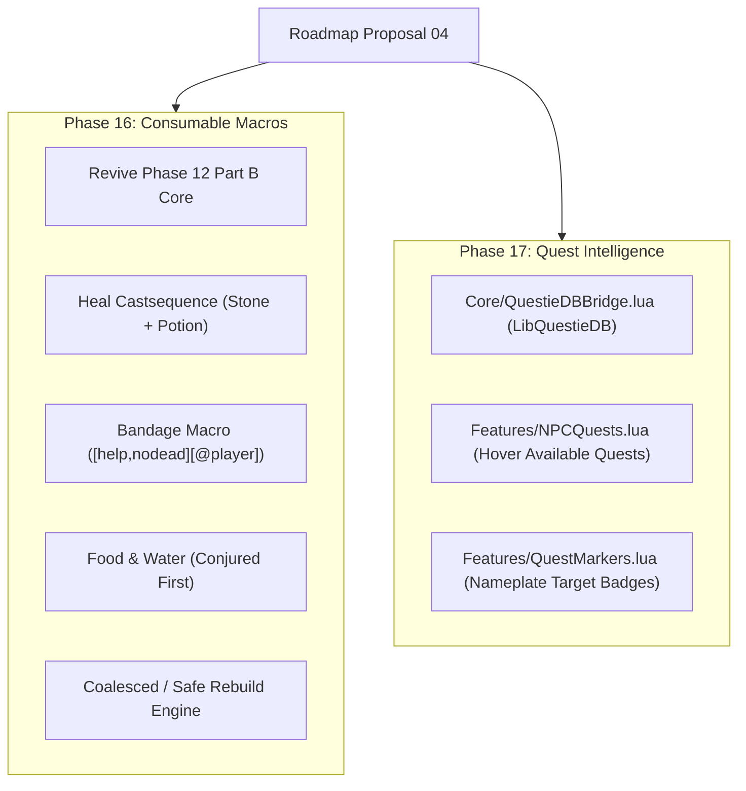
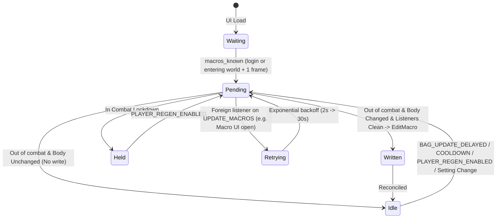

# PersonalAddon — Roadmap Proposal 04

**Date:** October 11, 2026  
**API version:** 1.60.1 (WoW Forever Beta), game type `camelot`  
**Client:** 1.60.1.70338 (`WowB.exe`), UI export 2026-10-11 — `patch_check status` reports `UpToDate`  
**Supersedes:** Phase 12 Part B on-hold status (`20261006-Phase12.md` §1.1, §9.5)  
**Depends on:**  
- `20261006-Phase12.md` rev 3 (Part A settings pages; Part B consumable classification, ranking, bodies, and write path);  
- `20261010-Phase15.md` rev 4 (nameplate restyle, `Core/FramePool.lua`, unit occupancy lifecycle);  
- `Core/ClientRead.lua`, `Core/CallWindow.lua`, `Core/BlockWatch.lua`, `Core/ConfigSchema.lua`;  
- `QuestieDB` companion addon (`Interface\AddOns\QuestieDB\`, `LibQuestieDB`);  
- README "Rules for future development".  
**Revision:** 1  

---

## 1. Scope

This proposal organizes three major capability additions into two phased implementations:

1. **Consumable & Bandage Macros (Phase 16):** Revives and expands Phase 12 Part B. Replaces AutoPotion and DrinkBot with optimal, taint-safe character macros:
   - A dual-use `/castsequence` healing macro (Healthstone + Healing Potion);
   - A dedicated bandage macro (`/use [help,nodead][@player]`) that heals friendly targets or self;
   - Separate Food and Water macros (summoned/conjured first, then highest usable tier);
   - Coalesced, out-of-combat macro reconciliation that avoids AutoPotion's aggressive client writes.
2. **Quest Integration (Phase 17):**
   - **NPC Tooltip Available Quests:** Queries `QuestieDB` at runtime via `LibQuestieDB` to list available quests (name and quest level) on NPC mouseover, filtered to eligible and uncompleted quests only.
   - **Quest Monster Nameplate Markers:** Displays an overhead quest marker icon on nameplates for monsters required by active quests, using `FramePool` parented to `UIParent` to avoid nameplate taint.

### 1.1 Decisions (Question Round 1, 2026-10-11)

| # | Decision | Consequence |
|---|---|---|
| D1 | **Dedicated Bandage Macro:** Separate `PA Bandage` macro healing friendly target or self | Uses `[help,nodead][@player]` targeting logic. Scans bandages in bags, checks First Aid skill / required level, and picks highest usable tier. |
| D2 | **No combined Rest macro:** Food and water stay separate macros | Food macro (`PA Food`) and Water macro (`PA Water`) are maintained independently. No dual Eat+Drink macro. |
| D3 | **Summoned/Conjured first:** Healing and food/water prioritize summoned items | Healthstone before potion on ties or ready cooldowns; conjured water/food before vendor consumables. |
| D4 | **Runtime `QuestieDB` binding:** Consume `QuestieDB` via `LibQuestieDB` | `Questie` itself stays disabled/unloaded; `QuestieDB` (already present in `Interface\AddOns\QuestieDB\`) remains enabled as a data provider. No redundant 13 MB database duplicated in PersonalAddon. |
| D5 | **Available quests only on NPC hover:** Filter out ineligible quests | Quests already completed (`C_QuestLog.IsQuestFlaggedCompleted`) or active in log (`C_QuestLog.GetLogIndexForQuestID`) are omitted. Level, race, and class requirements are enforced. |
| D6 | **Nameplate icon only for quest monsters:** No tooltip clutter for quest mobs | Active quest kill-target monsters receive an overhead badge on their nameplate. Tooltips remain clean. |
| D7 | **Two-phase delivery:** Phase 16 then Phase 17 | Phase 16 isolates macro safety, combat lockdown, and bag scanning. Phase 17 isolates `QuestieDB` data ingestion, tooltip hooks, and nameplate icon pooling. |

### 1.2 Structure of Delivery



---

## 2. Phase 16 — Consumable & Bandage Macros

### 2.1 Why Replace AutoPotion and DrinkBot?

1. **AutoPotion's inefficiencies and limitations:**
   - **Rigid macro logic:** AutoPotion chooses either a potion *or* a healthstone, but cannot sequence them within a single fight without overwriting the macro in combat (which the client forbids).
   - **Excessive macro writes:** AutoPotion rewrites all 5 macros 0.5 s after every combat, on every equipment change, on loading screens, and 3 s after every bag change—even when the macro body is completely unchanged. Under Blizzard's Gamepad UI, unnecessary writes into client macro slots increase exposure to `activeBar` taint cascades (`PageUnit.lua:546–547`).
2. **DrinkBot's obsolescence:**
   - DrinkBot depends on unmaintained internal libraries and throws Lua errors on recent client builds.
   - It forces macro updates after every combat regardless of bag state.
3. **PersonalAddon's design advantage:**
   - Evaluates bag candidates out of combat.
   - Diff checks planned body against current body: **zero client writes** if the macro body is already optimal.
   - Enforces `CallWindow.Listeners(WRITE_INLINE_EVENTS)` to prevent execution while the Macros window or action bar editors are open.

### 2.2 What Ships in Phase 16

| Item | Kind | File |
|---|---|---|
| `Features/ConsumableMacros.lua` | Feature | New |
| Schema keys for macro names, distinctness, and toggles | Substrate | `Core/ConfigSchema.lua` |
| Settings page additions on `Consumables` | Feature | `Features/SettingsPanel.lua` |
| `/pa consumables` diagnostic command | Command | `Core/Debug.lua` |
| Diagnostics counters in `PersonalAddonDiagnostics` | Substrate | `Core/Diagnostics.lua` |
| Premises 30–37 from Phase 12 §11 | Tooling | `Tools/patchcheck/premises.toml` |
| Spike S verification report | Documentation | Phase 16 design doc |

### 2.3 Macro Kinds and Generated Bodies

Four character-specific macros are maintained:

| Kind | Default Name | Planned Body | Rules |
|---|---|---|---|
| **Healing** | `PA Heal` | `#showtooltip`<br>`/castsequence reset=combat item:<stone>, item:<potion>` | If both carried: item with shortest cooldown first; stone on tie. If only one carried: `/use item:<id>`. If none: `#showtooltip`. |
| **Bandage** | `PA Bandage` | `#showtooltip`<br>`/use [help,nodead][@player] item:<bandage>` | Targets friendly unit if targeting a living ally; otherwise targets player. Checks First Aid skill and level. |
| **Food** | `PA Food` | `#showtooltip`<br>`/use item:<food>` | Conjured food first if `conjuredFirst`; highest required level. Skips Well Fed food if `skipBuffFood`. |
| **Water** | `PA Water` | `#showtooltip`<br>`/use item:<water>` | Conjured water first if `conjuredFirst`. Only created/maintained on mana-using classes. |

### 2.4 Classification and Item Ranking

1. **Signals:**
   - **Food:** Spell 433 name (`C_Spell.GetSpellName(433)`).
   - **Water:** Spell 430 name (`C_Spell.GetSpellName(430)`).
   - **Healing Potion:** Spell 439 name (`C_Spell.GetSpellName(439)`).
   - **Healthstone:** Explicit ID match against the 15 Classic healthstone IDs (Phase 12 §6.1).
   - **Bandage:** Spell 1195 ("Bandage") or item subclass `Enum.ItemConsumableSubclass.Bandage`.
   - **Conjured:** Tooltip line matches `ITEM_CONJURED`.
   - **Well Fed:** Tooltip line contains Spell 19705 name ("Well Fed").
2. **Ranking criteria:**
   - Usable: `requiredLevel <= UnitLevel("player")` and player meets skill requirements (First Aid for bandages).
   - Priority: `conjured` (if `conjuredFirst` is true) > `requiredLevel` > `itemLevel` > `itemId`.
3. **Cooldown reconciliation:**
   - Monitored via `BAG_UPDATE_COOLDOWN`. When a healthstone or potion cooldown completes out of combat, a 1-frame coalesced rebuild re-sequences the macro so the ready item leads.

### 2.5 Macro Lifecycle and Write Safety



- **Zero-write optimization:** If the planned body matches `GetMacroInfo(index)`, no call to `EditMacro` is made.
- **Listener gate:** No write occurs while `MacroFrame` is open (`UPDATE_MACROS` listener check).
- **Combat lock:** All writes defer until `PLAYER_REGEN_ENABLED`.

---

## 3. Phase 17 — Quest Intelligence (Tooltips & Nameplate Markers)

### 3.1 Architectural Seam: `Core/QuestieDBBridge.lua`

PersonalAddon will not duplicate Questie's 13 MB database. Instead, it interfaces directly with `LibQuestieDB` provided by the `QuestieDB` addon folder:

```
Interface/AddOns/
├── Questie/           (Disabled by user)
├── QuestieDB/         (Enabled in AddOns list; loads LibQuestieDB)
└── PersonalAddon/     (Consumes LibQuestieDB via Core/QuestieDBBridge.lua)
```

**Bridge Contract:**
```
type QuestieBridgeState = Available | AddonMissing | ContractMismatch | Errored(string)

# Safe accessor for QuestieDB runtime data
function QuestieDBBridge.GetState() -> QuestieBridgeState
function QuestieDBBridge.GetNPCQuests(npcId: integer) -> List<QuestSummary>
function QuestieDBBridge.GetQuestDetails(questId: integer) -> Optional<QuestRecord>
function QuestieDBBridge.GetActiveQuestKillObjectives() -> Map<NpcId, List<ObjectiveStatus>>
```

- **Guard against missing provider:** If `QuestieDB` is disabled or not installed, the bridge safely flags `AddonMissing`. Quest tooltips and markers cleanly stand down without throwing errors or tainting the UI.
- **Memory isolation:** PersonalAddon only queries lookup keys; it does not write to or mutate `QuestieDB` tables.

### 3.2 Part 1: NPC Tooltip Available Quests

When hovering over an NPC (`"mouseover"` unit), display which quests that NPC offers that the player can actually accept.

```
+---------------------------------------------------+
| Marshal Dughan                                    |
| Level 35 Human                                    |
| Stormwind Guard                                   |
|                                                   |
| Available Quests:                                 |
|   [10] Gold Dust Exchange                         |
|   [11] A Fishy Peril                              |
|   [12] Further Concerns                           |
+---------------------------------------------------+
```

#### Filtering Pipeline
For each quest ID in `npcData[npcId].starts`:
1. **Completion Check:** Skip if `C_QuestLog.IsQuestFlaggedCompleted(questId)` is true.
2. **Current Log Check:** Skip if the quest is already in the player's quest log (`C_QuestLog.GetLogIndexForQuestID(questId) > 0`).
3. **Level Requirement:** Skip if `playerLevel < quest.requiredLevel`.
4. **Race / Class Restrictions:** Filter against `UnitRace("player")` and `UnitClass("player")` bitmasks from `QuestieDB`.
5. **Prerequisite Check:** Query `QuestieDB.preQuestSingle` / `preQuestGroup` to ensure prerequisites are satisfied.
6. **Difficulty Color-coding:** Color-code `[level]` using Blizzard's standard quest difficulty formula:
   - Red: Very difficult (`questLevel >= playerLevel + 5`)
   - Orange: Difficult (`questLevel >= playerLevel + 3`)
   - Yellow: At player level (`questLevel >= playerLevel - 2`)
   - Green: Low level / easy
   - Grey: Trivial (`no XP`)

### 3.3 Part 2: Quest Target Nameplate Markers

Show an overhead quest icon directly on the nameplates of monsters required for an active quest.

```
       [!]  <-- PersonalAddon Quest Icon (FramePool, parented to UIParent)
   +---------+
   | [Mob HP]|
   +---------+
    Defias Rogue
```

#### Lifecycle & Nameplate Anchor Rules
- **Rule 6 Compliance:** To prevent Gamepad UI taint cascades, the icon frame **MUST NOT be parented to Blizzard's NamePlate frame**.
- **`FramePool` Allocation:** Icons are allocated from `Core/FramePool.lua`, parented to `UIParent`, and anchored to `nameplate.UnitFrame` on `NAME_PLATE_UNIT_ADDED`.
- **Unit Occupancy Lifecycle:**
  1. `NAME_PLATE_UNIT_ADDED(unitToken)`:
     - Read creature GUID: `UnitGUID(unitToken)`.
     - Extract `npcId = select(6, strsplit("-", guid))`.
     - Check `QuestieDBBridge.IsActiveKillTarget(npcId)`.
     - If true: acquire icon frame from pool, anchor above health bar, set texture (`Interface\QuestFrame\UI-Quest-BulletPoint` or Questie objective icon), and show.
     - If false: release frame to pool and hide.
  2. `NAME_PLATE_UNIT_REMOVED(unitToken)`:
     - Release icon frame back to pool.
  3. `QUEST_LOG_UPDATE`:
     - Rebuild active objective map.
     - Sweep currently visible plates; if a quest objective is completed (e.g. 10/10 slain), hide the icon immediately.

---

## 4. Settings and Configuration

### 4.1 Consumables Page (`Options > AddOns > PersonalAddon > Consumables`)

Maintained on the `Consumables` page registered in Phase 12 Part A:

| Setting | Kind | Default | Description |
|---|---|---|---|
| `healMacro` | Toggle | `true` | Maintain dual Healthstone/Potion healing macro |
| `bandageMacro` | Toggle | `true` | Maintain bandage macro (`[help,nodead][@player]`) |
| `foodMacro` | Toggle | `true` | Maintain food macro |
| `waterMacro` | Toggle | `true` | Maintain water macro (mana users only) |
| `conjuredFirst` | Toggle | `true` | Use conjured/summoned consumables first |
| `skipBuffFood` | Toggle | `true` | Never consume "Well Fed" food |
| `healMacroName` | Text | `PA Heal` | Character macro name for healing (1–16 chars) |
| `bandageMacroName`| Text | `PA Bandage`| Character macro name for bandages (1–16 chars) |
| `foodMacroName` | Text | `PA Food` | Character macro name for food (1–16 chars) |
| `waterMacroName`| Text | `PA Water`| Character macro name for water (1–16 chars) |

### 4.2 Quest Settings (`Options > AddOns > PersonalAddon > Quests`)

A new settings subcategory, **Quests**, registered under the PersonalAddon parent:

| Setting | Kind | Default | Description |
|---|---|---|---|
| `showNpcQuests` | Toggle | `true` | Show available quests and levels in NPC mouseover tooltips |
| `nameplateMarkers`| Toggle | `true` | Show quest markers on enemy nameplates for active quest targets |
| `markerIconScale` | Slider | `1.0` | Scale of the nameplate quest icon (80% to 150%) |
| `markerOffsetY` | Slider | `0` | Vertical offset of the nameplate marker in pixels |

---

## 5. Rule Compliance Matrix

| Rule | Phase 16 (Consumables) | Phase 17 (Quests) |
|---|---|---|
| **1. Blizzard never calls ours inline** | Event handlers only record and schedule 1-frame deferred work. `UPDATE_MACROS` is unsubscribed after login. | Tooltip hook runs post-draw (`TooltipDataProcessor`). Nameplate updates run on `NAME_PLATE_UNIT_ADDED`/`REMOVED` and `QUEST_LOG_UPDATE`. |
| **2. Never write into Blizzard tables** | Writes only to client macro slots (`CreateMacro`/`EditMacro`) and `PersonalAddonDB`. | Read-only access to `LibQuestieDB`. Nothing written to Blizzard or Questie tables. |
| **3. Stay out of panel system** | No panel interactions. | No panel interactions. |
| **4. Hooks are secure post-hooks** | No script hooks. | `TooltipDataProcessor.AddTooltipPostCall` or secure post-hook on tooltip unit set. |
| **5. Defer work 1 frame** | Macro planning and writing executes on `C_Timer.After(0)` from internal queue. | Objective changes coalesce 1 frame before re-evaluating visible nameplates. |
| **6. Own frames parented to UIParent** | If click-path is needed: hidden secure buttons parented to `UIParent`. | Quest marker icon frames are parented to `UIParent` and anchored to nameplates. |
| **7. Never call protected functions** | Macros written strictly out of combat (`PLAYER_REGEN_ENABLED`). | No protected functions called. |
| **8. Panel changes require test** | No Blizzard panel changes. | No Blizzard panel changes. |
| **9. Synchronous event guard** | All macro writes wrapped in `CallWindow.Capture` with listener checks. | No state-mutating calls that raise synchronous events. |
| **10. Secrecy-safe reads** | All unit power, health, and bag reads through `ClientRead`. | Unit GUIDs and quest log queries guarded with `ClientRead`. |
| **11. Premises recorded** | Premises 30–37 from Phase 12 §11 activated. | New premises for `LibQuestieDB` and tooltip processor hooks recorded in `premises.toml`. |

---

## 6. Verification and Exit Criteria

### 6.1 Phase 16 Exit Criteria (Consumables)
1. **Offline verification:**
   - Harness test suite runs with new consumable macro session (`tests16.lua`): covers food, water, stone+potion castsequence, bandage macro generation, and unchanged body no-op.
   - Secret-read lint: 0 violations.
2. **In-game verification:**
   - Log in carrying a healthstone and health potion: `PA Heal` generates `/castsequence reset=combat item:<stone>, item:<potion>`.
   - First press uses stone; second press uses potion; exiting combat resets sequence.
   - Targeting a damaged party member presses `PA Bandage` to heal them; targeting hostile or none bandages self.
   - Bag updates out of combat update macros smoothly; bag updates in combat wait until combat drops.
   - `/pa blocked` is empty across 3 consecutive dungeon runs.

### 6.2 Phase 17 Exit Criteria (Quests)
1. **Offline verification:**
   - Stubbed `LibQuestieDB` harness session validates NPC quest lookup, prerequisite filtering, and active kill objective mapping.
2. **In-game verification:**
   - Hovering over a quest giver (e.g. Marshal Dughan in Goldshire) lists available quests with correct levels.
   - Completed quests and quests already in the log do not appear.
   - Mobs required for an active quest display an overhead quest icon above their nameplates.
   - Killing the required number of mobs (e.g. 10/10) removes the icon immediately upon completion.
   - `/pa blocked` remains empty.
