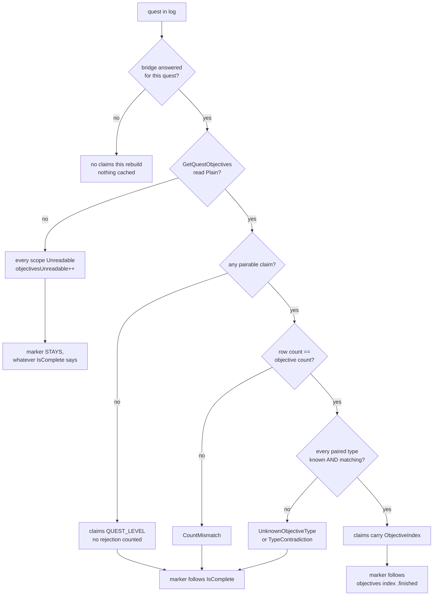
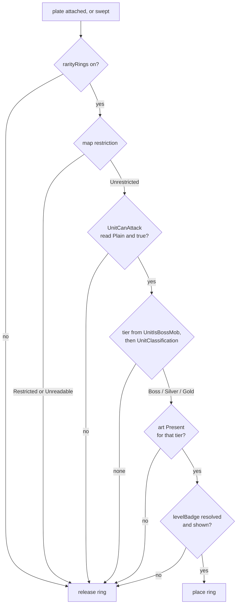

# PersonalAddon — Phase 19 Design: the marker tracks progress, and the plate shows rank

**Date:** October 16, 2026
**API version:** 1.60.1 (WoW Forever Beta), game type `camelot`
**Client:** 1.60.1.70450, UI export 2026-10-16 20:55 — `patch_check check` reports
`Review` (report `Tools/patchcheck/reports/2026-10-16-1.60.1.70450.md`); six premises
touched by file churn, two surface flag changes, **none of them in this phase's
surface**. The export is fresh and the build is the one this design is written
against.
**Implements:** the user's two requests of 2026-10-16, with the decisions of two
question rounds (§1.1):
- a quest marker that **disappears when the objective that named the mob is
  satisfied**, rather than when the quest leaves the log — **ships** (§2, §3);
- **rare and elite icons on the nameplate, encircling the level badge, in the
  client's own artwork** — **ships** (§4).

**Reverses:** Phase 17 decision D11 and the README's *Objective Counter Markers* row.
Both rest on a cost claim that is false on this client, and §2.1 is the correction.

**Depends on:**
- `20261011-Phase18.md` rev 2 — the marker's anchor and offsets, the bridge's
  answered/non-answered cache rule;
- `20261011-Phase17.md` rev 5 — `QuestieDBBridge`, `QuestMarkers`, the plate
  call-outs, the restricted-map stand-down;
- `20261010-Phase15.md` rev 4 — the guild label: a pooled frame of ours anchored to
  a Blizzard sub-frame, released on untrack. **The precedent §4 follows;**
- `20261010-Phase14.md` rev 4 — `HealthBarsContainer`, the frame whose height is a
  setting, and which the level badge is now anchored to;
- `20261002-Phase10.md` §7.1 — `Core/MapRestriction.lua`;
- README "Rules for future development".
**Revision:** 2 — audit dispositions in §15.

---

## 1. Scope

Two features. One changes what an existing marker means; the other draws something
the client has the artwork for and deliberately does not draw.

### 1.1 Decisions

| # | Question | Answer (2026-10-16) | Where |
|---|---|---|---|
| D1 | How a QuestieDB objective row is matched to a client objective | **Ordinal pairing with a type check; any quest that fails falls back to quest-level completion** | §2.2 |
| D2 | Which artwork encircles the level badge | **The target frame's dragon surrounds** — `UI-HUD-UnitFrame-Target-PortraitOn-Boss-Gold`, `-Boss-Rare-Silver-Winged`, `-Boss-Gold-Winged` | §4.3 |
| D3 | Which plates get a ring | **Attackable units only, and stood down on restricted maps** | §4.5 |
| D4 | A turn-in marker on quest-ender plates | **No.** Out of scope; `NpcDB.questEnds` stays unused | §1.3 |
| D5 | How the ring is sized against a 28×16 badge | **Full surround**: square-from-width, uniform aspect, spilling above and below the bar | §4.4 |
| D6 | Which settings ship | **All four**, including a toggle that restores Phase 17's marker meaning | §6.2 |

**D6 is taken against this document's recommendation.** The cost is named in §6.3 and
paid: one marker texture now carries two meanings that a player cannot tell apart by
looking at the plate. The mitigation is that `/pa quests` states which meaning is in
force, so "why is this marker still here" is answerable in one command rather than by
reading the settings panel.

### 1.2 What ships

| Item | Kind | Section | File |
|---|---|---|---|
| Objective-aware markers | Feature change | §2 | `Features/QuestMarkers.lua` |
| `KillClaimsForQuest`, replacing `KillTargetsForQuest` | Substrate | §3 | `Core/QuestieDBBridge.lua` |
| Rare and elite rings on the level badge | Feature | §4 | `Features/Nameplates.lua` |
| Constants and the version | Substrate | §6.1 | `Core/Constants.lua` |
| Four settings, two pages | Feature change | §6.2 | `Features/SettingsPanel.lua` |
| `/pa quests` and `/pa plates` additions | Command | §7 | `Core/Debug.lua`, `Core/Diagnostics.lua` |
| Premises 68–74 | Tooling | §8 | `Tools/patchcheck/premises.toml` |
| `tests19.lua`, `stubs19.lua` | Tooling | §11.1 | `Tools/harness/` |
| README | Housekeeping | §9 | `README.md` |
| TOC `1.9.0`, `X-Phase: 19`, `PersonalAddonSpikeLog` removed | Housekeeping | §14 | `PersonalAddon.toc` |

### 1.3 Not possible, or out of scope

- **Turning Blizzard's own rarity icon on (D2's rejected route).** The client has the
  whole feature already: `NamePlateClassificationFrameMixin` picks
  `nameplates-icon-elite-gold`, `nameplates-icon-elite-silver` or
  `UI-HUD-UnitFrame-Target-PortraitOn-Boss-Rare-Star` from `UnitClassification` and
  draws it on the plate. Camelot closes both of its gates on purpose:
  `Blizzard_NamePlates/Camelot/Blizzard_NamePlateFrameOptionsOverrides.lua:1` sets
  `NamePlateEnemyFrameOptions.showClassificationIndicator = false`, and
  `Blizzard_SettingsDefinitions_Frame/Camelot/NameplatesOverrides.lua:20-23` hides the
  settings checkbox with the comment *"Nameplates don't show Rarity icons in Camelot
  so this option is not needed."* Opening either gate means writing a Blizzard global
  table that Blizzard's plate driver then reads — **README rule 2, verbatim**, and the
  one taint shape this codebase has never knowingly taken. Not a judgement call.
- **Operating Blizzard's per-plate `ClassificationFrame`** (`SetExplicitValues`, or
  `SetAtlas` on its `classificationIndicator`). Its `UpdateShownState` runs on
  `UNIT_CLASSIFICATION_CHANGED`, on the info-display CVar callback and on every
  `SetUnit`, and each of those recomputes `GetClassificationAtlasElement`, which
  returns `nil` while the enemy option is false. We would lose that contest on a
  schedule we do not control — the colour contest of Phase 2, for a decoration. §4
  draws its own frame instead.
- **A turn-in marker (D4).** `NpcDB.questEnds` is reachable and the pool and lifecycle
  would be reused, but it is a second marker with a second meaning and the user
  declined it. Recorded so the next phase inherits the knowledge, not the work.
- **Distinguishing `rare` from `rareelite` by artwork.** Camelot's own target frame
  does not: `Camelot/TargetFrameUtils.lua:1-3` lumps both into the silver surround and
  `ShouldShowStar` returns `false`. §4.3 follows the client. The nameplate atlases that
  would distinguish them are the three Camelot does not draw, so their presence in this
  flavour's atlas database is unverified — and a ring that resolves on one client and
  not another is worse than three tiers that always resolve.
- **Objective counts on the plate** (`7/10` beside the marker). Not asked for. The
  numbers are now read, so it is one font string away; it is also text on every quest
  mob's plate, which is the thing Phase 15 found expensive in attention.

### 1.4 Types

```
QuestId            = number
NpcId              = number
ItemId             = number
UnitToken          = string
ObjectiveIndex     = number           # 1-based, the client's own index
ObjectiveSlot      = enum {
                       CreatureKill = 1, Object = 2, Item = 3,
                       Reputation = 4, KillCredit = 5, Spell = 6
                     }

# The scope a claim is satisfied by, as ONE SCALAR so a Lua table can be keyed by
# it: 0 means "no client objective stands behind this claim, so only the quest's own
# completion can satisfy it" (audit finding 2 -- a table indexed by a record
# compares by reference, not by value).
QUEST_LEVEL        = 0
ClaimScope         = ObjectiveIndex | QUEST_LEVEL

# What one NPC id owes one quest. A mob may carry several, from several quests.
# npcId is carried because build_target_set keys TargetSet.byNpcId with it
# (audit finding 1).
ObjectiveClaim     = { npcId: NpcId, questId: QuestId, scope: ClaimScope }

# What QuestieDB says about one quest, in the shape the pairing needs.
TargetClaim        = { npcId: NpcId, slot: ObjectiveSlot, row: number }
QuestObjectiveShape = {
                       claims:      List<TargetClaim>,
                       extraNpcIds: List<NpcId>,
                       rowsBySlot:  Map<ObjectiveSlot, number>,
                       answered:    bool
                     }

# Why a quest could not be paired. Each is counted; each means the same thing for
# behaviour -- that quest's claims become QUEST_LEVEL and follow IsComplete.
# An unreadable objectives list is NOT in here: it is not a pairing outcome but an
# ObjectiveState, and section 2.3 is why (audit finding 4).
PairingRejection   = enum {
                       CountMismatch, TypeContradiction, UnknownObjectiveType
                     }

ObjectiveState     = enum { Outstanding, Satisfied, Unreadable }

# Phase 17's reading set, unchanged, plus one arm.
MarkerReading      = enum {
                       Shown, NotATarget, Released, Withheld, StoodDown, Satisfied
                     }

# One row of C_QuestLog.GetQuestObjectives, as the client documents it
# (QuestLogDocumentation.lua:1581-1592). Only three fields are read.
QuestObjectiveInfo = {
                       text: string, type: string, finished: bool,
                       numFulfilled: number, numRequired: number
                     }

# The marker feature's own state, as section 2.3 reads it.
MarkerSettings     = {
                       markerScale: number, markerOffsetX: number,
                       markerOffsetY: number, markersIgnoreProgress: bool
                     }
Clock              = { now: () -> number }

# satisfied is two levels deep and keyed by scalars throughout, so
# read_objective_states and marker_wanted index it the same way (finding 2).
TargetSet          = {
                       byNpcId:   Map<NpcId, List<ObjectiveClaim>>,
                       satisfied: Map<QuestId, Map<ClaimScope, ObjectiveState>>,
                       npcCount: number, questsSeen: number,
                       questsExpected: number, builtAt: number, complete: bool
                     }

# Nameplates' per-plate record (Phase 15, Phase 17 section 4.1), plus this phase's
# two fields.
PlateRecord        = {
                       frame: Frame, unitFrame: Frame, healthBar: StatusBar,
                       container: Frame, levelBadge: Frame | None,
                       unitToken: UnitToken, scope: PlateScope,
                       rarityTier: ClassificationTier | None,
                       rarityRing: Frame | None,
                       ...                       # Phase 2, 14, 15 and 17 fields
                     }
NameplateSettings  = {
                       rarityRings: bool, rarityRingSize: number,
                       rarityRingOffsetX: number, rarityRingOffsetY: number,
                       ...                       # Phase 2, 14 and 15 settings
                     }

ClassificationTier = enum { Boss, Silver, Gold }

# aspect is info.height / info.width from C_Texture.GetAtlasInfo's AtlasInfo
# (TextureUtilsDocumentation.lua:204-218), and is the only thing kept from it.
AtlasInfo          = { width: number, height: number, ... }
RingArt            = { atlas: string, aspect: number }
RingResolution     = Present(RingArt) | Missing(atlas: string)
RingPlacement      = Placed | BadgeUnmeasured | NoBadge | NotRanked | StoodDown
```

---

## 2. The marker disappears when the objective is satisfied

### 2.1 Phase 17 was wrong about what this costs

The README row reads: *"Tracking exact objective counts (e.g. 7/10) requires polling
all log entries per unit death; marker signals active objective target."* The file
header says the same: *"tracking progress would need a read per quest and a plate
sweep per kill."*

Both describe a design nobody has to build. Progress is not sampled per death; it is
**announced**, and the announcement is the event this feature already subscribes to:

- `C_QuestLog.GetQuestObjectives(questID)` is documented
  (`QuestLogDocumentation.lua:477-491`), carries `SecretArguments =
  "AllowedWhenUntainted"` and **no** `SecretWhen*Restricted` flag, and returns
  `QuestObjectiveInfo` rows with `finished`, `numFulfilled` and `numRequired`
  (`:1581-1592`). It is flagged `MayReturnNothing`, which is a readable failure, not a
  secret.
- Objective progress changes the quest log, so it raises `QUEST_LOG_UPDATE`. That event
  is `UniqueEvent` — it can never arrive inside one of our calls — and
  `Features/QuestMarkers.lua` has subscribed to it since Phase 17, coalescing bursts
  through a cancellable `NewTimer(0)`.

So the cost is: **two client calls and one table allocation per quest in the log, once
per `QUEST_LOG_UPDATE` burst.** The rebuild already walks up to
`QUEST_LOG_INDEX_MAXIMUM` log indices calling `GetQuestIDForLogIndex` on each, and
already runs exactly once per burst. This roughly doubles a pass that happens a handful
of times a minute. There is no per-kill sweep anywhere in it: the kill raises the
event, the event rebuilds the snapshot, and `refreshMarkers` — which Phase 17 already
calls at the end of every rebuild — re-reads every plate on screen.

`GetQuestObjectiveInfo(questID, index, false)` would allocate nothing, being a
per-objective scalar call. It is **undocumented** — absent from
`Blizzard_APIDocumentationGenerated` entirely, so it carries no secrecy, restriction or
nilability contract at all. The documented call is used and the allocation accepted. If
a spike ever shows the allocation mattering, that is the optimisation, and it needs the
spike first.

### 2.2 Pairing QuestieDB's rows to the client's objectives (D1)

The two sources disagree about shape. QuestieDB answers by **type**: `objectives(questId)`
is a tuple whose slot 1 holds creature-kill rows, slot 3 item rows, slot 5 kill-credit
rows. The client answers by **position**: `GetQuestObjectives` is an ordered list,
1..N, and `finished` is a property of a position. Nothing in either source states the
relation between them.

The relation assumed here is the one Questie itself assumes: **the client's list is the
concatenation of QuestieDB's slots in slot order.**

**And QuestieDB publishes the exceptions to it.** `LibQuestieDB.ObjectiveFirst`
(`QuestieDB/src/corrections/_end.lua:18`, fed by `src/corrections/compat.lua:39-45`)
is five sets of quest ids — `itemObjectiveFirst`, `killCreditObjectiveFirst`,
`objectObjectiveFirst`, `spellObjectiveFirst`, `eventObjectiveFirst` — and
`compat.lua`'s own comment calls them *"consumer hints about objective ordering, not
entity data, so they are collected and published rather than merged into the
database."* The Forever flavour carries four
(`src/corrections/Forever/foreverQuestFixes.lua:15-18`): quests 92682, 97277 and 97485
put their item objective first, and 94489 puts its kill-credit objective first.

So the slot order is **not** a flat assumption; it is a default with a published
per-quest override, and the pairing consults it:

```
# The order QuestieDB's slots appear in the client's objective list for one quest.
# pre:  none
# post: the default slot order, with the one slot named by LibQuestieDB.ObjectiveFirst
#       moved to the front when that set holds this quest id.
#       The default order unchanged when the hint tables cannot be read: a hint is an
#       improvement on the default, never a precondition for it.
#       eventObjectiveFirst is deliberately NOT honoured -- it names a client
#       objective QuestieDB models no row for, so such a quest fails the count check
#       below and goes quest-level, which is the honest outcome.
# raises: never
function slot_order_for_quest(questId: QuestId) -> List<ObjectiveSlot>:
    ...
```

An assumption drawn from another addon's behaviour is not a premise, so even with the
hints applied it is **checked, per quest, before it is used**:

```
# Resolves one quest's claims against the client's objective list. All-or-nothing
# per quest: a pairing that is right for some rows and wrong for others shifts every
# index after the wrong one, so a partially-trusted pairing is rejected whole.
# pre:  shape.answered; clientObjectives is the Plain return of GetQuestObjectives
# post: on success every TargetClaim carries the ObjectiveIndex it pairs with, and
#       every extraNpcId carries QUEST_LEVEL.
#       On rejection the SAME claim list comes back with every scope QUEST_LEVEL --
#       the list is returned either way and only the scopes differ (finding 1), so
#       no caller can lose a claim by taking the failure arm -- and the rejection
#       reason is counted.
#       A quest with no pairable claim skips the count check entirely: there is
#       nothing to index, and a quest whose only creature reference comes from
#       extraObjectives would otherwise be counted as a CountMismatch it cannot
#       avoid (finding 6).
# raises: never
function resolve_claims(
    questId: QuestId,
    shape: QuestObjectiveShape,
    clientObjectives: List<QuestObjectiveInfo>
) -> (List<ObjectiveClaim>, PairingRejection | None):
    if length(shape.claims) == 0:
        return (quest_level_claims(questId, shape), None)

    order: List<ObjectiveSlot> = slot_order_for_quest(questId)
    totalRows: number = sum(shape.rowsBySlot)
    if totalRows != length(clientObjectives):
        return (quest_level_claims(questId, shape), CountMismatch)

    for claim in shape.claims:
        index: ObjectiveIndex = objective_index_for_row(claim.slot, claim.row, shape.rowsBySlot, order)
        expected: string = CLIENT_OBJECTIVE_TYPE_FOR_SLOT[claim.slot]
        actual: string = clientObjectives[index].type
        if actual is not a key of KNOWN_OBJECTIVE_TYPES:
            return (quest_level_claims(questId, shape), UnknownObjectiveType)
        if actual != expected:
            return (quest_level_claims(questId, shape), TypeContradiction)

    paired: List<ObjectiveClaim> = []
    for claim in shape.claims:
        paired.append(ObjectiveClaim(
            npcId = claim.npcId,
            questId = questId,
            scope = objective_index_for_row(claim.slot, claim.row, shape.rowsBySlot, order)))
    for npcId in shape.extraNpcIds:
        paired.append(ObjectiveClaim(npcId = npcId, questId = questId, scope = QUEST_LEVEL))
    return (paired, None)
```

```
# The client objective index one QuestieDB row occupies, in the given slot order.
# pre:  rowsBySlot carries a count for every slot, zero included; order is a
#       permutation of the six slots
# post: returns a 1-based index into the client's objective list
# raises: never
function objective_index_for_row(
    slot: ObjectiveSlot,
    row: number,
    rowsBySlot: Map<ObjectiveSlot, number>,
    order: List<ObjectiveSlot>
) -> ObjectiveIndex:
    preceding: number = 0
    for earlier in order:
        if earlier == slot:
            break
        preceding = preceding + rowsBySlot[earlier]
    return preceding + row
```

**The type check is strict, and `UnknownObjectiveType` is a rejection rather than a
shrug.** The six strings in `CLIENT_OBJECTIVE_TYPE_FOR_SLOT` are the one unverified
element of this phase: the UI export contains consumers for `"progressbar"` only
(`Blizzard_ObjectiveTracker/Blizzard_QuestObjectiveTracker.lua:255`), so the vocabulary
`"monster"`, `"object"`, `"item"`, `"reputation"`, `"spell"` comes from outside the
export and must be confirmed in game (§11.3 check 1). If any of it is wrong on this
client, **every quest falls back to quest-level completion** — the feature degrades to
"markers go when the quest is done", which is correct, visible in one `/pa quests`, and
fixed by one constant table. The alternative reading — accept an unknown type and hope
the order holds — buys the per-objective arm on day one at the price of possibly hiding
a marker on the wrong mob. A marker that is absent when it should be present is
indistinguishable from "this mob is not a quest target", which is the exact reasoning
Phase 17 §4.3 used to stand the feature down in dungeons. The same reasoning applies
here and produces the same answer.



**The unreadable arm does not go through the pairing at all** (finding 4). A
non-`Plain` `GetQuestObjectives` is not a statement about ordering, so it is not a
`PairingRejection`; it makes every scope of that quest `Unreadable`, which §2.4 reads
as "keep the marker". Downgrading to `QUEST_LEVEL` instead would consult `IsComplete`
on a quest we just failed to read, and a complete-but-unreadable quest would silently
drop every marker it owns. One counter, `objectivesUnreadable`, covers it; there is no
`pairingUnreadable`.

### 2.3 The satisfaction snapshot

Reading `finished` per plate would put a client call on the plate path. It does not go
there: the rebuild produces a snapshot, and the plate path consults it.

```
# Rebuilds the kill-target set and the satisfaction snapshot together. Replaces
# Phase 17's build_kill_targets.
# pre:  the feature is enabled and the bridge is Available
# post: returns a TargetSet whose byNpcId maps an NpcId to every ObjectiveClaim on
#       it, and whose satisfied is satisfied[questId][scope] -> ObjectiveState, two
#       levels of scalar keys (finding 2).
#       On an unreadable log count the PREVIOUS set is returned unchanged -- Phase
#       17's rule, kept: markers must not all vanish because of one failed read.
#       When settings.markersIgnoreProgress is true no objective and no completion
#       is read at all and satisfied is left empty, which section 2.4 reads as
#       Outstanding for every claim.
# raises: never
function build_target_set(
    previous: TargetSet | None,
    settings: MarkerSettings,
    clock: Clock
) -> TargetSet:
    ...
```

Per quest, inside that pass:

```
# One quest's objective states, for the snapshot.
# pre:  questId is in the log; scopes holds every ClaimScope this quest's claims use
# post: Satisfied for an index whose row read Plain and whose finished is true;
#       Outstanding for a Plain row that is not finished;
#       Unreadable for EVERY scope of a quest whose objectives read was not Plain,
#       and for the QUEST_LEVEL scope whose IsComplete read was not Plain.
#       An index beyond the list the client returned is Unreadable, not Satisfied:
#       the pairing passed the count check at rebuild time, so a short list now
#       means the log moved under us, not that the objective is done.
#       Unreadable keeps a marker (section 2.4): "could not tell" is not permission
#       to hide something (README rule 10).
# raises: never
function read_objective_states(
    questId: QuestId,
    scopes: Set<ClaimScope>
) -> Map<ClaimScope, ObjectiveState>:
    ...
```

And the helper both arms of `resolve_claims` return through:

```
# Every claim this quest owns, with nothing but the quest's own completion behind it.
# pre:  none
# post: one ObjectiveClaim per TargetClaim and per extraNpcId, each carrying its
#       npcId and QUEST_LEVEL. Length equals length(shape.claims) +
#       length(shape.extraNpcIds), so the rejection arm loses no claim (finding 1)
# raises: never
function quest_level_claims(
    questId: QuestId,
    shape: QuestObjectiveShape
) -> List<ObjectiveClaim>:
    ...
```

### 2.4 What the plate path now asks

```
# Whether a marker belongs on this NPC id.
# pre:  set is the current TargetSet
# post: true while ANY claim on this NpcId is Outstanding or Unreadable, false only
#       when EVERY claim is Satisfied. A mob wanted by two quests keeps its marker
#       until both are satisfied; a mob that is both a kill target and a drop source
#       for the same quest keeps it until both of those are.
#       A scope absent from the snapshot is Outstanding, which is what makes
#       markersIgnoreProgress a no-read path (section 2.5)
# raises: never
function marker_wanted(set: TargetSet, npcId: NpcId) -> bool:
    claims: List<ObjectiveClaim> = set.byNpcId[npcId]
    if claims == None:
        return false
    for claim in claims:
        byQuest: Map<ClaimScope, ObjectiveState> = set.satisfied[claim.questId]
        if byQuest == None or byQuest[claim.scope] != Satisfied:
            return true
    return false
```

`attach_marker` changes in one place: where it asked `if not targets().byNpcId[npcId]`
and returned `NotATarget`, it asks `marker_wanted` and distinguishes the two outcomes —
a mob that was never a target counts `notTargeted` and returns `NotATarget`; a mob whose
claims are all satisfied counts `satisfied` and returns the new `Satisfied` reading.
Both release the marker. They are separated because they are different facts about the
world and Phase 17's own lesson, learned twice, is that an arm which counts nothing is
the arm you cannot diagnose.

### 2.5 The toggle that restores Phase 17 (D6)

`markersIgnoreProgress`, default off. When on, `build_target_set` skips every objective
and completion read, and every claim is `Outstanding`. The marker then means exactly
what Phase 17's header says it means, the feature costs exactly what it cost before,
and the file header must say both things rather than one.

---

## 3. The bridge gives claims, not a flat id list

`KillTargetsForQuest(questId) -> List<NpcId>` cannot support §2.2: the pairing needs to
know which slot and row an id came from, and needs the row count of **every** slot —
including the object, reputation and spell slots that name no creature — because those
rows occupy client objective indices and shift everything after them.

It is **kept as a derived accessor**, not deleted. This document first said it was
replaced outright because `Features/QuestMarkers.lua` was its only caller; that was
wrong — `tests17.lua:124` and `tests18.lua:221,231` call it too, and §13's criterion
that every earlier session passes unchanged outranks deleting a six-line accessor. The
cache lives once, in the claims path; `KillTargetsForQuest` flattens the claims and the
extras into the distinct id list Phase 17 shipped.

```
# The NPC ids one quest names, each tagged with the objective row that named it.
# pre:  the bridge is Available
# post: claims holds one TargetClaim per DISTINCT (npcId, slot, row) -- not per
#       distinct npcId: a creature that must be killed AND drops the quest's item is
#       two claims, and collapsing them to one would drop its marker the moment the
#       first of the two finished (finding 8);
#       extraNpcIds holds the ids drawn from extraObjectives, distinct by npcId and
#       excluding any npcId already in claims, since a QUEST_LEVEL claim beside a
#       paired one for the same mob could only keep a satisfied marker alive;
#       claims and extraNpcIds SHARE the QUEST_TARGETS_PER_QUEST_MAXIMUM budget, so
#       one quest cannot fill the set on its own whichever source its ids come from;
#       rowsBySlot carries a count for all six slots, zero included, and slot 4 is
#       counted by shape rather than by length (see below, finding 5);
#       answered is false unless QuestDB.objectives, QuestDB.extraObjectives AND
#       every ItemDB.npcDrops read that slot 3 required all answered, in the Phase 18
#       sense -- an unanswered shape is NOT CACHED, for the reason Phase 18 section 5
#       records: a cache this code never invalidates must not keep a failed read.
# raises: never
function kill_claims_for_quest(questId: QuestId) -> QuestObjectiveShape:
    ...
```

**Slot 4 is not an array, and counting it as one shifts every slot after it.**
`QuestieDB/Types/General.t.lua:46` types the objectives tuple as
`{[1]: CreatureObjective[]?, [2]: ObjectObjective[]?, [3]: ItemObjective[]?,
[4]: ReputationPair?, [5]: KillCreditObjective[]?, [6]: SpellObjective[]?}` — slot 4
is a **single** `{FactionId, number}` pair, not a list of rows. `#objectives[4]` is
therefore `2`, which would inflate `totalRows` by one and shift the kill-credit and
spell indices by one, turning every reputation quest into a `CountMismatch`:

```
rowsBySlot[Reputation] = 1 when objectives[4] is a table whose [1] is a number
                         0 otherwise
```

**And `ItemDB.npcDrops` is part of `answered`.** Slot 3 reaches the droppers through a
second entity (`Core/QuestieDBBridge.lua:468-476`); a quest whose item objective
resolved no droppers because that call failed looks exactly like a quest whose item
nobody drops. Since this cache is never invalidated, caching that would mean the mobs
that drop a quest item carry no marker until the user relogs — Phase 18 §5's defect,
in a new place (finding 7).

Three details carried from Phase 17 unchanged, because they were right:

- **The four sources stay four.** Slot 1 and slot 5 name creatures directly; slot 3
  names an item whose droppers come from `ItemDB.npcDrops`; `extraObjectives` holds
  `{"monster", npcId}` references. The first in-game run of Phase 17 is the evidence
  that dropping the item slot drops most "go kill those" quests.
- **An item slot's droppers all claim the same row.** `npcDrops(itemId)` for slot 3 row
  *r* yields many ids and one claim scope — which is correct: when the item objective
  is satisfied, every mob that drops it stops being wanted at once.
- **An answered-empty shape is cached; an unanswered one is not.** Unchanged, and §11.1
  T12 and T13 are the regression tests for it.

`QuestFacts`, `QuestsStartedBy` and `NpcName` are untouched. `NpcDB.questEnds` stays
unread (D4).

---

## 4. Rare and elite rings on the level badge

### 4.1 What the client draws today, and where

The badge the user means is `UnitFrame.PlayerLevelDiffFrame`
(`Blizzard_NamePlates/Blizzard_NamePlates.xml:259`), built from Camelot's
`NameplateLevelFrame` template: a `ui-hud-nameplates-levelindicator` background, the
unit's level in `SystemFont_NamePlateLevel` coloured by difficulty, a
`ui-hud-nameplates-levelindicator-skull` for `level <= 0`, and a
`ui-hud-nameplates-levelindicator-rectangle-selected` border shown only while the unit
is the target or focus. `CompactUnitFrame_UpdatePlayerLevelDiff`
(`Blizzard_UnitFrame/Shared/CompactUnitFrame.lua:1521-1550`) fills and shows it;
Camelot's `ShouldDisplay` hides it only for game objects and for friendly players under
`nameplateShowOnlyNameForFriendlyPlayerUnits`, so **on an attackable NPC it is always
shown.**

The classification ring is not drawn at all, on purpose, and §1.3 is the chain of two
deliberately closed gates. So this is our frame or nothing.

### 4.2 What build 70450 moved, and why it helps

The 70450 patch re-anchored that badge
(`Blizzard_NamePlates/Camelot/Blizzard_NamePlateLevelFrame.xml`, diffed against the
70338 baseline in `C:\tmp\PersonalAddonBaseline`):

```
- <Anchor point="LEFT"      relativeKey="$parent.HealthBarsContainer"           relativePoint="RIGHT"       x="5"/>
+ <Anchor point="TOPLEFT"    relativeKey="$parent.HealthBarsContainer.healthBar" relativePoint="TOPRIGHT"    x="5" y="3"/>
+ <Anchor point="BOTTOMLEFT" relativeKey="$parent.HealthBarsContainer.healthBar" relativePoint="BOTTOMRIGHT" x="5" y="-2"/>
```

Two consequences this design depends on:

1. **The badge's height now follows the health bar** and discards the
   `playerLevelDiffHeight` that `Blizzard_NamePlateUnitFrame.lua:239` sets — the same
   shape Phase 14 found on the bar itself, where two vertical anchors beat a
   `SetHeight`. Our Phase 14 bar-height slider therefore changes the badge's height
   too.
2. **Its width still comes from `SetSize`** (`LEVEL_INDICATOR_WIDTH` 28 ×
   `namePlateScale.classification`, `Blizzard_NamePlates.lua:406-408`) and is
   unaffected by anything we write.

§4.4 sizes the ring from the **width** for exactly this reason: the one dimension our
own bar-height feature cannot move. A ring sized from the badge's height would resize
on every height write, which is the hot path.

### 4.3 The artwork, and the probe (D2)

Camelot's target frame picks classification artwork in
`Blizzard_UnitFrame/Camelot/TargetFrameUtils.lua:9-19`, consumed live at
`Blizzard_UnitFrame/Mainline/TargetFrame.lua:423-427`. Three atlases, in that
precedence:

| Tier | Test | Atlas |
|---|---|---|
| `Boss` | `UnitIsBossMob(unit)` | `UI-HUD-UnitFrame-Target-PortraitOn-Boss-Gold-Winged` |
| `Silver` | classification is `rare` or `rareelite` | `UI-HUD-UnitFrame-Target-PortraitOn-Boss-Rare-Silver-Winged` |
| `Gold` | classification is `elite` | `UI-HUD-UnitFrame-Target-PortraitOn-Boss-Gold` |

This is the "original and existing artwork" the request asked for, and it is the
strongest kind of existence proof available offline: not a name in a disabled code
path, but a name this client's own target frame sets every time the player targets an
elite. `worldboss` is covered by `UnitIsBossMob` the way the target frame covers it;
`minus` and `normal` get nothing.

Atlas membership still cannot be read from the export, so it is probed once per UI
load:

```
# Resolves one tier's artwork, once per UI load.
# pre:  tier is a ClassificationTier
# post: the probe result is remembered for the UI load, and cleared by disable --
#       three C_Texture reads on the next enable are not worth remembering a client
#       that answered oddly once, and it is the only way back to an unprobed state
#       inside a session, which T20 needs.
#       Present(RingArt) when C_Texture.GetAtlasInfo answered Plain with width > 0
#       and height > 0; aspect is height / width and is what section 4.4 sizes with.
#       Missing(atlas) when the read did not answer -- GetAtlasInfo is
#       MayReturnNothing -- or gave no usable size. A Missing tier draws NOTHING and
#       is said once; it is never drawn with another tier's art, because a silver
#       dragon on an elite is a wrong answer and no ring is an honest one.
# raises: never
function resolve_ring_art(tier: ClassificationTier) -> RingResolution:
    ...
```

`SetAtlas` itself reports nothing: it is documented at
`SimpleTextureBaseAPIDocumentation.lua:368-381` with no return value and
`SecretArguments = "AllowedWhenTainted"`, so it cannot refuse the way `SetFont` refused
in Phase 18, and "did not raise" is all there is. That is why existence is established
by `GetAtlasInfo` before anything is drawn, rather than inferred from a silent
`SetAtlas`.

### 4.4 Sizing and placement (D5)

```
# Sizes and places one plate's ring on its level badge.
# pre:  plate.levelBadge resolved; art is Present; settings.rarityRingSize within
#       the schema's bounds
# post: Placed -- the ring's width is badgeWidth * RARITY_RING_WIDTH_FACTOR *
#       rarityRingSize, its height is that width * art.aspect, and its centre sits
#       rarityRingOffsetX / rarityRingOffsetY SCREEN PIXELS from the badge's centre.
#       The ring is our own pooled frame under UIParent: nothing is parented to the
#       plate and no field is written onto any Blizzard frame.
#       BadgeUnmeasured -- the width read did not answer, so
#       LEVEL_INDICATOR_WIDTH_FALLBACK is used, counted, and the ring is still
#       drawn. A ring one patch stale in width beats no ring.
# raises: never
function place_rarity_ring(
    plate: PlateRecord,
    art: RingArt,
    settings: NameplateSettings
) -> RingPlacement:
    ...
```

Two things differ from the quest marker's placement and both are deliberate:

- **The offsets are plain screen pixels, undivided.** Phase 12's rule — divide an
  offset by the scale — exists because the marker is positioned with `SetScale`. The
  ring is positioned with an explicit `SetSize` derived from a measured width, so there
  is no scale to divide by and `rarityRingSize` means "a multiple of the badge's
  width", not "a multiple of the art's native size". Stating it here because the two
  features now have two different meanings for the word *size* on two different
  settings pages.
- **The ring is centred, not edge-anchored.** "Encircle" has only one anchor that makes
  sense, and with a square-from-width ring around a 28×16 badge the art crosses the
  bar's top and bottom edges by roughly six pixels each way. That is the cost D5
  accepted; `rarityRingSize` down to 0.6 and the two offsets are how a player who
  dislikes it moves or shrinks it.

**`PlayerLevelDiffFrame` is the right frame to measure and to centre on, and the
badge's child texture is not** (audit finding 9, rejected). In Camelot's template
`playerLevelDiffIcon` carries `TOPLEFT` **and** `BOTTOMRIGHT` anchors to its parent and
no `<Size>` at all (`Camelot/Blizzard_NamePlateLevelFrame.xml:10-15`), so it fills the
frame exactly; `playerLevelDiffText` is centred in the frame by
`CompactUnitFrame.lua:1536`. Neither this file nor the base template contains a 20×20
`LEFT`-anchored icon or a 24×24 frame. The frame is also the only one of the two whose
width is written — `SetSize(playerLevelDiffWidth, …)` at
`Blizzard_NamePlateUnitFrame.lua:239`, from `LEVEL_INDICATOR_WIDTH` × the
classification scale — so measuring the frame measures the visible art, and centring on
the frame centres on the number. Recorded here because the question will recur at the
next patch that touches this template.

### 4.5 The gate chain (D3)



- **`UnitClassification` is safe to read anywhere.**
  `UnitDocumentation.lua:966-978` gives it `SecretArguments = "AllowedWhenUntainted"`,
  a non-nilable `cstring` return, and **no** `SecretWhen*Restricted` flag. It is
  already read this way by `Features/ThreatPanel.lua:325` for the `+` / `r` tags. So
  the restricted-map stand-down in this chain is **not** a secrecy stand-down like the
  quest markers' — it is D3's product decision, because in a dungeon almost every mob
  is elite and a ring on every plate carries no information. `Unreadable` stands down
  too: rule 10's direction, and here the conservative answer is also the quiet one.
- **`UNIT_CLASSIFICATION_CHANGED` is not subscribed to.** It exists
  (`UnitDocumentation.lua:4158-4167`) and is `SynchronousEvent`, which rule 1 and Phase
  7 §6.4 both say to stay away from. A creature's rank does not change under a live
  plate; the attach path and the sweep are enough.
- **Nothing text-bearing crosses a boundary**, so `EscapeGuard` has no part here. The
  tier comes from a client enum string compared against literals, never drawn.

### 4.6 Where it is re-evaluated, and where it is not

| Path | Runs | Why |
|---|---|---|
| `trackPlate` | per plate attach | **The one place `UnitIsBossMob` and `UnitClassification` are read.** The tier is cached on `plate.rarityTier` and the `tiers seen` counters move here and nowhere else; a recycled plate must not inherit the previous unit's rank, and the read is unconditional — before the `rarityRings`, map and attackable gates — so a plate already up gets its ring the moment a gate opens (finding 10) |
| `untrackPlate` | per plate detach | Releases the ring and clears `plate.rarityTier` before the record goes, beside `releaseGuildLabel` and the marker call-out, for the same reason |
| `rescopePlate` | on `UNIT_FACTION` for a tracked plate | A unit can stop being attackable while its plate is up — a PvP flag drop, a charm ending, a faction change — and gate D would then be stale. This is the one path that re-reads `UnitCanAttack`; the tier itself does not change (finding 11) |
| the sweep | every `sweepInterval` | Catches a badge Blizzard re-laid out — a nameplate style or scale change rewrites `playerLevelDiffWidth` — and a badge whose shown state changed under a live unit. **Outside the sweep's `SCOPE.IN` filter**: `Features/Nameplates.lua:1009-1020` paints only in-scope plates, and a neutral elite is `SCOPE.OUT` by `classifyScope`'s own definition while still being attackable and still deserving a ring |
| `onConfigChanged` | on a slider move **or the toggle** | Re-places every ring on screen without waiting for a plate, as Phase 17 §4.4's refresh does. The `rarityRings` key is the branch that matters: off releases every ring, on places one on every tracked plate that passes the gates (finding 11) |
| **`reassertPlate`** | **never** | **The hot path.** It runs from `CompactUnitFrame_UpdateHealthColor` and `UpdateHealth`, which fire per plate per health tick. A `GetWidth` read plus `SetSize` plus `SetPoint` there is rule 4's $O(1)$ budget spent on a decoration that cannot change between two health ticks. §4.2's choice of the badge's **width** is what makes this safe: the only dimension our own writes move is its height, and the ring does not read it |

The tier cache is also what keeps `tiers seen` meaningful. Read on the sweep instead,
it would count the same elite four times a second and the line would measure the
sweep interval rather than the world.

---

## 5. Where the code lives

The ring goes in `Features/Nameplates.lua`, not a new feature file.

The quest marker is in its own file because it needs QuestieDB and the quest log —
subsystems nameplates knows nothing about — and it pays for that separation with two
call-outs from `trackPlate`/`untrackPlate` and an `adoptTrackedPlates` path to reach
plates that existed before it enabled. The ring needs none of that: it reads two unit
APIs and one Blizzard sub-frame, both already in `resolveParts`' remit. **Phase 15's
guild label is the precedent** — a pooled frame of ours, anchored to a plate sub-frame,
sized from a measured width, released on untrack, with its own settings on the
Nameplates page. A third file would add a third call-out and a second `TrackedPlates`
consumer to buy nothing.

`resolveParts` gains one line: `levelBadge = unitFrame.PlayerLevelDiffFrame or
unitFrame.playerLevelDiffFrame`. Resolved rather than assumed, like `healthBar` and
`container` before it, and for the reason Phase 1 learned: on this client the
well-known name is the one that moves.

---

## 6. Constants and settings

### 6.1 Constants

| Name | Value | Why not inline |
|---|---|---|
| `RARITY_RING_POOL_CAPACITY` | 48 | The guild pool's figure, and the plate cap is ~40 |
| `RARITY_RING_WIDTH_FACTOR` | 1.25 | The default surround, as a multiple of the badge's measured width |
| `RARITY_RING_SIZE_MINIMUM` / `_MAXIMUM` / `_STEP` | 0.6 / 2.0 / 0.05 | The slider's bounds |
| `RARITY_RING_OFFSET_LIMIT` | 24 | ±24 px, tighter than the marker's ±40: the badge is 28 wide and a ring further out than that is not on it |
| `RARITY_RING_STRATA` | `"HIGH"` | §12's open risk: the ring must draw **over** the badge's own box. One constant, one in-game check |
| `LEVEL_INDICATOR_WIDTH_FALLBACK` | 28 | Blizzard's `LEVEL_INDICATOR_WIDTH`, used only when the width read does not answer |
| `RARITY_RING_ATLAS` | the three names of §4.3 | Keyed by tier |
| `QUEST_OBJECTIVE_SLOT` | the six slot numbers | QuestieDB's tuple, named |
| `CLIENT_OBJECTIVE_TYPE_FOR_SLOT` | six strings | **The unverified table.** §11.3 check 1 confirms it |
| `KNOWN_OBJECTIVE_TYPES` | the set above plus `"progressbar"`, `"player"`, `"event"` | An objective type we know of but never pair with: present so a quest carrying one is a `TypeContradiction` rather than an `UnknownObjectiveType`, which are different diagnoses |
| `ns.VERSION` | `"1.9.0-phase19"` | |

### 6.2 Settings

**Quests page** (`settingsOrder` 20, `questMarkers`), one new control after the three
Phase 18 ones:

| Key | Kind | Label | Default |
|---|---|---|---|
| `markersIgnoreProgress` | `TOGGLE` | *Keep markers until the quest leaves the log* | `false` |

> Description: *Off, a marker goes as soon as you have killed or collected enough for
> the objective that named the mob. On, it stays while the quest is in your log, which
> is what you want if you are farming a mob you have already finished with.*

**Nameplates page** (`settingsOrder` 10, `nameplates`), four new controls after
`guildFontSize`:

| Key | Kind | Label | Default | Bounds |
|---|---|---|---|---|
| `rarityRings` | `TOGGLE` | *Rare and elite rings* | `true` | |
| `rarityRingSize` | `NUMBER`, `FRACTION` | *Ring size* | `1.0` | 0.6–2.0, step 0.05 |
| `rarityRingOffsetX` | `NUMBER`, `PIXELS` | *Ring offset, left and right* | `0` | ±24, step 1 |
| `rarityRingOffsetY` | `NUMBER`, `PIXELS` | *Ring offset, up and down* | `0` | ±24, step 1 |

`rarityRings`' description states the three things a player cannot see from the ring
itself: the artwork is the game's own target-frame dragon, rare and rare-elite share
the silver one because the game's own target frame does, and it is off in dungeons and
raids where nearly everything is elite.

Every number is compared against `nil`, not truthiness, when read from config: zero is
a position and 0.6 is a size. Phase 17's `readSettings` already does this and the new
keys follow it.

### 6.3 The cost of D6, recorded

One texture, two meanings, no way to tell which is in force by looking at the plate.
The settings panel is the only place the distinction exists, and a player who flips the
toggle and forgets will read the markers wrongly for as long as that lasts. The
mitigation is one line in `/pa quests` (§7) stating the meaning in force, so the
question is answerable without opening the panel. This is the second setting in this
addon whose cost is interpretive rather than computational (the first being Phase 14's
bar height, where a short bar reads as a defect); if a third appears, the pattern is
worth a rule.

---

## 7. Commands and diagnostics

`/pa quests`, after the existing `targets:` line:

```
  claims: 14 NPC ids, 9 paired to an objective, 5 quest-level
  pairing: paired=7 countMismatch=1 typeContradiction=0 unknownType=0 unreadable=0
  objective types seen: monster, item
  satisfied: 3 of 12 claims; markers released as satisfied: 2
  meaning: a marker goes when its objective is satisfied        <- or: ... when the quest leaves the log
```

The `objective types seen` line is §11.3 check 1 and the reason it is printed before
anything depends on it being right.

`/pa plates`, after the bar-height line:

```
  rarity rings: 3 drawn (gold=2 silver=1 boss=0)  art: gold=ok silver=ok boss=ok
    tiers seen: elite=11 rareelite=1 rare=0 worldboss=0
    badge: resolved=40 hidden=0 unmeasured=0   pool: 3 of 48
  rings are off here: this map restricts addons               <- only when stood down
```

New counters on the `questMarkers` and `nameplates` tables: `satisfied`,
`pairingPaired`, `pairingCountMismatch`, `pairingTypeContradiction`,
`pairingUnknownType`, `objectivesUnreadable`, `pairingSkipped`,
`ringsDrawn`, `ringArtMissing`, `ringBadgeMissing`, `ringBadgeUnmeasured`,
`ringStoodDown`, `ringPoolExhausted`.

---

## 8. Premises

Seven new, 68–74, taking the register to 74. **Every `file` path is relative to
`BlizzardInterfaceCode/Interface/AddOns/` and therefore starts with the addon
directory** — four of these were written without it and would have been reported
`Broken` for a missing file rather than a moved premise (finding 13).

| id | Statement | Check | If it breaks |
|---|---|---|---|
| `LEVEL-BADGE-FRAME` | The level badge hangs off the plate's unit frame as `PlayerLevelDiffFrame` | `Pattern`, `Blizzard_NamePlates/Blizzard_NamePlates.xml`, `parentKey="PlayerLevelDiffFrame"` | There is nothing to encircle; §4 stands down and says so once |
| `LEVEL-BADGE-ANCHORED-TO-BAR` | The badge's height follows the health bar and its width does not | `Pattern`, `Blizzard_NamePlates/Camelot/Blizzard_NamePlateLevelFrame.xml`, both anchors to `$parent.HealthBarsContainer.healthBar` | **The premise 70450 just moved.** Re-read §4.2: if the badge goes back to a fixed size, sizing from width still works but the spill changes |
| `LEVEL-INDICATOR-WIDTH` | The badge's width comes from a constant times the classification scale | `Pattern`, `Blizzard_NamePlates/Blizzard_NamePlates.lua`, `GetLevelIndicatorWidth` returning `LEVEL_INDICATOR_WIDTH * namePlateScale.classification` | `LEVEL_INDICATOR_WIDTH_FALLBACK` is wrong; only the unmeasured path is affected |
| `RARITY-ICON-OFF-IN-CAMELOT` | This flavour does not draw its own rarity icon | `Pattern`, `Blizzard_NamePlates/Camelot/Blizzard_NamePlateFrameOptionsOverrides.lua`, `showClassificationIndicator = false` | **Good news.** Blizzard's own icon is back; §4 is duplicating it and should be reconsidered, not merely re-anchored |
| `BOSS-PORTRAIT-ATLASES` | The three classification atlases are the ones the target frame sets | `Pattern`, `Blizzard_UnitFrame/Camelot/TargetFrameUtils.lua`, the three atlas names | The art may have been renamed; `resolve_ring_art` already fails soft, but this catches it at patch time instead of at the next elite |
| `UNITCLASSIFICATION-READABLE` | A unit's classification is never secret | `FlagAbsent`, `UnitClassification`, `SecretWhenUnitIdentityRestricted` | The tier read must go through the same stand-down the markers use, and §4.5's restricted-map gate stops being a product decision |
| `QUEST-OBJECTIVES-CARRY-FINISHED` | A quest's objectives come back with a type and a finished flag | `Pattern`, `Blizzard_APIDocumentationGenerated/QuestLogDocumentation.lua`, `GetQuestObjectives` plus `QuestObjectiveInfo`'s `type` and `finished` fields | §2 has no progress signal; the markers revert to Phase 17's meaning and `markersIgnoreProgress` becomes the only behaviour |

**`LibQuestieDB.ObjectiveFirst` gets no premise, deliberately.** Both `Pattern` and
`Watch` resolve their `file` inside the Blizzard export and report `Unknown` for
anything outside its load set (`Tools/patchcheck/premises.py:136-137`), and QuestieDB
is a third-party addon, not Blizzard code. A premise there would sit `Unknown` for
ever, which is worse than no premise: the register's value is that every row either
holds or shouts. The hint read is written to survive the tables disappearing —
`slot_order_for_quest` falls back to the default slot order (§2.2) — and the dependency
is recorded in §12 and in the assumptions instead. The bridge's existing contract and
flavour gates remain the real protection against a QuestieDB that has changed shape.

`QUEST-LOG-UPDATE-UNIQUE` (premise from Phase 17) now carries a second dependant: it is
the only trigger for the satisfaction snapshot as well as for the target set. Its
`consequence` text gains that sentence.

---

## 9. README

- **Features, Quests, quest markers.** The existing bullet gains: *A marker goes as
  soon as you have killed or collected enough for the objective that named that mob,
  and a setting keeps it until the quest leaves your log instead.*
- **Features, Combat, Nameplates.** New bullet: *Rare, rare-elite and world-boss
  monsters get the game's own dragon surround around the level badge on their
  nameplate — the artwork the target frame uses — with size and position sliders. Off
  in dungeons and raids, where nearly every monster is elite.*
- **Tried and not possible.** The *Objective Counter Markers* row is **removed**, and
  replaced by: *Nameplate rarity icons through the client's own feature — the client
  has the whole feature and this flavour disables it in two places; turning it on means
  writing Blizzard's option table, which rule 2 forbids, so the ring is our own frame
  ([Phase 19](Architecture/20261016-Phase19.md) §1.3, build 1.60.1.70450).*
- **Known exceptions.** Unchanged. Nothing new is hooked and nothing new is parented.

Removing a *not possible* row is the first time this table has lost an entry. The row
was not wrong about the client; it was wrong about the cost, and §2.1 is the correction
it should have had.

---

## 10. Rule compliance

| Rule | How Phase 19 meets it |
|---|---|
| 1. Blizzard's Lua never calls ours inline | §2 runs from `QUEST_LOG_UPDATE`, a `UniqueEvent`, through the existing cancellable timer. §4 runs from Nameplates' own attach, sweep and config paths. `UNIT_CLASSIFICATION_CHANGED` is `SynchronousEvent` and is **not** subscribed to (§4.5). No dropdowns: the two new choices are a toggle and three sliders |
| 2. Never write into Blizzard's variables or tables | **The whole of §1.3.** `showClassificationIndicator` and the `nameplateInfoDisplay` bit would both be writes into Blizzard's state and neither is made. No CVar is written this phase; no field is added to any plate frame |
| 3. Stay out of the panel system | No panel interactions |
| 4. Hooks are secure post-hooks, $O(1)$ | **No hook is added.** §4.6 is the deliberate refusal to put the ring on the existing hook's path |
| 5. Defer work one frame | The marker rebuild already defers through `C_Timer.NewTimer(0)`; §4's work is triggered by our own attach, our own ticker and our own config path |
| 6. Own frames parented to `UIParent` | The ring pool's factory parents to `UIParent` and anchors to `plate.levelBadge`, exactly as the guild label anchors to `plate.container` |
| 7. Never call protected functions | None called |
| 8. Panel changes need a test first | No Edit Mode or panel frame is touched |
| 9. A call of ours can run Blizzard's handlers | `GetQuestObjectives` and `IsComplete` are reads; `SetSize`, `SetPoint` and `SetAtlas` act on our own frame and texture. Nothing written raises an event Blizzard listens for |
| 10. A client value may be secret | Every new read goes through `ClientRead`: `GetQuestObjectives` (`MayReturnNothing`), `IsComplete`, `UnitCanAttack`, `UnitIsBossMob`, `UnitClassification`, `GetAtlasInfo` (`MayReturnNothing`), the badge's `GetWidth` and `IsShown`. **`Unreadable` keeps a marker and withholds a ring** — in both cases the quiet answer, never a guess (§2.3, §4.5) |
| 11. Premises recorded | §8, premises 68–74 |

---

## 11. Verification

### 11.1 Harness: `tests19.lua`

| # | Check |
|---|---|
| T1 | Ordinal pairing: slot 1 row 1 pairs with client objective 1 (`monster`), slot 3 row 1 with objective 2 (`item`); both claims carry an `ObjectiveIndex` |
| T2 | Row count ≠ objective count → `CountMismatch`, counted, every claim `QUEST_LEVEL` |
| T3 | A paired type that contradicts its slot → `TypeContradiction`, same fallback |
| T4 | An objective type outside `KNOWN_OBJECTIVE_TYPES` → `UnknownObjectiveType`, same fallback. **Strictness is the test** |
| T5 | An object row in slot 2 shifts the item row's index: pairing still resolves, proving unmarked slots are counted |
| T6 | `GetQuestObjectives` non-`Plain` → every scope `Unreadable`, every marker stays, counted |
| T7 | A satisfied objective releases only the mobs of that objective; the quest's other mobs keep their markers |
| T8 | An NPC wanted by two quests keeps its marker while either claim is outstanding |
| T9 | An NPC that is both a kill target and a drop source in one quest keeps it while either is outstanding |
| T10 | An `extraObjectives` NPC carries `QUEST_LEVEL` and goes only when `IsComplete` reads `Plain` true |
| T11 | `IsComplete` non-`Plain` → the `QUEST_LEVEL` claim stays outstanding |
| T12 | An item objective's droppers all carry the same scope, and all release together |
| T13 | `markersIgnoreProgress` true → no `GetQuestObjectives` and no `IsComplete` call is made at all, and the set matches Phase 17's behaviour exactly |
| T14 | Bridge: a shape whose `extraObjectives` getter did not answer is **not cached**; the next rebuild asks again |
| T15 | Bridge: an answered-empty shape **is** cached and the next lookup is a hit |
| T16 | `Satisfied` and `NotATarget` are distinct readings and bump distinct counters |
| T17 | Ring tiers: `UnitIsBossMob` wins over classification; `rare` and `rareelite` both give `Silver`; `elite` gives `Gold`; `normal` and `minus` give no ring |
| T18 | Not attackable → no ring, even for an elite |
| T19 | `MapRestriction` `Restricted` → no ring; `Unreadable` → no ring; both counted |
| T20 | `GetAtlasInfo` not answering for one tier → that tier draws nothing, said once; the other two still draw |
| T21 | Badge `GetWidth` non-`Plain` → `BadgeUnmeasured`, the fallback width, the ring still drawn and counted |
| T22 | Badge absent from the unit frame → stood down once, no raise; badge hidden → no ring |
| T23 | `untrackPlate` releases the ring before the record goes: a recycled plate never shows the previous unit's tier |
| T24 | A slider change re-places every ring on screen without a plate event |
| T25 | `reassertPlate` calls neither the tier read nor the placement — §4.6's budget, asserted |
| T26 | A rejected pairing still returns **every** claim, each carrying its `npcId` and `QUEST_LEVEL`: the count out equals the count in (finding 1) |
| T27 | `satisfied` is indexed as `satisfied[questId][scope]` with scalar keys, and two claims built separately for the same `(questId, scope)` resolve to the same state (finding 2) |
| T28 | A reputation objective in slot 4 counts as **one** row, not two: a quest with slots 1 and 4 pairs, where `#objectives[4]` would have shifted it to `CountMismatch` (finding 5) |
| T29 | A quest whose only creature reference is an `extraObjectives` entry pairs without a `CountMismatch`, and its claims are `QUEST_LEVEL` (finding 6) |
| T30 | `ItemDB.npcDrops` failing for one item of a quest leaves `answered` false, nothing is cached, and the next rebuild asks again (finding 7) |
| T31 | A creature that is both a slot 1 kill target and a slot 3 drop source carries **two** claims, and its marker survives the first of them being satisfied (finding 8) |
| T32 | `LibQuestieDB.ObjectiveFirst.itemObjectiveFirst[questId]` moves the item slot to index 1 and the creature slot after it; absent or unreadable hint tables leave the default order (self-raised finding 15) |
| T33 | `rescopePlate` to a non-attackable scope releases the ring; the `rarityRings` toggle releases every ring when off and places them when on; the sweep's ring pass reaches a `SCOPE.OUT` plate (finding 11) |

Stub work in `stubs19.lua`: `C_QuestLog.GetQuestObjectives` / `IsComplete` with
per-call readings, `C_Texture.GetAtlasInfo`, `UnitIsBossMob`, `UnitClassification`, and
a `PlayerLevelDiffFrame` stub on the plate fixture. Both aliasing traps from the
harness notes apply: the stub tables must not share a sub-table between quests, and the
badge stub's widget methods must record calls rather than no-op.

### 11.2 The patch check

`python Tools/patchcheck/patch_check.py check` already reports `Review` against 70450
with none of this phase's surface touched. Before implementation: `accept`, then
`status` must read `UpToDate` with all 74 premises holding. `test_patch_check.py` gains
a T23 for premises 68–74 and T18's count moves to 74.

### 11.3 In game

1. **`/pa quests`, and read `objective types seen` first.** Every per-objective arm of
   §2 rests on `CLIENT_OBJECTIVE_TYPE_FOR_SLOT`, which the export cannot confirm. If
   that line shows strings the table does not have, `pairing: unknownType=` equals the
   quest count, every marker is quest-level, and the fix is the table.
2. A single-objective kill quest at *n−1*: the last kill clears every marker of that
   mob type with no reload.
3. A two-objective quest (kill *and* collect): finishing the kill half drops only the
   kill mob's markers; the drop mobs keep theirs.
4. A quest complete and ready to turn in: every marker of that quest gone.
5. `markersIgnoreProgress` on: the markers of 2–4 come back and stay.
6. **The ring draws over the badge's box**, not under it — the `RARITY_RING_STRATA`
   check. An elite (gold), a rare or rare-elite (silver) and a world boss (winged
   gold), each confirmed against the target frame's own art for the same unit.
7. A friendly elite city guard: no ring. An attackable elite beside it: ring.
8. A dungeon: no rings and no markers, and `/pa plates` says why. On leaving, both
   return without a reload.
9. Bar height at 30%: the badge shrinks with the bar, the ring keeps its size and stays
   centred on the badge — §4.2's reason for sizing from the width.
10. `/pa plates` with 20+ plates up: `ringPoolExhausted` is 0 and `pool:` stays under
    the cap.

---

## 12. Failure modes

| Mode | Behaviour |
|---|---|
| The objective type vocabulary is wrong | Every quest is `UnknownObjectiveType`, every claim quest-level, markers behave as Phase 17 plus quest completion. Visible in one `/pa quests` line; one constant fixes it |
| QuestieDB's row order differs from the client's for two objectives **of the same type** | The counts match and the types match, so the pairing is accepted and the **wrong objective's mobs lose their markers first**. Undetectable from inside: this is D1's residual risk. The mitigation, if §11.3 check 3 shows it, is a name confirmation (`NpcDB.name` against the objective text) for same-type pairs — the route D1 declined as a general mechanism and which is cheap as a tie-breaker |
| `GetQuestObjectives` does not answer | Every claim of that quest is `Unreadable`, markers stay, counted. The next quest-log change asks again |
| `IsComplete` does not answer | The quest-level claims stay outstanding. A marker that lingers, never one that vanishes wrongly |
| A quest QuestieDB does not know | No claims, as in Phase 17. The mob gets no marker and never did |
| The quest log read fails | Phase 17's rule, unchanged: the previous set stays rather than every marker vanishing |
| An atlas is missing | That tier draws nothing and is said once. The other tiers are unaffected, and a tier is never drawn with another's art |
| The ring draws **under** the badge | The surround's inner edge is hidden behind the badge's own box: a partial ring. One constant (`RARITY_RING_STRATA`), caught by §11.3 check 6. The honest open risk of this phase — the export states the badge's `frameLevel` (50) but not the plate's strata, and no frame of ours has drawn over a nameplate before |
| The badge is hidden for a unit | No ring. The ring is a decoration **on** the badge and has no meaning without it |
| The badge frame is gone after a patch | `NoBadge`, stood down once, nothing raised. Premise `LEVEL-BADGE-FRAME` catches it before a player does |
| The ring pool is exhausted | Counted and said once, as the guild pool does. The plate keeps its badge and loses only the ring |
| Both features on, one plate | The marker sits off the bar's **left** edge (Phase 18) and the ring on the badge off its **right**. They cannot collide; the bar is between them |
| Nameplates off | No plate, so neither marker nor ring. `/pa quests` already says so |
| `LibQuestieDB.ObjectiveFirst` is absent, renamed or unreadable | `slot_order_for_quest` returns the default slot order for every quest — the behaviour this design had before the hints were found. Only the four Forever quests §2.2 names are affected, and they degrade to `CountMismatch` or `TypeContradiction`, i.e. quest-level markers. No premise guards it (§8) |
| A quest carries `eventObjectiveFirst` | Not honoured: the client has an objective QuestieDB models no row for, so the count check rejects the quest and its markers go quest-level. Deliberate (§2.2) |
| `ItemDB.npcDrops` fails for one item of a many-item quest | The whole shape is unanswered and uncached, so the quest contributes no markers this rebuild and is retried on the next quest-log change. Strictly better than the alternative, which caches a quest whose drop mobs are invisible until a relog (§3) |

---

## 13. Exit criteria

1. **Offline:** `tests19.lua`'s 33 checks pass, every earlier session passes unchanged,
   the lint reports 0 violations, and the patch check passes with all 74 premises
   holding against an **accepted** 70450 export.
2. **§11.3 check 1 answered before anything else is believed.** The type vocabulary is
   confirmed or the table is corrected and the harness fixtures updated to match the
   strings the client actually returns.
3. **§11.3 checks 2–4 pass without a reload.** The objective-aware arm is the feature;
   a version of it that needs `/reload` is the Phase 17 cache defect again in a new
   place.
4. **§11.3 check 6 passes, or `RARITY_RING_STRATA` is corrected until it does.** A
   partial ring is the one visual outcome worse than no ring.
5. **`pairing:` counters recorded from a real quest log** — 15 or more quests — and
   carried into the audit. The ratio of `paired` to the four rejections is the only
   evidence that D1's assumption holds on this client's data, and it cannot be obtained
   offline.
6. **README's *Objective Counter Markers* row removed** and §2.1's correction recorded
   in its place (§9).

**The failure shape to keep watching.** Phase 18 §13 named it: a non-answer read as an
answer, three times in three phases. This phase adds a fourth kind — an **assumption
read as a fact**: QuestieDB's slot order as the client's objective order. The
difference is that this one is checked per use and rejected per quest, and the
rejection is counted. Any future design that pairs two independent sources by position
states what it does when the pairing is refused, and counts it.

---

## 14. Files

| File | Change |
|---|---|
| `Core/QuestieDBBridge.lua` | §3's `KillClaimsForQuest`, replacing `KillTargetsForQuest`; `rowsBySlot` and `extraNpcIds`; the answered/non-answered cache rule carried over unchanged |
| `Features/QuestMarkers.lua` | §2's claim map, pairing, satisfaction snapshot and `marker_wanted`; the `Satisfied` reading; `markersIgnoreProgress`; the header rewritten — its current first paragraph states the opposite of what the feature now does |
| `Features/Nameplates.lua` | §4's ring: the pool, the tier read, `resolve_ring_art`, `place_rarity_ring`, the release in `untrackPlate`, the sweep call, the `levelBadge` line in `resolveParts`. **`reassertPlate` untouched** (§4.6) |
| `Core/Constants.lua` | §6.1's constants; `ns.VERSION` → `"1.9.0-phase19"` |
| `Features/SettingsPanel.lua` | §6.2's five controls across two pages |
| `Core/Debug.lua` | §7's `/pa quests` and `/pa plates` lines |
| `Core/Diagnostics.lua` | §7's counters |
| `Tools/harness/stubs19.lua`, `tests19.lua` | New (§11.1) |
| `Tools/harness/run.py` | The `phase19` session |
| `Tools/patchcheck/premises.toml` | Premises 68–74; `QUEST-LOG-UPDATE-UNIQUE`'s consequence text |
| `Tools/patchcheck/tests/test_patch_check.py` | T23; T18's count to 74 |
| `PersonalAddon.toc` | `1.9.0`, `X-Phase: 19`, and **`PersonalAddonSpikeLog` dropped from `## SavedVariables`** — Phase 18 §11.4 left it declared for one version so an existing saved log was not orphaned mid-upgrade, and named Phase 19 as its removal (finding 14) |
| `README.md` | §9 |

**Not changed: `Core/CVarSteward.lua`.** §1.3 refuses the `nameplateInfoDisplay` route,
so the steward still has no caller and Phase 18 §14's note still stands.

---

---

## 15. Audit dispositions

`20261016-Phase19Audit.md`, 14 findings. **Twelve accepted** (one of them in part),
**two rejected as written**, and one finding raised here that the audit did not have.

| # | Disposition | What changed |
|---|---|---|
| 1 | **Accepted** | `ObjectiveClaim` gains `npcId` (§1.4), and both arms of `resolve_claims` now return the same claim list through `quest_level_claims`, so the rejection arm cannot lose a claim (§2.2, §2.3). The post-condition and the code agreed on neither point before |
| 2 | **Accepted** | `TargetSet.satisfied` is `Map<QuestId, Map<ClaimScope, ObjectiveState>>`, `QUEST_LEVEL` is the scalar `0`, and `read_objective_states` and `marker_wanted` index it identically (§1.4, §2.3, §2.4). The Lua point is the substance: a table keyed by a record compares by reference, so the original would have missed every lookup |
| 3 | **Accepted in part** | `QuestObjectiveInfo`, `TargetSet`, `MarkerSettings`, `Clock`, `UnitToken`, `AtlasInfo`, `PlateRecord` and `NameplateSettings` are now in §1.4. **Rejected:** the `WITHOUT_MARKER` clause — §2.4 returns `false` and no such symbol appears in this document, nor does `RingArt.Present.nativeWidth`; `RingArt` is `{atlas, aspect}` |
| 4 | **Accepted** | `ObjectivesUnreadable` is removed from `PairingRejection`: an unreadable objectives list is an `ObjectiveState`, not a pairing outcome, and the flowchart now routes it to "marker stays" rather than to `IsComplete` (§1.4, §2.2). One counter, `objectivesUnreadable`; `pairingUnreadable` is gone (§7). The contradiction was real and the wrong resolution would have dropped markers on a complete quest we had just failed to read |
| 5 | **Accepted** | Slot 4 is `QuestieDBReputationPair?`, a single pair — `QuestieDB/Types/General.t.lua:46` confirms it — so `#objectives[4]` is `2` and would have shifted slots 5 and 6 by one on every reputation quest. `rowsBySlot[Reputation]` is now counted by shape (§3) |
| 6 | **Accepted** | A quest with no pairable claim skips the count check and records no rejection (§2.2). The effect was counter noise rather than wrong markers — the claims were already `QUEST_LEVEL` on both paths — but a rejection counter that fires on quests which could never pair makes §13's exit criterion 5 unreadable |
| 7 | **Accepted** | `answered` now requires every `ItemDB.npcDrops` read that slot 3 needed (§3). This is Phase 18 §5's defect in a new place: a quest whose item droppers failed to resolve would have been cached as a quest whose item nobody drops, invisible until a relog |
| 8 | **Accepted** | `claims` is distinct by `(npcId, slot, row)`, `extraNpcIds` by `npcId` excluding those already claimed, and the two share the `QUEST_TARGETS_PER_QUEST_MAXIMUM` budget (§3). Deduplicating by `npcId` alone was the dangerous reading and is exactly what T31 now pins |
| 9 | **Rejected** | Factually wrong for this client. Camelot's `playerLevelDiffIcon` carries `TOPLEFT` and `BOTTOMRIGHT` anchors and no `<Size>`, so it fills its parent; there is no 20×20 `LEFT`-anchored icon and no 24×24 frame in either template, and this document never contained the `140%`/`20px`/`28px` sentence quoted against it. The frame is also the only one of the two whose width is written. §4.4 now records the evidence so the question does not recur |
| 10 | **Accepted** | `plate.rarityTier` is read once per attach, unconditionally and before the gates, and cleared on detach; the sweep re-places but never re-reads (§4.6). Both halves of the finding were right — the contradiction, and that a tier read on the sweep would make `tiers seen` measure the sweep interval |
| 11 | **Accepted** | `rescopePlate` and the `rarityRings` toggle path are both in §4.6, and the sweep's ring pass is specified **outside** the `SCOPE.IN` filter — which the finding implied but did not state, and which matters more than the paths it named: a neutral elite is `SCOPE.OUT` by `classifyScope`'s definition and would never have been swept |
| 12 | **Rejected** | Written against a design that creates the ring with `unitFrame:CreateTexture`, i.e. a region owned by Blizzard's frame. §4 does not do that and must not: rule 2 forbids writing onto their frames and rule 6 forbids parenting to them. The ring is a pooled frame under `UIParent` holding one texture, so there is no second region at the same sublevel to race. The real draw-order risk is the strata one, already §12's named open risk and §11.3 check 6 |
| 13 | **Accepted** | The four `file` paths are prefixed (§8). The finding's reference to check `T29` is wrong — §11.2 adds `T23` — but the defect is real: `premises.py:136` resolves `file` under the export root and would have reported `Broken` for a missing file rather than a moved premise |
| 14 | **Accepted** | `PersonalAddonSpikeLog` leaves `## SavedVariables` (§1.2, §14). Phase 18 §11.4 and its assumptions both named Phase 19 as the removal, and the TOC still carries it |
| **15** | **Raised here** | **The audit missed a published correction to D1's central assumption.** `LibQuestieDB.ObjectiveFirst` (`QuestieDB/src/corrections/_end.lua:18`) publishes five sets of quest ids whose objective order departs from the slot default, and the Forever flavour carries four of them (`src/corrections/Forever/foreverQuestFixes.lua:15-18`). §2.2 now consults the hints, §12 records what happens when they are gone, and T32 pins both directions. Without this, three Forever item-first quests and one kill-credit-first quest would have paired wrongly — and §12's residual risk is precisely the case where a wrong pairing is undetectable |

### Corrections found while implementing

Two of this document's own statements were wrong and are fixed above rather than left
for a later audit to find:

| Statement | Correction |
|---|---|
| §3: "`KillTargetsForQuest` is replaced, not wrapped. `Features/QuestMarkers.lua` is its only caller" | It has three callers — the feature and two earlier harness sessions. It stays as a derived accessor over `KillClaimsForQuest`, and §13's "every earlier session passes unchanged" is why |
| §4.3: the artwork probe is simply "once per UI load" | It is also cleared by `disable`, so a feature toggle re-probes. Without that there is no way back to an unprobed state inside a session, and T20 could not test the missing-atlas arm at all |

**One implementation hazard worth recording**, because it bit twice and is invisible to
the harness until a feature faults: a Lua `local function` is not in scope above its own
definition, so a helper placed beside the guild label's release-all — which reads as the
natural home for it — resolved `releaseRarityRing` as a nil global and faulted the whole
nameplate feature on the first config change. The same shape hit `refreshRingsAllowed`
from the sweep. Both were caught by the session, both by a fault rather than by a failed
assertion, and the fix in each case was to move the definition below its callee. Any
future phase that adds helpers to `Features/Nameplates.lua` should place them in the
feature's own section, not beside the analogous Phase 15 helper.

**What the audit's two misses have in common.** Findings 9 and 12 both quote code and
line numbers that are not in this document or in this client's templates, and both
argue from the retail layout rather than Camelot's. Findings 1, 2, 4 and 5 are the
opposite: narrow, checkable, and right, and two of them would have produced a feature
that looked like it worked while matching nothing. The useful audit of a design
document is the one that reads the types.

---

## Assumptions

1. **QuestieDB's slot order is the client's objective order, except where QuestieDB
   says otherwise.** The load-bearing assumption of §2.2. It is a default with a
   published per-quest override — `LibQuestieDB.ObjectiveFirst`, four entries on the
   Forever flavour — and the default is still an assumption taken from Questie's
   behaviour rather than from a contract. Checked per quest by count and type, rejected
   per quest when it fails, counted either way. Its residual — two same-type objectives
   in the wrong order — is in §12 with its mitigation. The hint tables carry no premise
   and no guarantee: §8 says why.
2. **The client's objective `type` strings are `monster`, `object`, `item`,
   `reputation`, `spell`.** Not in the UI export, which contains only a `progressbar`
   consumer. §11.3 check 1 exists to confirm or correct this before anything depends on
   it, and a wrong table degrades to quest-level markers rather than to wrong ones.
3. **A pooled frame of ours under `UIParent` at strata `HIGH` draws over a nameplate's
   level badge.** No frame of this addon has drawn over a plate before; the guild label
   and the quest marker both sit clear of one. §11.3 check 6 and one constant.
4. **The three target-frame atlases exist in this flavour's atlas database.** Strongly
   evidenced — `Mainline/TargetFrame.lua:423-427` sets them from
   `Camelot/TargetFrameUtils.lua` on every elite target — but atlas membership is in
   the client's data, not the export, so `resolve_ring_art` probes rather than assumes.
5. **A creature's classification does not change under a live nameplate.** Why §4.5
   skips the `SynchronousEvent` and reads the tier at attach and on the sweep.
6. **`QUEST_LOG_UPDATE` follows every objective progress change.** It is the trigger
   Phase 17 shipped on and the one the snapshot now also depends on; a kill that moved
   a counter changes the log. If the data lags the event by a frame, the next burst
   corrects it, and the rebuild already runs a frame late through `NewTimer(0)`.
7. **The user's QuestieDB stays 1.0.5 / contract 3 / Forever.** The bridge's two gates
   are unchanged and still refuse everything else.
8. **`markersIgnoreProgress` defaults off**, i.e. the new meaning is the default and
   D6's toggle is the escape hatch, not the other way round.
