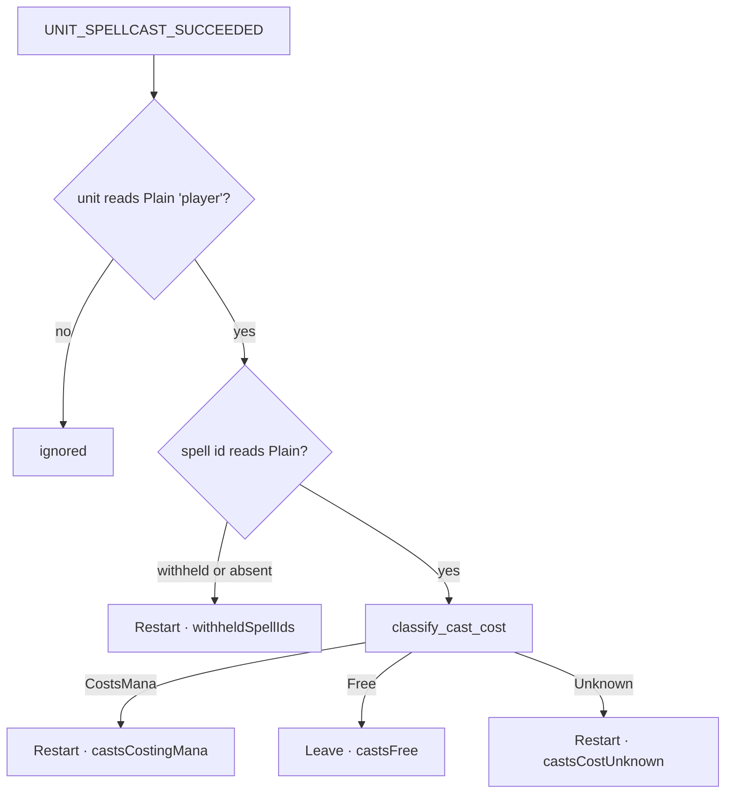
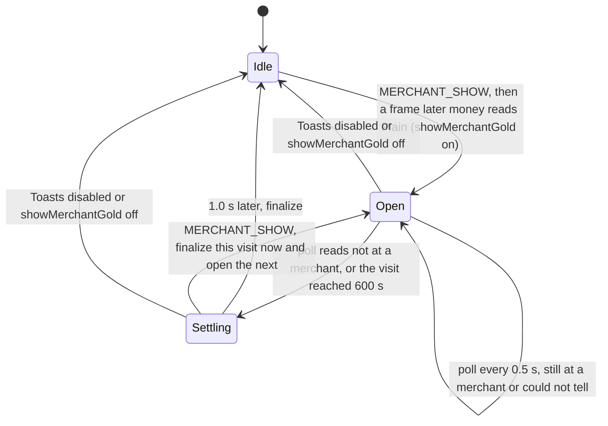
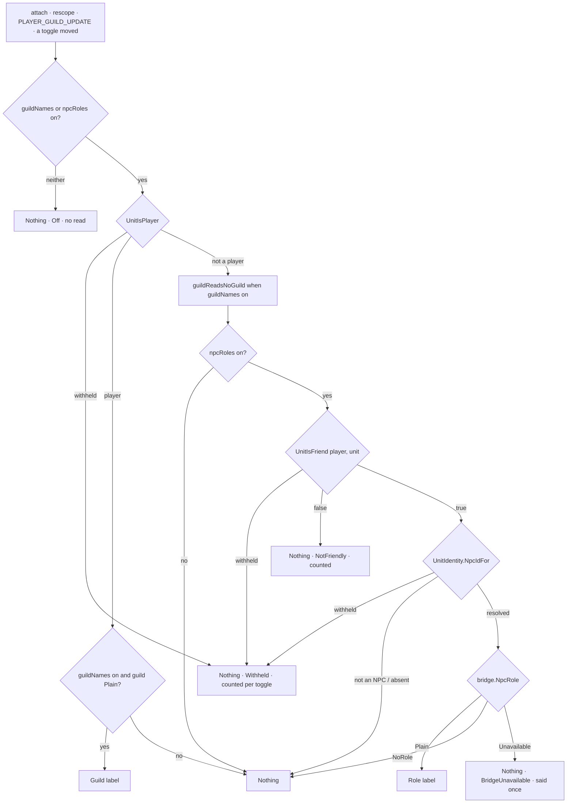
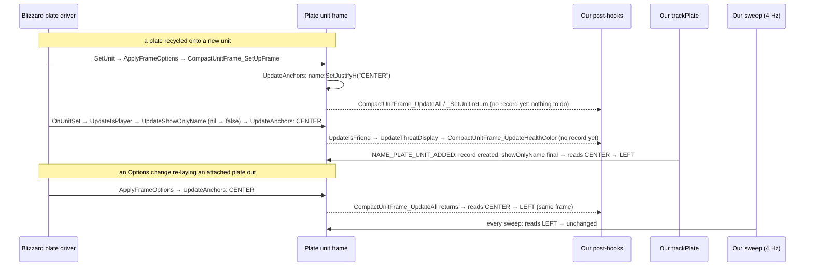

# PersonalAddon — Phase 20 Design: free casts, rows that add up, the merchant receipt, and the plate learns roles

**Date:** October 21, 2026
**API version:** 1.60.1 (WoW Forever Beta), game type `camelot`
**Client:** 1.60.1.70450 (`WowB.exe` of 2026-10-16 19:49), UI export 2026-10-16 20:55.
When this was drafted, `patch_check status` reported **`CheckDue`**: the verified build was
still 70338. Phase 19 had run `check` against 70450 (verdict Review: six premises touched by file
churn, one surface flag change, none in its surface) and nothing was accepted. Every citation
below is read from the 70450 export. **70450 was accepted (`AcceptedAfterReview`, 2026-10-21
08:23) before the build began**, which is the order §16.2 requires; `status` is `UpToDate`.
**Status:** built 2026-10-21, not committed. Harness, mutation pass, lint and patch check are
green (§21); the in-game checks of §16.3 are outstanding.
**Implements:** the user's seven items of 2026-10-21, with the decisions of two question
rounds (§1.1):
1. Auto Shot and wanding reset the five-second-rule line — **a defect, root cause found, fixed** (§2);
2. the damage breakdown's percentages do not add up after a multi-target fight — **fixed and re-presented** (§3);
3. does a mob that leaves the screen drop off the threat panel — **answered; README only** (§4);
4. does tidy bags use the game's own sort — **answered; README clarified** (§5);
5. selling to a vendor shows no gold total — **a merchant visit toast** (§6);
6. NPC roles on nameplates — **ships, from QuestieDB** (§7);
7. nameplate names along the x-axis — **a left-align setting** (§8).

**Corrects:** Phase 4 §4.5 and `Features/DamageBreakdown.lua:124-126` (`GetSpellPowerCost` is
present on this client); Phase 15 §1.3 and README *Tried and Not Possible* "NPC Role Tags on
Plates" (the tooltip was never the only source); Phase 15 §1.3 "Moving or restyling Blizzard's
unit name" (narrowed, §14).

**Depends on:**
- `20260919-Phase01.md` — the five-second window and its cost predicate;
- `20260919-Phase04.md`, `20261002-Phase09.md` §5.1, `20261005-Phase11.md` §6 — the breakdown;
- `20260927-Phase08.md` §4.4, §6, §7.2, §8.4 — event classification, toasts, auto-sell, the spike's settle timing;
- `20261005-Phase11.md` §1.3, §5.2, §5.7 — which mobs the threat panel lists;
- `20260919-Phase02.md` §4.7, §5.2 — the restricted name region; restore need only be non-permanent;
- `20261010-Phase14.md` — re-asserting a Blizzard property from the existing post-hooks and the sweep, restored from Blizzard's option table. **The precedent §8 follows;**
- `20261010-Phase15.md` — the guild label. **The precedent §7 follows;**
- `20261011-Phase17.md`, `20261011-Phase18.md` §5 — `QuestieDBBridge`, its gates, and the answered/non-answered cache rule;
- README "Rules for future development".

**Revision:** 3 — built; audit dispositions in §20, the build record in §21.

---

## 1. Scope

Two defects, two answers, three features. Items 6 and 7 share `Features/Nameplates.lua`; every
other item stays in its own file. The only shared substrate is a GUID parser that already exists
twice (§9).

### 1.1 Decisions

| # | Question | Answer (2026-10-21) | Where |
|---|---|---|---|
| D1 | How the breakdown presents a multi-target fight | **Spell rows whose percentages add up to exactly 100**: a header with the fight's length and DPS, and a final "+N more" row for spells past the row limit | §3 |
| D2 | What the vendor toast reports | **One toast per merchant visit, on leaving**: net gold gained over the visit (sales minus purchases and repairs), only when positive. The automatic junk sale folds into it | §6 |
| D3 | Where NPC role text comes from | **QuestieDB's `subName`** | §7.1 |
| D4 | Which NPC plates get a role | **Friendly NPCs only**, and it must work for both factions: the user will main Horde at launch | §7.2 |
| D5 | How the role label is switched | **Its own checkbox**, sharing the guild label's size slider, outline and fade | §10.2 |
| D6 | How names move along the bar | **One checkbox: Blizzard's own name, left-aligned.** No pixel offset, no name of our own | §8 |
| D7 | Off-screen mobs on the threat panel | **No code.** The user turns on Offscreen Nameplates; README carries the reminder | §4 |
| D8 | Does tidy bags use the game's sort | **Yes.** Answered; README clarified | §5 |

**The cost of each decision is named where it is paid.** The costs are D2's double notice
(§6.1), D3's coverage limit (§7.1), D4's exclusion of neutral NPCs (§7.2), and D6's dependence
on one in-game observation (§8.4).

### 1.2 What ships

| Item | Kind | Section | File |
|---|---|---|---|
| A cast that costs nothing leaves the window alone | Defect fix | §2 | `Features/FiveSecondRule.lua` |
| Breakdown rows merged by spell, apportioned to 100, header and "+N more" row | Defect fix, feature change | §3 | `Features/DamageBreakdown.lua` |
| Merchant visit toast; a junk sale during a visit is held into it | Feature change | §6 | `Features/Toasts.lua` |
| NPC role labels, in the guild label's slot | Feature | §7 | `Features/Nameplates.lua`, `Core/QuestieDBBridge.lua` |
| Nameplate names at the left end of the bar | Feature | §8 | `Features/Nameplates.lua` |
| `UnitIdentity.NpcIdFor`, replacing two private copies | Substrate | §9 | `Core/UnitIdentity.lua` (new), `Features/NPCQuests.lua`, `Features/QuestMarkers.lua` |
| Constants and settings | Substrate | §10 | `Core/Constants.lua`, the three features' schemas |
| `/pa fsr`, `/pa dps`, `/pa toasts`, `/pa plates` additions | Command | §11 | `Core/Debug.lua` |
| Premises 75–86 | Tooling | §12 | `Tools/patchcheck/premises.toml` |
| `stubs20.lua`, `tests20.lua`, two sessions; `tests8.lua` amended | Tooling | §16.1 | `Tools/harness/` |
| README | Housekeeping | §13 | `README.md` |
| TOC `1.10.0`, `X-Phase: 20`, `Core\UnitIdentity.lua` | Housekeeping | §19 | `PersonalAddon.toc` |

**`Features/AutoSellJunk.lua` does not change.** Its `report` treats only `Unavailable` and
`Dropped` as undelivered (`AutoSellJunk.lua:153`), so the new `Held` outcome (§6.5) needs nothing
from it.

### 1.3 Not possible, or out of scope

- **A pixel offset for the name (D6's rejected route).** It means re-anchoring a region whose
  anchors cannot be read: `GetPoint` is `SecretWhenAnchoringSecret`
  (`SimpleScriptRegionResizingAPIDocumentation.lua:65-70`) and Phase 2 §4.7 saw it refused in
  play. We would also have to re-implement the five branches of `UpdateAnchors`
  (`Blizzard_NamePlateUnitFrame.lua:678` onward) to know what we were offsetting from, and
  that copy breaks the first time Blizzard edits the function.
- **A name label of our own.** We would own the name's colour, its target highlight and its
  truncation, and would have to re-hide Blizzard's name on every update. That is a third
  contested property per plate, for a result the alignment setting already gives.
- **Threat panel rows for mobs with no plate.** Unchanged from Phase 11 §1.3: no unit token
  reaches them. The client's own option keeps their plates (§4).
- **Marking off-screen rows on the panel.** `C_NamePlateManager.IsNamePlateUnitBehindCamera`
  would allow it (`NamePlateManagerDocumentation.lua:30-43`). Offered and declined (D7).
- **A per-enemy breakdown.** `Enum.DamageMeterType.EnemyDamageTaken` exists
  (`DamageMeterConstantsDocumentation.lua:112`) and Blizzard's own meter offers it, but in a
  group it counts everyone's damage. Offered and declined (D1).
- **A gross-sales total.** Offered and declined (D2). `PLAYER_MONEY` is synchronous and raised
  inside money-frame paths (Phase 8 §4.4). Sampling instead would net out a sale and a purchase
  that land in the same tick.
- **Silencing Blizzard's "You gained" chat receipt.** It is `Blizzard_MoneyReceipt`'s frame,
  so silencing it means writing Blizzard state (rule 2). Both notices appear (§6.1).
- **Roles in dungeons and raids.** `UnitGUID` is `SecretWhenUnitIdentityRestricted`
  (`UnitDocumentation.lua:1241-1244`), so no NPC id resolves there.
- **Roles from the live tooltip (D3's rejected route).** `C_TooltipInfo.GetUnit` exists
  (`TooltipInfoDocumentation.lua:1181-1195`). But `Enum.TooltipDataLineType` has `UnitName`,
  `UnitLevel` and `UnitType` and **no subtitle type**, so the role line would be inferred from
  its position between typed lines. That inference needs a spike, and it builds a full tooltip
  table per new NPC.
- **An `IsAutoRepeatSpell` guard on the five-second rule.** Rejected. Despite its documentation
  string, Blizzard uses `C_Spell.IsAutoRepeatSpell` as "is this spell auto-repeating right now":
  it drives the button's checked state, its flash, and the decision to cancel
  (`HostileTargetingActionBar.lua:198-215`). That is a state, not a classification, and §2
  removes the need for it.
- **Clearcasting, Inner Focus and similar procs.** The cost is read after the proc is consumed,
  so a free cast reads as costing mana. Unchanged since Phase 1 §11.

### 1.4 Types

```
SpellId             = number
Copper              = number
Seconds             = number
NpcId               = number
UnitToken           = string
TextureId           = number | string
CounterName         = string
Counters            = Map<CounterName, integer>       # this UI load's Diagnostics table
Collection<T>       = an unordered set of T, iterated once per call
ReadKind            = enum { Plain, Absent, Withheld }
ClientReading<T>    = Plain(value: T) | Absent | Withheld(reason: ReadFailure)
ReadFailure         = enum { Unavailable, CallFailed, SecretValue, UnexpectedType }
ClientTable         = opaque                           # a table the client returned; read
                                                       # only through ClientRead.Field
ClientValue         = opaque                           # any client return, unclassified
SpellCostLookup     = (spellId: SpellId) -> ClientValue  # C_Spell.GetSpellPowerCost, or the
                                                         # global of the same name
FontStringRegion    = opaque                           # a Blizzard FontString
LabelFrame          = { frame: Frame, text: FontString }   # Phase 15's pooled label

FsrTracker          = { state: TrackerState, windowStartedAt: Seconds, windowEndsAt: Seconds,
                        costQueryable: Optional<boolean>,
                        lastUnknownReason: Optional<CostUnknownReason>,
                        counters: Counters }
LabelSettings       = { guildNames: boolean, npcRoles: boolean, guildFontSize: integer }

CostUnknownReason   = enum { ApiMissing, CallFailed, Withheld, EntryUnreadable }
CastCost            = CostsMana | Free | Unknown(reason: CostUnknownReason)
ManaEntryReading    = NotMana
                    | Mana(cost: number, costPerSecond: number, applies: boolean)
                    | Unreadable
WindowAction        = Restart | Leave

SpellEntry          = { spellId: SpellId, amount: number, rate: number }
SpellTotal          = { spellId: SpellId, amount: number, rate: number, entries: integer }
MergedSpells        = { totals: List<SpellTotal>, mergedEntries: integer, sumOfSpells: number }
SpellRow            = { spellId: SpellId, rate: number, percent: integer }
OtherRow            = { spellCount: integer, rate: number, percent: integer }
BreakdownRows       = { spells: List<SpellRow>, other: Optional<OtherRow>,
                        mergedEntries: integer, sumOfSpells: number }
HeaderText          = string

JunkSale            = { itemsSold: integer, itemsUnsold: integer,
                        revenue: Copper, confirmed: boolean }
VisitPhase          = enum { Idle, Open, Settling }
MerchantVisit       = { phase: VisitPhase, moneyAtOpen: Copper, openedAt: Seconds,
                        heldJunk: Optional<JunkSale> }
VisitVerdict        = PostVisit(net: Copper, junk: Optional<JunkSale>)
                    | PostJunkOnly(junk: JunkSale)
                    | Silent(net: Optional<Copper>)
ToastOutcome        = Shown | Queued | Coalesced | Held | Dropped | Unavailable

NpcIdReading        = Resolved(npcId: NpcId) | NotAnNpc(isPlayer: boolean) | Withheld | Absent
RoleReading         = Plain(text: string) | NoRole | Unavailable(reason: string)
PlateLabelWant      = Guild(name: string) | Role(text: string) | Nothing(why: LabelSkip)
LabelSkip           = enum { Off, NotFriendly, NoGuild, NoRole, NotAnNpc,
                             Withheld, BridgeUnavailable }
LabelOutcome        = Attached | Retexted | Unchanged | Released | NotAttached(reason: string)

NameAnchorStyle     = enum { InsideHealthBar = 1, AboveHealthBar = 2, CenteredAboveHealthBar = 3 }
NameAlignCapability = enum { NotYetProbed, Verified, Refused, Unverifiable }
AlignOutcome        = Written | Unchanged | Probed(verdict: NameAlignCapability)
                    | Skipped(why: AlignSkip)
AlignSkip           = enum { Off, CapabilityDown, StyleNotAbove, StyleUnreadable,
                             NameOnly, NoNameRegion }
PlateLabelSource    = enum { Guild, Role }

PlateRecord         = {
    frame: NamePlateFrame,                     # Phase 2, identity only
    unitFrame: Frame,                          # Phase 2
    healthBar: StatusBar,                      # Phase 2
    container: Optional<Frame>,                # Phase 14, HealthBarsContainer
    levelBadge: Optional<Frame>,               # Phase 19
    nameRegion: Optional<FontStringRegion>,    # NEW: unitFrame.name, resolved at attach (8.2)
    unitToken: UnitToken,
    scope: PlateScope,                         # Phase 2 section 6
    styleApplied: boolean, lastVerdict: Optional<Verdict>, desiredColour: Optional<Colour>,
    guild: Optional<string>,                   # Phase 15: the guild the label shows
    role: Optional<string>,                    # NEW: the role the label shows
    labelSource: Optional<PlateLabelSource>,   # NEW: which of the two the label shows
    label: Optional<LabelFrame>,               # Phase 15: now either kind's one label
    nameAligned: boolean,                      # NEW: we wrote "LEFT" this occupancy
    rarityTier: Optional<RarityTier>, rarityRing: Optional<Frame>,   # Phase 19
    questMarker: Optional<Frame>,              # Phase 17, owned by QuestMarkers
}
```

`PlateRecord` lives on our own table, created at attach and discarded at detach; the four
NEW fields are this phase's. Nothing on it is written onto a Blizzard frame.

---

## 2. Five-second rule: a cast that costs nothing is free (item 1)

### 2.1 Root cause

The line restarts on every cast the client cannot price. On this client, every cast with no
resource cost reads as unpriceable.

1. `costsMana` calls `C_Spell.GetSpellPowerCost(spellId)`. On a non-table return the inner
   function returns nil, so `costsMana` returns nil (`Features/FiveSecondRule.lua:245-272`).
2. `onSpellcastSucceeded` treats nil as "this client will not say": it sets
   `costQueryable = false` and `predicate = 1`, which starts the window
   (`FiveSecondRule.lua:299-308`).
3. **Nil is the client's documented answer for a spell that costs nothing.** `GetSpellPowerCost`
   is `MayReturnNothing`, documented *"May return nil if spell is not found or has no resource
   costs"* (`SpellDocumentation.lua:535-549`). Every Blizzard caller treats nil as "no cost".
   Four write `C_Spell.GetSpellPowerCost(spellID) or {}`
   (`Blizzard_UnitFrame/Mainline/UnitFrame.lua:373`, `Blizzard_PersonalResourceDisplay.lua:664`,
   `Blizzard_ClassNameplateBar.lua:163`, `Blizzard_TutorialLogic.lua:930`). The action button
   guards with `if costTable then` (`Blizzard_ActionBar/Shared/ActionButton.lua:807-808`,
   `:825-826`).
4. Wand **Shoot** (5019) and **Auto Shot** (75) cost nothing, and every shot arrives as a
   successful player cast; the Gamepad hostile bar names both ids
   (`HostileTargetingActionBar.lua:4-11`). So every shot restarts the window, and with a wand
   the sweep never completes.

The same path restarts the window on every potion, bandage, food, Hearthstone and mount. Wanding
is just the one that repeats every second and a half.

**The withheld path is not involved.** All five diagnostics sessions saved on 70450 have an empty
`fiveSecondRule` table, so `withheldSpellIds` never moved.

### 2.2 Phase 4 was wrong about the API

Phase 4 §4.5 and `DamageBreakdown.lua:124-126` say Phase 1 found `GetSpellPowerCost` "missing from
both the namespace and the globals". The only evidence was Phase 1's chat line *"spell mana cost
is not queryable on this client, so every successful cast opens the window"* (commit `496ff0c`).
That line printed whenever `costsMana` returned nil, which means on the first free cast. The
inference was wrong:

- Camelot's player frame is built by Mainline's `PlayerFrame_OnLoadBase`, with a
  `ManaCostPredictionBar` (`Blizzard_UnitFrame/Camelot/PlayerFrame.lua:1-2`,
  `Mainline/PlayerFrame.lua:3-20`).
- That bar registers `UNIT_SPELLCAST_START` for the player (`UnitFrame.lua:96-101`). The handler
  calls `C_Spell.GetSpellPowerCost` on every cast start that has a cast time (`UnitFrame.lua:373`).
- BugGrabber's log, sessions up to 394, has no error naming it.

**The harness never caught this.** `stubs8.lua:343` defines `C_Spell` with only
`GetSpellTexture`, so the lookup does not exist there. The only five-second-rule checks,
`tests9.lua:303-315`, fire a withheld spell id and then a withheld unit, so the cost path has
never been exercised offline.

### 2.3 The classification

```
# Whether one successful player cast spent mana, from the client's own cost table.
# pre:  spellId is the Plain spell id of a UNIT_SPELLCAST_SUCCEEDED whose unit read
#       Plain "player"; lookup is C_Spell.GetSpellPowerCost, else the global, else absent
# post: Free when the lookup answered nothing -- the documented answer for a spell with
#       no resource cost -- or answered a table with no applicable MANA entry above zero;
#       CostsMana when an applicable MANA entry has cost > 0 or costPerSecond > 0;
#       Unknown(ApiMissing) when lookup is absent; Unknown(CallFailed) when it raised;
#       Unknown(Withheld) when its return was hidden or not a table;
#       Unknown(EntryUnreadable) when a field a MANA test needs was hidden.
#       Every read goes through ClientRead (rule 10); no cost value leaves this function
# raises: never
function classify_cast_cost(
    spellId: SpellId,
    lookup: Optional<SpellCostLookup>
) -> CastCost:
    costRead: ClientReading<ClientTable> = client_read_call(lookup, "table", spellId)
    if costRead is Absent:
        return Free
    if costRead is Withheld(reason):
        return Unknown(unknown_reason_for(reason))
    entries: List<ClientTable> = as_entry_list(costRead.value)
    for entry in entries:
        manaEntry: ManaEntryReading = read_mana_entry(entry)
        if manaEntry is Unreadable:
            return Unknown(EntryUnreadable)
        if manaEntry is Mana and manaEntry.applies
                and (manaEntry.cost > 0 or manaEntry.costPerSecond > 0):
            return CostsMana
    return Free

# One cost entry, read field by field.
# pre:  entry is a table the client returned
# post: NotMana when type reads Plain and is not Enum.PowerType.Mana, or is Absent;
#       Mana(cost, costPerSecond, applies) when it is MANA, with Absent costs read as 0
#       and applies true when requiredAuraID is 0 or Absent, or when it is non-zero and
#       hasRequiredAura reads Plain true (SpellSharedDocumentation.lua:46-58: a cost
#       with a required aura does not apply without it);
#       Unreadable when type, cost, costPerSec or requiredAuraID was Withheld, or when
#       requiredAuraID reads Plain non-zero and hasRequiredAura is anything but Plain --
#       Withheld, or Absent from a field the docs say is never nil. Applicability is
#       part of the MANA test, so a hidden aura field is "could not tell", never "free"
#       (audit finding 3)
# raises: never
function read_mana_entry(entry: ClientTable) -> ManaEntryReading

# The entries of a cost answer, in either shape the client has used.
# post: a table carrying type or cost at its top level is one entry -- the shape
#       FiveSecondRule.lua:256-258 already tolerates -- otherwise its array part
# raises: never
function as_entry_list(costs: ClientTable) -> List<ClientTable>

# post: Unavailable -> ApiMissing; CallFailed -> CallFailed; anything else -> Withheld
# raises: never
function unknown_reason_for(reason: ReadFailure) -> CostUnknownReason
```

### 2.4 What a cast does to the window



```
# What one successful player cast does to the five-second window.
# pre:  the unit read Plain "player" (FiveSecondRule.lua:286-290, unchanged)
# post: Restart when the spell id did not read Plain -- withheld (Phase 9 section 5.2)
#       or absent, both counted withheldSpellIds as FiveSecondRule.lua:292-296 does
#       today (audit finding 4) -- or the cost is CostsMana or Unknown; Leave when it
#       is Free. classify_cast_cost is never called without a Plain id.
#       Restart sets the window to [now, now + FSR_WINDOW] and schedules its end;
#       Leave touches neither the window
#       nor the line, so a wand shot inside a running window lets it run out.
#       Every cast is counted in exactly one of withheldSpellIds, castsCostingMana,
#       castsFree and castsCostUnknown. costQueryable is false exactly when the lookup
#       is missing (Unknown(ApiMissing)), a standing client fact; every other outcome,
#       a per-cast failure included, sets it true
# raises: never
function on_player_cast(
    spellIdRead: ClientReading<SpellId>,
    lookup: Optional<SpellCostLookup>,
    tracker: FsrTracker,
    now: Seconds
) -> WindowAction:
    if spellIdRead is not Plain:
        bump(tracker.counters, "withheldSpellIds")
        return restart_window(tracker, now)
    cost: CastCost = classify_cast_cost(spellIdRead.value, lookup)
    if cost is Free:
        bump(tracker.counters, "castsFree")
        tracker.costQueryable = true
        return Leave
    if cost is Unknown:
        bump(tracker.counters, "castsCostUnknown")
        tracker.lastUnknownReason = cost.reason
        tracker.costQueryable = (cost.reason != ApiMissing)
        return restart_window(tracker, now)
    bump(tracker.counters, "castsCostingMana")
    tracker.costQueryable = true
    return restart_window(tracker, now)
```

**Unknown still restarts the window.** That is Phase 1's bias, kept: a line on a cast that was
free is a cosmetic error, and no line on a mana user is a dead feature. What changes is that
Unknown now means what it says.

### 2.5 Diagnostics

- **Counters** in `PersonalAddonDiagnostics` under `fiveSecondRule`: `castsCostingMana`,
  `castsFree` and `castsCostUnknown`, beside the existing `withheldSpellIds` and
  `withheldBarGeometry`. They persist, so one play session answers "did it work" from disk.
  Memory rule: never a diagnostic whose only output is chat.
- **`/pa fsr`** prints the three counts. When `castsCostUnknown > 0` it also prints the last
  reason. The two warning lines (`Core/Debug.lua:210-213`) now print only when
  `costQueryable == false`, and say *"this client has no spell cost lookup, so every cast opens
  the window"*. That sentence is finally true when it prints.
- `Inspect` gains `castsCostingMana`, `castsFree`, `castsCostUnknown` and `lastUnknownReason`.

---

## 3. Damage breakdown: rows that add up (item 2)

### 3.1 Why a multi-target fight did not add up

Four mechanisms can each produce the symptom. Only H1 is specific to fighting several targets.
The design makes all four impossible by construction rather than betting on one, and §3.6's
counters show which one the user was seeing.

| # | Hypothesis | Where | Counter that answers it |
|---|---|---|---|
| H1 | **The client lists a spell once per target.** `DamageMeterCombatSpell` carries `combatSpellDetails`, *"Amount for a single target"* (`DamageMeterDocumentation.lua:215-245`). Blizzard's own source window puts that target's name into the row (`DamageMeterEntry.lua:714-736`). Per-target entries multiply rows, push spells past the row limit (4 here), and the shown shares stop reaching 100 | `DamageBreakdown.lua:184-210` ranks entries as they come | `mergedEntries` |
| H2 | **The row limit.** `min(#ranked, maximumRows)` rows are drawn; `truncatedRows` is counted and invisible | `DamageBreakdown.lua:278-295` | `otherRowsDrawn` |
| H3 | **The denominator is the source's `totalAmount`, not the sum of the rows.** `overkillAmount` is a field of its own, so overkill may be counted in one total and not the other. More kills, more drift | `DamageBreakdown.lua:257`, `:293` | `totalMismatchReads` |
| H4 | **Independent rounding.** Each share is rounded alone (`formatShare`, `:420-422`), so four rows can show 99 or 101 | | none needed: §3.3 cannot produce it |

### 3.2 One total per spell

```
# One total per spell, however many entries the client gave it.
# pre:  every entry was read Plain through ClientRead (rankedSpells' reads, unchanged);
#       entries whose amount is <= 0 were already dropped (DamageBreakdown.lua:199-206)
# post: one SpellTotal per distinct spellId, amount and rate summed over its entries,
#       entries counting how many were folded in; mergedEntries is the number of entries
#       folded into an earlier one; sumOfSpells is the sum of every entry's amount;
#       totals ordered by amount descending, then spellId ascending, so equal spells
#       never swap rows between two reads
# raises: never
function merge_by_spell(entries: List<SpellEntry>) -> MergedSpells:
    bySpell: Map<SpellId, SpellTotal> = {}
    totals: List<SpellTotal> = []
    mergedEntries: integer = 0
    sumOfSpells: number = 0
    for entry in entries:
        existing: Optional<SpellTotal> = bySpell[entry.spellId]
        if existing is present:
            existing.amount = existing.amount + entry.amount
            existing.rate = existing.rate + entry.rate
            existing.entries = existing.entries + 1
            mergedEntries = mergedEntries + 1
        else:
            created: SpellTotal = SpellTotal(entry.spellId, entry.amount, entry.rate, 1)
            bySpell[entry.spellId] = created
            totals.append(created)
        sumOfSpells = sumOfSpells + entry.amount
    sort(totals, by = amount descending, then = spellId ascending)
    return MergedSpells(totals, mergedEntries, sumOfSpells)
```

Merging is correct whether or not the client splits by target. If it does not, `mergedEntries`
stays 0 and the rows are exactly today's.

### 3.3 Apportioning to exactly 100

```
# The rows the panel draws, whose percentages add up to exactly 100.
# pre:  rowLimit >= 1
# post: when merged.totals is empty or merged.sumOfSpells is 0 -- no fight yet, the
#       meter switched off, or a fight that dealt nothing -- spells is empty, other is
#       absent and nothing is apportioned: zero rows, percents summing to 0 (audit
#       finding 5). Otherwise spells holds the first rowLimit totals, and other holds
#       the rest summed -- their count, amount and rate -- when there are any, and is
#       absent when there are none.
#       Percentages are of merged.sumOfSpells, never of the source's totalAmount (H3).
#       They are apportioned by largest remainder over the drawn rows, other included,
#       so the integers shown sum to 100 exactly (H4)
# raises: never
function apportion_rows(merged: MergedSpells, rowLimit: integer) -> BreakdownRows:
    if length(merged.totals) == 0 or merged.sumOfSpells <= 0:
        return BreakdownRows([], absent, merged.mergedEntries, merged.sumOfSpells)
    drawn: List<SpellTotal> = first(merged.totals, rowLimit)
    rest: List<SpellTotal> = after(merged.totals, rowLimit)
    amounts: List<number> = [total.amount for total in drawn]
    if length(rest) > 0:
        amounts.append(sum_amount(rest))
    percents: List<integer> = largest_remainder_percents(amounts, merged.sumOfSpells)
    spells: List<SpellRow> = [SpellRow(drawn[i].spellId, drawn[i].rate, percents[i])
                              for i in 1 .. length(drawn)]
    other: Optional<OtherRow> = absent
    if length(rest) > 0:
        other = OtherRow(length(rest), sum_rate(rest), percents[length(percents)])
    return BreakdownRows(spells, other, merged.mergedEntries, merged.sumOfSpells)

# Integer percentages that sum to 100.
# pre:  sum > 0; every amount >= 0; sum(amounts) == sum
# post: each percent is floor(100 * amount / sum) or one more; the points the floors
#       left over go to the largest fractional remainders, ties to the earlier row
# raises: never
function largest_remainder_percents(amounts: List<number>, sum: number) -> List<integer>:
    exact: List<number> = [100 * amount / sum for amount in amounts]
    percents: List<integer> = [floor(share) for share in exact]
    shortfall: integer = 100 - total(percents)
    byRemainder: List<integer> = indices(exact) ordered by
        (exact[i] - percents[i]) descending, then i ascending
    for position in 1 .. shortfall:
        percents[byRemainder[position]] = percents[byRemainder[position]] + 1
    return percents
```

A spell can show 0%. That is honest arithmetic, and it is the price of an exact 100.

### 3.4 The header and the "+N more" row

```
 ┌──────────────────────────┐
 │ 18s · 654 dps            │   header: the fight's length and your DPS over it
 │ [SWP]   221    34%       │   icon · DPS · share, as today
 │ [MB ]   157    24%       │
 │ [Smt]   105    16%       │
 │ [Wnd]    59     9%       │
 │  +3     112    17%       │   "+N more": count in the icon cell, summed DPS, share
 └──────────────────────────┘
```

```
# The line above the rows.
# pre:  merged came from the same read as the rows
# post: "<duration>s · <dps> dps", where duration is GetSessionDurationSeconds rounded
#       when it read Plain; "<dps> dps" alone otherwise. dps is the sum of the merged
#       rates, rounded: the client's own per-spell rates, which divide by a fractional
#       duration it does not otherwise expose (Phase 4 section 4.4). Never recomputed
#       here as total / duration
# raises: never
function header_text(
    durationRead: ClientReading<Seconds>,
    merged: MergedSpells
) -> HeaderText
```

- **The header is a font string on the panel**, made in `ensurePanel`, `BREAKDOWN_HEADER_HEIGHT`
  tall, left-aligned at the padding. It is always shown when rows are. D1 made it part of the
  presentation, so it has no setting.
- **The "+N more" row is a pooled row like the others.** `createRow` gains one font string,
  `row.moreText`, which sits in the icon cell, shows `"+N"`, and is hidden on spell rows.
  `resetRow` clears it. The pool's capacity of 16 already covers `maximumRows` (at most 10)
  plus this one row.
- **`maximumRows` keeps its meaning: spell rows.** The "+N more" row is extra. The schema
  description changes from *"Anything beyond this is counted, not dropped"* to *"Spells past
  this are summed in a final '+N more' row"*.
- **Layout and height** (audit finding 6), all computed; nothing is read back off a frame,
  which is the rule the threat panel follows (`ThreatPanel.lua:397-399`). With `n` drawn rows,
  the "+N more" row counted:
  - `n >= 1`: the header's TOPLEFT sits at `(PANEL_PADDING, -PANEL_PADDING)`; row 1's TOPLEFT
    at `(PANEL_PADDING, -(PANEL_PADDING + BREAKDOWN_HEADER_HEIGHT + ROW_SPACING))`; each later
    row `ROW_SPACING` under the one before. Height is
    `2·PANEL_PADDING + BREAKDOWN_HEADER_HEIGHT + ROW_SPACING + n·ROW_HEIGHT + (n−1)·ROW_SPACING`.
  - `n == 0` (only drawn when `showWhenEmpty` is set): the header is hidden and empty, and the
    height is `2·PANEL_PADDING + ROW_HEIGHT`, which is today's empty panel unchanged.
- **Unchanged:** `hideInCombat`, the settle reads, the withheld path ("keep the last render"),
  the anchor, the scale and the icon lookup chain.

### 3.5 Preview

`showPlaceholders` draws through the same `apportion_rows`, from `PREVIEW_RATES`. A sample
duration, `PREVIEW_DURATION_SECONDS = 20`, sits beside those rates, because the preview reads no
session. At the default `maximumRows` of 4, with ten sample rates, the preview shows four rows,
a "+6" row and a header reading *"20s · 577 dps"*: the ten rates sum to 576.5, rounded. The
preview is where the new layout is first seen, so it must look exactly like a real fight.

**Closing the preview restores the real panel** (audit finding 7). Today `clearPlaceholders`
(`DamageBreakdown.lua:546-553`) releases the rows and hides the panel, so the last fight's
breakdown stays hidden until the next fight; with a header that would also leave
`Inspect().headerText` reading the sample. `clearPlaceholders` now empties the header, then runs
`refreshNow()` when the preview is off and the player is not in combat:
- `Preview.SetEnabled(false)` clears `state.enabled` before it calls any `clear`
  (`Preview.lua:265-268`), so the refresh is not refused by its own preview guard;
- a focus switch clears the breakdown while the preview is still on, and `refreshNow` returns at
  once there, which is the existing guard (`DamageBreakdown.lua:572-574`);
- a fight starting ends the preview, and reading the meter then would only be withheld
  (`SecretWhenInCombat`), so the combat read (`UnitAffectingCombat("player")` through
  `ClientRead`) skips it and the end-of-combat refresh draws the fight as before.

### 3.6 Diagnostics

- **Counters** in `PersonalAddonDiagnostics` under `damageBreakdown`:
  - `mergedEntries`, cumulative entries folded into an earlier one (H1);
  - `otherRowsDrawn` (H2);
  - `totalMismatchReads`, reads whose `sumOfSpells` differs from the source's `totalAmount` (H3).
- **`/pa dps`** adds one line: `entries=<n> spells=<k> merged=<m> sumOfSpells=<s>
  sourceTotal=<t> percents=<sum>`. The last figure is the sum of the integers drawn: 100
  whenever at least one row is drawn, 0 when none is (no fight yet, the meter off, or a fight
  that dealt nothing; audit finding 5).
- `Inspect` keeps every field it has. Two of them change slightly: `rowsShown` counts spell rows
  only, so `tests9.lua:288-300` stays true, and `truncatedRows` counts the spells inside the
  "+N more" row. It gains `otherRowShown`, `headerText`, `sumOfSpells`, `sourceTotal`,
  `lastMergedEntries` and `percentsSum`.

---

## 4. Threat panel and off-screen mobs (item 3)

**Yes, a mob that leaves the screen drops off the panel while still alive. That is by design,
and the client has the cure.**

- The panel lists mobs that have a nameplate. Phase 11 §1.3 recorded *"Mobs with no nameplate on
  screen — No unit token reaches them"*, and §5.2 reads `C_NamePlate.GetNamePlates()` fresh
  every sweep (`ThreatPanel.lua:141-174`). When the client removes a plate, the row goes with it.
- **`nameplateShowOffscreen`** is the client's option for exactly this. Its help text, from
  `WowB.exe`: *"When enabled, the nameplate is always shown if owner is in combat with player or
  player's group member."* That is the panel's own population (Phase 11 §5.2: mobs fighting you or
  your group).
- **It is offered on this flavour:** Options → Nameplates → **Offscreen Nameplates**
  (`Blizzard_SettingsDefinitions_Frame/Nameplates.lua:523-526`). Camelot's overrides do not
  remove it, and `RunSettingsCallback` skips only in Plunderstorm
  (`Mainline/InterfaceOverrides.lua:297-301`). Such a plate also shows Blizzard's behind-camera
  icon (`Blizzard_NamePlateUnitFrame.lua:530-537`).
- **It is not set on this account:** neither `WTF/Config.wtf` nor the account's
  `config-cache.wtf` has a `nameplateShowOffscreen` line.

**D7: no code.** The panel never writes a CVar; Phase 11 §5.7 recorded that "the setting is the
user's". README gains the reminder (§13), and premise 85 fails the patch check if the option
ever disappears.

---

## 5. Tidy bags uses the game's own sort (item 4)

**Yes.** `AutoSortBags.lua:146` calls `C_Container.SortBags()` through `CallWindow.Capture`. That
is the call behind both of the client's Clean Up Bags entry points:
- the combined bag's sort button (`ContainerFrame.xml:358-372`);
- the Gamepad backpack menu's Clean Up Bags (`ContainerFrame.lua:735-741`), the only
  `BAG_CLEANUP_BAGS` entry in the file.

The sort itself is the client's, so a bag marked **Ignore Cleanup** in its own menu
(`ContainerFrame.lua:668-688`) is left alone by ours too.

What the addon adds is only:
- **when**: the bag closing, through the `ContainerFrame.CloseBag` callback;
- **how often**: at most once per `cooldownSeconds`, 60 by default;
- **when not**: in combat, with the bag shown, with an item on the cursor, with any item locked,
  or with a listener on the two events the sort delivers inside the call (Phase 8 §7.1).

README's wording already says "native Clean Up Bags". It gains the Ignore Cleanup sentence
(§13), and premise 86 guards the claim.

---

## 6. The merchant visit toast (item 5)

### 6.1 What the client already does, and the cost of doing it again

`Blizzard_MoneyReceipt.lua` (77 lines, loads on `camelot`) handles merchant and mailbox visits:
- it records `GetMoney()` at `PLAYER_INTERACTION_MANAGER_FRAME_SHOW`;
- at `_HIDE` it prints *"You gained: X"* to chat when the difference is positive
  (`Blizzard_MoneyReceipt.lua:49-71`).

**D2 is that arithmetic, as a toast.** The chat line keeps printing (§1.3), so one event produces
two notices. That cost is accepted: the toast is where the user looks, and the chat line is
Blizzard's to keep.

Today only the automatic junk sale posts a toast (`AutoSellJunk.lua:140-156`). An item sold by
hand posts nothing. That is the defect the user reported.

### 6.2 Ownership: Toasts owns the visit

| Owner | Why not |
|---|---|
| `AutoSellJunk` | The visit toast would vanish with "Sell junk automatically". The toast is a toast category, and its switch belongs on Toasts' settings beside "Looted money" |
| A new Core module | One consumer. A lifecycle module with ordered listeners is premature for a single user |
| **`Toasts`** | **Chosen.** Merchant gold is money, like looted money; Toasts already coalesces money into a toast on screen (`Toasts.lua:364-389`). The junk sale arrives through the `Post` it already receives (`AutoSellJunk.lua:144-150`), so coupling stays feature → service, the direction it already runs |

### 6.3 The visit's lifecycle



```
# Starts tracking a merchant visit.
# pre:  MERCHANT_SHOW was delivered -- server-raised (Phase 8 section 4.4, section 6.7
#       below); this runs a frame later from Toasts' own deferral (rule 5)
# post: with showMerchantGold on and GetMoney reading Plain: a visit is Open with
#       moneyAtOpen and openedAt recorded, and the poll ticker running.
#       A visit already Open is kept as it is: a second MERCHANT_SHOW without leaving is
#       the same visit. A visit still Settling is finalized first, then the new one opens.
#       Money not Plain: no visit opens and visitMoneyUnreadable is counted, so a junk
#       sale in this visit displays at once, as before Phase 20.
#       A client without C_PlayerInteractionManager.IsInteractingWithNpcOfType or
#       Enum.PlayerInteractionType.Merchant opens no visit either, said once: the poll
#       could never answer "left", and every visit would run to the 600 s cap
# raises: never
function open_visit(now: Seconds) -> VisitPhase

# One poll of an open visit, on our ticker.
# pre:  phase == Open
# post: IsInteractingWithNpcOfType(Merchant) read Plain false: phase Settling, ticker
#       stopped, finalize scheduled MERCHANT_VISIT_SETTLE_SECONDS later.
#       Plain true, or Withheld: still Open -- "could not tell" never ends a visit early
#       (rule 10) -- unless now - openedAt >= MERCHANT_VISIT_MAXIMUM_SECONDS, which
#       settles it anyway and counts visitPollCapped. So no ticker outlives a visit by
#       more than ten minutes, whatever the client answers
# raises: never
function poll_visit(now: Seconds) -> VisitPhase

# Ends a visit and decides what, if anything, to show.
# pre:  phase == Settling, or a MERCHANT_SHOW arrived while Settling
# post: money does not read Plain now (audit finding 8): visitMoneyUnreadable is
#       counted; PostJunkOnly(heldJunk) for ANY held sale, confirmed or not, because
#       without a net there is no visit toast to fold it into; Silent(absent) when
#       nothing is held.
#       Money reads Plain: net = money now - moneyAtOpen, and
#         PostVisit(net, heldJunk) when net > 0;
#         PostJunkOnly(heldJunk) when net <= 0 and the held sale was unconfirmed or
#         left items: a failure notice is never swallowed;
#         Silent(net) otherwise -- including a confirmed junk sale outweighed by
#         purchases, which D2 ("only when positive") deliberately does not show.
#       Afterwards phase is Idle, no ticker or timer is running, and nothing is held.
#       The visit is reset BEFORE the toast is posted, so a PostJunkOnly request is
#       never held again by the visit it came from
# raises: never
function finalize_visit(visit: MerchantVisit, now: Seconds) -> VisitVerdict
```

**Why settle for a second before reading the money.** A sale clicked just before walking away is
paid by a server reply that can land after the interaction ends. Blizzard's receipt reads at the
instant of `_HIDE` and would miss it. Phase 8's spike measured that reply at 0.29 s (§8.4, V3).

### 6.4 The money read and the junk sale share a frame, safely

Toasts and AutoSellJunk both defer their `MERCHANT_SHOW` work by one frame. Inside that frame,
the order of the two deferred callbacks is Dispatch's subscription order, not ours to choose.
**The order does not matter.** The junk sale is a request, and its proceeds arrive in a server
reply. A reply to a request sent in frame N+1 cannot be processed before frame N+2. So `GetMoney`
read anywhere in frame N+1, before or after `SellAllJunkItems`, is the pre-sale balance. Phase 8
§8.4 observed both halves: the call delivered nothing inside itself, and the money settled 0.29 s
later. This is an assumption, so it is listed below and tested (M3).

### 6.5 Folding the junk sale

```
# Toasts.Post for a JunkSold request.
# pre:  request.kind == JunkSold (AutoSellJunk's existing request, unchanged)
# post: Held when a visit is Open or Settling. The sale merges into heldJunk:
#       itemsSold and revenue summed, itemsUnsold the latest figure, confirmed only if
#       every merged sale was confirmed. Nothing is displayed now and junkHeld is counted.
#       Otherwise the Phase 8 path, unchanged: Shown, Queued or Dropped
# raises: never
function post_junk_sold(request: JunkSale, visit: MerchantVisit) -> ToastOutcome
```

- `Held` is a new `OUTCOME` value. `AutoSellJunk` records it as `lastPosted`, so `/pa vend`
  prints `[Held]`. It falls back to chat only on `Unavailable` and `Dropped`
  (`AutoSellJunk.lua:153`), so nothing changes there.
- **Nothing held is ever lost.** If Toasts is disabled, or `showMerchantGold` turned off, while a
  visit holds a junk sale:
  - with Toasts disabled, the held sale goes to chat as one line with its figures (items
    sold, revenue, items left), formatted by Toasts itself, preserving Phase 8 audit finding 7
    ("the summary is never lost");
  - with `showMerchantGold` off, the held sale displays at once as the Phase 8 junk toast.
- **A held sale whose toast is dropped goes to chat** (audit finding 9). Holding the sale took
  AutoSellJunk's own chat fallback away, so Toasts owns it: when the toast carrying a held sale
  -- `PostVisit`, `PostJunkOnly`, or the toast shown when `showMerchantGold` turns off -- comes
  back `Dropped` or `Unavailable`, Toasts writes the same one chat line.
- **A second sale in the same visit merges; it never overwrites.** §6.5's contract above already
  says so (itemsSold and revenue summed, itemsUnsold the latest, confirmed only if all were).
  `/pa toasts test` (`PostSamples`) posts its junk sample **past** the hold, so a test run
  during a real visit neither joins nor disturbs that visit's figures (audit finding 10).
- **A sale that settles after its visit was finalized** displays as the Phase 8 junk toast. A
  visit finalizes at most one poll plus one settle (1.5 s) after the user walks away. A complete
  sale settles at its `BAG_UPDATE_DELAYED`, measured at 0.29 s, so it is always held. Only a sale
  that runs to AutoSellJunk's `VEND_SETTLE_SECONDS` (3 s) timeout, while the user left within
  the first second and a half, escapes its visit. That is the partial and unconfirmed path, where
  a separate failure notice is the right answer anyway.

### 6.6 The toast

```
 ┌──────────────────────────────────────────┐
 │ (coin)  Gained at a merchant · 6 junk    │   label (GameFontNormal)
 │         +1g 23s 45c                      │   text (GameFontHighlightLarge)
 └──────────────────────────────────────────┘
```

- **A new `KIND.MERCHANT_VISIT`.** Only Toasts posts it: from `finalize_visit`, and once in
  `PostSamples`. Icon `MONEY_ICON`, text white.
- **`PostSamples` now posts four kinds** (audit finding 11). At the default `maximumVisible` of
  3 its outcomes read `Shown, Shown, Shown, Queued`: the fourth sample waits in the queue and
  appears when the first fades, which is the queue doing its job. `maximumVisible` is not
  raised for a test command.
- **Label:** `"Gained at a merchant"`. When a confirmed junk sale was held, it appends
  `" · <n> junk"` and, when items were left, `", <k> left"`; an unconfirmed one appends
  `" · junk not sold"`.
- **Text:** `"+"` followed by `coinText(net)`, the existing coin formatter (`Toasts.lua:130-146`).
- **`PostJunkOnly` renders the Phase 8 junk toast as it is today.** Its strings are unchanged,
  and `tests8` still asserts them on the path where no visit is open (§6.8).
- Money toasts never coalesce into a visit toast, or the reverse: they are different events.

### 6.7 Events, and what is not subscribed

| Event | Flag | Raised inside Blizzard's Lua? | Use |
|---|---|---|---|
| `MERCHANT_SHOW` | Synchronous | **No.** The server raises it. Blizzard shows the panel through the interaction manager (`MerchantFrame.lua:85-91`, `:68-77`). Phase 8 §4.4's classification, re-read on 70450 | Toasts subscribes through `Dispatch`, which already registers it for auto-sell |
| `MERCHANT_CLOSED` | Synchronous | Yes: `CloseMerchant()` inside `MerchantFrame_OnHide` (`MerchantFrame.lua:163-164`) | **Not subscribed** |
| `PLAYER_INTERACTION_MANAGER_FRAME_HIDE` | Synchronous (`PlayerInteractionManagerDocumentation.lua:103-104`) | Yes, on the same panel-hide path | **Not subscribed** — `Blizzard_MoneyReceipt` listens to it; we read instead |
| `PLAYER_MONEY` | Synchronous (`CurrencyInfoDocumentation.lua:637-638`) | Yes (Phase 8 §4.4) | **Not subscribed** — `GetMoney()` is read |

**The visit's end is a read on our own ticker**:
`C_PlayerInteractionManager.IsInteractingWithNpcOfType(Enum.PlayerInteractionType.Merchant)`.
Phase 8 established the principle "whether a merchant is open is a read"
(`AutoSellJunk.lua:73-82`). Premises 77–79 guard the reads and the classification.

**Toasts' `enable` subscribes `MERCHANT_SHOW` before its loot-pattern early return**
(`Toasts.lua:914-919`), so a client missing a loot format string still gets visit toasts.

### 6.8 `tests8` amendment

`tests8.lua:535-602` asserts the junk toast on screen while `HARNESS.merchantOpen` is still
true. With `showMerchantGold` on by default, that sale is now held. The section therefore begins
with `/pa set toasts showMerchantGold false`, and its eleven checks stand unchanged as the
regression for the Phase 8 path. `tests20.lua` owns the visit path (M1–M17).

A second amendment, found while building: `phase8-noglobals` asserted that Toasts holds **no**
subscription when a loot format string is missing. §6.7 subscribes `MERCHANT_SHOW` before the
loot-pattern return, on purpose, so the count is now 1 (`tests8.lua:137-141`). The check's
intent — no chat event is subscribed — is unchanged, and the comment says so.

---

## 7. NPC roles on nameplates (item 6)

### 7.1 The source: QuestieDB's `subName` (D3)

- **What is installed** is QuestieDB **1.0.6**, `X-Contract-Version: 4`, Forever flavour, baked
  mode, updated 2026-10-12. The bridge requires contract 3 through `RequireContract`, a range
  check (`QuestieDBBridge.lua:79-92`), so 4 passes. The flavour gate is unchanged.
- **The getter:** `NpcDB.subName(id) -> string?` (`QuestieDB/Types/Npc.t.lua:17`). It is field 14
  of the NPC schema (`src/meta/npcMeta.lua:47`), localized through QuestieDB's overlay
  (`src/l10n/overlay.lua:38`).
- **Measured offline,** by decoding the baked TOC's `## X-Npc-<id>-S` records:
  - 11,964 NPC records, of which **3,096 carry a subName**;
  - Innkeeper Farley (295) → `Innkeeper`; Godric Rothgar (1213) → `Armorer & Shieldcrafter`;
    Brog Hamfist (151) → `General Supplies`; Dungar Longdrink (352) → `Gryphon Master`;
    Olivia Burnside (2455) → `Banker`; Gibbert (3000) → `Weapon Merchant`;
  - the most common are Innkeeper (59), Stable Master (54) and The Argent Dawn (53);
  - the longest is 44 characters; none contains `|`.
- **This is the tooltip's `<…>` line for the NPCs QuestieDB knows.** It includes organisation
  titles, such as `The Argent Dawn`, because the tooltip shows those too.

**The cost of D3:** an NPC QuestieDB does not carry gets no label, even when its tooltip has a
title. Forever-only NPCs are the likely gap. The only cure is the tooltip route, which §1.3
declined.

### 7.2 Which plates: friendly NPCs, for either faction (D4)

- **Friendly** means `UnitIsFriend("player", unit)` reads Plain true. That is the exact test
  Blizzard uses to give a plate its friendly frame options (`Blizzard_NamePlateBase.lua:52-58`),
  so our "friendly" can never disagree with how the plate is drawn. Premise 83 guards that.
- **It is faction-agnostic by construction.** The client evaluates friendliness for whichever
  character is playing. The code holds no faction constant and never reads QuestieDB's
  `friendlyToFaction`; check R11 makes the harness fail if it ever does. The data covers both
  sides: of the 3,096 role-bearing NPCs, 648 are friendly to both factions, 1,149 to Alliance
  only and 813 to Horde only.
- **It needs friendly NPC plates on.** That is `nameplateShowFriendlyNpcs`, which is on for this
  account, and README says so.
- **The cost of D4, named:** neutral NPCs with yellow names are not friendly. Examples are the
  Booty Bay, Gadgetzan, Ratchet and Everlook vendors at default Steamwheedle standing. They get
  no label until the character's standing turns Friendly. "Not attackable" would include them;
  D4 chose "friendly". The two differ by one predicate (Assumptions).

### 7.3 One label per plate

A player has a guild and an NPC has a role, so a plate carries at most one label, in one slot:
- Phase 15's slot: our frame under `UIParent`, anchored TOP to the health bar container's
  BOTTOM with `GUILD_LABEL_GAP`;
- its size, outline and fade (`Nameplates.lua:374-400`).

That is D5's "same location and settings".

**The Phase 15 path is refactored around a decision, not a source.** Today `applyGuild` releases
the plate's label whenever the guild does not read (`Nameplates.lua:448-477`).
`PLAYER_GUILD_UPDATE` runs it on every tracked plate (`:484-495`). With a role in the same slot,
the next guild update anywhere in view would strip every NPC's role. The refactor makes that
impossible:

```
# What label one plate should carry under its bar.
# pre:  plate is tracked; settings are current
# post: Nothing(Off) with NO client read when guildNames and npcRoles are both off
#       (audit finding 12a; Phase 15's U3 "no label, no read").
#       Otherwise UnitIsPlayer is read once, and:
#       Withheld -> Nothing(Withheld), counted guildReadsWithheld when guildNames is
#         on and roleReadsWithheld when npcRoles is on (12b), with no guild read at
#         all (Phase 15's U15);
#       Plain true -> Guild(name) when guildNames is on and the guild reads Plain
#         (Phase 15's readGuild minus its own UnitIsPlayer read, which moves here, and
#         counted exactly as Phase 15 counts it); Nothing otherwise;
#       Plain false or Absent -> counted guildReadsNoGuild when guildNames is on, as
#         Phase 15 counts an NPC today (12c; U12 and U13: GetGuildInfo is never asked),
#         then Role(text) when npcRoles is on, UnitIsFriend("player", unit) reads
#         Plain true, the NPC id resolves and the role reads Plain; Nothing(why)
#         otherwise, counted per §11.
#       Every "could not tell" is Nothing(Withheld) and counted, never a guess (rule 10)
# raises: never
function wanted_label(plate: PlateRecord, settings: LabelSettings) -> PlateLabelWant

# Brings one plate's label to what wanted_label says now.
# pre:  plate is tracked
# post: the plate holds at most one label. It is acquired, re-texted or released to
#       match: Unchanged when source and text already match, Retexted when only the text
#       differs, Released for Nothing. Text goes through EscapeGuard.Neutralize at this
#       crossing, every time. Styling and anchoring are Phase 15's, unchanged. Nothing is
#       parented to, or written onto, a Blizzard frame (rules 2 and 6)
# raises: never
function apply_plate_label(plate: PlateRecord) -> LabelOutcome
```



### 7.4 Reads and the cache

```
# The role text QuestieDB holds for one NPC, cached on our side.
# pre:  none
# post: Plain(text) for a non-empty subName, cached. NoRole when the getter answered nil
#       or "", also cached: most NPCs have none, and not caching that would re-read
#       QuestieDB for every guard and critter that attaches (Phase 17 audit finding 18).
#       Unavailable(reason) when the bridge is not Available, or the getter is missing,
#       raised or returned a hidden value -- NOT cached, so the next attach asks again
#       (Phase 18 section 5: a non-answer must never be cached as an answer).
#       The text is QuestieDB's, unneutralized; the caller neutralizes it where it draws.
#       The cache holds at most NPC_ROLE_CACHE_CAPACITY ids and is emptied when full,
#       the policy of the bridge's other caches (QuestieDBBridge.lua:204-210)
# raises: never
function npc_role(npcId: NpcId) -> RoleReading
```

- **Reads per plate, per occupancy:** `UnitIsPlayer`, `UnitIsFriend`, `UnitGUID` (inside
  `UnitIdentity.NpcIdFor`, §9) and one cache lookup. **Never per sweep.** A role cannot change
  while a plate is up, and nothing re-asserts a label, which is ours and which Blizzard never
  writes (Phase 15 §1).
- None of `UnitIsPlayer`, `UnitIsFriend` or `UnitCanAttack` carries a secret flag
  (`UnitDocumentation.lua:2271`, `:1977`, `:763`). They still go through `ClientRead`, because
  documentation is evidence, not proof (Phase 11 `Core/Threat.lua:208-213`).

### 7.5 When a label is decided

| Moment | What runs |
|---|---|
| Plate attaches (`trackPlate`, `Nameplates.lua:1085-1163`) | `apply_plate_label`, where `applyGuild` runs today: outside the scope guard |
| Scope changes (`rescopePlate`, `:1167-1186`) | `apply_plate_label`. A unit turning hostile while its plate is up loses its role there, beside the ring |
| `PLAYER_GUILD_UPDATE` | `apply_plate_label` on every tracked plate. Roles come from the cache, so for an NPC this is a table lookup |
| `guildNames` or `npcRoles` changes | `apply_plate_label` on every tracked plate. Either toggle leaves the other's labels alone |
| `guildFontSize` changes | `applyGuildFontSize`, unchanged: one pool, so role labels resize too |
| Plate detaches (`untrackPlate`, `:1058-1083`) | The label is released, as today |

**Not caught:** a unit whose friendliness changes without its attackability changing. Its scope
does not move, so it keeps its label until the plate recycles (§17).

### 7.6 The trust boundary, and the pool

- **QuestieDB strings are third-party, attacker-reachable data.** `RegisterCorrection` is public,
  so any addon can inject a subName. The bridge's header rule applies
  (`QuestieDBBridge.lua:18-20`), and `EscapeGuard.Neutralize` doubles every pipe before the text
  reaches our font string, exactly as for guild names (Phase 15 §2). The shipped data contains no
  pipe; neutralizing is for injected corrections.
- **There is no stand-down on restricted maps,** unlike quest markers (Phase 17 D9). A missing
  marker means "no quest wants this", so a partial set lies. A missing role means nothing, so a
  partial set is merely incomplete. The NPC id reads Withheld there and is counted.
- **The pool** becomes `plateLabels`, one pool for both kinds, at **64**
  (`PLATE_LABEL_POOL_CAPACITY`, replacing `GUILD_LABEL_POOL_CAPACITY = 48`). The 70450 sessions
  saw `maxTrackedPlates` reach 40, and with roles nearly every friendly plate in a city carries a
  label. `SURFACE_AND_FAIL` is unchanged: exhaustion means the cap is wrong, and says so.
  `Nameplates.Inspect().guildPoolCapacity` keeps its name, so `/pa plates` and `tests15.lua:268`
  read it as before, and is populated from `PLATE_LABEL_POOL_CAPACITY` (audit finding 13);
  `labelPoolCapacity` is the same figure under its new name.

---

## 8. Nameplate names at the left end of the bar (item 7)

### 8.1 Alignment, not anchoring

The client already lays the name out in three ways, chosen by the nameplate Style
(`Blizzard_NamePlates.lua:452-460`, stored as `NamePlateSetupOptions.unitNameAnchorStyle` at
`:578`):

| Style (Camelot offers four, `Camelot/NameplatesOverrides.lua:7-14`) | Name layout | Alignment |
|---|---|---|
| Modern ("Large"), Block | Inside the bar, from its left edge | `"LEFT"` already (`Blizzard_NamePlateUnitFrame.lua:755`) |
| Thin (the default), **Cast Focus (this account: `nameplateStyle "4"`)** | **Above the bar, spanning its width:** BOTTOMLEFT to the container's TOPLEFT, RIGHT to the container's or level badge's RIGHT | `setupOptions.nameJustificationWhenAboveHealthBar` (`:769`), which Camelot sets to `"CENTER"` (`Camelot/Blizzard_NamePlateFrameOptionsOverrides.lua:3`) |
| Classic (not offered on Camelot) | Above, centred on one BOTTOM anchor | `"CENTER"` (`:763`); alignment moves nothing |

On the user's plates the name's region already runs from the bar's left end to its right end.
**Left alignment puts the text at the left end without touching an anchor.**

Phase 2 §4.7's restriction is on **anchoring**. `GetPoint` is `SecretWhenAnchoringSecret`, and the
client exposes `IsAnchoringRestricted` for exactly this
(`SimpleScriptRegionAPIDocumentation.lua:400-412`). `SetJustifyH` carries only
`SecretArguments = "AllowedWhenUntainted"`, and `GetJustifyH` carries no flag at all
(`SimpleFontStringAPIDocumentation.lua:177-188`, `:560-568`). Neither has been tried on a
nameplate name, so §8.4 probes before anything else is written.

### 8.2 Which plates

A plate is eligible when all of these hold:
- `nameAlignLeft` is on;
- the capability is `Verified` (§8.4);
- `NamePlateSetupOptions.unitNameAnchorStyle` reads Plain and equals `NamePlateConstants.NAME_ANCHOR_STYLES.AboveHealthBar`;
- `unitFrame.showOnlyName` does not read Plain true, and does not read Withheld. A friendly player shown by name only has no bar, and the request is about the bar (`Blizzard_NamePlateUnitFrame.lua:741-742`, `:565-587`);
- `plate.nameRegion` resolved: `resolveParts` gains `unitFrame.name` (`Blizzard_NamePlateUnitFrame.lua:49`).

Friendly and enemy plates alike, whatever their colouring scope. **So the work runs in its own
loop over every tracked plate, outside the sweep's `SCOPE.IN` filter.** That is Phase 19's
lesson, `Nameplates.lua:1330-1340`.

The two option fields are read once per sweep, not per plate: they change only with the Style,
and the Style change re-lays every plate out through the hooks anyway
(`Blizzard_NamePlates.lua:612-614`). A hook fire reads them for its one plate.

**`showOnlyName` is provisional until `OnUnitSet` finishes** (audit finding 14, verified against
the source). `OnUnitCleared` sets it to nil (`Blizzard_NamePlateUnitFrame.lua:202`).
`OnUnitSet` then decides it in two steps: `UpdateIsPlayer` → `UpdateShowOnlyName` sets it
false while `isFriend` is still unset (`:150`, `:273`), and `UpdateIsFriend` fires
`UpdateThreatDisplay` → `CompactUnitFrame_UpdateHealthColor`, one of our hooks, **before** its
own `UpdateShowOnlyName` sets it true for a friendly player in name-only mode (`:310-311`). So a
hook firing during attach can find a name-only plate eligible. The design accepts that and
heals it, rather than guessing:
- the write it makes is overwritten in the same call by Blizzard's `UpdateAnchors` for the name-only layout, which centres the name — the right final state;
- the next pass that finds the plate ineligible clears `nameAligned` and counts the skip (§8.3), so the record and the counters converge within one sweep;
- the authoritative judgement is made where `showOnlyName` is final: in `trackPlate` (§8.3) and on every sweep.

### 8.3 Re-assertion

`UpdateAnchors` rewrites the alignment on every layout pass, so the value has two writers, like
the bar colour and the container height. It is re-asserted the way Phase 14 re-asserts height,
through **one entry point, `align_plate_name`**, called from four places (audit finding 15):
- **`trackPlate`**, after the guild/role label and the ring: our `NAME_PLATE_UNIT_ADDED` handler, which is where an attach is judged with `showOnlyName` final whenever it runs after Blizzard's driver;
- **`reassertPlate`**, from the post-hooks already installed (`HOOK_CANDIDATES`, `Nameplates.lua:1391-1396`);
- **every sweep**, in its own all-plates loop;
- **`onConfigChanged("nameAlignLeft")`**: on, every tracked plate goes through the entry point; off, `restore_name_alignment` (§8.5).

**No new hook.**



- **Attach is judged in `trackPlate`.** Because `OnUnitSet` re-runs `UpdateAnchors` on every
  attach after the setup-time hooks have returned (finding 14), the hooks cannot be the attach
  path. Our `NAME_PLATE_UNIT_ADDED` handler can: if it runs after Blizzard's driver, it sees the
  final layout and corrects it in the same frame. If it runs first (the order is not ours to
  choose, Phase 15 §3.4), the record exists during `SetUnit`, and the
  `CompactUnitFrame_UpdateHealthColor` hook that `UpdateIsFriend` fires corrects the plain-plate
  case after the last `UpdateAnchors`. Anything left over is up to one sweep (0.25 s) late.
- **Same frame on a layout pass of an attached plate.** `CompactUnitFrame_SetUpFrame` runs the
  layout and then `CompactUnitFrame_UpdateAll` (`CompactUnitFrame.lua:313-316`), and
  `ApplyFrameOptions` ends by calling `CompactUnitFrame_SetUnit`
  (`Blizzard_NamePlateBase.lua:62-69`, premise `PLATE-OPTIONS-REACH-SETUNIT`). Both are hooked,
  and both return after the reset.
- **Up to one sweep late** after the debuff-padding CVar callback
  (`Blizzard_NamePlateUnitFrame.lua:137`), and after a show-only-name CVar change.

```
# The one alignment entry point, for every caller above.
# pre:  plate is tracked; styleAbove is this pass's reading of the two option fields
#       (§8.2): true, false, or absent when either did not read Plain
# post: Skipped(Off) when nameAlignLeft is off, and Skipped(CapabilityDown) when the
#       capability is Refused or Unverifiable -- both checked once, before any
#       per-plate work, and counted nowhere per plate.
#       An ineligible plate is Skipped(why): nameAligned is cleared -- the layout pass
#       that made it ineligible already rewrote its alignment, so nothing is written --
#       and the skip is counted (finding 16):
#         StyleNotAbove, StyleUnreadable -> nameAlignSkippedStyle
#         NameOnly                       -> nameAlignSkippedNameOnly
#         NoNameRegion                   -> nameAlignSkippedNoRegion.
#       An eligible plate while the capability is NotYetProbed: Probed(verdict), from
#       probe_name_alignment (§8.4), which aligns it when the verdict is Verified.
#       An eligible plate while Verified: reassert_name_alignment
# raises: never
function align_plate_name(plate: PlateRecord, styleAbove: Optional<boolean>) -> AlignOutcome

# Keeps one eligible plate's name at the left end of its bar.
# pre:  capability is Verified; plate is eligible (§8.2)
# post: a name reading anything but "LEFT" is written "LEFT", marked nameAligned for
#       this occupancy and counted nameAlignWrites; one that reads "LEFT" is marked and
#       counted nameAlignUnchanged. A write that raises sets the capability to
#       Refused -- the setting stands down for the UI load, as after a failed probe --
#       and is counted nameAlignWriteFailed, so a refusing client is never retried four
#       times a second. O(1)
# raises: never
function reassert_name_alignment(plate: PlateRecord) -> AlignOutcome
```

The read before the write is not only an optimisation. Without it a refused write could not be
told from an accepted one (§8.4). Per sweep it costs one `GetJustifyH` per tracked plate: at
40 plates and four sweeps a second, 160 C calls a second.

### 8.4 Probe once, then trust or stand down

On this client a refusal can arrive as a log line and a nil, not a Lua error (Phase 2 §4.7).
"Did not raise" therefore proves nothing. The verdict is taken once per UI load, on the first
eligible plate, and cached.

```
# Whether this client lets us set a nameplate name's alignment, and lets us see it.
# pre:  capability is NotYetProbed; plate is eligible but for the capability
# post: Verified when GetJustifyH read Plain, SetJustifyH("LEFT") did not raise, and
#       a second GetJustifyH read "LEFT": the plate is left aligned and marked.
#       Refused when the read-back was anything else: the value first read is written
#       back. Unverifiable when the first read was not Plain: nothing is written.
#       Every verdict is counted as nameAlignCapability<Verdict> (§11). Refused and
#       Unverifiable are said once, shown by /pa plates, and stand the setting down
#       until the next UI load.
#       At most three calls and so at most one complaint line, whatever the client does
# raises: never
function probe_name_alignment(plate: PlateRecord) -> NameAlignCapability
```

**Blind writes are rejected.** If the read is refused, the writes may be refused with a log line
each. Phase 2's first build showed what that becomes: "11x and rising" per pull. A feature that
cannot see its own effect stands down, and the in-game check (§16.3, check 5) decides what
follows.

### 8.5 Restore

```
# Hands every aligned name back to Blizzard's alignment.
# pre:  nameAlignLeft turned off, or the nameplate feature is disabling
# post: every tracked plate marked nameAligned is written
#       NamePlateSetupOptions.nameJustificationWhenAboveHealthBar, read Plain, and
#       unmarked. That field is the original by construction: it is exactly what
#       UpdateAnchors writes on an eligible plate (premise 80). When it does not read,
#       nothing is written and Blizzard's next layout pass restores the value
#       (Phase 2 section 5.2: restore must be non-permanent, not perfect).
#       Returns how many were restored
# raises: never
function restore_name_alignment(plates: Collection<PlateRecord>) -> integer
```

- **No style-ledger record.** The original is Blizzard's option, not something on the frame;
  Phase 14 restored height from `NamePlateSetupOptions` for the same reason. Untracking only
  clears `nameAligned`, because the plate's next occupancy runs `UpdateAnchors` before anything
  is drawn.
- **Taint.** No Blizzard nameplate code reads the name's justification: the only read of the
  region is `GetLineHeight` (`Blizzard_NamePlateUnitFrame.lua:794`). The write is a widget
  property, not a Lua value. It is the same class as the bar colour and the container height,
  and README's known exception for plate restyling covers it.

---

## 9. Core: `UnitIdentity`

Two private copies of the GUID → NPC id parse exist: `NPCQuests.lua:242-283` and
`QuestMarkers.lua:502-512`. §7 would be the third. One copy, in Core:

```
# The NPC id behind a unit, from its GUID.
# pre:  unitToken is a plain unit token
# post: Resolved(npcId) for a Creature or Vehicle GUID whose id field parses.
#       NotAnNpc(isPlayer) for any other GUID type, isPlayer true for "Player".
#       Withheld when UnitGUID's return was hidden (SecretWhenUnitIdentityRestricted)
#       or the call failed. Absent when the unit has no GUID or the id does not parse.
#       The GUID is classified through ClientRead before any string operation (rule 10;
#       the secret-read lint exists for this line)
# raises: never
function npc_id_for(unitToken: UnitToken) -> NpcIdReading
```

- **The migration preserves behaviour.** Each caller maps the reading onto its own outcomes and
  keeps its own counters: `NPCQuests` keeps `RESOLUTION`, `guidWithheld`, `notAnNpc` and
  `npcsResolved`; `QuestMarkers` keeps `guidWithheld` and `npcIdUnreadable`. Their existing
  sessions (`phase17`, `phase18`, `phase19`) are the regression.
- `Core/UnitIdentity.lua` loads after `Core/ClientRead.lua` and before any feature. It is
  stateless and allocates nothing.

---

## 10. Constants and settings

### 10.1 Constants (`Core/Constants.lua`)

| Constant | Value | Why |
|---|---|---|
| `BREAKDOWN_HEADER_HEIGHT` | 12 | One `GameFontHighlightSmall` line |
| `BREAKDOWN_MORE_FORMAT` | `"+%d"` | The icon cell of the "+N more" row |
| `MERCHANT_VISIT_POLL_SECONDS` | 0.5 | Half a second of lag on a toast nobody waits for, against two reads a second while trading |
| `MERCHANT_VISIT_SETTLE_SECONDS` | 1.0 | Over three times Phase 8's measured 0.29 s settle |
| `MERCHANT_VISIT_MAXIMUM_SECONDS` | 600 | Bounds the ticker if the interaction read never answers false |
| `NPC_ROLE_CACHE_CAPACITY` | 256 | `QUEST_BRIDGE_CACHE_CAPACITY`'s size and reasoning |
| `PLATE_LABEL_POOL_CAPACITY` | 64 | Replaces `GUILD_LABEL_POOL_CAPACITY` (48); §7.6 |
| `NAME_ALIGN_JUSTIFY` | `"LEFT"` | |
| `VERSION` | `"1.10.0-phase20"` | |

### 10.2 Settings

| Feature | Key | Default | Kind | Label | Order |
|---|---|---|---|---|---|
| `damageBreakdown` | `maximumRows` | 4 | unchanged | description: *"How many spells to list. Spells past this are summed in a final '+N more' row."* | 2 |
| `toasts` | **`showMerchantGold`** | **true** | Toggle | "Gold gained at a merchant" | after "Looted money" |
| `nameplates` | **`nameAlignLeft`** | **false** | Toggle | "Names at the left end of the bar" | after "Health bar height" |
| `nameplates` | `guildNames` | false | unchanged | "Show guild names" | |
| `nameplates` | **`npcRoles`** | **false** | Toggle | "Show NPC roles" | after "Show guild names" |
| `nameplates` | `guildFontSize` | 10 | unchanged key | **relabelled "Guild name and role size"** | after "Show NPC roles" |

- **`showMerchantGold` defaults on.** It replaces a toast the user already gets. Off restores
  Phase 8 behaviour exactly.
- **`npcRoles` defaults off,** for the reason Phase 15 gave for guild names: it puts text on
  plates. D5 gives it its own switch, and the user turns it on once.
- **`nameAlignLeft` defaults off.** It changes how Blizzard's own plate looks.
- **Descriptions:**
  - `npcRoles`: *"Under the health bar of friendly NPCs, such as Innkeeper or Weapon Merchant,
    from QuestieDB. Needs QuestieDB and friendly NPC nameplates; nothing is shown in dungeons and
    raids."*
  - `nameAlignLeft`: *"Moves each nameplate's name from the middle of the bar to its left end.
    For the Thin and Cast Focus styles; Large and Block already put the name inside the bar on
    the left."*
  - `showMerchantGold`: *"When you leave a merchant richer than you arrived: one toast with the
    gold gained, junk sold automatically included."*
- **No key is renamed, so there is no migration.** `ConfigStore` gives new keys their defaults
  (Phase 9 §1.3).
- **Each new toggle is a sub-option under its feature's switch** (Phase 12 §3.4). The Phase 12
  and 13 checks that enumerate switches (`tests12.lua:106-113`) are unaffected, because no
  feature is added.

---

## 11. Commands and diagnostics

| Command | Adds |
|---|---|
| `/pa fsr` | `casts: mana=<n> free=<n> unknown=<n>`, the last unknown reason when there is one, and the corrected warning (§2.5) |
| `/pa dps` | `entries spells merged sumOfSpells sourceTotal percents` (§3.6) |
| `/pa toasts` | `merchant: phase=<Idle/Open/Settling> visits=<n> toasts=<n> silent=<n> held=<n> moneyUnreadable=<n> capped=<n>`; `/pa toasts test` also posts one visit toast |
| `/pa vend` | Nothing new; `lastPosted` can now read `Held` |
| `/pa plates` | `roles: on/off · QuestieDB <Describe()> · labels <n> · reads plain=<n> none=<n> withheld=<n> notFriendly=<n> unavailable=<n>`, then `alignment: on/off · capability=<…> · aligned <n> · writes=<n> unchanged=<n> skipped style=<n> nameOnly=<n> noRegion=<n> failed=<n>`. `guildLabels` keeps counting guild labels only, so `tests15.lua:83-293` stay true |

New counters (`PersonalAddonDiagnostics`, per UI load):

| Feature table | Counters |
|---|---|
| `fiveSecondRule` | `castsCostingMana`, `castsFree`, `castsCostUnknown` |
| `damageBreakdown` | `mergedEntries`, `otherRowsDrawn`, `totalMismatchReads` |
| `toasts` | `merchantVisits`, `merchantVisitToasts`, `merchantVisitsSilent`, `junkHeld`, `visitMoneyUnreadable`, `visitPollCapped` |
| `nameplates` | `roleReadsPlain`, `roleReadsNone`, `roleReadsWithheld`, `roleSkippedNotFriendly`, `roleBridgeUnavailable`, `roleLabelsAttached`, `nameAlignWrites`, `nameAlignUnchanged`, `nameAlignSkippedStyle`, `nameAlignSkippedNameOnly`, `nameAlignSkippedNoRegion`, `nameAlignWriteFailed`, and the probe's verdict as **one of** `nameAlignCapabilityVerified`, `nameAlignCapabilityRefused`, `nameAlignCapabilityUnverifiable`, bumped once per probe |

**The verdict is a counter name, not a string value.** The first draft stored
`nameAlignCapability` as a string. `Diagnostics` validates the saved log on load and rejects any
counter that is not a number or a boolean (`Core/Diagnostics.lua:55-73`), so one string would
have made the whole `PersonalAddonDiagnostics` log `WrongShape` and discarded five sessions of
evidence. Found while implementing.

`Toasts.COUNT_NAMES` gains the six `toasts` names, so `Inspect` reports them as 0 when absent.

**New `Inspect` fields** (audit finding 17), which `/pa toasts`, `/pa plates` and the harness
read:

| View | Fields added |
|---|---|
| `Toasts.Inspect()` | `showMerchantGold`, `visitPhase` (`Idle` / `Open` / `Settling`), `visitHeldJunk` (boolean), `visitTimersPending` (boolean: the poll ticker or the settle timer is live), `visitCapable` (boolean); the six counters inside `counts` |
| `Nameplates.Inspect()` | `npcRoles`, `roleLabels` (plates whose label shows a role), `labelPoolCapacity`, `roleReadsPlain`, `roleReadsNone`, `roleReadsWithheld`, `roleSkippedNotFriendly`, `roleBridgeUnavailable`, `roleLabelsAttached`, `roleBridge` (`QuestieDBBridge.Describe()`); `nameAlignLeft`, `nameAlignCapability` (the in-memory verdict, a string, never persisted), `nameAlignedNow` (plates marked `nameAligned`), `nameAlignWrites`, `nameAlignUnchanged`, `nameAlignSkippedStyle`, `nameAlignSkippedNameOnly`, `nameAlignSkippedNoRegion`, `nameAlignWriteFailed`. `guildLabels` counts plates whose label shows a guild, as before |
| `FiveSecondRule.Inspect()` | §2.5 |
| `DamageBreakdown.Inspect()` | §3.6 |
| `QuestieDBBridge.Inspect()` | `cachedRoles` |

---

## 12. Premises

Twelve new premises, 75–86; the register reaches 86.

| # | Id | Statement | Check | If it stops holding |
|---|---|---|---|---|
| 75 | `SPELL-COST-NIL-IS-FREE` | `GetSpellPowerCost` answers nothing for a spell with no resource cost | Pattern, `Blizzard_APIDocumentationGenerated/SpellDocumentation.lua`: `Name = "GetSpellPowerCost",[\s\S]{0,80}?MayReturnNothing = true,[\s\S]{0,400}?has no resource costs` | §2's Absent → Free arm may be wrong: a nil could mean "refused". Re-read §2.3 (`Features/FiveSecondRule.lua`) |
| 76 | `SPELL-COST-ENTRY-FIELDS` | A cost entry carries `type`, `cost`, `costPerSec`, `requiredAuraID`, `hasRequiredAura` | Pattern, `Blizzard_APIDocumentationGenerated/SpellSharedDocumentation.lua`: `Name = "SpellPowerCostInfo",[\s\S]{0,300}?Name = "type"[\s\S]{0,300}?Name = "cost"[\s\S]{0,1200}?Name = "costPerSec"[\s\S]{0,500}?Name = "requiredAuraID"[\s\S]{0,400}?Name = "hasRequiredAura"` | Entries read Unreadable and every cast reads Unknown, which restarts the window: Phase 1's over-reporting, never silence (`Features/FiveSecondRule.lua`) |
| 77 | `GETMONEY-READABLE` | The player's money is never secret | FlagAbsent, entry `GetMoney`, flag `SecretReturns` | Visits cannot be measured; every visit finalizes as `visitMoneyUnreadable` and junk shows alone (`Features/Toasts.lua`) |
| 78 | `MERCHANT-INTERACTION-READABLE` | Whether a merchant interaction is open is never secret | FlagAbsent, entry `IsInteractingWithNpcOfType`, flag `SecretReturns` | Visits end only at the 600 s cap. Auto-sell's `atMerchant` compares the return with `== true` (`AutoSellJunk.lua:80-81`); on a secret that raises, so its sale faults the feature (`Features/Toasts.lua`, `Features/AutoSellJunk.lua`) |
| 79 | `MERCHANT-FRAME` | The merchant panel opens through the interaction manager and closes through `CloseMerchant` on hide | Watch, `Blizzard_UIPanels_Game/Mainline/MerchantFrame.lua` | Re-read Phase 8 §4.4's classification of `MERCHANT_SHOW` before trusting the subscription auto-sell and Toasts now share |
| 80 | `PLATE-NAME-JUSTIFY-FROM-OPTIONS` | Above the bar, the name's alignment is `nameJustificationWhenAboveHealthBar` | Pattern, `Blizzard_NamePlates/Blizzard_NamePlateUnitFrame.lua`: `self\.name:SetJustifyH\(setupOptions\.nameJustificationWhenAboveHealthBar\)` | `restore_name_alignment` writes back a value Blizzard no longer uses; its next layout pass corrects it (`Features/Nameplates.lua`) |
| 81 | `PLATE-NAME-CENTRED-IN-CAMELOT` | This flavour centres the name above the bar | Pattern, `Blizzard_NamePlates/Camelot/Blizzard_NamePlateFrameOptionsOverrides.lua`: `nameJustificationWhenAboveHealthBar = "CENTER"` | Good news, and not a licence to keep writing: if Blizzard left-aligns it, `nameAlignLeft` is redundant and should be retired |
| 82 | `PLATE-NAME-ANCHOR-STYLE` | The name's layout follows `unitNameAnchorStyle`, set from the Style | Pattern, `Blizzard_NamePlates/Blizzard_NamePlates.lua`: `NamePlateSetupOptions\.unitNameAnchorStyle = GetUnitNameAnchorStyle\(namePlateStyle\)` | Eligibility reads a field nothing sets; every plate is `Skipped(StyleUnreadable)` (`Features/Nameplates.lua`) |
| 83 | `PLATE-FRIENDLY-TEST` | A plate is friendly when `UnitIsFriend("player", unit)` | Pattern, `Blizzard_NamePlates/Blizzard_NamePlateBase.lua`: `if UnitIsFriend\("player", self\.unitToken\)` | Our "friendly" stops matching Blizzard's friendly plates; re-read §7.2 |
| 84 | `UNIT-IS-FRIEND-READABLE` | Friendliness is not secret by unit identity | FlagAbsent, entry `UnitIsFriend`, flag `SecretWhenUnitIdentityRestricted` | Roles read `Withheld` wherever identity is restricted; `roleReadsWithheld` climbs (`Features/Nameplates.lua`) |
| 85 | `OFFSCREEN-OPTION-PRESENT` | Options → Nameplates offers Offscreen Nameplates | Pattern, `Blizzard_SettingsDefinitions_Frame/Nameplates.lua`: `Settings\.SetupCVarCheckbox\(category, "nameplateShowOffscreen"` | README's threat-panel advice (§4) names an option that is gone |
| 86 | `CLEANUP-BAGS-IS-SORTBAGS` | The Gamepad bag menu's Clean Up Bags is `C_Container.SortBags` | Pattern, `Blizzard_UIPanels_Game/Mainline/ContainerFrame.lua`: `CreateButton\(BAG_CLEANUP_BAGS, function\(\)\s*\n\s*C_Container\.SortBags\(\);` | README's claim (§5) that tidy bags runs the game's own Clean Up Bags is wrong |

The derived surface gains `UnitIsFriend`, `GetJustifyH` and `NamePlateConstants`.
`C_Spell.GetSpellPowerCost`, `GetMoney`, `IsInteractingWithNpcOfType`, `MERCHANT_SHOW`,
`NamePlateSetupOptions` and `SetJustifyH` are already on it (`verified.json`), from Phases 1, 8
and 14. No premise is needed for QuestieDB: it is third-party, and the bridge's gates check it at
run time.

---

## 13. README

- **Five-Second Rule:** add *"A cast that costs no mana — a wand shot, Auto Shot, a potion —
  leaves the sweep alone."*
- **Damage Breakdown HUD:** replace the description with *"Your damage by spell after each fight:
  a header with the fight's length and DPS, then icon, DPS and share. The shares always add up to
  100%: a spell that hit several enemies counts once, and spells past the row limit are summed in
  a final '+N more' row."*
- **Threat Panel HUD:** add the reminder (D7): *"Turn on Options → Nameplates → Offscreen
  Nameplates. Without it, a mob whose nameplate leaves the screen — behind you, say — drops off
  the panel while it is still fighting you; with it, the client keeps the plate of anything in
  combat with you or your group."* The same sentence goes under *Troubleshooting & Known Issues*,
  headed "A mob vanished from the threat panel".
- **Custom Toast Alerts:** replace *"Does not trigger for vendor purchases…"* with *"When you
  leave a merchant richer than you arrived, one toast shows the gold gained over the visit —
  items sold by hand and junk sold automatically alike. The game's own 'You gained' chat line
  still prints."*
- **Junk Liquidation:** *"…reporting total proceeds in the merchant visit toast, or on its own
  toast when that is switched off."*
- **Automated Bag Consolidation:** add *"It is `C_Container.SortBags`, the same call as the bag's
  Clean Up Bags button, so a bag you set to Ignore Cleanup is left alone."*
- **Nameplates:**
  - new bullet "NPC Roles": friendly NPCs, from QuestieDB, guild-label slot and size, needs
    friendly NPC plates, off in dungeons;
  - new bullet "Name Alignment": Thin and Cast Focus only, why, how to tell it worked (`/pa plates`).
- **Tried and Not Possible:**
  - **remove** the row "NPC Role Tags on Plates";
  - **add** "Nameplate Name Offset | The name's anchors are restricted and unreadable; an offset
    means re-implementing Blizzard's layout. Alignment ships instead | Phase 20 §1.3, build
    1.60.1.70450".
- **What the Game Already Does:** *"Native vendor junk selling and transaction summaries"* →
  *"…and the 'You gained' chat receipt on leaving a merchant (PersonalAddon shows the same figure
  as a toast)"*.
- **Command Reference:** no new commands. Re-point the `/pa fsr`, `/pa dps`, `/pa toasts` and
  `/pa plates` descriptions where §11 changed what they report.

---

## 14. Corrections to earlier documents

| Document | What it said | What is true | Action |
|---|---|---|---|
| Phase 4 §4.5; `DamageBreakdown.lua:124-126` | `GetSpellPowerCost` is absent from `C_Spell` and the globals | Present: Blizzard's player frame calls it on every cast start (§2.2) | Comment rewritten; the icon chain stays, since it is harmless |
| Phase 1 tracker message (since removed); `Debug.lua:210-213` | "Not queryable" | Printed on any free cast | §2.5 |
| Phase 15 §1.3; README *Tried and Not Possible* | NPC role tags need a tooltip scrape | QuestieDB carries them (§7.1) | Row removed; Phase 15 gets a one-line pointer to this section |
| Phase 15 §1.3 | "Moving or restyling Blizzard's unit name. Phase 2 §4.7: it cannot even be measured" | Moving still stands. The restriction is anchoring, and alignment is not anchoring (§8.1). Whether the write is accepted is §8.4's probe | Phase 15 gets a pointer |

---

## 15. Rule compliance

| Rule | Item 1 | Item 2 | Item 5 | Item 6 | Item 7 |
|---|---|---|---|---|---|
| 1 Blizzard never calls us inline | Unchanged handler, same event | No new path | `MERCHANT_SHOW` is server-raised; `MERCHANT_CLOSED`, `PLAYER_INTERACTION_MANAGER_FRAME_HIDE` and `PLAYER_MONEY` are not subscribed (§6.7) | Phase 15's attach call-out | Existing post-hooks only, still O(1). This is README's known exception for plate restyling |
| 2 Never mutate Blizzard variables or tables | Reads only | Our panel | Reads only | Our frames, our record | Writes a widget property of Blizzard's name region; no Lua field or table is written. `NamePlateSetupOptions` is read, never written (as Phase 14) |
| 3 Outside panel management | — | — | No `ShowUIPanel` | — | — |
| 4 Post-hooks only | — | — | — | — | No new hook |
| 5 Defer one frame | — | — | Visit opens a frame after `MERCHANT_SHOW` | — | — |
| 6 Parent to ours | — | Header on our panel | Our toast frames | Labels under `UIParent`, anchored to the container | — |
| 7 No protected calls | — | — | `GetMoney` and `IsInteractingWithNpcOfType` are reads; no protected call is made | — | `SetJustifyH` is not protected; §8.4 decides whether this region accepts it |
| 8 Panel modifications spiked first | — | — | The merchant panel is not touched | — | Not a listed panel; the probe stands in |
| 9 Synchronous events | No API we call delivers events | — | `SellAllJunkItems` stays inside `CallWindow` (unchanged) | — | `SetJustifyH` delivers nothing |
| 10 Secret values through `ClientRead` | Every cost field (§2.3) | Unchanged reads | Money and interaction reads | Every unit read; the GUID before any string operation | Option fields, `showOnlyName`, `GetJustifyH` |
| 11 Premises | 75, 76 | — | 77–79 | 83, 84 | 80–82 |

Items 3 and 4 add no code. 85 and 86 guard their README claims.

---

## 16. Verification

### 16.1 Harness: `stubs20.lua`, `tests20.lua`

**`stubs20.lua`** loads in every session, and **wraps; it never replaces**: Phase 19's lesson
was that an earlier session asserts on the old stub.
- **`C_Spell.GetSpellPowerCost`,** keyed by `HARNESS.spellCosts[spellId]`:
  - nil → returns nothing;
  - a table → returned as is;
  - `HARNESS.SECRET` → the sentinel;
  - `"raise"` → error.

  Existing `GetSpellTexture` and `GetSpellName` are kept. Older sessions fire no plain-id cast
  that expects a window: `tests9.lua:305-310` uses a withheld id and a withheld unit, so their
  outcomes do not move.
- **`C_DamageMeter` knobs:** `HARNESS.meterSpells` (an entry list) and `HARNESS.meterTotal`. When
  they are nil, it falls through to `stubs8.lua:330-342`.
- **`UnitIsFriend`** from `HARNESS.units[token].friend`, defaulting to false. Every older session
  therefore draws no role.
- **`NpcDB.subName`** reads `HARNESS.npcRoles` **by name on every call**, and a wrapper around
  `HARNESS.buildQuestie` re-adds it after a rebuild. That is the memory note's trap: a getter
  closed over a table captures the table. Any call to `NpcDB.friendlyToFaction` raises (R11).
- **Plates** gain a `unitFrame.name` region. `GetJustifyH` is rawset on it, beside the
  `SetJustifyH` regions already have (`stubs8.lua:37`). Without it, `stubs8`'s metatable makes
  `GetJustifyH` a silent nil, and a check reading it passes for the wrong reason: the Phase 12,
  18 and 19 note. Knobs:
  - `HARNESS.justifyRefuse = "read"` makes the read answer nil;
  - `"write"` makes the write a silent no-op.

  Plates also gain `unitFrame.showOnlyName`.

  *As built:* the name is its own table (`HARNESS.newNameRegion`), with both methods real, a
  per-region log of every write, and a third knob, `"raise"`. `HARNESS.addPlate20` builds a
  whole plate — bar, container, name — **before** `NAME_PLATE_UNIT_ADDED` fires once, so an
  attach is counted once; the older sessions' pattern of re-firing after attaching parts would
  count every role read twice.
- **Blizzard's option tables:** `NamePlateSetupOptions` gains `unitNameAnchorStyle` and
  `nameJustificationWhenAboveHealthBar` (wrapped, keeping Phase 14's `healthBarHeight`), and
  `NamePlateConstants.NAME_ANCHOR_STYLES` is defined.

  *As built:* `NamePlateConstants` is defined at load, since nothing older reads it.
  `NamePlateSetupOptions` is **not**: no earlier stub defines it, and `tests14.lua:170-186`
  asserts on its absence and on its replacement. `HARNESS.installNameOptions(style)` adds the
  two fields for a session that wants them.
- **The player's mana bar** (added while building, §20 correction 5): `PlayerFrameManaBar`
  exists in every session, as it does on every client. Until now only `phase9` built one, so the
  five-second rule declined at enable in every other session — unseen, because
  `fiveSecondRule` was not in `WATCHED`. A session that builds its own (`tests9.lua:109`)
  replaces it.
- **`HARNESS.layoutPass(token)`** writes `"CENTER"` to the plate's name, then calls the hooked
  `CompactUnitFrame_UpdateAll` and `CompactUnitFrame_SetUnit` in Blizzard's order.

**Sessions:** `phase20`, and **`phase20-nocostapi`**, which removes `GetSpellPowerCost` before
login and runs only the F checks. That makes 27 sessions. Add `fiveSecondRule` and
`questieBridge` to `WATCHED` in `run.py`.

| Group | Checks |
|---|---|
| **F** five-second rule | F1 a wand shot (5019, no cost) with no window open draws no line, `castsFree = 1`. F2 a 50-mana cast opens the window. F3 a wand shot inside it does not move `windowStartedAt`. F4 a rage-only entry is Free. F5 a mana entry at 0 is Free. F6 a mana entry whose required aura is absent is Free; present, it costs mana. F7 a raising lookup restarts the window, `castsCostUnknown = 1`, reason `CallFailed`. F8 a secret cost table is `Withheld` and restarts. F9 (`phase20-nocostapi`) every cast restarts, `costQueryable = false`, and `/pa fsr` names the missing lookup. F10 all counters are on `PersonalAddonDiagnostics`. F11 a cast with no spell id (Absent) restarts the window and counts `withheldSpellIds` (audit 4). F12 a mana entry with a withheld `requiredAuraID`, and one with a non-zero aura id and a withheld or missing `hasRequiredAura`, are `Unknown(EntryUnreadable)` and restart (audit 3) |
| **B** breakdown | B1 entries `{1:300, 1:300, 2:400}` give two rows, 60% and 40%, `mergedEntries = 1`. B2 six spells at `maximumRows` 4 give four rows plus "+2", and the drawn integers sum to 100. B3 three equal spells show 33, 33 and 34. B4 `totalAmount` 1100 against spells summing 1000 gives shares of 1000 and `totalMismatchReads = 1`. B5 the header reads exactly `"10s · 100 dps"`. B6 an unreadable duration gives `"100 dps"`. B7 the preview draws a header and a "+N" row. B8 `rowsShown` counts spell rows (`tests9` D checks still pass). B9 a pooled spell row reused as "+N" hides its icon and shows the text, and the reverse. B10 the panel's height follows the row count. B11 no fight yet and the meter off both draw zero rows, `percentsSum = 0` (audit 5). B12 row 1 sits `PANEL_PADDING + BREAKDOWN_HEADER_HEIGHT + ROW_SPACING` below the top, and an empty panel is `2·PANEL_PADDING + ROW_HEIGHT` tall with the header hidden (audit 6). B13 closing the preview out of combat redraws the last fight and clears the sample header (audit 7) |
| **M** merchant visit | M1 a hand sale of 500, then leaving, gives one toast `"+coins:500"` after poll plus settle. M2 a junk sale in a visit returns `Held`, shows nothing at the merchant, and one toast after leaving whose label carries "2 junk". M3 Toasts' deferred callback after auto-sell's in the same frame still takes the pre-sale balance. M4 purchases only: no toast, `merchantVisitsSilent = 1`. M5 a confirmed junk sale outweighed by a purchase: no toast. M6 an unconfirmed junk sale with net ≤ 0: the Phase 8 "not confirmed" toast at visit end. M7 a `Withheld` interaction read keeps the visit Open. M8 the 600 s cap settles and counts. M9 `showMerchantGold` off gives the immediate Phase 8 junk toast. M10 Toasts disabled with a sale held puts the summary in chat. M11 a `MERCHANT_SHOW` while Settling finalizes the old visit first. M12 after a visit, no ticker or timer of ours is pending. M13 a held sale whose toast comes back `Dropped` is written to chat (audit 9). M14 money unreadable at finalize: `visitMoneyUnreadable`, and a held CONFIRMED sale still shows as the Phase 8 junk toast (audit 8). M15 `/pa toasts test` during a visit posts its junk sample past the hold, and the visit's held figures are unchanged (audit 10). M16 `PostSamples` returns `Shown, Shown, Shown, Queued` at `maximumVisible` 3 (audit 11). M17 a client without the interaction read opens no visit (corrected while implementing) |
| **R** roles | R1 a friendly NPC with a role gets a label with the role text, anchored TOP to the container's BOTTOM. R2 a hostile NPC with a role gets none, `roleSkippedNotFriendly`. R3 a player keeps a guild label while an NPC beside it shows a role. R4 `npcRoles` off releases role labels only. R5 `guildNames` off releases guild labels only. R6 `PLAYER_GUILD_UPDATE` leaves role labels in place: this check is written against the defect §7.3 removes. R7 a withheld GUID gives no label, `roleReadsWithheld`. R8 a role `"|cffff0000x|r"` has every pipe doubled. R9 a second plate of the same NPC is a cache hit; a nil role is cached; a raising getter is not cached. R10 QuestieDB missing: no labels, and `/pa plates` says why. R11 the role path never calls `friendlyToFaction`. R12 `guildFontSize` resizes role labels. R13 the pool cap is 64. R14 a scope change to attackable releases the role. R15 with both toggles off, attach reads nothing (audit 12a). R16 a withheld `UnitIsPlayer` counts `guildReadsWithheld` and `roleReadsWithheld` for the toggles that are on; an NPC under `guildNames` counts `guildReadsNoGuild` (audit 12b, 12c). R17 `Inspect().guildPoolCapacity` reads 64 and `/pa plates` prints with guild names on (audit 13) |
| **A** alignment | A1 on, `AboveHealthBar`: an attached plate reads `"LEFT"`. A2 after `HARNESS.layoutPass`, `"LEFT"` again before the call returns. A3 `InsideHealthBar` is `Skipped(StyleNotAbove)` with no write. A4 a name-only plate is untouched. A5 a SCOPE.OUT friendly plate is aligned, which proves the loop sits outside the scope filter. A6 off restores `"CENTER"` from the option table. A7 `justifyRefuse = "read"` gives `Unverifiable` with zero writes and one log line. A8 `justifyRefuse = "write"` gives `Refused`, original written back, no further writes. A9 the probe runs once per UI load. A10 the unchanged path writes nothing. A11 a hook firing during attach on a name-only plate that `showOnlyName` has not yet flagged is healed by the next sweep: `nameAligned` cleared and `nameAlignSkippedNameOnly` counted (audit 14, 16). A12 a plate attached after the setting is on is aligned by `trackPlate` with no hook and no sweep (audit 15a). A13 turning the setting on aligns every tracked plate at once (15b). A14 the first eligible plate is probed before any reassert (15c). A15 each `AlignSkip` lands on the counter §8.3 maps it to, and `Off`/`CapabilityDown` on none (audit 16). A16 the probe's verdict is a NUMBER counter, and the saved diagnostics still validate (corrected while implementing) |
| **U** identity | U1 Creature and Vehicle GUIDs resolve. U2 Player gives `NotAnNpc(true)`, Pet `NotAnNpc(false)`. U3 a hidden GUID is Withheld, with no string operation on it. U4 the `phase17`, `phase18` and `phase19` sessions pass unchanged |

**Mutation pass,** one breakage at a time, each restored afterwards, every edit made with
Write/Edit (the memory's heredoc lesson). Each must turn at least one check red:
1. Absent → Unknown (the original defect) — F1, F3
2. `applies` ignored — F6
3. denominator back to `totalAmount` — B4
4. independent rounding — B3
5. no merge — B1
6. `Held` displays at once — M2
7. finalize without settle — M1
8. a withheld poll ends the visit — M7
9. no friend gate — R2
10. role not neutralized — R8
11. Phase 15's release-on-no-guild restored — R6
12. alignment loop inside `SCOPE.IN` — A5
13. probe skipped — A7
14. restore writes `"LEFT"` — A6
15. a withheld `requiredAuraID` read as "does not apply" (the pre-audit contract) — F12
16. `clearPlaceholders` without the refresh — B13
17. `trackPlate` without the alignment call — A12
18. finalize with unreadable money dropping a confirmed held sale (the pre-audit contract) — M14

### 16.2 The patch check

1. **Before building:** `python Tools/patchcheck/patch_check.py check` on 70450, then `accept`.
   Phase 19's review of the same build found nothing in its surface, and the 70450 diffs this
   phase depends on (`CompactUnitFrame.lua`: a level-diff update moved; `PlayerFrame.lua`:
   mana-bar geometry moved into `PlayerFrame_UpdateManaBarVisuals`) do not touch it.
2. Add premises 75–86. `check` must hold all 86, and the derived surface must include §12's names.
3. Run the patch-check suite: 28 tests pass, 1 skipped (T2, as since Phase 12).

   *As built:* T18 pins the register's size, so it moves from 74 to 86, and **T24** is added
   for this phase's premises, as T23 was for Phase 19's. That makes 30 tests: 29 pass, 1 skipped.

### 16.3 In game

1. **Five-second rule.** On a mana user with a wand:
   - wand a target before casting anything: no line;
   - cast a mana spell, then wand: the sweep runs its full five seconds without restarting;
   - drink a potion mid-window: no restart.

   Afterwards, `PersonalAddonDiagnostics.fiveSecondRule` should show `castsFree > 0` and
   `castsCostUnknown = 0`.
2. **Breakdown.** Pull two or three mobs, using more spells than rows. The shown percentages,
   "+N more" included, add up to 100; the header shows length and DPS. Note `mergedEntries` and
   `totalMismatchReads` on disk: they say which of H1 and H3 was in play.
3. **Merchant.**
   - Arrive with junk, sell two items by hand, buy nothing, leave: one toast, whose figure equals
     Blizzard's chat receipt.
   - Buy more than you sold: no toast.
   - Switch "Gold gained at a merchant" off: the Phase 8 junk toast returns.
4. **Roles.** Turn on "Show NPC roles" in a capital:
   - vendors, trainers, innkeeper, flight master and banker show their roles under the bar;
   - untitled guards show nothing; players keep guild names; an attackable mob shows nothing.

   Horde coverage comes from the harness (R1, R11) now, and from play at launch.
5. **Names.** With the Cast Focus style, turn on "Names at the left end of the bar":
   - names sit at the left end of the bar on enemy and friendly plates;
   - `/pa plates` shows `capability=Verified` and writes > 0;
   - BugGrabber holds no "restricted" entry.

   Then switch the Style to Large: names stay inside the bar on the left, and the plates count
   as skipped.
6. **Threat panel.** Turn on Offscreen Nameplates, pull a mob, and turn the camera away: its row
   stays.
7. **Regression.** Guild labels, quest markers, rings and threat colours are as before. No new
   BugGrabber entry. `/pa blocked` shows only G1's known signature, which is the baseline since
   Phase 12.

---

## 17. Failure modes

| Failure | Where | Behaviour | Surfaced by |
|---|---|---|---|
| A future client removes `GetSpellPowerCost` | §2.3 | Every cast restarts the window, which is Phase 1's behaviour | `castsCostUnknown`, `/pa fsr` names the missing lookup, premise 75's file |
| Cost entry fields move | §2.3 | `EntryUnreadable` → restart | Premise 76, `castsCostUnknown` |
| A free cast is mispriced as mana (a proc consumed before the read) | §1.3 | One extra window | Known since Phase 1 §11 |
| The meter splits entries by something other than target | §3.2 | The merge still sums by spell | `mergedEntries` |
| Duration unreadable | §3.4 | Header shows DPS only | B6 |
| Money unreadable at open | §6.3 | No visit; junk shows at once | `visitMoneyUnreadable` |
| The interaction read never answers false | §6.3 | The visit ends at 600 s | `visitPollCapped` |
| Two merchants within half a second | §6.3 | One merged visit | Accepted, documented |
| A junk sale settles after its visit ends | §6.5 | Separate Phase 8 junk toast | Only on partial and unconfirmed sales |
| Toasts disabled with a sale held | §6.5 | Summary to chat | M10 |
| QuestieDB missing, wrong flavour, contract too old | §7.4 | No roles; one line; `/pa plates` gives `Describe()` | `roleBridgeUnavailable` |
| An injected subName with escape codes | §7.6 | Rendered inert | R8 |
| GUID withheld (dungeon, raid) | §7.6 | No role | `roleReadsWithheld` |
| Friendliness changes without a scope change | §7.5 | Label stays until the plate recycles | Accepted |
| Label pool exhausted | §7.6 | `SURFACE_AND_FAIL`: one error line, "the cap is wrong" | Existing counter |
| The name's alignment unreadable | §8.4 | Setting stands down for the UI load | `nameAlignCapability = Unverifiable`, one line |
| The write is refused | §8.4 | Original written back; stands down | `Refused`, one line |
| Blizzard left-aligns the name itself | §8 | Our writes become no-ops | Premise 81 |
| Style changed to Large or Block | §8.2 | Plates skipped; Blizzard already left-aligns inside the bar | `nameAlignSkippedStyle` |

---

## 18. Exit criteria

1. **Harness:**
   - the 25 existing sessions pass, with only the documented amendment (`tests8`'s merchant
     section runs with `showMerchantGold` off, §6.8);
   - `phase20` and `phase20-nocostapi` pass;
   - all eighteen mutations in §16.1 are caught.
2. **Lint:** 0 hits. `Features/FiveSecondRule.lua`'s allowlist entry for `UNIT_SPELLCAST_SUCCEEDED`
   still applies, and no new allowlist entry is needed.
3. **Patch check:** 70450 accepted; `check` holds all 86 premises; the suite passes.
4. **In game:** checks 1–4, 6 and 7 of §16.3 pass. **Check 5 failing is not a phase failure.**
   The setting ships inert, saying `Refused` or `Unverifiable`, and README's alignment bullet is
   replaced by a *Tried and Not Possible* row citing the observed verdict. That is the outcome
   §8.4 was built to make cheap.
5. **README** updated as in §13.

---

## 19. Files

| File | Change |
|---|---|
| `Core/UnitIdentity.lua` | **New.** `NpcIdFor` (§9) |
| `Core/Constants.lua` | §10.1; `GUILD_LABEL_POOL_CAPACITY` → `PLATE_LABEL_POOL_CAPACITY` |
| `Core/QuestieDBBridge.lua` | `NpcRole`, its cache, `Inspect` gains `cachedRoles`, `Reset` empties it |
| `Core/Debug.lua` | §11 |
| `Features/FiveSecondRule.lua` | §2 |
| `Features/DamageBreakdown.lua` | §3; header comment corrected (§14) |
| `Features/Toasts.lua` | §6: `MERCHANT_SHOW`, the visit, `Held`, `KIND.MERCHANT_VISIT`, `showMerchantGold`, counters |
| `Features/Nameplates.lua` | §7 and §8: `apply_plate_label`, `npcRoles`, `nameAlignLeft`, the alignment loop and probe, `resolveParts` gains the name |
| `Features/NPCQuests.lua`, `Features/QuestMarkers.lua` | Use `UnitIdentity.NpcIdFor`; private parsers removed |
| `Features/AutoSellJunk.lua` | **No change** (§1.2) |
| `Tools/patchcheck/premises.toml` | Premises 75–86 |
| `Tools/patchcheck/tests/test_patch_check.py` | T18's count to 86; T24 (added while building, §16.2) |
| `Tools/patchcheck/reports/2026-10-21-1.60.1.70450.md` | **New.** The 86-premise `check` (§21) |
| `Tools/harness/stubs20.lua`, `tests20.lua`, `run.py` | New, plus two sessions and `WATCHED` |
| `Tools/harness/tests8.lua` | §6.8 |
| `README.md` | §13 |
| `PersonalAddon.toc` | `## Version: 1.10.0`, `## X-Phase: 20`, `Core\UnitIdentity.lua` after `Core\ClientRead.lua` |
| `Architecture/20261010-Phase15.md`, `20260919-Phase04.md` | One-line pointers to §14 |

---

## 20. Audit dispositions

`Architecture/20261021-Phase20Audit.md`, 18 findings. Every claim was checked against the source
before it was answered: the Blizzard export for findings 14 and 15, the harness for 12, 13 and
18, and `Core/` for 7 and 9.

| # | Finding | Disposition | Where |
|---|---|---|---|
| 1 | Types used but not defined | **Accepted.** `ClientTable`, `ClientValue`, `SpellCostLookup`, `FsrTracker`, `LabelSettings`, `PlateRecord`, `Collection<T>`, `Counters`, `FontStringRegion`, `LabelFrame` defined | §1.4 |
| 2 | `isPlayer` on the record, never used | **Accepted.** Removed; `UnitIsPlayer` stays a per-call read | §1.4 |
| 3 | A hidden aura field read as "does not apply", so Free | **Accepted.** `Unreadable` when `requiredAuraID` is withheld, or non-zero with `hasRequiredAura` withheld or absent | §2.3 |
| 4 | An absent spell id reaches the cost lookup | **Accepted.** Anything not Plain restarts and counts `withheldSpellIds`, as the code does today | §2.4 |
| 5 | The empty breakdown unspecified; "must read 100" false with no rows | **Accepted.** Zero rows and 0 when nothing to apportion | §3.3, §3.6 |
| 6 | Header-to-row offset and empty height unspecified | **Accepted.** Exact offsets and both height formulas | §3.4 |
| 7 | Closing the preview leaves the panel hidden and the header stale | **Accepted.** `clearPlaceholders` empties the header and refreshes out of combat. The hidden panel predates this phase; the stale header would have been new | §3.5 |
| 8 | Unreadable money at finalize drops a confirmed held sale | **Accepted.** `visitMoneyUnreadable`, and any held sale shows as the junk toast | §6.3 |
| 9 | A held sale lost when its toast is dropped | **Accepted.** Toasts writes the chat line itself | §6.5 |
| 10 | A second junk sale overwrites the first; `PostSamples` captured | **Partly rejected.** §6.5's contract already merged a second sale ("itemsSold and revenue summed…"), it never overwrote. **Accepted** for `PostSamples`: its sample bypasses the hold | §6.5 |
| 11 | Four samples, three visible | **Accepted as a clarification.** `Shown, Shown, Shown, Queued` is the expected answer; `maximumVisible` is not raised for a test | §6.6 |
| 12 | `UnitIsPlayer` moved up breaks Phase 15's counting and no-read rule | **Accepted.** No read when both toggles are off; per-toggle withheld counters; an NPC still counts `guildReadsNoGuild` | §7.3 |
| 13 | `guildPoolCapacity` would read nil after the rename | **Accepted.** Kept, populated from `PLATE_LABEL_POOL_CAPACITY` | §7.6 |
| 14 | `OnUnitSet` re-lays every attach out after the hooks; `showOnlyName` provisional | **Accepted; the design was wrong.** Attach is judged in `trackPlate`; a hook's early write on a name-only plate heals on the next pass | §8.2, §8.3 |
| 15 | No alignment in `trackPlate` or on the toggle; no caller for the probe | **Accepted.** One entry point, `align_plate_name`, four callers, probe first | §8.3 |
| 16 | Skip reasons not mapped to counters; `nameAligned` never cleared on a skip | **Accepted.** Mapping given; skips clear the mark | §8.3, §11 |
| 17 | New `Inspect` fields undefined | **Accepted.** Listed per view | §11 |
| 18 | Premise 76's path missing its folder | **Accepted.** `Blizzard_APIDocumentationGenerated/` added | §12 |

### Corrections found while implementing

1. **A string counter would have destroyed the diagnostics log.** `nameAlignCapability` as a string
   fails `Diagnostics`' validation on the next load and discards the whole saved log. The
   verdict is now a counter name (§11).
2. **A client without the interaction read would hold every visit open for ten minutes.**
   `open_visit` now opens no visit there (§6.3).
3. **A disable lets the alignment probe run again.** `disable` resets the verdict to
   `NotYetProbed`, as Phase 19 resets its ring-art probe. "Once per UI load" (§8.4) holds for
   everything a user does short of switching nameplates off; A9 checks the setting's own toggle,
   and A7 and A8 use a disable to probe again.
4. **`phase8-noglobals` counted Toasts' subscriptions as zero.** §6.7 makes it one by design. The
   check is amended in §6.8.
5. **`WATCHED` gaining `fiveSecondRule` turned 23 sessions red.** None of them had a mana bar, so
   the feature declined at enable in each, and nothing reported it. The cure is the client's
   shape rather than a narrower watch: `stubs20.lua` gives every session the bar (§16.1). All 25
   older sessions still pass with the same check counts.
6. **`NamePlateSetupOptions` cannot be wrapped at load.** No stub defines it and Phase 14's
   session asserts on its absence, so the fields are added per session (§16.1).
7. **T18 pins the premise count.** 74 → 86, and T24 added (§16.2).

---

## 21. Build record

Built 2026-10-21 on 1.60.1.70450. Not committed.

**Harness:** 27 sessions, **1,124 checks, all passing**; `phase20` 159, `phase20-nocostapi` 6.
The 25 older sessions pass with their check counts unchanged (959), with the two amendments
of §6.8. U4 is a fact about the run, not a check: `phase17`, `phase18` and `phase19`, which
exercise the two parsers `UnitIdentity` replaced, pass unchanged.

**Lint:** 0 hits, 5 allowlisted, 0 stale. No allowlist entry was added.

**Mutation pass:** all eighteen caught, each applied as an exact, counted replacement and restored
byte for byte (the files are CRLF, so the edits are too):

| # | Breakage | First check to go red |
|---|---|---|
| 1 | Absent → Unknown | F1 a wand shot draws no line (10 red) |
| 2 | `applies` ignored | F6 a mana cost whose required aura is absent is free |
| 3 | denominator back to `totalAmount` | B4 shares are of the spells' sum: 55, 37 |
| 4 | independent rounding | B3 three equal spells: 33, 33, 33 |
| 5 | no merge | B1: three rows, 40, 30, 30 |
| 6 | `Held` displays at once | M2: `Shown` (9 red) |
| 7 | finalize without settle | M1: the visit is `Idle` straight after the poll |
| 8 | a withheld poll ends the visit | M7: `Idle` |
| 9 | no friend gate | R2 a hostile NPC with a role gets none |
| 10 | role not neutralized | R8: `\|cffff0000x\|r` drawn raw |
| 11 | Phase 15's release-on-no-guild | R6: the role label is gone |
| 12 | alignment loop inside `SCOPE.IN` | A5 a `SCOPE.OUT` friendly plate is aligned by the sweep |
| 13 | probe skipped | A7: `NotYetProbed`, 30 writes (11 red) |
| 14 | restore writes `"LEFT"` | A6: a plate still reads `LEFT` |
| 15 | withheld `requiredAuraID` → "does not apply" | F12, all three entries |
| 16 | `clearPlaceholders` without the refresh | B13: no header, no rows |
| 17 | `trackPlate` without the alignment call | A12: `CENTER` after attach |
| 18 | unreadable money drops a confirmed held sale | M14 |

Mutation 11 first **crashed** the session instead of failing it: R12 indexed the role label
the mutation had released, and the error ended the run before the report. R12, B7, B12 and B13
now guard their lookups, so a mutation can only turn checks red.

**Patch check:** 70450 accepted before the build (header). `check`: **Pass**, all 86 premises
hold; 243 names on the derived surface, 0 changed, among them `UnitIsFriend`,
`NamePlateConstants` and the font string's `GetJustifyH` and `SetJustifyH`. Suite: 30 tests,
29 pass, 1 skipped (T2).

**Not done:** the in-game checks of §16.3, and the commit.

**Seen, not changed:** `stubs16.lua`'s `UnitPowerType` returns the power type's number without
its token, so in every session the five-second rule logs once that the power type is unreadable
and treats the player as a mana user. That predates this phase (`phase9` has shown it since
Phase 16); this phase only made it visible in more sessions. It moves no check.

## Revision history

- **1** — 2026-10-21. Drafted after two question rounds. The user took every recommendation in
  round one. Round two narrowed D4 to friendly NPCs for both factions, gave roles their own
  switch, and reduced item 3 to a README reminder.
- **2** — 2026-10-21. Audit dispositions (§20): seventeen findings accepted in whole or part, one
  part rejected. §8.3 rewritten around the attach ordering finding 14 exposed. Two corrections of
  our own.
- **3** — 2026-10-21. Built. Five more corrections found while building (§20); the build record in
  §21; the harness and patch-check notes in §16.1 and §16.2 say where the build differs from the
  plan.

## Assumptions

- **The build follows `accept` of 70450** (§16.2). The design's citations are the 70450 export's.
- **A server reply cannot be processed in the frame its request was sent** (§6.4). Phase 8's
  spike is consistent with it (nothing delivered inside the sale call; money settled 0.29 s
  later); M3 tests the ordering, not the network.
- **`MERCHANT_SHOW` stays server-raised.** Premise 79 watches the file that would change it.
- **Every wand shot and Auto Shot arrives as a successful player cast.** The evidence is the
  user's report that each one resets the line; the ids are the Gamepad bar's. "Auto Shoot and
  wanding" is read as hunters' Auto Shot and casters' Shoot, and one fix covers both.
- **`GetSpellPowerCost` is present on 70450** (§2.2), so `ApiMissing` is a fallback, not the
  expected path.
- **The header is always on, and the "+N more" row is extra to `maximumRows`.** D1 chose the
  layout; neither got a setting.
- **D2's "only when positive" does not swallow a failed junk sale.** An unconfirmed or partial
  sale still shows its Phase 8 toast at the visit's end even when the visit netted nothing
  (§6.3). That goes one step past the user's answer, on the principle that failures surface.
- **"Friendly" means `UnitIsFriend`.** Neutral goblin-town vendors therefore get no role until
  the character's standing is Friendly (§7.2). If the user wants them, the predicate becomes
  "UnitCanAttack is false and UnitReaction ≥ 4", one function, and R2 gains a neutral case.
- **Roles read without brackets, like guild names** (Phase 15 D2): D5's "same settings".
- **QuestieDB stays installed, Forever flavour.** Without it, roles are off and `/pa plates` says
  why.
- **Alignment applies to friendly and enemy plates alike,** and never to a name-only plate (§8.2).
- **Defaults:** roles and alignment off, the merchant toast on (§10.2). The user switches the two
  on once.
