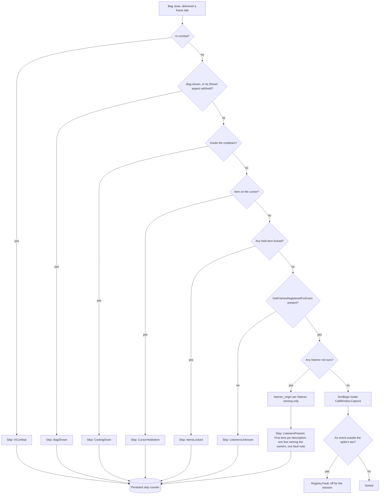
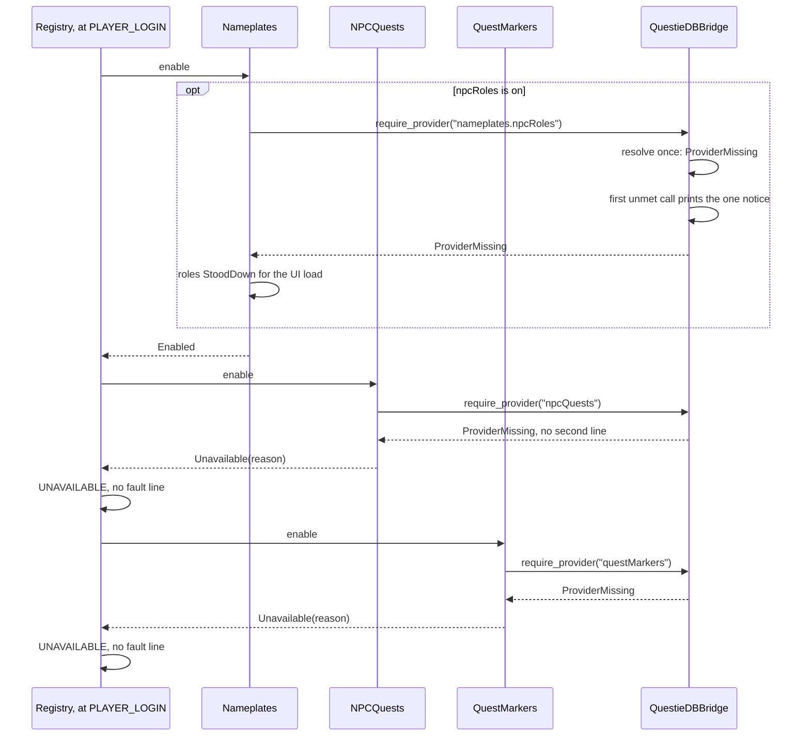

# PersonalAddon — Patch 02: WoW Forever goes live (1.60.1.70790, re-checked at 70840)

**Date:** November 4, 2026
**API version:** 1.60.1 (WoW Forever, live), game type `camelot`
**Client:** 1.60.1.70840 (`Wow.exe` of 2026-11-06 18:25), UI export 2026-11-06 18:50. Revision 1
was drafted against 1.60.1.70790 (`Wow.exe` of 2026-11-04 20:30, export 20:35). 70840 shipped two
days later, and revision 2 re-ran the check and re-read every unwatched citation against it
(§2.1). The beta's `WowB.exe` is gone, and the patch check cannot run without it (§2.4). Given
`--binary`, `status` reports **`CheckDue`** against the verified 70450. `check` against scratch
copies of the store and `verified.json` returned **Fail** on both builds, for the same four
reasons: one premise Broken, three NeedsReview, the surface unchanged, the lint clean (§2). §9.3
puts the accept before the build, which is the order Phase 20 §16.2 required.
**Status:** built 2026-11-06, not committed.
- Green: harness, mutation pass, lint, the patch check's unit tests, and the patch check itself.
- 70840 was accepted before the build, as §9.3 requires.
- Outstanding: the in-game checks G2–G10 (§13).
**Implements:** the user's two reports of 2026-11-04 — *"tidy bags is holding back while
something listens to what a sort delivers inside the call"* and *"NPC roles come from QuestieDB,
which is not usable here"* — the README's move from beta to live, and what the patch check found,
with the decisions of two question rounds (§1.1). Revision 2 adds the report of 2026-11-06 that
pulling back in combat no longer backpedals (§6.3), with the decisions of one more round.
**Corrects:** README (beta framing, install path, tidy bags' hold-back description, the rarity
ring, QuestieDB as a separate install); Phase 19 §4 (the ring is retired, not re-anchored);
Phase 20 §7.1 (the installed provider is QuestieDB 1.0.10, which moved the class keys);
`Core/QuestieDBBridge.lua:4-7` (provider version).
**Depends on:**
- `20260927-Phase08.md` §4.5, §7.1, §8.4 — `CallWindow`, the listener guard, the spike;
- `20261002-Phase09.md` §3 — Diagnostics sessions and fault notes;
- `20261002-Phase10.md` — the patch check;
- `20261011-Phase17.md` §2, `20261011-Phase18.md` §5 — the bridge's gates, and its answered versus non-answered rule;
- `20261016-Phase19.md` §4 — the ring this patch retires;
- `20261021-Phase20.md` §7 — NPC roles;
- `20261002-GAPBugs01.md` §2 — G1;
- README "Rules for future development".

**Revision:** 4 (history at the end; audit dispositions in §12, build record in §13).

---

## 0. Summary

| # | Finding | Kind | Disposition |
|---|---|---|---|
| F1 | Tidy bags never runs. QuestieTrace 1.8.0, installed with Questie 12.6.0, listens for `ITEM_LOCK_CHANGED` from load | Environment; the guard worked as designed | QuestieTrace disabled by the user; the notice now names the addon; skips persist (§3) |
| F2 | NPC roles, NPC tooltip quests and quest markers are all off: the live migration removed QuestieDB | Environment | Reinstalled (1.0.10). One notice instead of five, and an unmet provider is no longer a fault (§4.4–§4.6) |
| F3 | QuestieDB 1.0.10 carries no `classKeys` for Forever. `ClassMask` answers nil for every class, so every class-restricted quest is rejected `Unreadable` | **Defect, silent** | Read the published `Enum.classKeys` first (§4.3) |
| F4 | Blizzard re-enabled its nameplate rarity icon in Forever; `RARITY-ICON-OFF-IN-CAMELOT` is Broken | Client change | Our ring retired (§5) |
| F5 | The patch check cannot run on live: `WowB.exe` is hardcoded, and a missing binary raises | Tooling defect | Configurable binary; a `ClientMissing` refusal (§2.4) |
| F6 | Three premises NeedsReview through file churn | Client change | All hold in substance. G1 is **not** fixed (§2.2) |
| F7 | Beta wording, one instance functional: the `/pa` taint help points to `_classic_beta_/Logs` | Docs | §6 |
| F8 | Pulling back in combat turns the character around. Never an addon feature: the live client started from default gamepad settings (combat face-movement angle 105) | Environment | The user's Options setting; README only (§6.3) |
| F9 | 70840 shipped on 2026-11-06 | Client change | Re-checked: the same verdict and reasons as 70790; every citation re-verified (§2.1) |

---

## 1. Scope

### 1.1 Decisions

| Id | Question | Decision | By | Section |
|---|---|---|---|---|
| D1 | Should another addon's listener keep blocking tidy bags? | **Yes: any listener that is not ours blocks**, as Phase 8 §7.1 decided. The new origin read only names the owner | User | §3.2 |
| D2 | QuestieTrace | **Disabled** in the AddOns list. It collects data for Questie, which this setup runs disabled | User | §3.1 |
| D3 | QuestieDB | **Reinstalled**: 1.0.10, 2026-11-04 22:14 | User | §4 |
| D4 | Our rarity ring, now that Blizzard's icon is back | **Retired, whether or not Blizzard's icon is confirmed working** | User | §5 |
| D5 | How a feature reports an unmet optional provider | **A new feature state, `UNAVAILABLE`**, not `FAULTED`, behind one provider-owned notice | This patch | §4.5 |
| D6 | Version | **1.10.1**, `X-Phase` stays 20. Patches bump the third digit (`488abbd`: 1.0.0 → 1.0.1) | This patch | §10 |
| D7 | Combat movement | **The client's own setting**, the combat face-movement angle, set by the user in Options. README guidance only; no code | User, 2026-11-06 | §6.3 |
| D8 | 70840 | **Re-export and re-check before revising the plan** | User, 2026-11-06 | §2.1 |

### 1.2 What ships

1. **Tidy bags names what holds it back** (§3.3), and its skips and hold-backs survive a reload (§3.4). The guard itself is unchanged (D1).
2. **The bridge reads the class mask QuestieDB publishes** (§4.3), so class quests return to NPC tooltips.
3. **One QuestieDB notice per UI load**, owned by the bridge (§4.4). NPC quests and quest markers enter `UNAVAILABLE`, not `FAULTED` (§4.5). NPC roles stand down for the session instead of asking per plate (§4.6).
4. **The rarity ring is removed**, with its settings, constants, diagnostics, harness checks and five premises (§5).
5. **The patch check finds `Wow.exe`** through configuration, and refuses cleanly when the binary is missing (§2.4).
6. **README and wording move from beta to live** (§6).
7. **README guidance for combat movement**: the setting, its live default, and the reset that lost the beta's value (§6.3). No code.

### 1.3 Out of scope

- **Letting third-party listeners through.** Rejected by D1; the argument is recorded in §3.2 so it is not re-run.
- **An NPC role source without QuestieDB.** Phase 20 §1.3 rejected `C_TooltipInfo.GetUnit`. QuestieDB is back, so the question does not arise.
- **G1.** Still present on live (§2.2), and Blizzard's to fix.
- **QuestieTrace registering before consent.** It records nothing without consent. Registering early is what makes it a listener, and that choice is theirs.
- **`QUESTIE_REQUIRED_CONTRACT`.** It stays 3 (§4.2).
- **Writing gamepad movement settings from the addon** (D7). Offered and declined; §6.3 records why.

### 1.4 Types

```
EventName            = string
FrameLabel           = string
SourceLocation       = string
AddOnFolderName      = string
ConsumerId           = string
ClassFileName        = string
ClassMask            = integer
BridgeDescription    = string
ClientBinaryName     = string

ReadKind             = Plain | Absent | Withheld
WithheldDetail       = SecretValue | Unavailable | CallFailed | UnexpectedType
ClientReading<T>     = { kind: Plain, value: T }
                     | { kind: Absent }
                     | { kind: Withheld, detail: WithheldDetail }

ListenerOrigin       = Blizzard
                     | AddOn(folder: AddOnFolderName)
                     | Unknown(reason: OriginUnknownReason)
OriginUnknownReason  = Withheld | NoLocation | Unparsed
Listener             = { label: FrameLabel, origin: ListenerOrigin }
ListenerMap          = Map<EventName, List<Listener>>

SkipReason           = InCombat | BagShown | CoolingDown | CursorHoldsItem
                     | ItemsLocked | ListenersPresent | ListenersUnknown

BridgeState          = Available | ProviderMissing | ContractMismatch | WrongFlavor | Errored
EnableOutcome        = Enabled | Unavailable(reason: string) | Failed(reason: string)
FeatureState         = Registered | Disabled | Enabling | Enabled | Unavailable | Faulted
RoleCapability       = Off | Available | StoodDown(reason: BridgeDescription)

ClassMaskSource      = Published | ByExpansion
ClassMaskReading     = { mask: ClassMask, source: ClassMaskSource }
ClassMaskUnavailable = BridgeUnavailable | NoClassKeys | NotInClassKeys(name: ClassFileName)
PlayerFacts          = { level: integer | Absent,
                         raceMask: integer | Absent,
                         classMask: ClassMask | Absent,
                         classMaskSource: ClassMaskSource | ClassMaskUnavailable }

ClientIdentity       = { build: BuildString | Absent, binaryModifiedAt: Timestamp }
IdentifiedClient     = { identity: ClientIdentity, buildNote: string | Absent }
ClientMissing        = { expectedAt: Path, configKey: string }
```

`ClientReading<T>` is the pair `Core/ClientRead.lua` actually returns. `Call` answers:
- a missing function as `(Withheld, Unavailable)`;
- a raise as `(Withheld, CallFailed)`;
- a secret as `(Withheld, SecretValue)`;
- a wrong type as `(Withheld, UnexpectedType)`;
- a nil as `(Absent)` (`ClientRead.lua:79-103`).

Revision 2 modelled it as one flat union, which filed a missing method under `Withheld` (audit
finding 1).

---

## 2. The live patch check (70790, then 70840)

### 2.1 How it was run, and the verdict

`patch_check.py status` raises before reporting anything (§2.4). The CLI already accepts path
overrides (`patch_check.py:420-426`), so `check` was run with `--binary <client>\Wow.exe` and
with `--store`, `--verified` and `--reports` pointed at scratch copies of
`C:\tmp\PersonalAddonBaseline` and `Tools/patchcheck/verified.json`. Nothing in the repo or in
the real store was written. The committed report comes from §9.3 step 3.

It ran twice, each time from a fresh copy of the 70450 baseline: against 70790 on 2026-11-04,
and against 70840 on 2026-11-06 after the user re-exported (every export file dated 18:50).
70790 was never accepted, so the real check will compare 70840 with 70450, as the second run did.

**Verdict: Fail, on both builds.**

- Premises: 86 in the register. 82 hold, 3 NeedsReview, 1 Broken. The premise table is
  identical between the two runs.
- Surface: 243 names, 0 changed.
- Secret-read lint against the current docs: 0 hits, 5 allowlisted, 0 stale.
- Export: 8 files added and 9 removed; 176 modified at 70790, 177 at 70840. Documented entries: 7
  added, 1 removed, 8 with changed flags, none of them a name this addon uses.
- Load set: 3,353 files, no unknown tags, nothing listed but absent.

**What 70840 changed beyond 70790:** one more exported file differs from the baseline. The two
reports are otherwise identical, and so are the stored diffs of the eight watched files, so that
file lies outside every premise, watched file, surface name and documented entry. The unwatched
citations in this document were re-read on the 70840 export and hold:
- the item-lock listener set and its line numbers (§3.1);
- the Rarity Icon checkbox at `Nameplates.lua:609`, and the three-line Camelot override (§5.1);
- the gamepad settings (§6.3);
- `UnitDocumentation.lua:4178`, and the merchant footer line (§2.2).

### 2.2 The four premises

| Premise | Outcome | What changed (70790 and 70840 alike) | Review | Action |
|---|---|---|---|---|
| `RARITY-ICON-OFF-IN-CAMELOT` | **Broken** | `Blizzard_NamePlates/Camelot/Blizzard_NamePlateFrameOptionsOverrides.lua:1` (`NamePlateEnemyFrameOptions.showClassificationIndicator = false;`) deleted. `NameplatesOverrides.ShowRarityIconInfoDisplayOption` deleted from both `Camelot/` and `Mainline/NameplatesOverrides.lua`, so `Blizzard_SettingsDefinitions_Frame/Nameplates.lua:609` now adds the Rarity Icon checkbox unconditionally | Both of the gates in Phase 19 §1.3 are gone | Retired with the ring (§5, D4) |
| `G1-PATH` | NeedsReview | Six watched files: `MainActionBarFrame.lua` +93/−6, `FrameControlsManager.lua` +81/−192, `PromptedBindingFooter.lua` −14, `SmartNavigation.lua` +295/−140, `Utility.lua` +178/−123, `StaticPopupGamepad.lua` +7/−34. New: `Blizzard_GamepadSmartNavigation/SecureHelper.lua` | **G1 is not fixed.** On 70790, our session 2 of 2026-11-04 recorded `blockWatch.refusalsOthersKnownDefect = 16` with `knownDefectHintShown`, and BugGrabber holds `SetPreferredGamepadInteractTarget()` refused and blamed on BetterForeverChat, in the same session. That is G1's signature (GAPBugs01 §0). `G1-SOLE-CALLER` holds at `MainActionBarFrame.lua:373`, and BlockWatch's traced path still matched, because the refusals were classified as known | Keep BlockWatch's hint and the README's known issue; the README says it persists on live |
| `GUILD-INFO-UNDOCUMENTED` | NeedsReview | `UnitDocumentation.lua:4178`: `UNIT_COMBAT`'s `amount` gained `SecretValue = true` | Unrelated to the premise. `GetGuildInfo` is still undocumented, and no feature registers `UNIT_COMBAT` | Holds |
| `MERCHANT-FRAME` | NeedsReview | Baseline `MerchantFrame.lua:1252`, `self.footer:AddStandardFrameControlManagerBindings(self);`, removed | A gamepad footer binding. The interaction-manager open and `CloseMerchant` on hide are untouched, so Phase 8 §4.4's `MERCHANT_SHOW` classification stands | Holds |

This table is the review record that `accept --reviewed` relies on in §9.3.

### 2.3 Register changes

Retired with the ring (D4). Each one's consequence names only the ring:

| Id | Why it goes |
|---|---|
| `RARITY-ICON-OFF-IN-CAMELOT` | Broken, and the feature it protected is removed |
| `LEVEL-BADGE-FRAME` | Its only consumer is the ring's anchor |
| `LEVEL-BADGE-ANCHORED-TO-BAR` | Ring geometry |
| `LEVEL-INDICATOR-WIDTH` | Ring sizing fallback (`LEVEL_INDICATOR_WIDTH_FALLBACK`) |
| `BOSS-PORTRAIT-ATLASES` | Ring artwork |

Edited: `UNITCLASSIFICATION-READABLE` stays. Its consequence drops the ring and keeps ThreatPanel's
`+`/`r` level tags, which read the same API (`ThreatPanel.lua:325-332`).

Added:

| Field | Value |
|---|---|
| id | `SOURCE-LOCATION-NOT-SECRET` |
| statement | `ScriptRegion:GetSourceLocation` is secret only per object (`SecretReturnsForAspect` `ObjectDebug`), never unconditionally |
| source | Patch 02 §3.3 |
| consequence | Tidy bags stops naming the addon that holds it back and falls back to frame labels such as `<unnamed>`. No decision depends on it (Core/CallWindow.lua, Features/AutoSortBags.lua) |
| check | `FlagAbsent`, entry `SimpleScriptRegionAPI:GetSourceLocation`, flag `SecretReturns` |

`FlagAbsent` rather than `FlagEquals` on `SecretReturnsForAspect`: `FlagEquals` compares the
docs' literal text, and a table-valued flag's literal is not a stable thing to pin. After these
changes the register holds 82 premises, and the expected verdict is **Review** (§9.3).

### 2.4 The tool cannot find the client

**Root cause.** `Tools/common/paths.py:15` defines `BINARY = CLIENT / "WowB.exe"`, with no configuration
key. `client_build.identify` (`client_build.py:70-73`) calls `os.path.getmtime` on that path
unconditionally, so `status` dies with `FileNotFoundError`, a traceback instead of one of the
tool's own refusals. The same literal is in `patch_check.py:82, 108, 112`, `report.py:63` and
`tests/test_patch_check.py:59, 252`. It shows even when the binary is overridden: at 70840, before
the re-export, `status --binary <client>\Wow.exe` printed "WowB.exe (2026-11-06 18:25:31) is newer
than the export".

**Design.** The binary's name moves into `Tools/config.toml` as `client_binary = "Wow.exe"`.
`config.local.toml` can override it, for a PTR binary say, and `--binary` still wins over both.
A missing binary becomes a typed answer.

```
# Where the client binary is, from configuration rather than a literal.
# pre:  config is Tools/config.toml merged with Tools/config.local.toml
# post: client_root / config.client_binary, or client_root / "Wow.exe" when the key is
#       absent, so an older local override file keeps working
# raises: never
function client_binary_path(
    config: ToolConfig,
    client_root: Path
) -> Path

# The client's identity, or why there is none.
# pre:  none
# post: Success(IdentifiedClient) when the binary exists, buildNote carrying the
#       build-read failure reason exactly as today; Failure(ClientMissing) naming the path
#       and the config key when it does not. No file time is read for a file that is absent
# raises: never
function identify_client(
    binary: Path,
    build_reader: BuildReader
) -> Result<IdentifiedClient, ClientMissing>
```

`status` maps `ClientMissing` to the kind `ClientMissing` and exits 2, like every other
non-`UpToDate` kind. `check` and `adopt` are the two commands that identify the client
(`patch_check.py:195, 327`); they raise `Refused("ClientMissing", …)` and exit with
`REFUSED_EXIT`. `accept` never reads the binary: it accepts the identity `check` recorded in the
store (`patch_check.py:358-409`), so it is unchanged (audit finding 13). Every message uses
`binary.name` in place of the literal. `run_check` also saves the name in its report, so the
report's client line prints it.

---

## 3. Tidy bags: QuestieTrace

### 3.1 Root cause

- **Blizzard's side did not change.** The Blizzard files that register `ITEM_LOCK_CHANGED` or
  `ITEM_LOCKED` in the 70790 and 70840 exports are the same files as in the 70450 baseline. Only
  line numbers in `ContainerFrame.lua` moved (808 → 797, 836 → 825). `ItemBeltFrame` registers while shown, but
  it loads only in plunderstorm (`Blizzard_ItemBeltFrame.toc`: `AllowLoadGameType: plunderstorm`).
- **QuestieTrace 1.8.0 arrived.** It was installed at 20:37 with Questie 12.6.0. It is not in
  `AddOns.txt` (written 20:44), so it loads by its default state, which is enabled.
  `QuestieTrace.lua:174-181` lists `ITEM_LOCK_CHANGED` in its "inventory" category, and
  `QuestieTrace.lua:719-722` registers every tracked event on an **unnamed** frame at file scope.
  Consent (`:451`) gates recording, not registration.
- **The notice read `<unnamed>`** (round 1). Among the installed third-party addons, QuestieTrace is
  the only one that names either event.

So `CallWindow.Listeners` answered `ITEM_LOCK_CHANGED: <unnamed>`, and
`AutoSortBags.lua:137-143` skipped with `ListenersPresent` on every close. The guard did what
Phase 8 §7.1 specified, including for "another addon's bag frame" (Phase 8 §7.1 and its failure
table). The defects are elsewhere: the notice names nothing a person can act on (§3.3), and the
skip leaves no trace after a reload (§3.4).

### 3.2 Policy unchanged (D1)

Here is the argument, recorded so it is not re-run.

- **Why letting them through looks safe.** A third-party handler is insecure in any execution, so running it inside our sort adds no Blizzard-side taint.
- **What does change is blame.** A refusal that handler causes there may be attributed to this addon, and `/pa blocked` would then record it as ours.
- **Why it needs more than a name.** Letting addon listeners through needs a classifier that *decides*, and one Blizzard frame misread as an addon's reopens the hazard Phase 8 closed.
- **Why the cost of staying strict is acceptable.** For an addon listener the remedy belongs to the user: disable it, or use Clean Up Bags from the bag menu. Staying strict costs a feature that pauses, never a taint.

Consequence for this patch: the origin read below is used **for naming only**. A failure there
changes the words of the notice and never the decision.

### 3.3 Naming the owner

`ScriptRegion:GetSourceLocation()` returns where a frame was created
(`SimpleScriptRegionAPIDocumentation.lua:294-306`; a `string`,
`SecretReturnsForAspect = { Enum.SecretAspect.ObjectDebug }`). It is read through `ClientRead`,
like the `GetName` and `GetDebugName` reads beside it (`CallWindow.lua:65-78`). The string's format
is not documented, so the parse accepts either separator, ignores case, and searches anywhere in
the string. In-game check G4 confirms the format on this client.

```
# Who created one listening frame, for naming it. Never decides whether a sort runs (D1).
# pre:  target was returned by GetFramesRegisteredForEvent and is not this addon's
# post: AddOn(folder) when the location reads Plain and names a path under
#       Interface/AddOns/<folder>/ whose folder does not begin with "Blizzard_";
#       Blizzard when the folder does begin so, or the path lies under a Blizzard
#       source root (Interface/FrameXML, Interface/SharedXML, Interface/GlueXML).
#       Unknown(Withheld) only when the read is secret: (Withheld, SecretValue).
#       Unknown(NoLocation) when the method is missing (Withheld, Unavailable), raised
#       (Withheld, CallFailed), answered nil (Absent) or answered an empty string.
#       Unknown(Unparsed) when it answered something other than a string
#       (Withheld, UnexpectedType), or a string no rule matches.
#       The folder keeps the case the client returned
# raises: never
function listener_origin(target: Frame) -> ListenerOrigin:
    reading: ClientReading<SourceLocation> = ClientRead.call(target.GetSourceLocation, String, target)
    match reading:
        { kind: Withheld, detail: SecretValue }:
            return Unknown(Withheld)
        { kind: Withheld, detail: UnexpectedType }:
            return Unknown(Unparsed)
        { kind: Withheld, detail: Unavailable } | { kind: Withheld, detail: CallFailed } | { kind: Absent }:
            return Unknown(NoLocation)
        { kind: Plain, value: location_text }:
            if is_empty(location_text):
                return Unknown(NoLocation)
            location: SourceLocation = with_forward_slashes(location_text)
            if contains_any_ignoring_case(location, BLIZZARD_SOURCE_ROOTS):
                return Blizzard
            folder: AddOnFolderName | Absent = capture_ignoring_case(location, ADDON_FOLDER_PATTERN)
            if folder == Absent:
                return Unknown(Unparsed)
            if starts_with_ignoring_case(folder, BLIZZARD_FOLDER_PREFIX):
                return Blizzard
            return AddOn(folder)

# Who listens to each event now, this addon's frames left out. Phase 8 §4.5's contract,
# extended with each listener's origin.
# pre:  none
# post: one Listener per registered frame that is not ours: label as today (name, else
#       debug name, else "<unnamed>"), origin from listener_origin. Absent when the client
#       has no GetFramesRegisteredForEvent
# raises: never
function listeners(names: List<EventName>) -> ListenerMap | Absent

# The distinct addon folders among the listeners, in first-seen order.
# post: Blizzard and Unknown origins contribute nothing
# raises: never
function addon_owners(listener_map: ListenerMap) -> List<AddOnFolderName>
```

`BLIZZARD_SOURCE_ROOTS`, `ADDON_FOLDER_PATTERN` and `BLIZZARD_FOLDER_PREFIX` are named constants
in `Core/Constants.lua`. `any_listener` is unchanged: every `Listener` counts, whatever its origin.

`Describe` renders `EVENT: label (owner), label (owner); EVENT: none`, where the owner is the folder,
`Blizzard`, or `?`. It stays sorted, so the once-only key is still stable (`CallWindow.lua:120-128`).
Folders and labels are third-party text and pass through `EscapeGuard.Neutralize` before they
reach chat.

The notice is printed once per distinct description per UI load. Its words follow fixed rules
(audit finding 4):

```
# The words of one hold-back notice.
# pre:  any_listener(listener_map) is true
# post: Reading order is the events sorted by name, then each event's listeners in the
#       client's order. owners = addon_owners(listener_map): the distinct folders in that order.
#       When owners is not empty, the addon row below, with owners joined by ", " in both
#       places it appears.
#       Otherwise the Blizzard row, with names = the distinct labels in the same order:
#       a frame listening to both events is named once, and "<unnamed>" is named once,
#       followed by " x<N>" when N unnamed frames listen, joined by ", ".
#       The verb is "listens" for one owner or name, "listen" for several.
#       Every folder and label is neutralized
# raises: never
function hold_back_notice(listener_map: ListenerMap) -> ChatLine
```

| Listeners | Line |
|---|---|
| At least one addon owner | `tidy bags is off while <owners> listen(s) for item locks: a sort would run their code inside this addon's call. Disable <owners>, or use Clean Up Bags from the bag menu.` |
| Only Blizzard or unknown origins | `tidy bags is waiting: <names> listen(s) for item locks right now (an open panel, a Cooldown Manager bag item, or the bag tutorial); it tries again at the next close.` |

With QuestieTrace alone, the first row reads: `tidy bags is off while QuestieTrace listens for item
locks: a sort would run their code inside this addon's call. Disable QuestieTrace, or use Clean Up
Bags from the bag menu.`

### 3.4 Evidence that survives a reload

Today `state.skips` and `state.lastListeners` live in memory only
(`AutoSortBags.lua:36-46, 107-111`). On 2026-11-04, every close in five sessions was skipped, yet
`/pa diag` shows no `autoSortBags` counters at all.

```
# Counts one skip where it survives a reload.
# pre:  counters is Diagnostics.CountersFor("autoSortBags")
# post: state.skips[reason] and the persisted counter "skip" .. reason both rise by one;
#       state.lastSkip = reason. Counter names are fixed strings, never third-party text
# raises: never
function record_skip(
    reason: SkipReason,
    counters: DiagnosticCounters
) -> SkipReason

# The sort waits because something other than this addon listens (Phase 8 §7.1, D1).
# pre:  any_listener(listener_map) is true
# post: Returns record_skip(ListenersPresent, counters), with
#       state.lastListeners = describe(listener_map), as the shipped code already sets it.
#       One of holdBacksByAddOn, holdBacksByBlizzard or holdBacksByUnknown rises by one,
#       chosen by the most specific origin present (AddOn over Blizzard over Unknown).
#       Each listener whose origin is Unknown(reason) adds one to listenerOriginWithheld,
#       listenerOriginNoLocation or listenerOriginUnparsed.
#       The first time this UI load that a description is seen: one chat line
#       (hold_back_notice, §3.3) and one Diagnostics fault note carrying the description.
#       Diagnostics.NoteFault neutralizes and truncates it, and its capacity
#       (DIAGNOSTICS_FAULT_NOTE_CAPACITY, 8) bounds the set of descriptions noted; once it
#       refuses, nothing more is noted and faultNotesDropped counts the refusal.
#       Every counter lives in Diagnostics.CountersFor("autoSortBags"); CallWindow keeps none
# raises: never
function hold_back(
    listener_map: ListenerMap,
    counters: DiagnosticCounters
) -> SkipReason
```

Every other skip in `sortIfSettled` goes through `record_skip`. `/pa bags` prints each listener's
origin in both `listenersNow` and `lastListeners`. Today it prints only the former
(`Debug.lua:482-495`), so `commandBags` gains a `lastListeners` line, and a line with the origin
counters (audit findings 2 and 5).

### 3.5 Flow



---

## 4. QuestieDB

### 4.1 Root cause

- **The live migration removed QuestieDB.** Its folder was absent at 20:44, while `AddOns.txt` still read `QuestieDB: enabled`, a stale beta entry. Questie 12.6.0 (installed at 20:37) declares `X-QuestieDB-Contract: 4` and `OptionalDeps: QuestieDB` and does not bundle it. Questie's own check says *"QuestieDB not installed. Please reinstall Questie in your addon manager"* (`Questie/Modules/VersionCheckDB.lua:35-37`).
- **The bridge saw no provider.** `_G.LibQuestieDB` was nil, so the state was `ProviderMissing` (`QuestieDBBridge.lua:84-88`).
- **The consumers each said so separately.**
  - NPCQuests and QuestMarkers failed `enable` (`NPCQuests.lua:390-397`, `QuestMarkers.lua:741-747`). Each printed its own line, and Registry then printed *"feature '…' faulted … and is disabled for this session"* for each (`Registry.lua:83-85`).
  - Nameplates printed the roles line on the first friendly plate (`Nameplates.lua:504-507`) and counted `roleBridgeUnavailable` once per plate: 24, 58 and 389 in sessions 3–5.

  That is up to five lines for one cause, and two of them are errors.
- **Load order is not a factor.** Features enable at `PLAYER_LOGIN` (`Registry.lua:338-341`), after every addon that is not load-on-demand.

### 4.2 QuestieDB 1.0.10 against the bridge

| Bridge assumption | 1.0.10 | Holds |
|---|---|---|
| `RequireContract(3)` passes | Accepts `[minSupportedContract, contractVersion]` = `[1, 4]` (`src/config.lua:18-23`, `src/api.lua:101-110`) | Yes |
| Flavour gate `"Forever"` | `name = "Forever"`, with `_Camelot` as a suffix alias (`src/config.lua:66`); `flavor` set from `flavorByName` (`src/read/baked.lua:149`) | Yes |
| Globals `QuestDB`, `NpcDB`, `ItemDB` | `_G[entityType.name .. "DB"]` (`src/api.lua:30`) | Yes |
| Every getter the bridge calls: `questStarts`, `name`, `subName`, `questLevel`, `requiredLevel`, `requiredMaxLevel`, `requiredRaces`, `requiredClasses`, `preQuestSingle`, `preQuestGroup`, `exclusiveTo`, `objectives`, `extraObjectives`, `npcDrops` | Declared in `Types/Quest.t.lua`, `Types/Npc.t.lua`, `Types/Item.t.lua` | Yes |
| `LibQuestieDB.ObjectiveFirst` | `compat.objectiveFirst` (`src/corrections/_end.lua:18`); Forever now carries six hints, up from four (`foreverQuestFixes.lua:15-20`) | Yes |
| `Enum.raceMaskById` | `src/corrections/enum/expansions.lua:11` | Yes |
| `Enum.byExpansion[flavor.expansion].classKeys` | **Absent for Forever** (§4.3) | **No** |

`QUESTIE_REQUIRED_CONTRACT` stays 3. Asking for 4 gains nothing and would reject any provider
whose maximum is 3. The 1.0.10 changelog lists NPC ranks and reputation spillover fractions for
Forever, and nothing this addon reads.

### 4.3 The class mask defect

- **Where the keys live now.** In QuestieDB 1.0.10, `byExpansion.Forever` carries `npcFlags` and `raceKeys` but no `classKeys` (`src/corrections/enum/expansions.lua:330-370`). QuestieDB selects with `byExpansion[flavor.expansion][name] or byExpansion[flavor.rules][name]` and publishes the result as `LibQuestieDB.Enum.classKeys` (`src/api.lua:66-76`). Forever's `rules` is `Classic` (`src/config.lua:66`).
- **What the bridge reads.** `ClassMask` reads only `Enum.byExpansion[flavor.expansion].classKeys` (`QuestieDBBridge.lua:176-201`). For Forever that table has no class keys, so the bridge answers nil for every class.
- **The effect.** NPCQuests' player facts carry no class mask (`NPCQuests.lua:97-105`), and `judgeQuest` rejects every quest with `requiredClasses > 0` as `Unreadable` (`NPCQuests.lua:191-194`).
  - Rule 10 holds: "could not tell" is not read as "no", so the quest is hidden rather than misjudged.
  - But the only traces are the `playerFactUnreadable` counter and `/pa quests`'s `classMask=unreadable`. Class quests vanish from NPC tooltips with no message.
- **Why Phases 17 and 20 could not catch it.** Their providers (1.0.5, 1.0.6) carried the keys where the bridge looks.
- **The keys match the client.** Classic's keys are `UnitClass` file names, `WARRIOR` through `DRUID` (`expansions.lua:42-56`), which cover the nine classes `CLASS_SORT_ORDER` lists for this client.

```
# One field of a QuestieDB table, through ClientRead (rule 10).
# post: the field when the container is a readable table, the key is present, and the
#       field reads Plain with the expected type; Absent otherwise, including when the
#       container or the key is itself Absent. Nothing is indexed before the container is
#       known to be a table (ClientRead.Field, ClientRead.lua:203-218)
# raises: never
function read_field(
    container: Value | Absent,
    key: Key | Absent,
    expected: LuaType
) -> Value | Absent

# One class's bit in a class-key table.
# post: Success({ mask, source }) when the table holds a Plain number for the class;
#       Failure(NotInClassKeys(class_file_name)) otherwise
# raises: never
function mask_in(
    keys: ClassKeyTable,
    class_file_name: ClassFileName,
    source: ClassMaskSource
) -> Result<ClassMaskReading, ClassMaskUnavailable>

# The player's class in QuestieDB's class-bit numbering.
# pre:  class_file_name is UnitClass's second return, read Plain
# post: Success({ mask, Published }) when LibQuestieDB.Enum.classKeys is a readable table
#       holding a Plain number for class_file_name: QuestieDB's own selection for the
#       active flavour, its rules fallback included.
#       Else Success({ mask, ByExpansion }) from Enum.byExpansion[flavor.expansion].classKeys,
#       the only place providers before 1.0.10 put it.
#       A published table that lacks the class is NotInClassKeys, with no fallback,
#       because the published table is QuestieDB's answer.
#       Every table on the way is read one step at a time through read_field, so an absent
#       or non-table Enum, flavor or byExpansion answers NoClassKeys rather than raising.
#       The source is counted: classMaskPublished, classMaskByExpansion or
#       classMaskUnavailable
# raises: never
function class_mask(class_file_name: ClassFileName) -> Result<ClassMaskReading, ClassMaskUnavailable>:
    if resolve_state() != Available:
        return Failure(BridgeUnavailable)
    enum: Table | Absent = read_field(LibQuestieDB, "Enum", Table)
    published: ClassKeyTable | Absent = read_field(enum, "classKeys", Table)
    if published != Absent:
        return mask_in(published, class_file_name, Published)
    flavor: Table | Absent = read_field(LibQuestieDB, "flavor", Table)
    expansion: string | Absent = read_field(flavor, "expansion", String)
    by_expansion: Table | Absent = read_field(enum, "byExpansion", Table)
    flavour_set: Table | Absent = read_field(by_expansion, expansion, Table)
    legacy: ClassKeyTable | Absent = read_field(flavour_set, "classKeys", Table)
    if legacy != Absent:
        return mask_in(legacy, class_file_name, ByExpansion)
    return Failure(NoClassKeys)
```

`resolveState` has already established that `LibQuestieDB` is a table before the state is
`Available` (`QuestieDBBridge.lua:84-88`). Everything beneath it is read through `read_field`
(audit finding 6).

`NPCQuests.playerFacts` unpacks the result into `PlayerFacts` (§1.4):
- `classMask` is the plain number `MaskHolds` receives (`NPCQuests.lua:195`), or Absent on failure;
- `classMaskSource` keeps the tag, or the failure, for `/pa quests`.

Any failure still counts as an unreadable player fact, so the rejection behaviour on failure is
unchanged. In Lua, `Bridge.ClassMask` returns two values: the mask or nil, then the source or the
failure's name. No table is built per tooltip (audit finding 7).

`/pa quests` prints `classMask=<n> (Published)`, or the failure. It used to print the facts of
the last hovered NPC's tooltip only, so straight after `/reload` it read "unreadable" both before
and after any fix. `NPCQuests.Inspect` now reads the player's facts afresh when nothing has been
hovered yet, without counting `playerFactUnreadable` (audit finding 7).

`RaceMask` is unchanged: `raceMaskById` is expansion-invariant and present.

### 4.4 One notice per outage

The bridge already resolves its state once per UI load (`QuestieDBBridge.lua:78-82`). It now
also owns the only line a missing or unusable provider prints. It learns who depends on it from
their calls, so Core never names a feature.

```
# One consumer's need for QuestieDB.
# pre:  consumer is a constant id from this addon's own code, never third-party text
# post: The resolved BridgeState, resolution unchanged. When it is not Available,
#       consumer joins unmet_consumers (bounded by the consumer ids in the code: three
#       today), and the first such call in the UI load prints the one notice for that
#       state; later calls print nothing.
#       The notice is built from the state's kind and its raw detail, never from Describe,
#       which prefixes the kind already (audit finding 10).
#       Reset, which only the harness calls, empties unmet_consumers too (audit finding 9)
# raises: never
function require_provider(consumer: ConsumerId) -> BridgeState:
    provider_state: BridgeState = resolve_state()
    if provider_state == Available:
        return Available
    if not contains(unmet_consumers, consumer):
        append(unmet_consumers, consumer)
    Log.once(QUESTIE_UNMET_NOTICE_KEY, unmet_notice(provider_state, state.detail))
    return provider_state
```

| State | Notice |
|---|---|
| `ProviderMissing` | `QuestieDB is not loaded. It is a separate addon that Questie does not bundle: install it, enable it in the AddOns list, then /reload. Until then, /pa quests lists what is off.` |
| `ContractMismatch` | `QuestieDB refused this addon's contract: <detail>. /pa quests lists what is off.` (`<detail>` is QuestieDB's own message) |
| `WrongFlavor` | `QuestieDB loaded its <detail> data, not Forever's: reinstall QuestieDB for WoW Forever, then /reload.` (`<detail>` is the flavour name) |
| `Errored` | `QuestieDB's contract check raised; /pa quests has the detail and lists what is off.` |

QuestieDB's message and the flavour name are third-party text, so they are neutralized before
they are printed. The three consumers call `require_provider` and drop their own lines
(`NPCQuests.lua:392-394`, `QuestMarkers.lua:743-745`, `Nameplates.lua:504-507`). `/pa quests`
prints `unmet_consumers` under the bridge's state.

`nameplates.npcRoles` defaults to off (`Nameplates.lua:109, 2036`). Nameplates calls
`require_provider` only when the setting is on (§4.6), so under defaults two consumers ask, not
three (audit finding 8):



### 4.5 An unmet provider is not a fault (D5)

**The problem.** Registry has exactly one failure state. An `enable` that returns `nil, reason`
goes to `enterFault` and prints an error line. A missing optional provider is a fact about the
setup, not a defect in this addon. The error framing asks for a bug report that should not be
filed, and it duplicates the provider's own notice.

```
# Brings one feature up, telling an unmet provider from a fault.
# pre:  record.state is Registered, Disabled or Unavailable
# post: Enabled -> ENABLED. Unavailable(reason) -> everything the attempt subscribed is
#       released, state UNAVAILABLE, the reason kept for /pa status, and no chat line,
#       because the provider's notice is the one line. Failed(reason) or a raise ->
#       enter_fault, unchanged: FAULTED and one error line. The stored preference is never
#       touched
# raises: never
function enter_enabled(record: FeatureRecord) -> FeatureState:
    record.state = Enabling
    attempt: Result<EnableOutcome, LifecycleRaise> = Isolation.call(record.lifecycle.enable, ConfigStore.feature(record.id))
    match attempt:
        Failure(raised):
            return enter_fault(record, "enable raised", raised)
        Success(Failed(reason)):
            return enter_fault(record, "enable failed: " + reason)
        Success(Unavailable(reason)):
            release_feature(record)
            record.state = Unavailable
            record.faultReason = reason
        Success(Enabled):
            record.state = Enabled
            record.faultReason = Absent
    return record.state
```

- The record keeps the reason in its existing `faultReason` field, which `Registry.State` already returns. The field now holds the reason for `UNAVAILABLE` too, so no reader changes (audit finding 11).
- `SetEnabled(featureId, true)` returns `false, reason` when the attempt ends `UNAVAILABLE`: the feature did not enable.
- `/pa on` (`Debug.lua:116-134`) prints that through `Log.Info` as `<feature> -> UNAVAILABLE: <reason>`, not `Log.Error`.
- tests17's Q1 return-value assertion stands, and gains a state check and a no-"faulted"-line check (§9.1).
- `SetEnabled(false)` adds `UNAVAILABLE` to the states it releases (`Registry.lua:211-216`).
- `SetEnabled(true)` from `UNAVAILABLE` tries again. It answers `UNAVAILABLE` again for the rest of the UI load, because the bridge state is fixed until `/reload`.
- `/pa status` already prints any state together with its reason (`Debug.lua:101-110`), so it needs no change.
- In the Lua shape, a third return value marks Unavailable. A two-value `nil, reason` keeps meaning Failed, so no other feature changes.
- Cost: one state, one branch, one entry in the release set. This is not premature abstraction: two features return exactly this outcome today.

### 4.6 NPC roles stand down for the session

The bridge state is fixed for the UI load, and QuestieDB is not load-on-demand. A per-plate retry
can therefore never succeed: the 389 reads of session 5 bought nothing.

```
# Whether NPC roles can be read this UI load.
# pre:  called from enable, and from onConfigChanged whenever npcRoles changes
# post: Off while npcRoles is off, and require_provider is not called (the setting
#       defaults to off; audit finding 8). Available when require_provider
#       ("nameplates.npcRoles") answers Available. Otherwise StoodDown(describe()), counted
#       once per transition as roleCapabilityStoodDown and kept until the next call.
#       While StoodDown, wanted_role returns no label without reading UnitIsFriend, the GUID
#       or the bridge
# raises: never
function resolve_role_capability() -> RoleCapability
```

The capability judges the provider. One NPC's read can still fail while the provider is
`Available`, for example a `subName` getter that raises for that NPC. `Bridge.NpcRole` then
answers `Unavailable` for that NPC alone. `wanted_role` gives that plate no label, caches
nothing, as before, and counts `roleReadsFailed`, with no chat line. That per-NPC half is what
tests20's R9 measures (audit finding 9).

The per-plate `roleBridgeUnavailable` counter and its once-only line are retired. Their per-NPC
half becomes `roleReadsFailed`; their provider half is the capability. `/pa plates` prints
`roleCapability`, with the reason when the roles have stood down, beside the bridge's own
description.

---

## 5. The rarity ring, retired (D4)

### 5.1 What Blizzard changed

- The Camelot override is deleted, so `NamePlateEnemyFrameOptions.showClassificationIndicator`
  is the shared default, `true` (`Blizzard_NamePlateFrameOptions.lua:69-87`).
- The settings gate is deleted, so the `Enum.NamePlateInfoDisplay.RarityIcon` checkbox is always
  offered (`Blizzard_SettingsDefinitions_Frame/Nameplates.lua:609`).
- Drawing still needs that checkbox's CVar bit (`Blizzard_NamePlateClassificationFrame.lua:68-75`).
  It never draws on friendly plates, because
  `NamePlateFriendlyFrameOptions.showClassificationIndicator = false`
  (`Blizzard_NamePlateFrameOptions.lua:38-56`). It also never draws on raid-marked, name-only or
  widgets-only plates (`Blizzard_NamePlateClassificationFrame.lua:90-106`).
- Its mapping: `elite` and `worldboss` gold, `rare` a star, `rareelite` silver (`:117-127`).

### 5.2 Why the in-game test showed nothing

The test: a Horde character, an Orgrimmar Grunt, Blizzard's checkbox on and ours off. Nothing was
drawn.

- **Neither icon could have drawn there.** Both are designed for enemies only: Blizzard's through the friendly option above, ours through `UnitCanAttack` (`Nameplates.lua:1266-1267`). To a Horde character the grunt is friendly.
- **A separate reading.** Our tier counter is bumped at every plate attach, before any gate (`Nameplates.lua:1416-1419`). It read zero `ringTier*` in all five sessions of 2026-11-04. So no tracked unit, the grunt included, was classified `elite`, `rare`, `rareelite` or `worldboss`, and whether the grunt is elite in Forever is unverified.

D4 does not depend on either point. G7 offers an optional look at a hostile elite.

### 5.3 What is removed

The line ranges are as of 1.10.0; confirm them at build time.

| Where | What |
|---|---|
| `Features/Nameplates.lua` | The `RING` enum (`:46-53`); ring state fields (`:96-105`); ring settings in `readSettings` (`:144-153`); the level badge in `resolveParts` (`:172-180`), because nothing else reads it; the ring section, from its Phase 19 header through `refreshRingsAllowed` (`:1089-1348`: pool, artwork resolution, tier read, `ringsAllowedHere`, `applyRarityRing`, release, map gate); the release on untrack (`:1364-1367`); the tier read and counters at attach (`:1395-1418`); the ring's scope and attackable re-evaluations (`:1443`, `:1489`, `:1644-1647`, `:1855`, `:1896-1900`); config handlers (`:1958-1973`); defaults (`:2040-2043`); schema (`:2095-2110`); Inspect fields (`:2268-2305`), including `classificationWithheld` (`:2305`), whose only writer was the tier read (audit finding 14) |
| `Core/Constants.lua:426-480` | The Phase 19 ring section: every `RARITY_*` constant, and `LEVEL_INDICATOR_WIDTH_FALLBACK` |
| `Core/Debug.lua:260-282` | The ring lines of `/pa plates` |
| `Tools/harness/tests19.lua` | The ring checks (`:423-589`), and T34's "with rings on" wording. Phase 19's QuestMarkers checks stay |
| `Tools/harness/stubs19.lua` | Only the atlas reader and the level badge, whose sole users were the ring checks. The classification wrapper, the frame recorder and the restriction knob load in every session and stay |
| `Tools/patchcheck/premises.toml` | §2.3 |
| `README.md` | §6.1 |

Kept: ThreatPanel's own `UnitClassification` read. This addon never writes
`NamePlateEnemyFrameOptions` or the info-display CVar (rule 2). Blizzard's checkbox is the user's
to set.

### 5.4 Stored settings

`nameplates.rarityRings`, `rarityRingSize`, `rarityRingOffsetX` and `rarityRingOffsetY` are pruned
at hydration, because no default claims them any longer (`ConfigStore.lua:94-110`). Four one-time
"pruned obsolete key" notices on the first login after the update are expected. No migration step
is needed: renames belong to migrations, removals to the prune. Downgrading to 1.10.0 brings the
keys back at their defaults.

---

## 6. Beta to live

### 6.1 README

| Where (current line) | Today | Change |
|---|---|---|
| L7, intro | "developed for the World of Warcraft Forever Beta (API 1.60.1)" | "developed for World of Warcraft Forever (API 1.60.1). Built during the beta; maintained against the live client since build 1.60.1.70790" |
| L131, Quests tour, "Bridge Architecture" | "without requiring the full Questie interface suite" | Add: QuestieDB is its own addon, and Questie itself may stay disabled |
| L138-148, Installation | `_classic_beta_/Interface/AddOns/PersonalAddon/` | `_forever_/Interface/AddOns/PersonalAddon/`. New step: QuestieDB (a separate addon, optional) for NPC quest tooltips, quest markers and NPC roles. Addon managers may install Questie without it; `/pa quests` reports whether it is usable |
| L195-196, "Rare and Elite Rings on Nameplates" | The feature | Delete |
| L204-205, Automated Bag Consolidation | "suspended while item locks or Cooldown Manager updates are active" | "Held back while items are locked, and while anything else listens for item-lock events: a Cooldown Manager bag item, the bag tutorial, an open panel, or another addon (QuestieTrace listens from load). `/pa bags` names it" |
| L224, Well Fed note | "nearly all Forever Beta food" | "nearly all Forever food" |
| L254, `/pa bags` | "including skip reasons" | "including skip reasons and what holds a sort back" |
| L256, `/pa quests` | "Displays QuestieDB bridge status, offered NPC quests, and marker targets" | Add "and which features are waiting for QuestieDB" |
| L257, `/pa plates` | "(guild names, NPC roles, name alignment and its capability)" | "(guild names, NPC roles and whether they can be read, name alignment and its capability)" |
| Troubleshooting, G1 | — | Add: "Still present on the live client (1.60.1.70790, 2026-11-04)" |
| Troubleshooting, new | — | **Tidy Bags Never Runs.** Mechanism: a sort delivers `ITEM_LOCK_CHANGED` inside the call, and another addon listening would run inside this addon's execution. Symptom: one chat line naming the addon. Fix: disable it (QuestieTrace, as installed with Questie 12.6.0), or use Clean Up Bags from the bag menu |
| Troubleshooting, new | — | **Quest Tooltips, Quest Markers and NPC Roles Are Off.** Mechanism: QuestieDB missing or unusable. Symptom: one chat line; `/pa status` shows `UNAVAILABLE`. Fix: install QuestieDB, enable it, then `/reload` |
| What the Game Already Does | — | Add: "A rarity icon on enemy nameplates: Options → Nameplates → Rarity Icon. Forever turned it on in build 1.60.1.70790, and PersonalAddon's ring was retired for it (Patch 02 §5)" |
| Tried and Not Possible, "Nameplate Rarity Icons via Client Feature" | The row | Delete: the client now ships the feature |
| L293, What the Game Already Does | "Directional strafing/backpedaling angles configured via Options → Gamepad." | "Strafing and backpedaling in combat: Options → Gamepad → Camera → the combat face-movement angle. At 0 you always turn to face where the stick points; at 180 you never do, so you strafe and backpedal. The live default, 105, strafes but turns you around when you pull back. The backpedal threshold beside it sets how hard a pull turns you instead. PersonalAddon never changes these; they are yours to set" |
| Troubleshooting, new | — | **Pulling Back in Combat Turns the Character Around.** Mechanism: the live launch started every gamepad setting from its default, and values tuned on the beta did not carry over. Fix: Options → Gamepad → Camera → set the combat face-movement angle to 180; if a full pull still turns you, raise the backpedal threshold. PersonalAddon has never controlled movement (Phase 07 §4) |
| Tried and Not Possible, new row | — | **Target-Gated Combat Strafing.** Strafing only while a hostile target is selected, with a delay before switching back, means owning the client's face-movement settings: a secure-setting refusal, `CVAR_UPDATE` listeners (the settings panel among them), and losing the user's own value. The static version is a client setting. [Phase 7](Architecture/20260926-Phase07.md) §4.2 |
| Development | — | The patch check reads the client binary's name from `client_binary` in `Tools/config.toml` (default `Wow.exe`) |

`Tools/README.md`: the Setup paragraph names `client_binary`. Its harness line ("seventeen
sessions, 439 checks") is already stale, since `run.py` lists 27 sessions; it is updated with the
totals after this patch.

### 6.2 Code and comments

| File:line | Text | Change | Kind |
|---|---|---|---|
| `Core/Debug.lua:785` | "in _classic_beta_/Logs/taint.log the line above each…" | "in Logs/taint.log, in the game folder, the line above each…" | **Functional**: the path does not exist on live |
| `PersonalAddon.toc:17-18` | "If the beta reports a different number, only this line changes." | "If the client reports…" | Wording |
| `Core/Constants.lua:2` | "so a beta patch that moves one" | "so a client patch that moves one" | Wording |
| `Features/SettingsPanel.lua:14` | "On this beta, closing Options after a change…" | "On the beta, …" (a historical observation, not re-verified on live) | Wording |
| `Core/QuestieDBBridge.lua:4-7` | "1.0.5, contract 3" | "1.0.10, contracts 1–4, baked mode, Forever flavour" | Stale fact |
| `CLAUDE.md:3` | "Forever - Beta expert" | Not changed by this patch: the owner's own instructions | — |

### 6.3 Combat movement: gamepad settings that did not carry over

**The report (2026-11-06).** Pulling the stick back in combat now turns the character around; on
the beta it backpedalled. The user first remembered this as a PersonalAddon feature, then
recalled that it is a client setting.

**It was never this addon's.** Phase 07 §4 dropped "dynamic gamepad movement"
(`20260926-RoadmapProposal02.md` item 1) because the client already does it. No commit has
written a movement setting in code:
- the commits whose diffs mention `FaceMovement` or `backpedal` (`2c37615`, `1d45680`, `55f0d49`)
  touch only documents;
- no Lua change in the history calls `SetCVar` on a `GamePad` setting.

The README lists the setting under "What the Game Already Does" (L293), in one line too terse to
find once the behaviour changed.

**Why it changed.** The client keeps these settings in `WTF/Config.wtf`, where Phase 07 §4.1 read
the user's beta angles (45 for both, 2026-09-26). The live client's `Config.wtf`, written
2026-11-06 18:26, holds no movement setting. The account's `bindings-cache.wtf` holds only two
Terminal binds and one modified click. The beta's values did not carry over, and there is nothing
to recover them from: `_classic_beta_` has no `WTF` folder. So live runs its defaults:

| Options → Gamepad → Camera | Setting | Default | Client help text (live `Wow.exe`) |
|---|---|---|---|
| Face-movement angle | `GamePadFaceMovementMaxAngle` | 0 (`Gamepad.lua:104-107`) | "Max movement to camera angle to face movement direction instead of camera direction. 0 = always, 180 = never (115 allows using strafe with quick turn around)" |
| Face-movement angle, combat | `GamePadFaceMovementMaxAngleCombat` | **105** (`:109-112`) | The same text, "in combat" |
| Backpedal threshold | `GamePadBackPedalThreshold` | 0.6 (`:114-117`) | "Stick magnitude threshold to face the movement direction instead of back pedal" |
| Turn with camera | `GamePadTurnWithCamera` | 3 (`:76-102`) | "Turn character to match when camera facing is changed (1=in-combat, 2=always, 3=in-combat or casting)" |

These are the defaults the Options panel declares. `Gamepad.lua` is identical in 70450, 70790 and
70840.

What the combat angle does:
- **At 105** a stick pushed more than 105° from the camera's direction turns the character to face it. Sideways still strafes, but a pull straight back (180°) turns you around.
- **At 180** nothing turns you in combat: you strafe and backpedal.

How the backpedal threshold combines with 180 is undocumented. By its help text, a pull stronger
than the threshold faces the movement direction instead of backpedalling. So if a full pull still
turns the character at 180, the threshold is the second setting to raise.

**Decision (D7): the client's setting, and README guidance only.** The user sets the combat angle
in Options. The README records the setting, its live default and the reset (§6.1). The
target-gated variant that Phase 07 §4.2 rejected moves into "Tried and Not Possible", so it is not
proposed again. Two alternatives were offered and declined:
- **A read-only `/pa` readout of the four settings.** It would diagnose the next reset in one command, but the troubleshooting entry names the same fix.
- **The addon writing the setting.** Phase 07 §4.2's hazards apply:
  - a secure-setting refusal;
  - `CVAR_UPDATE` listeners, the settings panel among them, that may run inside our write — a rule 9 question no spike has answered;
  - owning the user's own value.

  All of that buys only survival of the next settings wipe, and it breaks the README's policy for client options: "PersonalAddon never changes this option itself; it is yours to set" (Phase 20 §4).

**Verification:** G10 (§9.2).

---

## 7. Taint review

Checked against README "Rules for future development".

| Change | Blizzard calls our code? | Blizzard reads a value we wrote? | Blizzard handles our frames? | Notes |
|---|---|---|---|---|
| `listener_origin` | No | No | No | A read on frames Blizzard returns, like `GetName` today. Rule 10 through `ClientRead` |
| `record_skip`, `hold_back` | No | No | No | Our SavedVariables; chat through `AddMessage` (a documented exception) |
| `require_provider` and the notice | No | No | No | Third-party tables and chat only |
| `UNAVAILABLE` | No | No | No | Lifecycle inside our `PLAYER_LOGIN` handler (rule 1) |
| Roles standing down | — | — | — | Removes reads from inside Blizzard's draw hooks: strictly less work on the documented exception's path |
| Ring retired | — | — | — | Removes an addon frame anchored to Blizzard's level badge (rule 6) and its per-sweep writes. We never write Blizzard's option table or CVar (rule 2) |
| `class_mask` | No | No | No | Third-party tables only |
| Tools | — | — | — | Offline |

**Net:** no new path by which Blizzard calls our code, reads our values or handles our frames,
and two existing paths are removed.

---

## 8. Failure modes

| Failure | Detected by | Behaviour | Surfaced as |
|---|---|---|---|
| `GetSourceLocation` missing, or it raises | `ClientRead` answers `(Withheld, Unavailable)` or `(Withheld, CallFailed)` | `Unknown(NoLocation)`; labels only | Owner shown as `?`; `listenerOriginNoLocation` (§3.4) |
| The location is secret for one frame | `ClientRead` answers `(Withheld, SecretValue)` | `Unknown(Withheld)` | `?`; `listenerOriginWithheld` (§3.4) |
| The location's format is not parseable | The parse, or `(Withheld, UnexpectedType)` | `Unknown(Unparsed)` | `?`; `listenerOriginUnparsed`; G4 catches it at verification |
| One NPC's role read fails while the provider is `Available` | `Bridge.NpcRole` answers `Unavailable` for that NPC | No label on that plate; nothing cached | `roleReadsFailed` (§4.6) |
| A frame's location names an addon folder although Blizzard code drives it (an addon built it from a Blizzard template) | Not detected | Words only: the sort is still held (D1) | The wrong owner named |
| Fault-note capacity reached | `NoteFault` returns false | No further notes | `faultNotesDropped` |
| QuestieDB missing, wrong flavour, contract refused, or check raised | `require_provider` | Consumers `UNAVAILABLE`; roles `StoodDown` | One notice; `/pa status`; `/pa quests` lists what is unmet |
| QuestieDB installed mid-session | — | Stays unavailable until `/reload` | The notice says `/reload` |
| `Enum.classKeys` absent (an older provider) | `class_mask` | Falls back to `ByExpansion` | `classMaskByExpansion` |
| Both class-key tables absent | `class_mask` | Failure; class quests rejected `Unreadable`, as today | `classMaskUnavailable`; `/pa quests` |
| The player's class absent from the published keys | `class_mask` | `NotInClassKeys`; the same rejection | The same |
| Client binary missing | `identify_client` | `status` answers `ClientMissing`; `check` and `adopt` refuse | The message names the path and the config key |
| Stored ring settings | Hydration prune | Pruned | One notice per key, once |
| The client resets its gamepad settings (a migration, a reinstall) | Not detected: the addon reads no movement setting (D7) | The defaults: in combat, pulling back turns you around | README troubleshooting (§6.3) |

There is no new single point of failure. QuestieDB already was one for three features (Phase 17),
and this patch makes its absence loud once and accurate. Every new collection is bounded: consumer
ids by the code, noted descriptions by the fault-note capacity. Every persisted counter has a
fixed name.

---

## 9. Verification

### 9.1 Offline

**A new harness file**, `Tools/harness/testsPatch02.lua`, with `stubsPatch02.lua`, run in three
sessions: `patch02` (QuestieDB 1.0.10 shape), `patch02-oldprovider` (1.0.6 shape: no
`Enum.classKeys`, `byExpansion[expansion].classKeys` present) and `patch02-noprovider`.

| Id | Check |
|---|---|
| P1 | 1.0.10 shape: `class_mask("WARRIOR")` answers `{ 1, Published }`, and a class-restricted quest is offered |
| P2 | 1.0.6 shape: `{ 1, ByExpansion }` |
| P3 | Neither table: failure; NPCQuests counts `playerFactUnreadable` and rejects the class quest `Unreadable` (unchanged). An `Enum` that is not a table answers `NoClassKeys` without raising |
| P4 | No provider, `npcRoles` on: three consumers, exactly one QuestieDB line in chat, and `unmet_consumers` = `nameplates.npcRoles`, `npcQuests`, `questMarkers`. With `npcRoles` off: two consumers, the same single line, and `roleCapability` = `Off` |
| P5 | `Unavailable(reason)` → `UNAVAILABLE`, no "faulted" line, subscriptions released; `SetEnabled(false)` → `DISABLED`; `SetEnabled(true)` → `UNAVAILABLE` again |
| P6 | Regression guard: a two-value `nil, reason` is still `FAULTED` with its line |
| P7 | Roles `StoodDown`: across N friendly plates, zero `UnitIsFriend`, GUID or bridge reads; `roleCapabilityStoodDown` = 1 |
| P8 | `listener_origin`: `Interface/AddOns/QuestieTrace/QuestieTrace.lua:719` → `AddOn("QuestieTrace")`; the backslash form and different case → the same; a `Blizzard_` folder → `Blizzard`; `Interface/FrameXML/...` → `Blizzard`; secret → `Unknown(Withheld)`; method missing → `Unknown(NoLocation)`; noise → `Unknown(Unparsed)`; a folder holding pipes is neutralized in chat |
| P9 | **Strictness guard:** an addon-only listener yields `ListenersPresent`, and `SortBags` is not called. In the mutation pass, a mutant that ignores `AddOn` origins must fail P9 |
| P10 | Persistence: after one skip the session counters carry `skipListenersPresent` and `holdBacksByAddOn`; one fault note per distinct description; past capacity, `faultNotesDropped` |
| P11 | Ring retired: no rarity keys in the defaults; a stored config holding the four keys hydrates with four prune notices; no `rarityRings` pool is created; `/pa plates` prints no ring lines |
| P12 | `/pa bags` prints each listener's origin, in both `listenersNow` and `lastListeners`, and the origin counters |
| P13 | Before any NPC is hovered, `/pa quests` shows the player's facts read afresh, and `playerFactUnreadable` does not move |
| P14 | `/pa on npcQuests` without the provider prints `npcQuests -> UNAVAILABLE: …` as information, not as an error |
| P15 | Notice wording: two addon owners are joined by ", " in both places, with "listen"; one owner takes "listens"; three unnamed Blizzard-side frames read `<unnamed> x3`; a frame listening to both events is named once |

**Existing sessions:**
- **`tests8`** (all four phase8 sessions):
  - the listener check compares `BAG_UPDATE[1].label` with `"MerchantFrame"`, and builds its failure detail through `Describe` rather than `table.concat`;
  - "the listener is named" looks for `CooldownViewerBagItem1 listens for item locks`, the §3.3 wording, in place of `ITEM_LOCK_CHANGED: CooldownViewerBagItem1` (audit finding 3).
- **`tests17`** Q1-again keeps `okQuests ~= true and okMarkers ~= true`, and adds that both states read `UNAVAILABLE` and that no chat line says "faulted" (audit finding 11).
- **`tests19`** loses its ring checks; T34 reads "/pa plates runs".
- **`tests20`** (audit finding 9):
  - R9's raising-getter check counts `roleReadsFailed` in place of `roleBridgeUnavailable`.
  - R10 sets the provider missing and calls `Bridge.Reset()`, then turns `npcRoles` off and on, so that `resolve_role_capability` runs again. It then checks for no label, for `roleCapability` = `StoodDown`, and that `/pa plates` says `ProviderMissing`.
  - Afterwards it restores the provider, resets, and turns `npcRoles` off and on again, so the later checks see `Available`.

**Lint:** `secret_lint.py` passes, with `GetSourceLocation` read through `ClientRead`.

**Patch check unit tests:**

| Id | Check |
|---|---|
| t25 | The binary name comes from `client_binary`, and `default_paths` resolves it under the client root |
| t26 | Missing binary: `status` → `ClientMissing`, exit 2; `check` and `adopt` → refused `ClientMissing`, `REFUSED_EXIT` |
| t27 | Messages and the report carry the configured name: the fixture's binary takes its name from `client_binary` |
| t28 | `SOURCE-LOCATION-NOT-SECRET` holds on the current export |

The new tests are numbered from `t25`, after the existing `t1`–`t24`, so they cannot be confused
with them. Revision 2 named them T1–T3. Two existing tests change with the register (audit
finding 12):
- `test_t18` counts 82 premises, not 86;
- `test_t23` keeps the two Phase 19 premises that remain, `UNITCLASSIFICATION-READABLE` and
  `QUEST-OBJECTIVES-CARRY-FINISHED`.

On the unpatched tools, `test_t1` errors on the missing `WowB.exe`, and `test_t23` fails on the
Broken rarity premise.

### 9.2 In game

| Id | Check | Expected |
|---|---|---|
| G1 | **Before the build**, with 1.10.0 and QuestieDB 1.0.10: `/reload`, hover any NPC so its tooltip builds, then `/pa quests` | The bridge reads `Available (contract 4, baked mode, Forever flavour)`, and the player line shows `classMask=unreadable`. This confirms F3 on the shipped code; without the hover, 1.10.0 prints "unreadable" for every fact (audit finding 7). After the build: a number, `(Published)`, with or without a hover |
| G2 | After the build: friendly NPCs near an inn or vendor; `/pa plates` | Roles drawn; `roleCapability=Available` |
| G3 | With NPC roles on: disable QuestieDB, `/reload` | One QuestieDB line and no "faulted" lines; `/pa status` shows `npcQuests` and `questMarkers` as `UNAVAILABLE` with the reason; `/pa plates` shows `roleCapability=StoodDown`. Re-enable QuestieDB and `/reload` |
| G4 | QuestieTrace enabled: open and close the bags; `/pa bags`; `/reload`; `/pa diag` | One line naming QuestieTrace; `listenersNow` reads `ITEM_LOCK_CHANGED: <unnamed> (QuestieTrace)`; after the reload, `skipListenersPresent` and the note survive. **This confirms the `GetSourceLocation` format.** If the owner shows `?`, read the raw location from `/pa bags` and correct `ADDON_FOLDER_PATTERN` |
| G5 | Disable QuestieTrace, `/reload`, wait out the cooldown, close the bags | Sorted; `/pa bags` shows `sorts=1` and `listenersNow` `none` for both events |
| G6 | Track a bag item in the Cooldown Manager, or keep the character pane open, then close the bags | The line names the Blizzard frame and gives no addon remedy; origin `Blizzard` |
| G7 | Nameplates options | No ring controls; four prune notices on the first login after the update. Optional: tick Blizzard's Rarity Icon and look at a hostile elite outside an instance |
| G8 | `/pa blocked` after G1–G7 | Nothing of ours. G1's known-defect refusals attributed to other addons may appear |
| G9 | `patch_check.py status` | `UpToDate` |
| G10 | README advice, not code: Options → Gamepad → Camera, combat face-movement angle 180; in combat, pull the stick fully back | The character backpedals. If it still turns around, raise the backpedal threshold and repeat, then record the working values in the README entry |

**Confirmed so far (2026-11-06, on 1.10.0, by the user):** with QuestieTrace disabled, tidy bags
sorts; with QuestieDB 1.0.10 installed, friendly plates show NPC roles. These are the environment
halves of F1 and F2. G4 and G2 still check the code changes after the build.

### 9.3 Order of work

1. **Tools first.** `client_binary` and `ClientMissing` (§2.4); patch check unit tests green.
2. **Register.** §2.3: retire five, edit one, add one.
3. **Check, then accept.** `check` is expected to give **Review**: `G1-PATH`, `GUILD-INFO-UNDOCUMENTED`, `MERCHANT-FRAME`. Read the report against §2.2, run `accept --reviewed`, and confirm `status` is `UpToDate`. Commit `verified.json` with the report the check writes (`reports/2026-11-06-1.60.1.70840.md` while 70840 is current). If the client has moved again by then, re-export first and review whatever the new build changed; §2.2 covers 70840. Nothing below starts before this step: README "Development", and `Tools/README.md` "After a client patch".
4. **G1 in game, on the unchanged 1.10.0.** It confirms F3 before the code changes. (Done offline instead, §13: 1.10.0's own bridge, loaded against a provider of 1.0.10's shape.)
5. **Build, in this order:** Constants and Registry (`UNAVAILABLE`) → bridge (`require_provider`, `class_mask`) → NPCQuests, QuestMarkers → Nameplates (roles capability, ring removal) → CallWindow, AutoSortBags → Debug → TOC, README.
6. **Offline checks:** harness (every session), mutation pass, lint, and the patch check again (`UpToDate`).
7. **In game:** G2–G9.

---

## 10. Files

| File | Change |
|---|---|
| `PersonalAddon.toc` | `## Version: 1.10.1`; the interface comment (§6.2) |
| `Core/Constants.lua` | `ns.VERSION = "1.10.1-patch02"`; `FEATURE_STATE.UNAVAILABLE`; `BLIZZARD_SOURCE_ROOTS`, `ADDON_FOLDER_PATTERN`, `BLIZZARD_FOLDER_PREFIX`, `QUESTIE_UNMET_NOTICE_KEY`; ring constants removed; header wording |
| `Core/Registry.lua` | `enter_enabled` gains the `Unavailable` branch, keeping the reason in `faultReason`; `SetEnabled(true)` returns `false, reason` for it; `SetEnabled(false)` releases `UNAVAILABLE` |
| `Core/QuestieDBBridge.lua` | `require_provider` with `unmet_notice(kind, detail)`; `class_mask` through `read_field`; Inspect (`unmetConsumers`, class-mask source); `Reset` empties `unmet_consumers`; header fact |
| `Core/CallWindow.lua` | `listener_origin`, `Listener` records, `addon_owners`, `hold_back_notice`, `Describe` with owners |
| `Core/Debug.lua` | `/pa bags` origins, `lastListeners` and the origin counters; `/pa plates` loses the ring and gains `roleCapability` and `roleReadsFailed`; `/pa quests` shows the class-mask source and unmet consumers; `/pa on` prints `UNAVAILABLE` as information; the taint path |
| `Features/AutoSortBags.lua` | `record_skip`, `hold_back`, the notices, the persisted counters |
| `Features/NPCQuests.lua` | `require_provider`; the `Unavailable` outcome; its own notice removed; `playerFacts` unpacks the mask and its source; `Inspect` reads fresh facts before any hover |
| `Features/QuestMarkers.lua` | The same |
| `Features/Nameplates.lua` | `resolve_role_capability`; `roleReadsFailed`; the per-plate notice and counter removed; the ring removed (§5.3) |
| `Features/SettingsPanel.lua` | Comment wording |
| `README.md` | §6.1 |
| `Tools/config.toml` | `client_binary = "Wow.exe"` |
| `Tools/common/paths.py`, `Tools/patchcheck/client_build.py`, `patch_check.py`, `report.py` | §2.4 |
| `Tools/patchcheck/tests/test_patch_check.py` | Fixture name from config; t25–t28; `test_t18` counts 82; `test_t23` keeps the two Phase 19 premises that remain |
| `Tools/patchcheck/premises.toml` | §2.3 |
| `Tools/patchcheck/verified.json`, `reports/2026-11-06-1.60.1.70840.md` | Written by §9.3 step 3 |
| `Tools/harness/run.py`, `testsPatch02.lua`, `stubsPatch02.lua` | New sessions (§9.1) |
| `Tools/harness/tests8.lua`, `tests17.lua`, `tests19.lua`, `stubs19.lua`, `tests20.lua` | §9.1 and §5.3 |
| `Tools/README.md` | `client_binary`; harness totals |

---

## 11. Assumptions

- `GetSourceLocation`'s string contains the creating file's path under
  `Interface/AddOns/<folder>/`. This is unverified, and G4 settles it. If it is wrong, only the
  wording of the notice degrades (§3.2).
- An addon's folder name is what the user recognises in the AddOns list. That is true for
  QuestieTrace; an addon whose folder differs from its title is named by its folder.
- The beta client is gone, so `Wow.exe` is the right default.
- Forever food on live still mostly applies Well Fed. The README note is reworded, not re-verified.
- The fixed tool's `check` gives the scratch run's result, minus the premises §2.3 retires: the
  same export, the same baseline.
- The one file 70840 modified beyond 70790 does not matter to this addon: it lies outside
  everything the patch check tracks (§2.1). It was not identified, because the re-export
  overwrote the 70790 export.
- How `GamePadBackPedalThreshold` combines with a combat angle of 180 is undocumented. The README
  advises 180 first, and the threshold only if a full pull still turns the character; G10
  settles it.

---

## 12. Audit dispositions

From `20261104-Patch02Audit.md`, read against the code. All fourteen findings hold in
substance and are accepted. Where a finding's wording names something the plan never contained,
the disposition says so, and the fix follows the plan's own terms.

| # | Finding | Disposition | Where |
|---|---|---|---|
| 1 | `ClientReading` modelled as a flat union; a missing `GetSourceLocation` would read as `Withheld` | **Accepted.** Confirmed in `ClientRead.lua:94-103`: every failure comes back as kind `Withheld` with a detail. The type is now the real pair, and `listener_origin` branches on the detail | §1.4, §3.3 |
| 2 | `originWithheld` named in §8 but defined nowhere | **Accepted.** Three counters, one per unknown reason, live in tidy bags' Diagnostics table; `CallWindow` keeps none. The audit's `Diagnostics.NewCounters()` does not exist; `CountersFor` is used | §3.4, §8 |
| 3 | `tests8.lua` asserts the old listener shape and notice text | **Accepted.** Confirmed at `tests8.lua:449-454, 509`; both assertions change, in all four phase8 sessions | §9.1, §10 |
| 4 | Notice wording undefined for several listeners | **Accepted** for the plan's two rows; the "four-way table" the audit mentions does not exist. `hold_back_notice` fixes the order, the deduplication, the joiner, verb agreement and repeated `<unnamed>` frames | §3.3 |
| 5 | `lastListeners` not set by `hold_back`'s contract; `/pa bags` never prints it | **Accepted.** Confirmed at `Debug.lua:482-495`. The contract sets it, and `commandBags` prints it. `state.lastSkipReason` and `state.holdBackNoticed`, which the audit names, are not in the plan | §3.4, §10 |
| 6 | `read_table` and `mask_in` undefined; `Enum` and `flavor` indexed directly | **Accepted.** Both are defined, and every nested table is read one step at a time through `ClientRead.Field` | §4.3 |
| 7 | G1 cannot show the defect without a hover; the shape of `playerFacts` is unspecified | **Accepted.** Confirmed at `NPCQuests.lua:57, 371, 456-467`. G1 hovers first; `Inspect` reads fresh facts before any hover; `PlayerFacts` keeps a plain mask and its source. The audit's `DerivedFromWotlk` is not a plan term: the tag is `ByExpansion` | §1.4, §4.3, §9.2 |
| 8 | `npcRoles` defaults off, but the diagram, P4 and G3 assumed it on | **Accepted.** `RoleCapability` gains `Off`, and no `require_provider` call is made while the setting is off. The diagram, P4 and G3 now condition on it | §1.4, §4.4, §4.6, §9 |
| 9 | R9 and R10 break; a per-NPC non-answer is left uncounted; `Reset` does not clear consumers | **Accepted.** Confirmed at `tests20.lua:958-962, 1043-1057`. `roleReadsFailed` counts the per-NPC case. R10 toggles `npcRoles` to re-resolve, and `Reset` clears `unmet_consumers` | §4.4, §4.6, §9.1 |
| 10 | `Describe` prefixes the kind, so the notice would print it twice | **Accepted.** Confirmed at `QuestieDBBridge.lua:137-144`. The notice is built from kind and raw detail | §4.4 |
| 11 | The record's field name and `SetEnabled`'s return were unspecified; `/pa on` logs an error | **Accepted.** The field stays `faultReason`. `SetEnabled(true)` returns `false, reason`, and `/pa on` prints `UNAVAILABLE` through `Log.Info`. tests17's assertion holds and is extended | §4.5, §9.1 |
| 12 | `test_t18` and `test_t23` pin the retired premises; T1–T3 collide with existing names | **Accepted.** Confirmed at `test_patch_check.py:387, 482-485`. Both tests are updated, and the new tests are `t25`–`t28`. The audit's `T30`–`T32`, and its premise name `CALLWINDOW-GETSOURCELOCATION-METHOD`, are replaced by the next free numbers and the plan's own `SOURCE-LOCATION-NOT-SECRET` | §9.1, §10 |
| 13 | `adopt` identifies the client and `accept` does not | **Accepted.** Confirmed at `patch_check.py:195, 327, 358-409`. `check` and `adopt` refuse; `accept` is unchanged | §2.4, §8 |
| 14 | `classificationWithheld` would be left as a dead counter | **Accepted.** Confirmed at `Nameplates.lua:1215, 2305`. The removal range extends to `:2305` | §5.3 |

---

## 13. Build record

Built on 2026-11-06 in §9.3's order. Steps 1–3 came first: the tools, the register, then
`check` against 70840, which answered **Review** on exactly §2.2's three premises. `accept
--reviewed` followed, and `status` then read **UpToDate**. Only then did step 5 build the code.
Before the accept, the 70450 baseline store and `verified.json` were copied to the session's
scratch folder.

| Check | Result |
|---|---|
| Harness | 30 sessions, 1,176 checks, 0 failed. Before the patch: 27 sessions, 1,124 checks. Phase 19's ring checks went; Patch 02 added 77 |
| Patch 02 sessions | `patch02` 43, `patch02-oldprovider` 13, `patch02-noprovider` 21 checks, all passing |
| Mutation pass | A mutant `AnyListener` that ignores `AddOn` origins fails P9 ("an addon-only listener still holds the sort", with the sort run once), and P10 and P12 with it. The file was restored byte for byte |
| Secret-read lint | 0 hits, 5 allowlisted, 0 stale. `GetSourceLocation` is read through `ClientRead` |
| Patch check unit tests | 34 run, OK, 1 skipped (`t2` needs the 10-02 export). Before the patch: `t1` errored on the missing `WowB.exe`, and `t23` failed on the Broken rarity premise |
| Patch check | 70840 `AcceptedAfterReview` at 2026-11-06 20:08. With the built code, a further `check` on scratch copies of the accepted store answered **Pass**: 241 surface names, 0 changed, no watched file changed |
| F3, offline | Each bridge loaded against a provider of 1.0.10's shape: 1.10.0's (`git show HEAD:Core/QuestieDBBridge.lua`) gave `ClassMask("WARLOCK")` = nil; Patch 02's gave 256 from `Published`. This stands in for G1's pre-build step, which the build overtook |

**Names in the Lua.** The pseudo-code maps onto these:
- `require_provider` is `QuestieDBBridge.Require`.
- `class_mask` is `QuestieDBBridge.ClassMask`, returning `mask, source`.
- `listener_origin` is `CallWindow.ListenerOrigin`; `addon_owners` is `CallWindow.AddOnOwners`; `hold_back_notice` is `CallWindow.HoldBackNotice`.
- `record_skip` and `hold_back` are `skip` and `holdBack` in `AutoSortBags`.
- `resolve_role_capability` is `resolveRoleCapability`.
- The unavailable marker is `ns.ENABLE_OUTCOME.UNAVAILABLE`, returned third.

**Small departures from the text above:**
- Nameplates resets the role capability to `Off` on disable. It is decided again at the next enable, so a disabled feature reports nothing stale.
- tests19 keeps its reassert-hook installation check. It was written for the ring's hot-path checks but tests the hook, not the ring.
- The QuestieDB notice goes through `Log.Once`, so it is a warning-coloured line, like every once-only notice.
- `Bridge.ClassMask` counts its source on every call, `/pa quests`' fresh read included. Only `playerFactUnreadable` is spared, as §4.3 specifies.

**Not done, by design:**
- Nothing is committed. `verified.json`, `reports/2026-11-06-1.60.1.70840.md` and every change are in the working tree.
- In-game checks G2–G10 are outstanding. G4 is the one that settles `GetSourceLocation`'s format.

---

## Revision history

| Revision | Date | Change |
|---|---|---|
| 1 | 2026-11-04 | Drafted against 1.60.1.70790 after two question rounds: F1–F7, D1–D6 |
| 2 | 2026-11-06 | 70840 re-checked after a re-export (§2.1): the same verdict, and every citation holds. Combat movement added (F8, D7, §6.3): never an addon feature, so README guidance only. The user confirmed the environment halves of F1 and F2 on 1.10.0 (§9.2) |
| 3 | 2026-11-06 | All fourteen audit findings accepted (§12). `ClientReading` matches `ClientRead`; the notice's wording rules; the origin counters; `lastListeners` printed; `class_mask` reads step by step; `PlayerFacts`; `RoleCapability.Off`; `roleReadsFailed`; the notice built from the raw detail; the `UNAVAILABLE` return contract; `adopt` refuses a missing client; the test renumbering and register-count updates; `classificationWithheld` removed |
| 4 | 2026-11-06 | Built (§13): 70840 accepted after review; harness, mutation pass, lint, unit tests and patch check green; F3 reproduced offline on 1.10.0's bridge |
