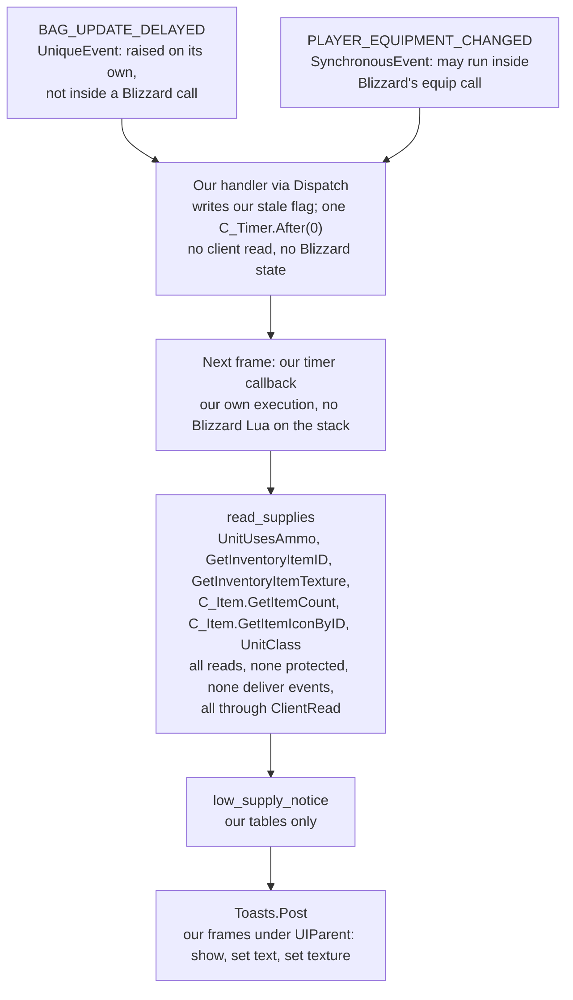
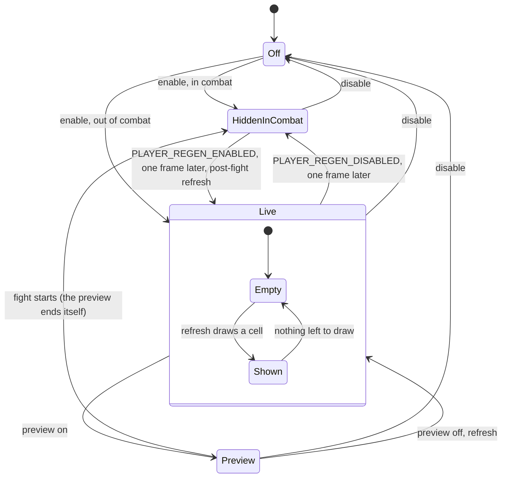

# PersonalAddon — Phase 21 Design: Upkeep, and rare alerts

**Date:** November 12, 2026
**API version:** 1.60.1 (WoW Forever), game type `camelot`
**Client:** 1.60.1.70938 (`Wow.exe` of 2026-11-12 19:24), UI export 2026-11-12 19:58. `patch_check
check` returned **Review**: two premises were touched by file churn, and none of the 241 surface names
changed (§2). Both premises were re-read and hold, and **70938 was accepted (`AcceptedAfterReview`,
2026-11-12 20:26:10) before this was drafted**, so `status` is `UpToDate`. Every citation below is
read from the 70938 export; paths are relative to its `Interface/AddOns`.
**Status:** built 2026-11-12, not committed. Harness, mutation pass, lint and patch check are green
(§21); the in-game checks of §16.3 are outstanding.
**Implements:** the user's two requests of 2026-11-12, with the decisions of two question rounds
(§1.1):
1. a small movable tracker that shows only buffs about to expire (30 seconds or less), with the option
   to attach it to the threat and damage panels. This is **Upkeep** (§3–§7). The user then broadened it
   to weapon enchants and to ammo and soul shard counts;
2. three proposed quality-of-life features. **One was taken: rare alerts** (§8). The threat cue and
   auto-repair were declined.

**Depends on:**
- `20260927-Phase08.md` §6: Toasts, its queue, and the `Unavailable`/`Dropped` fallback to chat;
- `20261002-Phase09.md` §2, §5: `ClientRead`, and what "in combat the meter is secret" taught (`:458`);
- `20261002-Phase10.md` §7.1: `MapRestriction`;
- `20261005-Phase11.md` §5.6: the panels' anchor on `PlayerFrame`, and the plate sweep this phase's
  enable scan copies;
- `20261006-Phase12.md` §3.4: settings pages and indentation. Rule 1's "two-value choices only" shapes
  §6.2;
- `20261009-Phase13.md` §2: the preview, its groups and registrations;
- `20261011-Phase17.md` §4: `QuestMarkers`. Its stand-down on restricted maps is the precedent §8.5
  follows;
- `20261021-Phase20.md` §9: `UnitIdentity.NpcIdFor`; §6: the toast kinds this phase extends;
- README "Rules for future development".

**Revision:** 3 — built; audit dispositions in §20, the build record in §21.

---

## 1. Scope

Two features, one new toast pair, and three small seams in existing code. Upkeep and rare alerts are
each a feature of their own, in their own files. They meet the rest of the addon at four points:
- `Toasts`, which paints two new kinds (§9);
- one `Frame()` accessor each on the damage breakdown and the threat panel (§6.2);
- one new window and group in `Preview` (§6.3);
- two commands in `Debug` (§11).

### 1.1 Decisions

| # | Question | Answer (2026-11-12) | Where |
|---|---|---|---|
| D1 | What the tracker shows | **Only what is about to run out:** buffs on you with 30 s or less left (a setting), soonest first. Never a permanent buff | §4.3 |
| D2 | Short buffs | **Ignored when their full duration is 60 s or less.** The duration is the one the client reports, which is Forever's own, never a Classic table | §4.1 |
| D3 | Weapon enchants | **Included** | §4.2 |
| D4 | What ran out | **Its icon stays, dark red, for 10 s.** A buff or enchant that ran out during a fight gets its dark red tail when the fight ends | §4.4 |
| D5 | In combat | **The whole panel hides** | §3.1, §6.4 |
| D6 | Moving it | **Offset and scale sliders plus the preview, in its own preview group.** No drag | §6.2, §6.3 |
| D7 | Look and anchor | **The threat panel's style; one checkbox attaches it to the damage and threat panels** | §6.1, §6.2 |
| D8 | A broader tracker | **An ammo count when the client says you use ammo; a soul shard count on a warlock.** Shown whenever it applies, out of combat | §5.1 |
| D9 | Counter colours | **Ammo amber under 200, red under 50; shards amber under 3, red at 0** | §5.2 |
| D10 | Low counts in combat | **One toast when a count drops below red, in combat too, provided there is no taint path.** §5.4 shows there is none | §5.3, §5.4 |
| D11 | The soul shard item | **6265.** The user's `/dump C_Item.GetItemInfoInstant("Soul Shard")` on Forever returned it first (`itemID`, `ItemDocumentation.lua:671`) and icon fileID 134075 fifth (`icon`, `:675`) | §5.1 |
| D12 | Rare alerts | **A toast and a sound for rare and rare-elite, not world bosses.** Skip dead ones and ones another player tagged; sound on by default; once per creature per 10 minutes | §8 |
| D13 | Threat cue, auto-repair | **Declined** | §1.3 |
| D14 | Build 70938 | **Accepted after review** | §2 |
| D15 | Name | **"Upkeep":** buffs, enchants, ammo and shards, the things you maintain between pulls | — |
| D16 | Who gets the ammo count | **Whoever the client says uses ammo** (`UnitUsesAmmo`), the test Blizzard's character pane uses for its ammo slot. No class list | §5.1 |
| D17 | Which panel it attaches to | **The damage breakdown first** (it is on screen when Upkeep is), then the threat panel, then the player frame | §6.2 |
| D18 | Enchant icon | **The weapon's own icon with its charges as a number,** as Blizzard's buff frame draws it | §4.2 |
| D19 | Rare alerts' home | **A feature of its own, on the Nameplates page** | §8, §10.2 |

D15–D19 were proposed in round two. The user's answers did not object to them, so they are recorded
as decided.

**Each decision's cost is named where it is paid:**
- D5: Upkeep is blind during fights (§3.1);
- D4: the post-fight tail matches by spell (§4.4);
- D10: a one-minute cooldown on the low-count toast (§5.3);
- D12: the memory of alerted rares lasts one UI load (§8.3);
- D19: the Nameplates page gains feature headers (§10.2).

### 1.2 What ships

| Item | Kind | Section | File |
|---|---|---|---|
| Upkeep: buffs and enchants about to run out, dark red tails, the post-fight tail | Feature | §3, §4, §6, §7 | `Features/Upkeep.lua` (new) |
| Upkeep: ammo and soul shard counters, the low-supply toast | Feature | §5 | `Features/Upkeep.lua` |
| Rare alerts: toast and sound | Feature | §8 | `Features/RareAlerts.lua` (new) |
| Two toast kinds, an icon reset on every paint, six samples | Feature change | §9 | `Features/Toasts.lua` |
| `Frame()` on the breakdown and the threat panel | Seam | §6.2 | `Features/DamageBreakdown.lua`, `Features/ThreatPanel.lua` |
| Upkeep's preview window and group | Seam | §6.3 | `Core/Preview.lua`, `Core/Constants.lua` |
| Constants and settings | Substrate | §10 | `Core/Constants.lua`, the two features' schemas |
| `/pa upkeep [test]`, `/pa rares [test]` | Command | §11 | `Core/Debug.lua` |
| Premises 87–99 | Tooling | §12 | `Tools/patchcheck/premises.toml` |
| `stubs21.lua`, `tests21.lua`, three sessions; `tests12`, `tests13`, `tests20` amended | Tooling | §16.1 | `Tools/harness/` |
| One lint allowlist entry (`UNIT_AURA`) | Tooling | §3.3 | `Tools/lint/secret_lint_allow.txt` |
| README | Housekeeping | §13 | `README.md` |
| TOC `1.11.0`, `X-Phase: 21`, two feature files | Housekeeping | §19 | `PersonalAddon.toc` |

**No new core module.** Upkeep reads equipped items with
`ClientRead.Call(GetInventoryItemID, …)`, which already is the shared seam. EquippedSkills reads the
same globals privately ([EquippedSkills.lua:212-232](../Features/EquippedSkills.lua#L212-L232)). A
third consumer, not a second, is the bar for extracting them (Phase 20 §9).

### 1.3 Not possible, or out of scope

- **Buff timers during a fight (D5's rejected routes).**
  - Every aura read is secret "when combat, encounter, challenge mode, or PvP match addon restrictions
    are in effect" (`Blizzard_APIDocumentationGenerated/SecretPredicatesDocumentation.lua:80-84`).
  - `UNIT_AURA`'s payload is secret under the same restrictions
    (`UnitAuraDocumentation.lua:645-655`).
  - The meter read under the combat restriction was observed secret in every fight (Phase 9 `:458`,
    GAPBugs01 R2).
  - Our code therefore cannot test "30 s or less" in combat. Passing hidden values straight to our
    icons, through a curve on the aura's duration object, is possible on paper. Every link would need
    an in-game spike first, and the user chose to hide instead.
- **Blizzard's `CustomAuraContainer` as the renderer.**
  - Its Lua runs secure, so it can sort hidden durations, but its only duration filter is
    `maxDuration`: "derived from maximum aura duration, not remaining duration"
    (`Blizzard_AuraContainer/Blizzard_CustomAuraContainer.lua:106-110`).
  - Its frames deny tainted access while auras are secret
    (`Blizzard_AuraContainer/Blizzard_AuraContainerShared.lua:108`), so we cannot filter after it either.
- **Dragging the panel.** Every panel is built with `EnableMouse(false)` so the Gamepad UI's
  navigation has nothing to land on ([PanelChrome.lua:144-146](../Core/PanelChrome.lua#L144-L146)). A
  draggable frame is a navigation target and a second positioning model.
- **A three-way anchor choice.** Settings shows only two-value choices, as checkboxes (rule 1;
  [SettingsPanel.lua:209-220](../Features/SettingsPanel.lua#L209-L220)). D17's fixed order needs one
  checkbox (§6.2).
- **Low charges counting as "expiring".** `WeaponEnchantInfo` reports `charges`
  (`ItemDocumentation.lua:1975`), but whether Forever's temporary enchants use charges is unknown.
  Upkeep shows the number, and `/pa upkeep` reports it, so a later phase can decide on data.
- **Out of scope:**
  - party members' buffs, and debuffs;
  - names and tooltips on Upkeep's icons. A tooltip needs a mouse target, and a name needs width the
    panel does not have;
  - reagents other than ammo and shards;
  - remembering alerted rares across a reload;
  - the threat cue and auto-repair (D13).
- **What the game already does,** recorded for README (§13):
  - Blizzard's buff frame, collapsed, hides permanent buffs and any buff with more than 90 s left
    (`Blizzard_FrameXMLUtil/AuraUtil.lua:2`; `Blizzard_BuffFrame/BuffFrame.lua:733-734`). It flashes
    them under 31 s (`BuffFrame.lua:1, 70`), and Edit Mode can move it. Upkeep differs in its 30 s
    window, its attachment to our panels, its short-buff rule, and its counters;
  - a swing timer (`Blizzard_SettingsDefinitions_Frame/Camelot/InterfaceOverrides.lua:56-58`);
  - item and reagent counts on action buttons, gamepad bars included
    (`Blizzard_ActionBar/Shared/ActionButton.lua:852-854`).

### 1.4 Types

```
Seconds          = number                       # GetTime()'s clock unless stated
Milliseconds     = number
Nothing          = no value
Frame            = opaque                       # one of ours, PlayerFrame or UIParent
ClientValue      = opaque                       # any client return, unclassified
AuraListLookup   = (unit: UnitToken, filter: string, maxCount: integer) -> ClientValue
                                                # C_UnitAuras.GetUnitAuras
EnchantLookup    = (slot: WeaponSlot) -> ClientValue   # C_Item.GetWeaponEnchantInfo
FeatureConfig    = { settings: Map<string, boolean | number | string> }
Enabled          = true
EnableRefusal    = { reason: string }
ToastFrame       = opaque                       # one of Toasts' pooled frames
ToastRequest     = Phase 8's request table, with section 9's two kinds
SpellId          = number
ItemId           = number
NpcId            = number
AuraInstanceId   = number
TextureId        = number | string              # a fileID or a texture path
AtlasName        = string
UnitToken        = string
InventorySlot    = integer                      # 0 ammo, 16 main hand, 17 off hand, 18 ranged
WeaponSlot       = enum { MainHand = 0, OffHand = 1, Ranged = 2 }        # Enum.WeaponSlot
EnchantType      = enum { None = 0, Permanent = 1, Temporary = 2, Imbue = 3 }  # Enum.ItemEnchantType
CounterName      = string
Counters         = Map<CounterName, integer>     # this UI load's Diagnostics table
ReadFailure      = enum { Unavailable, CallFailed, SecretValue, UnexpectedType }
ToastOutcome     = Shown | Queued | Coalesced | Held | Dropped | Unavailable   # Phase 20 section 6.5

TrackedBuff      = { auraInstanceId: AuraInstanceId, spellId: SpellId, icon: TextureId,
                     duration: Seconds, expiresAt: Seconds, timeMod: number }
TrackedEnchant   = { slot: WeaponSlot, enchantId: number, icon: TextureId,
                     charges: integer, expiresAt: Seconds }
WeaponIds        = Map<WeaponSlot, Optional<ItemId>>
Roster           = { buffs: List<TrackedBuff>, buffsKnown: boolean,
                     enchants: List<TrackedEnchant>, weapons: WeaponIds, enchantsKnown: boolean,
                     readAt: Seconds }
BuffReadFailure  = enum { ApiMissing, CallFailed, Hidden }
EnchantReadFailure = enum { ApiMissing, EnumsMissing, Hidden }
EnchantReading   = { enchants: List<TrackedEnchant>, weapons: WeaponIds }

CellSource       = enum { Buff, Enchant }
TailKey          = Buff(spellId: SpellId) | Enchant(slot: WeaponSlot)
Tail             = { key: TailKey, icon: TextureId, endsAt: Seconds }
ExpiryCell       = Counting(source: CellSource, icon: TextureId, remaining: Seconds, charges: integer)
                 | Expired(key: TailKey, icon: TextureId, endsAt: Seconds)

Supply           = enum { Ammo, SoulShards }
SupplyLevel      = enum { Plenty, Low, Critical }       # white, amber, red
SupplyReading    = Counted(supply: Supply, count: integer, icon: TextureId)
                 | NotApplicable(supply: Supply)
                 | Unreadable(supply: Supply, reason: ReadFailure)
SupplyThresholds = { amberBelow: integer, redBelow: integer }
LowSupplyNotice  = { supply: Supply, count: integer, icon: TextureId }

PanelContents    = { supplies: List<SupplyReading>, cells: List<ExpiryCell>, truncated: integer }
UpkeepVisibility = enum { Off, Shown, Empty, HiddenInCombat, Preview }
AnchorTarget     = enum { DamageBreakdown, ThreatPanel, PlayerFrame, Screen }
AnchorPlacement  = { target: AnchorTarget, frame: Frame, panelPoint: string, targetPoint: string,
                     offsetX: number, offsetY: number }
StalePart        = enum { Buffs, Enchants, Supplies, Anchor }

UpkeepSettings   = { warningSeconds: Seconds, shortBuffSeconds: Seconds,
                     showWeaponEnchants: boolean, showSupplies: boolean, lowSupplyToast: boolean,
                     expiredTailSeconds: Seconds, maximumIcons: integer, attachToPanels: boolean,
                     panelAlpha: number, scale: number, anchorOffsetX: number, anchorOffsetY: number,
                     ammoAmberBelow: integer, ammoRedBelow: integer,
                     shardAmberBelow: integer, shardRedBelow: integer }
                                                # the stored keys of section 10.2, flat, as
                                                # FeatureConfig holds them (audit finding 1)

RareClass        = enum { Rare, RareElite }
RareSighting     = { npcId: NpcId, name: string, level: Optional<integer>, rareClass: RareClass }
RareSkip         = enum { Gone, NotRare, ClassificationUnreadable, NotAttackable, Dead,
                          TappedByOthers, IdentityUnreadable, Repeat }
RareVerdict      = Alert(sighting: RareSighting) | Skip(reason: RareSkip)
RareMemory       = Map<NpcId, Seconds>           # bounded: RARE_ALERT_MEMORY_CAPACITY
RareAlertSettings = { playSound: boolean, repeatMinutes: integer }
AnnounceOutcome  = { shown: ToastOutcome, chatted: boolean, sounded: boolean }
```

`Roster`, `Tail` and `RareMemory` live in the features' own tables. Nothing is written onto a
Blizzard frame or table.

The two thresholds a supply is judged by come from the flat keys, never from a nested table
(audit finding 1):

```
# The amber and red thresholds for one supply.
# post: Ammo gives { amberBelow = settings.ammoAmberBelow, redBelow = settings.ammoRedBelow };
#       SoulShards gives { amberBelow = settings.shardAmberBelow,
#       redBelow = settings.shardRedBelow }
# raises: never
function thresholds_for(supply: Supply, settings: UpkeepSettings) -> SupplyThresholds
```

---

## 2. Build 70938

The client patched on 2026-11-12. The export was taken that evening, and `check` gave **Review** with
two reasons. Both were re-read against their diffs:
- **`G1-PATH` holds; G1 is not fixed.**
  - `FrameControlsManager.lua` gains an early return when the top-level parent sets
    `disallowGamepadUnfocus`.
  - `SmartNavigation.lua` re-parents itself on `UI.AlternateTopLevelParentChanged`.
  - `focusedFrame` is still shared state that any caller writes, and the one restricted caller is
    unchanged (`G1-SOLE-CALLER` holds at `MainActionBarFrame.lua:373`). BlockWatch's hint and README's
    known issue stay.
- **`PLATE-CONTAINER-NO-SIZE-SCRIPT` holds.** The diff moves the crowd-control frames' anchoring into
  `UpdateControlAnchors`. The only `OnSizeChanged` is still the base frame's
  (`Blizzard_NamePlates/Blizzard_NamePlateBase.lua:7`).

Surface: 241 names, 0 changed. Lint: 0 hits. The report,
`Tools/patchcheck/reports/2026-11-12-1.60.1.70938.md`, is new, and `verified.json` now records the
acceptance. Both are uncommitted and go in with this phase.

---

## 3. Upkeep: what the client lets us read

### 3.1 Aura data is secret in combat (D5)

The predicate behind every aura getter, `SecretWhenUnitAuraRestricted`, names four triggers: combat,
encounter, challenge mode and a PvP match (`SecretPredicatesDocumentation.lua:80-84`). The map
restriction, which hides unit identity in dungeons and raids, is not among them.
- **In a dungeon between pulls,** aura reads are Plain, which is where rebuffing matters.
- **During any fight** they are not. Upkeep hides there, keeps the roster it last read, and does no
  aura read until the fight ends.
- **In a PvP match** the restriction holds out of combat too. The buff section then has nothing to
  draw, and `/pa upkeep` says why. Enchants and counters do not depend on aura data and keep working.

Hiding is honest; anything else would show stale numbers. An aura's expiry cannot change in combat
unless it is recast, and a recast is exactly what we cannot see. So a frozen countdown can be wrong,
silently. A hidden panel is never wrong, and the post-fight tail (§4.4) reports what the fight
consumed.

### 3.2 Sources

| Part | Read | Flags (70938) | Notes |
|---|---|---|---|
| Buffs | `C_UnitAuras.GetUnitAuras("player", "HELPFUL", UPKEEP_AURA_READ_CAPACITY + 1)` | Return `ConditionalSecretContents` (`UnitAuraDocumentation.lua:495`) | Fields as Blizzard reads them: `auraInstanceID`, `spellId`, `icon`, `duration`, `expirationTime`, `timeMod` (`BuffFrame.lua:740-755`) |
| Enchants | `C_Item.GetWeaponEnchantInfo(slot)` for `Enum.WeaponSlot` 0–2 | None (`ItemDocumentation.lua:1141-1155`) | `WeaponEnchantInfo`: `hasEnchant`, `enchantType`, `timeLeft`, `charges`, `enchantID`, `enchantIconID` (`:1968-1979`). `timeLeft` is milliseconds (`BuffFrame.lua:775`) |
| Weapons | `GetInventoryItemID("player", 16/17/18)`, `GetInventoryItemTexture(...)` | Undocumented | `WeaponSlot + 1` → 16, 17, 18 (`BuffFrame.lua:30-34`); EquippedSkills' precedent |
| Ammo | `UnitUsesAmmo("player")`; `GetInventoryItemID("player", 0)`; `C_Item.GetItemCount(itemId)` | None (`UnitDocumentation.lua:3359-3371`; `ItemDocumentation.lua:451`) | The character pane shows its ammo slot on exactly `UnitUsesAmmo` (`Blizzard_UIPanels_Game/Camelot/PaperDollFrame.lua:1517`); `INVSLOT_AMMO = 0` (`Blizzard_FrameXMLBase/Constants.lua:135`) |
| Shards | `UnitClass("player")` (second return); `C_Item.GetItemCount(6265)`; `C_Item.GetItemIconByID(6265)` | `UnitClass` is identity-restricted, never for `player`; the others none (`ItemDocumentation.lua:611-623`) | No shard power bar loads on Camelot (`Blizzard_UnitFrame/Blizzard_UnitFrame.toc:77-78`, `Blizzard_NamePlates/Blizzard_NamePlates.toc:43-44`), so shards are an item (D11) |

`C_Item.GetWeaponEnchantInfo` replaces the global `GetWeaponEnchantInfo`, which this client keeps only
in `Blizzard_Deprecated/Shared/Deprecated_12_1_0.lua:44`.

### 3.3 Signals

Every handler writes our own state and schedules one refresh a frame later. None reads the client
(rules 1, 5, 9).

| Event | Flags | Handler |
|---|---|---|
| `UNIT_AURA` | `SynchronousEvent`, payload `SecretWhenAurasRestricted` (`UnitAuraDocumentation.lua:645-655`) | Ignored in combat. Otherwise `unitTarget` is classified through `ClientRead.Classify`: Plain `"player"` marks `Buffs` stale; a Withheld unit marks it too, since "could not tell" may be the player; anything else does nothing |
| `WEAPON_ENCHANT_CHANGED` | `UniqueEvent` (`ItemDocumentation.lua:1923-1924`) | Marks `Enchants` stale |
| `PLAYER_EQUIPMENT_CHANGED` | `SynchronousEvent` (`PaperDollInfoDocumentation.lua:386-391`) | Marks `Enchants` and `Supplies` stale |
| `BAG_UPDATE_DELAYED` | `UniqueEvent` (`ContainerDocumentation.lua:677-678`) | Marks `Supplies` stale, **in combat too**: the low-supply path (§5.4) |
| `PLAYER_REGEN_DISABLED` | `SynchronousEvent` | Records combat; schedules the hide (§6.4) |
| `PLAYER_REGEN_ENABLED` | `SynchronousEvent` | Records the fight's end; schedules the post-fight refresh (§4.4) |
| `PLAYER_ENTERING_WORLD` | — | Marks `Anchor` and every part stale; the breakdown's precedent ([DamageBreakdown.lua:899-913](../Features/DamageBreakdown.lua#L899-L913)) |

- **Required events:** the two `PLAYER_REGEN_*` events. Without them the panel cannot hide in combat,
  so enable fails with the reason, as the threat panel's does.
- **Optional events:** the rest each carry a `lost` sentence, as the breakdown's signals do. For
  example, `UNIT_AURA` missing means "buffs update only when equipment, bags or a fight change".
- **`UNIT_AURA` fires for every unit,** nameplates included. The handler returns before any work in
  combat, and out of combat it does one classify and one comparison.
- **`RegisterUnitEvent` would filter at the source.** Dispatch's single host frame cannot do that per
  subscriber, and widening Dispatch for one feature is not worth it.

**Lint.** `UNIT_AURA` is a secret-capable event, so its literal needs an allowlist entry, as
`FiveSecondRule`'s `UNIT_SPELLCAST_SUCCEEDED` has:
`Features/Upkeep.lua | UNIT_AURA | event = "UNIT_AURA" | the payload is classified through
ClientRead.Classify in onAuraSignal, and ignored in combat`.

---

## 4. Upkeep: the roster, the window and the tails

The roster is everything Upkeep might draw, read out of combat. The window and the tails decide what
it draws.

### 4.1 Buffs

```
# The player's timed buffs that Upkeep may draw, as the client reports them now.
# pre:  out of combat, from our own timer; auraList is C_UnitAuras.GetUnitAuras or absent
# post: Success(buffs): one TrackedBuff per entry whose four timing fields —
#       auraInstanceID, spellId, duration, expirationTime — read Plain numbers, with
#       duration > 0, expirationTime > 0 and duration > settings.shortBuffSeconds (D2
#       ignores 60 s or less, so a buff of exactly 60 s is ignored). Permanent entries
#       count aurasPermanent; short ones aurasShort; an entry with a timing field Absent
#       or of an unexpected type counts auraEntriesUnreadable and is left out.
#       timeMod is the Plain value when > 0, 1 when Absent. icon is cosmetic: the Plain
#       value, else UPKEEP_FALLBACK_ICON (iconsUnreadable), never a reason to drop an
#       entry. At most UPKEEP_AURA_READ_CAPACITY entries are kept; one more present counts
#       rosterTruncated.
#       Failure(ApiMissing) when auraList is absent (said once). Failure(CallFailed) when it
#       raised (auraReadsFailed).
#       Failure(Hidden) when the list, or any timing field or timeMod of any entry, reads
#       Withheld (SecretValue): a partial roster would make every unread buff look gone,
#       and section 4.4 would tail them (auraReadsWithheld).
#       auraReadsPlain counts one per Success
# raises: never
function read_buffs(
    auraList: Optional<AuraListLookup>,
    settings: UpkeepSettings,
    counters: Counters
) -> Result<List<TrackedBuff>, BuffReadFailure>
```

`ApiMissing` is said once and turns the buff section off for the UI load. Enchants and supplies stay
on.

### 4.2 Enchants

```
# The temporary enchants on the player's weapons, and which weapons they are on.
# pre:  enchantInfo is C_Item.GetWeaponEnchantInfo or absent; Enum.WeaponSlot and
#       Enum.ItemEnchantType were resolved through ClientRead.Field at enable
# post: Success(EnchantReading). weapons holds, for MainHand, OffHand and Ranged, the
#       Plain item id in inventory slot 16, 17 or 18; absent when the slot is empty OR the
#       read was not Plain — "could not tell" and "no weapon" both mean no comparison.
#       enchants holds, per slot, at most UPKEEP_ENCHANTS_PER_SLOT entries whose four
#       timing fields read Plain: hasEnchant true; enchantType Temporary or Imbue
#       (Permanent and None are never drawn); timeLeft > 0; enchantID a number. The slot
#       must hold a weapon. expiresAt = now + timeLeft / 1000.
#       charges and the icon are cosmetic: charges is the Plain value, else 0
#       (chargesUnreadable when it was Withheld); icon is the weapon's texture, else
#       UPKEEP_FALLBACK_ICON (iconsUnreadable) (D18).
#       An entry whose timing field reads Absent or an unexpected type is left out
#       (enchantEntriesUnreadable).
#       ALL-OR-NOTHING, as section 4.1 is for buffs (audit finding 3): a partial reading
#       would show a slot whose read failed as "enchant gone, same weapon", and section 4.4
#       would tail it. So:
#         - Failure(CallFailed) when any slot's call raised (enchantReadsFailed);
#         - Failure(Hidden) when any slot's list, entry or timing field reads Withheld
#           (enchantReadsWithheld).
#       Failure(ApiMissing) when enchantInfo is absent; Failure(EnumsMissing) when either
#       enum did not resolve; both are said once and turn the enchant section off.
#       enchantReadsPlain counts one per successful call of this function, not per slot
# raises: never
function read_enchants(
    enchantInfo: Optional<EnchantLookup>,
    now: Seconds,
    counters: Counters
) -> Result<EnchantReading, EnchantReadFailure>
```

**The short-buff rule cannot apply to enchants.** `WeaponEnchantInfo` carries the time left, never
the full duration. Enchants are therefore always eligible. Temporary enchants last minutes, so this
costs nothing in practice. Premises 92 and 93 (§12) pin the milliseconds and the slot mapping.

### 4.3 The window

```
# Seconds left on a buff or enchant, on the client's clock.
# pre:  expiresAt and timeMod were read Plain (an enchant's timeMod is 1)
# post: (expiresAt - now) / timeMod when timeMod > 0, else expiresAt - now. This is
#       Blizzard's own arithmetic (BuffFrame.lua:1233-1237). May be zero or negative
# raises: never
function remaining_of(expiresAt: Seconds, timeMod: number, now: Seconds) -> Seconds
```

An item is **in the window** when `0 < remaining_of(...) <= settings.warningSeconds`. The window is
D1's 30 s by default, and the same window serves buffs and enchants. An enchant that runs out
mid-fight still surfaces, through §4.4.

### 4.4 Tails (D4)

A tail is the dark red icon of something that ran out. **All tails live in one map,
`tails: Map<TailKey, Tail>`, and only the map draws `Expired` cells** (§4.5; audit finding 4). Three
paths insert into it. Every insertion is refused when `expiredTailSeconds` is 0 or the new `endsAt`
is not after `now`. An existing key keeps the later `endsAt`.
- **On a tick:** a roster buff or enchant reaches `remaining <= 0` while the client still lists it,
  because the server's removal lags our clock. It is inserted under its key with
  `endsAt = expiresAt + expiredTailSeconds`.
- **On a refresh, live:**

```
# Tails for what ran out between two out-of-combat reads.
# pre:  previous and current both have buffsKnown and enchantsKnown as stated; a part
#       that is not Known on both sides contributes nothing
# post: Buffs: one Tail per buff in previous whose spellId is absent from current and whose
#       expiresAt <= now + UPKEEP_EXPIRY_TOLERANCE_SECONDS, ending at
#       expiresAt + tailSeconds, and dropped when that is already past. A buff gone early
#       (dispelled, cancelled, used up) gets none: D4 is about running out, and our code
#       cannot tell a cancel from a dispel. A buff present again under the same spellId
#       (renewed) gets none.
#       Enchants: one Tail per slot that held an enchant in previous and holds none in
#       current, when previous.weapons[slot] is present and current.weapons[slot] equals
#       it (both Plain; audit finding 3). The tail ends at now + tailSeconds, time and
#       charges alike, since either ends it. A changed, emptied or unreadable weapon gets
#       none.
#       tailSeconds = 0 gives none. tailsLive counts each
# raises: never
function live_tails(
    previous: Roster,
    current: Roster,
    now: Seconds,
    tailSeconds: Seconds
) -> List<Tail>
```

- **After a fight:**

```
# Tails for what ran out while Upkeep was hidden in combat.
# pre:  snapshot is the roster last read before the fight; current was read after it;
#       fightStartedAt and fightEndedAt bracket the fight on our own clock
# post: Buffs (both Known): one Tail per snapshot buff with
#       fightStartedAt < expiresAt <= fightEndedAt + UPKEEP_EXPIRY_TOLERANCE_SECONDS whose
#       spellId is absent from current. "Ran out during the fight", literally: a stale
#       snapshot cannot produce a tail for something that ran out before the pull.
#       Enchants (both Known): one Tail per slot that held an enchant in the snapshot and
#       holds none now, on a weapon read Plain on both sides and unchanged.
#       EVERY tail ends at fightEndedAt + tailSeconds. A buff that ran out in the first
#       minute of a long fight still shows its full tail when the fight ends, which is
#       when you can rebuff.
#       A spell recast during the fight is present in current and gets none.
#       tailsPostFight counts each
# raises: never
function post_fight_tails(
    snapshot: Roster,
    current: Roster,
    fightStartedAt: Seconds,
    fightEndedAt: Seconds,
    tailSeconds: Seconds
) -> List<Tail>
```

- **The map is keyed by `TailKey`,** so a tick tail and the refresh that confirms it are one tail.

```
# Keeps the tail map true to the roster.
# post: a tail whose key is present again in roster with remaining > 0 is removed: a buff
#       renewed under the same spellId, or a slot holding an enchant again, ends its tail
#       at once (T2). A tail with endsAt <= now is removed. Runs after every refresh and
#       on every tick, before cells are built
# raises: never
function reconcile_tails(tails: Map<TailKey, Tail>, roster: Roster, now: Seconds) -> Nothing
```

- **The map is bounded:** past `maximumIcons` live tails, the oldest `endsAt` goes first. Combat start
  clears it (§6.4).
- **The post-fight read can come back Withheld** if the restriction lifts a moment after
  `PLAYER_REGEN_ENABLED`. After the first read, up to `UPKEEP_POST_FIGHT_RETRIES` further reads run,
  `UPKEEP_POST_FIGHT_RETRY_SECONDS` apart, each counted in `postFightRetries`. Retries run only while
  the snapshot's buffs were Known, since otherwise there is nothing to tail.
  - `fightEndedAt` does not move between retries.
  - When the retries run out, there are no buff tails (`postFightGaveUp`); enchants and supplies draw
    as usual.
  - A new fight cancels pending retries (§6.4's generation).

### 4.5 Cells and order

```
# What the panel draws, from the anchor outwards.
# pre:  roster is the last refresh's; tails are live; supplies are §5.1's
# post: supplies first, Ammo then SoulShards, each Counted reading one cell; NotApplicable
#       and Unreadable draw nothing.
#       Then the expiry cells: every Tail in the map with endsAt > now as Expired, and
#       ONLY those (the tick path inserts into the map, so nothing is drawn twice); every
#       buff and enchant with 0 < remaining <= settings.warningSeconds as Counting.
#       Order: Expired first, most recent endsAt first; then Counting by remaining
#       ascending, ties Enchant before Buff, then by slot or auraInstanceId, so two equal
#       timers never swap places between ticks.
#       Expiry cells are cut at settings.maximumIcons and supplies never are;
#       truncated is the number cut (cellsTruncated keeps the most in any one draw).
#       A part that is not Known draws no expiry cell
# raises: never
function build_cells(
    roster: Roster,
    tails: Map<TailKey, Tail>,
    supplies: List<SupplyReading>,
    now: Seconds,
    settings: UpkeepSettings
) -> PanelContents
```

---

## 5. Upkeep: supplies and the low-supply toast

### 5.1 Which counters apply (D8, D11, D16)

```
# The counters that apply to this character now.
# pre:  from our own timer, in or out of combat
# post: settings.showSupplies off: NotApplicable for both, with no read.
#       Ammo: NotApplicable when UnitUsesAmmo("player") reads Plain false;
#       Unreadable(reason) when it does not read Plain (ammoApplicabilityWithheld).
#       Otherwise: the ammo slot's item id read Plain gives Counted(C_Item.GetItemCount(id),
#       the slot's texture or UPKEEP_FALLBACK_ICON); an empty slot (Absent) gives
#       Counted(0, UPKEEP_FALLBACK_ICON) — someone who uses ammo and has none is the case
#       the counter exists for.
#       SoulShards: NotApplicable unless UnitClass("player")'s second return reads Plain
#       "WARLOCK"; Unreadable(reason) when that read is not Plain
#       (shardApplicabilityWithheld); else Counted(C_Item.GetItemCount(SOUL_SHARD_ITEM_ID),
#       C_Item.GetItemIconByID(SOUL_SHARD_ITEM_ID) or UPKEEP_FALLBACK_ICON).
#       Per supply per call (audit finding 7):
#         - supplyReadsPlain counts one Counted reading;
#         - supplyReadsWithheld counts one item-id or count read that is not Plain, whatever
#           the reason (SecretValue, CallFailed, Unavailable, UnexpectedType). The reason is
#           kept in the Unreadable reading for /pa upkeep.
#       Bank contents are not counted (includeBank = false)
# raises: never
function read_supplies(settings: UpkeepSettings, counters: Counters) -> List<SupplyReading>
```

- **Ammo is decided by the client's own predicate, not a class list.** If Forever lets a warrior or
  rogue fire ammo, they get the counter with no table edit. If Forever withdraws ammo from a class, it
  disappears just as quietly.
- **The count is `C_Item.GetItemCount` of the ammo item,** not the character pane's
  `GetInventoryItemCount("player", 0)` (`PaperDollFrame.lua:2185`). The first is documented and
  premised (§12); the second is undocumented. In-game check 5 compares them.
- **The shard item is constant 6265,** from D11's `/dump` on Forever. Premise 95 pins the fact that
  makes shards an item: Camelot's own class-resource override gives bars to rogues and druids only. If
  a warlock bar ever appears there, §5.1 is re-read.

### 5.2 Levels (D9)

```
# How urgent a count is.
# post: Critical when count < thresholds.redBelow; Low when count < thresholds.amberBelow;
#       Plenty otherwise. A redBelow at or above amberBelow leaves Low unreachable. That is
#       the user's to choose, and no value is refused for it
# raises: never
function supply_level(count: integer, thresholds: SupplyThresholds) -> SupplyLevel
```

Defaults: ammo `{ amberBelow = 200, redBelow = 50 }`, shards `{ amberBelow = 3, redBelow = 1 }`.
"Red at 0" is "below 1". The count is drawn white, `UPKEEP_AMBER` or `UPKEEP_RED`.

### 5.3 The toast (D10)

```
# Whether a new reading crosses into red and earns a toast.
# pre:  previous is this supply's last Counted reading this UI load, or absent;
#       lastNoticeAt is when this supply last posted a notice, or absent
# post: redBelow = thresholds_for(current.supply, settings).redBelow (audit finding 1).
#       Notice(supply, count, icon) when previous is present, previous.count >= redBelow,
#       current is Counted with count < redBelow, settings.lowSupplyToast is on, and
#       lastNoticeAt is absent or at least UPKEEP_LOW_SUPPLY_COOLDOWN_SECONDS ago.
#       Absent otherwise. In particular the first reading of a UI load never toasts:
#       logging in with no shards draws a red counter and nothing else. A reading that is
#       not Counted never toasts either: "could not tell" is never "low".
#       lowSupplyCooled counts a crossing the cooldown held back
# raises: never
function low_supply_notice(
    previous: Optional<SupplyReading>,
    current: SupplyReading,
    lastNoticeAt: Optional<Seconds>,
    now: Seconds,
    settings: UpkeepSettings
) -> Optional<LowSupplyNotice>

# Shows a notice: a toast, else a chat line.
# post: Toasts.Post({ kind = SupplyLow, supply, count, icon }) when Toasts is loaded. On
#       Unavailable or Dropped, or with no Toasts, one chat line through Log.Info,
#       AutoSellJunk's precedent (AutoSellJunk.lua:140-156). lowSupplyToasts counts every
#       notice; toastUnavailable counts the fallbacks. No sound
# raises: never
function post_low_supply(notice: LowSupplyNotice, counters: Counters) -> ToastOutcome
```

**In combat, a refresh is supplies only** (audit finding 2):

```
# What a refresh does while Upkeep is hidden in combat.
# pre:  state is HiddenInCombat; a coalesced refresh fired (BAG_UPDATE_DELAYED or
#       PLAYER_EQUIPMENT_CHANGED marked Supplies stale)
# post: read_supplies, then low_supply_notice and post_low_supply for each supply, and
#       the readings kept for the next comparison. NOTHING else: no read_buffs, no
#       read_enchants, no tail, no draw, no timer, and the roster and snapshot are left
#       exactly as they were, so the post-fight comparison (section 4.4) sees the pull's
#       state. refreshes is not counted here; supplyReadsPlain and supplyReadsWithheld are
# raises: never
function refresh_in_combat(settings: UpkeepSettings, counters: Counters) -> Nothing
```

- **Crossings, not levels.** Ammo falls one shot at a time in a fight, and a toast per shot below 50
  would be noise.
- **The cooldown** stops a shard count that flickers between 0 and 1 from flooding the toast queue.
- **Out of combat** the same rule applies: the panel is visible then, and the toast costs one line.

### 5.4 No taint path (D10's condition)

The user accepted an in-combat toast "as long as we don't run into taint issues". This is the path
in full:



| Hazard (README rules) | On this path |
|---|---|
| Blizzard calls our code inline (1) | Only Dispatch's event delivery, and the handlers do nothing but mark and schedule (rule 5). `PLAYER_EQUIPMENT_CHANGED` may run inside Blizzard's equip call; ThreatPanel's `PLAYER_REGEN_*` handlers have the same shape |
| We write Blizzard state (2) | Nothing: our roster, counters and frames |
| Panel management (3), hooks (4) | None |
| A protected call (7) | None. Every documented function on the path lacks `HasRestrictions` in the 70938 docs. The two undocumented inventory reads are the ones EquippedSkills has made since Phase 8 without a refusal. Premise 99 pins `C_Sound.PlaySound`, which only the rare alert calls (§8.4) |
| A call that runs listeners inside ours (9) | None: every call is a read. `Toasts.Post` shows our frames; no client event follows from it |
| Secret values (10) | Every return through `ClientRead`. `GetItemCount` and `UnitUsesAmmo` are not secret-flagged (premises 88 and 90); if they become so, the reading is `Unreadable` and no toast fires |
| Frame creation in combat | Upkeep's cells are prewarmed at enable. Toasts' frames are its own, as for loot toasts in combat today. A non-protected frame may be created and shown in combat anyway |

**What is left is G1,** Blizzard's own gamepad-focus taint, which needs no help from us. In-game check
5 fights until ammo crosses 50 and reads `/pa blocked` afterwards. Any new record fails the phase.

---

## 6. Upkeep: panel, placement and preview

### 6.1 Layout

- **Panel:** `PanelChrome.Build({ frameName = "PersonalAddonUpkeep", width, height,
  alpha = panelAlpha, ownerKey = "upkeep", ownerLabel = "the upkeep panel" })`. That is the threat
  panel's look (D7): parented to `UIParent`, not a mouse target.
- **Cells:** a `FramePool` (`upkeepCells`, capacity `UPKEEP_CELL_CAPACITY` = 12,
  `SURFACE_AND_FAIL`), prewarmed at enable, so nothing is created later.
  - Capacity: 10 is the largest `maximumIcons`, and two supply cells come on top.
  - Each cell is an icon (`UPKEEP_ICON_SIZE`) with a line of `GameFontHighlightSmall` under it, plus a
    second small string over the icon's bottom-right corner for charges.
- **Geometry:** cells sit in one row, right to left from the panel's right edge, which is the anchored
  edge. Width is `2·UPKEEP_PADDING + n·UPKEEP_CELL_WIDTH + (n − 1)·UPKEEP_CELL_SPACING`; height is
  `2·UPKEEP_PADDING + UPKEEP_CELL_HEIGHT`. Geometry is computed, never read back off a frame (the
  threat panel's rule, [ThreatPanel.lua:397-399](../Features/ThreatPanel.lua#L397-L399)).
- **Text:**
  - Counting: `"%d"` of the ceiling of the seconds left, or `"%dm"` of the ceiling of the minutes when
    60 s or more are left (a window above a minute is the user's to set);
  - Expired: empty;
  - supplies: the count, coloured by §5.2;
  - charges: shown when above 0.
- **Expired cells** set `SetDesaturated(true)` and `SetVertexColor(UPKEEP_EXPIRED_TINT)`, which is
  D4's dark red. **Every paint puts both back first** (`SetDesaturated(false)`, white), and so does
  the pool's reset, so a cell is never red by accident. The paint-level reset is the one that
  matters: a live cell is repainted in place on every tick with no release in between, so a reset
  on release alone would leave a cell that showed a tail red when it next counts down (T11;
  corrected while implementing, §20).

### 6.2 Placement (D6, D7, D17)

```
# Where Upkeep sits.
# pre:  settings read; ns.DamageBreakdown.Frame() and ns.ThreatPanel.Frame() each return
#       their feature's panel or nil
# post: attachToPanels on: the damage breakdown's panel when Registry.State(
#       "damageBreakdown") is ENABLED and the panel exists; else the threat panel's under
#       the same test. Upkeep's BOTTOMRIGHT goes to that panel's BOTTOMLEFT, base offset
#       (-UPKEEP_ATTACH_GAP, 0).
#       Otherwise, or when neither qualifies: PlayerFrame's TOPLEFT, base offset
#       (-UPKEEP_ATTACH_GAP, UPKEEP_DETACHED_BASE_Y). Both panels default to (0, 8) on that
#       corner (ThreatPanel.lua:983-984, DamageBreakdown.lua:1061-1062), so in the default
#       layout the checkbox moves nothing.
#       With no PlayerFrame: UIParent's CENTER, base (0, 0), said once.
#       anchorOffsetX and anchorOffsetY add to the base; PanelChrome.Place divides by scale
#       so offsets stay screen pixels (PanelChrome.lua:210-226). One anchor counter per
#       resolution: anchorBreakdown, anchorThreatPanel, anchorPlayerFrame, anchorScreen
# raises: never
function resolve_anchor(settings: UpkeepSettings, counters: Counters) -> AnchorPlacement
```

- **Breakdown first:** Upkeep shows out of combat, when the breakdown is on screen and the threat
  panel is not.
- **Bottom edges aligned:** both panels grow upward from their bottom-left corner, so a panel gaining
  rows never moves Upkeep.
- **The seams.** `ns.DamageBreakdown.Frame` and `ns.ThreatPanel.Frame` each return `state.panel` or
  nil. They are read-only accessors on public tables that already exist
  ([DamageBreakdown.lua:1116](../Features/DamageBreakdown.lua#L1116),
  [ThreatPanel.lua:1060](../Features/ThreatPanel.lua#L1060)).
  - Upkeep depends on them and on `Registry.State`; neither panel knows Upkeep exists.
  - A panel disabled later in the session keeps its frame (frames are never destroyed). The `ENABLED`
    test moves Upkeep to the next candidate rather than beside an invisible frame.
- **The Registry announces no state changes,** so the anchor is re-resolved:
  - at enable;
  - on `PLAYER_ENTERING_WORLD`;
  - at every return to `Shown` after a fight;
  - on `attachToPanels`, the offsets or the scale;
  - when the preview shows Upkeep.

  A breakdown turned on mid-session is therefore picked up at the next fight's end at the latest.
- **Rule 6.** Upkeep is parented to `UIParent` and anchored to our own frames, or to `PlayerFrame` as
  both panels already are.

### 6.3 Preview

- **Own window and group.** `PREVIEW_PANEL.UPKEEP` belongs to a new `PREVIEW_GROUP.UPKEEP`, focused on
  itself.
  - A group shows one window at a time ([Preview.lua:119-134](../Core/Preview.lua#L119-L134)). In the
    player-frame group, Upkeep would take turns with the threat panel and could not be placed beside
    it.
  - `WINDOWS`, `WINDOW_ORDER` and the initial `focus` table gain one entry each
    ([Preview.lua:48-65, 92-94](../Core/Preview.lua#L48-L94)). The entry is
    `{ group = GROUP.UPKEEP, featureId = "upkeep", order = 1 }`, appended to `WINDOW_ORDER` after
    `TOASTS`, so it is reported fifth and no existing window's position moves (audit finding 5).
- **Samples, as the threat panel's are:** they read no client value and move no counter. Upkeep draws:
  - one supply cell, "180" in amber;
  - one Expired cell;
  - two Counting cells, "24" and "7";
  - one enchant cell with charges "12";

  all with `UPKEEP_FALLBACK_ICON`. As in the real panel, **only the four expiry samples are cut to
  `maximumIcons`; the supply sample never is** (audit finding 5). `show()` returns the number of cells
  drawn, supply included, which is what `Preview` records as `rowsDrawn`. At `maximumIcons = 2` that
  is 3.
- **`clear()`** releases the samples and, out of combat, runs a refresh. Leaving the preview redraws
  the real state, which is the breakdown's B13 lesson (Phase 20 §3.5).
- **Combat start ends the preview,** as before (Preview's own subscription). Upkeep then hides with
  everything else.

### 6.4 Visibility and scheduling



- **Live, out of combat:**
  - A stale mark schedules one refresh (`refreshScheduled`); marks made before it runs coalesce. A
    refresh reads every part (buffs, enchants, supplies), computes `live_tails`, builds cells and
    draws. Reading everything is cheap and leaves no partial-staleness logic to get wrong.
  - **A ticker** runs at `UPKEEP_TICK_SECONDS` while any expiry cell is drawn. Each tick rebuilds the
    cells from the roster with no client read: countdowns move, items enter the window, tick tails
    begin and end.
  - **When no expiry cell is drawn,** the ticker stops and one wake timer is armed for `next_wake`. A
    roster that holds only long buffs therefore costs one timer, not a poll.
  - **After a Hidden read** (a PvP match), refreshes are throttled to one per
    `UPKEEP_WITHHELD_RETRY_SECONDS`. Every aura change of every unit in a battleground must not cost a
    read.

```
# When to wake with nothing on screen.
# pre:  no expiry cell is drawn
# post: over the Known parts of the roster — buffs, and enchants only while
#       showWeaponEnchants is on (with it off the roster holds none) —
#       wakeAt = expiresAt - settings.warningSeconds * timeMod. Only a wakeAt STRICTLY after
#       now counts (audit finding 6): an entry already past its threshold but not drawn
#       waits for the next signal rather than re-arming a zero-second timer every frame.
#       Examples are an entry still listed after its tail ended, or with tails off.
#       Absent when no entry qualifies. Otherwise the earliest qualifying wakeAt, never
#       sooner than now + UPKEEP_TICK_SECONDS, nor later than now +
#       UPKEEP_MAXIMUM_WAKE_SECONDS, so the panel re-checks at least that often
# raises: never
function next_wake(roster: Roster, now: Seconds, settings: UpkeepSettings) -> Optional<Seconds>
```

- **Into combat:**
  - The handler records `inCombat` and bumps `generation`.
  - A frame later: hide; stop the ticker and the wake timer; clear tails; record `fightStartedAt`;
    keep the roster as `snapshot`.
  - No aura or enchant read happens until the fight ends. A coalesced refresh that fires in combat
    runs `refresh_in_combat` (§5.3): supplies only. It never runs the full refresh, and never
    touches the roster, the snapshot, the tails or the panel (audit finding 2).
- **Out of combat:**
  - The handler records `inCombat = false` and bumps `generation`.
  - A frame later: `fightEndedAt = now`; the anchor is re-resolved; the post-fight refresh runs, with
    its retries (§4.4); then `post_fight_tails`, then the draw.
- **The wake timer reads nothing.** Like a tick, it rebuilds the cells from the roster, and it starts
  the ticker when a cell appears. Only signals cause client reads.
- **Every deferred callback carries the `generation` it was scheduled under,** and does nothing when
  it is stale: ThreatPanel's `schedule` ([ThreatPanel.lua:846-858](../Features/ThreatPanel.lua#L846-L858)).
  At most one ticker, one wake timer, one refresh and one retry chain are ever live.

---

## 7. Upkeep: lifecycle

```
# Builds Upkeep and starts listening.
# pre:  the feature's config; Toasts may or may not be enabled
# post: Success when C_Timer.After and C_Timer.NewTicker exist and both PLAYER_REGEN_*
#       subscriptions succeed. Otherwise Failure(reason), with whatever was built released
#       by disable, as ThreatPanel's enable does.
#       On success:
#         - the panel and its prewarmed pool exist;
#         - the enums are resolved and the preview window is registered;
#         - combat is read Plain through UnitAffectingCombat("player"): in combat, the state
#           is HiddenInCombat and there is no snapshot; out of combat, one refresh is
#           scheduled.
#       A missing optional event says its lost sentence once
# raises: never
function enable_upkeep(config: FeatureConfig) -> Result<Enabled, EnableRefusal>

# Stops everything; leaves nothing scheduled.
# post: unregistered from the preview; every subscription released; ticker, wake timer,
#       pending refresh and retries cancelled (generation bumped); cells released; panel
#       hidden; roster, snapshot and tails emptied
# raises: never
function disable_upkeep() -> Nothing
```

`onConfigChanged`:
- **Re-anchor:** the offsets, `scale` and `attachToPanels`.
- **Background:** `panelAlpha` goes through `PanelChrome.SetAlpha`.
- **Re-read on the next refresh:** `shortBuffSeconds`, `showWeaponEnchants` and `showSupplies` mark
  their parts stale, since the roster holds only what passed the filter.
- **Redraw on the next tick or refresh:** `warningSeconds`, `maximumIcons` and the four thresholds.
- **New tails only:** `expiredTailSeconds`.
- **The preview's samples are redrawn** when any of these change while the preview is on.

---

## 8. Rare alerts (D12, D19)

### 8.1 The trigger

- **`NAME_PLATE_UNIT_ADDED` is `SynchronousEvent`** (`NamePlateManagerDocumentation.lua:118-125`).
  The handler classifies `unitToken` through `ClientRead.Classify`.
  - A Plain string goes into a pending set, counted in `tokensQueued`. A set with
    `RARE_ALERT_PENDING_CAPACITY` entries refuses more and counts `pendingDropped`. The set keeps
    arrival order, so a flush evaluates plates in the order they appeared.
  - One flush is scheduled for the next frame, carrying the `generation` it was scheduled under.
    Withheld or Absent tokens count `tokensUnreadable`.
  - Nothing else runs in the event.
- **Disable while a flush is pending** (audit finding 8). `C_Timer.After` cannot be cancelled, so:
  - `disable` bumps `generation`, empties the pending set and clears `flushScheduled`;
  - the flush returns at once, without a read, a toast or a sound, when its `generation` is stale
    or the feature is not enabled.

  A disable and enable inside one frame therefore cannot flush the old set twice.
- **Why a subscription of its own:** QuestMarkers takes plates through Nameplates' call-outs because
  it attaches to Nameplates' plate record ([QuestMarkers.lua:18-24](../Features/QuestMarkers.lua#L18-L24)).
  The rare alert attaches nothing and reads only the unit, so it cannot race that record. It also
  works with the Nameplates feature off; the plates are Blizzard's.
- **At enable:**
  - the plates already on screen are queued once, read as the threat panel reads them
    ([ThreatPanel.lua:141-174](../Features/ThreatPanel.lua#L141-L174)), so a reload beside a rare
    still alerts;
  - `nameplateShowEnemies` is read once, and a "0" gives one hint line, as the threat panel's
    ([ThreatPanel.lua:337-345](../Features/ThreatPanel.lua#L337-L345)).
- **The flush** counts `flushes` and reads `MapRestriction` once:
  - `Restricted` drops the pending set (`mapStoodDown`);
  - `Unreadable` does the same (`mapUnreadable`): "could not tell" stands down, as QuestMarkers does
    ([QuestMarkers.lua:143-150](../Features/QuestMarkers.lua#L143-L150));
  - `Unrestricted` evaluates every pending token, each under `Isolation.Call`. A raise counts
    `evaluateFaults` and notes the fault once.
- **A token can be reassigned between the event and the flush.** Plates recycle, so the flush then
  evaluates whichever unit holds the token. That unit's own event queues it too, and the memory (§8.3)
  stops a double alert. The worst case is a rare whose plate lived less than one frame.

### 8.2 The verdict

```
# Whether a newly shown nameplate is a rare worth announcing.
# pre:  from our own flush, a frame after NAME_PLATE_UNIT_ADDED, the map read Unrestricted
# post: Skip(Gone) unless UnitExists(token) reads Plain true.
#       Skip(NotRare) when UnitClassification reads Plain and is neither "rare" nor
#       "rareelite" — "worldboss", "elite", "normal", "trivial" and "minus" all skip;
#       Skip(ClassificationUnreadable) when it does not read Plain.
#       Skip(NotAttackable) when UnitCanAttack("player", token) reads Plain false.
#       Skip(Dead) when UnitIsDead reads Plain true; Skip(TappedByOthers) when
#       UnitIsTapDenied reads Plain true.
#       A Withheld attackable, dead or tapped read suppresses nothing: suppression needs a
#       Plain yes (rule 10), and a missed rare is the failure this feature exists to
#       prevent. suppressionUnreadable counts each.
#       Skip(IdentityUnreadable) unless UnitIdentity.NpcIdFor(token) is Resolved: without
#       an id there is no "once per creature".
#       Skip(Repeat) when memory holds the id from less than repeatMinutes ago.
#       Otherwise Alert({ npcId, name, level, rareClass }): name is UnitName's Plain value,
#       or "a rare" (nameUnreadable). It is neutralized by EscapeGuard once, where it is
#       shown (section 20, correction 3). level is UnitLevel's Plain value, absent
#       otherwise.
#       Each Skip counts exactly one counter, named for it (audit finding 7): gone,
#       notRare, classificationUnreadable, notAttackable, dead, tappedByOthers,
#       identityUnreadable, repeats. An Alert counts nothing here; announce counts it
# raises: never
function evaluate_plate(
    token: UnitToken,
    now: Seconds,
    memory: RareMemory,
    settings: RareAlertSettings,
    counters: Counters
) -> RareVerdict
```

- **Classification first,** because almost every plate fails it, at one read.
- **Classification strings:** "rare" and "rareelite" are Blizzard's own, tested by the plate's
  classification frame (`Blizzard_NamePlates/Blizzard_NamePlateClassificationFrame.lua:122-125`;
  premise 96).
- **Read flags:**
  - `UnitIsTapDenied`, `UnitIsDead`, `UnitCanAttack`, `UnitLevel`, `UnitExists` and
    `UnitClassification` carry no secret flags (`UnitDocumentation.lua:2365, 1916, 763, 2474, 1192,
    966`).
  - `UnitName` and `UnitGUID` are identity-restricted (`:2489`, `:1241`). In the open world they
    have read Plain for NPC plates since Phase 17 (quest markers, then NPC roles). Where they do not,
    the alert skips, counted, and never guesses.
- **Dead and tapped skips are not remembered.** A rare that is tapped now may be free when the plate
  next appears.

### 8.3 Memory

```
# Records an alert, keeping the memory bounded.
# post: memory[npcId] = now. When the memory already holds RARE_ALERT_MEMORY_CAPACITY
#       entries and npcId is not among them, entries older than repeatSeconds are dropped
#       first, then the oldest, until one slot is free (memoryEvictions)
# raises: never
function remember(
    memory: RareMemory,
    npcId: NpcId,
    now: Seconds,
    repeatSeconds: Seconds
) -> RareMemory
```

- **Keyed by NPC id, not GUID.** A rare that walks out of plate range and back is the same id. One
  that dies and respawns inside ten minutes is not announced twice either.
- **The memory is per UI load** (§1.3). A reload beside a known rare alerts once more.

### 8.4 The announcement

```
# Tells the user about one rare.
# post: Toasts.Post({ kind = RareSpotted, name, level, rareClass,
#       atlas = RARE_ALERT_ATLAS[rareClass] }), the art Blizzard's own plate uses for that
#       class. On Unavailable or Dropped, or with no Toasts, one chat line through
#       EscapeGuard.Format. With playSound on,
#       C_Sound.PlaySound(SOUNDKIT[RARE_ALERT_SOUND_KEY]): the documented call, in the
#       C_Sound namespace (SoundDocumentation.lua:5, 52). The global PlaySound is only
#       Blizzard's alias for it (Blizzard_SharedXML/Mainline/Sound.lua:3; audit finding 10).
#       The id is read through ClientRead.Field and the call made through ClientRead.Call.
#       A key that does not read Plain, or a call that is missing or raises, counts
#       soundUnavailable and is silent.
#       alerts counts every call; toastUnavailable counts the fallbacks
# raises: never
function announce(
    sighting: RareSighting,
    settings: RareAlertSettings,
    counters: Counters
) -> AnnounceOutcome
```

- **Sound:** `RAID_WARNING` (8959, `Blizzard_SharedXML/Mainline/SoundKitConstants.lua:84`) on the
  default channel, so the user's sound settings apply. On a controller, an unmissable cue is the
  point, and the repeat window keeps it rare.
- **`C_Sound.PlaySound` is unrestricted:** only `SecretArguments` (`SoundDocumentation.lua:52-55`;
  premise 99).
- **The toast** shows in combat like any other. A rare that turns up mid-fight is still announced.

### 8.5 Standing down

The alert is silent in dungeons and raids, and wherever the map read cannot tell. It needs enemy
nameplates on. That covers neutral rares too, which take enemy plates; one hint line at enable says
so if the option is off. It never changes that option.

---

## 9. Toasts: two new kinds

- **`KIND` gains `RARE_SPOTTED = "RareSpotted"` and `SUPPLY_LOW = "SupplyLow"`**
  ([Toasts.lua:47-53](../Features/Toasts.lua#L47-L53)). The whitelist in `post`
  ([Toasts.lua:480-482](../Features/Toasts.lua#L480-L482)) accepts them. Both go through the existing
  queue, coalescing nothing.

```
# Paints one toast for its request.
# pre:  request.kind is one of KIND's six
# post: every paint first returns the icon and its border to a plain state, so a paint
#       never depends on what the frame showed before (audit finding 9c):
#         - icon texture coordinates (0, 1, 0, 1); SetAtlas writes the region's
#           coordinates, and nothing in SetTexture's contract says it puts them back, so a
#           pooled toast that showed a rare's atlas would otherwise crop the next looted
#           item's icon (X2);
#         - icon vertex colour white;
#         - iconBorder vertex colour white. resetToast already does this on release
#           (Toasts.lua:244), so no live leak exists today; doing it in paint as well
#           keeps the repaint path (coalesceMoney) honest.
#       RareSpotted:
#         - label "Rare" or "Rare elite";
#         - the icon is the atlas only when C_Texture.GetAtlasInfo(request.atlas) reads a
#           Plain table and SetAtlas, called under pcall, does not raise. SetAtlas returns
#           nothing (SimpleTextureBaseAPIDocumentation.lua:368-381), so its return can
#           never be the test (audit finding 9a). Otherwise UPKEEP_FALLBACK_ICON;
#         - text "<name> · level <n>", or "<name>" with no level; white text, white
#           border.
#       SupplyLow: label "Out of ammo", "Low on ammo", "Out of soul shards" or "Low on soul
#       shards" (count 0 or not); icon through setIcon with UPKEEP_FALLBACK_ICON as its
#       fallback, not the money icon (audit finding 9b); text "<count> left"; text and
#       border UPKEEP_RED.
#       The four Phase 8 and Phase 20 kinds paint exactly as before. setIcon gains a
#       fallback argument, and they pass MONEY_ICON, which is today's behaviour
# raises: never
function paint(toast: ToastFrame, request: ToastRequest) -> Nothing
```

- **`PostSamples` posts one of each kind it can paint: six.** At the default `maximumVisible` of 3,
  three show and three queue. `tests20.lua`'s M16 pins the old four and is amended (§16.1).
- **Who switches them off:** each new kind is switched by the feature that posts it, not by Toasts —
  the rare alert's toggle, and Upkeep's `lowSupplyToast`. Toasts needs no new setting.

---

## 10. Constants and settings

### 10.1 Constants (`Core/Constants.lua`)

| Constant | Value | Why |
|---|---|---|
| `UPKEEP_TICK_SECONDS` | 0.2 | Whole-second countdowns never skip a number |
| `UPKEEP_AURA_READ_CAPACITY` | 40 | Bounds the roster; one more requested detects truncation |
| `UPKEEP_ENCHANTS_PER_SLOT` | 2 | The API returns a list per slot |
| `UPKEEP_CELL_CAPACITY` | 12 | `maximumIcons`' maximum 10 plus two supplies |
| `UPKEEP_ICON_SIZE` | 24 | |
| `UPKEEP_CELL_WIDTH`, `UPKEEP_CELL_HEIGHT` | 32, 38 | A four-digit count under the icon |
| `UPKEEP_CELL_SPACING`, `UPKEEP_PADDING` | 2, 6 | The threat panel's padding |
| `UPKEEP_ATTACH_GAP` | 4 | Between Upkeep and the panel it attaches to |
| `UPKEEP_DETACHED_BASE_Y` | 8 | The panels' default `anchorOffsetY`, so detaching moves nothing by default |
| `UPKEEP_EXPIRY_TOLERANCE_SECONDS` | 1.0 | The server's removal against our clock |
| `UPKEEP_POST_FIGHT_RETRIES`, `UPKEEP_POST_FIGHT_RETRY_SECONDS` | 3, 0.5 | The restriction lifting late |
| `UPKEEP_WITHHELD_RETRY_SECONDS` | 5 | Bounds reads during a PvP match |
| `UPKEEP_MAXIMUM_WAKE_SECONDS` | 300 | The longest the wake timer sleeps |
| `UPKEEP_LOW_SUPPLY_COOLDOWN_SECONDS` | 60 | §5.3 |
| `UPKEEP_EXPIRED_TINT` | `{ 0.55, 0.06, 0.06 }` | D4's dark red, on a desaturated icon |
| `UPKEEP_AMBER`, `UPKEEP_RED` | `{ 1.0, 0.69, 0.0 }`, `{ 1.0, 0.25, 0.25 }` | Red is the threat palette's "on you" |
| `UPKEEP_FALLBACK_ICON` | `"Interface\\Icons\\INV_Misc_QuestionMark"` | |
| `UPKEEP_AMMO_SLOT` | 0 | `INVSLOT_AMMO` (premise 94) |
| `UPKEEP_WEAPON_INVENTORY_SLOTS` | `{ 16, 17, 18 }` | `WeaponSlot + 1` (premise 93) |
| `SOUL_SHARD_ITEM_ID` | 6265 | D11 |
| `RARE_ALERT_PENDING_CAPACITY` | 128 | Plates added in one frame on entering a city |
| `RARE_ALERT_MEMORY_CAPACITY` | 64 | §8.3 |
| `RARE_ALERT_SOUND_KEY` | `"RAID_WARNING"` | §8.4 |
| `RARE_ALERT_ATLAS` | `Rare` → `"UI-HUD-UnitFrame-Target-PortraitOn-Boss-Rare-Star"`, `RareElite` → `"nameplates-icon-elite-silver"` | The plate's own (premise 96) |
| `PREVIEW_PANEL.UPKEEP`, `PREVIEW_GROUP.UPKEEP` | `"Upkeep"` | §6.3 |
| `VERSION` | `"1.11.0-phase21"` | |

### 10.2 Settings

**`upkeep`**: label "Upkeep", Combat page, `settingsOrder = 40`, `enabledByDefault = true`.
Description: *"Out of combat: buffs and weapon enchants about to run out, and your ammo or soul shards.
Hidden in combat; what ran out during a fight shows in dark red when it ends."*

| Key | Default | Kind | Bounds | Label | Order |
|---|---|---|---|---|---|
| `warningSeconds` | 30 | Number, Seconds | 5–300, step 5 | "Warn with this much time left" | 1 |
| `shortBuffSeconds` | 60 | Number, Seconds | 0–600, step 10 | "Ignore buffs this short or shorter" | 2 |
| `showWeaponEnchants` | true | Toggle | | "Weapon enchants" | 3 |
| `showSupplies` | true | Toggle | | "Ammo and soul shard counts" | 4 |
| `lowSupplyToast` | true | Toggle | | "Toast when ammo or shards run low" | 5 |
| `expiredTailSeconds` | 10 | Number, Seconds | 0–30, step 1 | "Show what ran out for" | 6 |
| `maximumIcons` | 6 | Number, Count | 1–10 | "Most timers shown" | 7 |
| `attachToPanels` | true | Toggle | | "Attach to the damage and threat panels" | 8 |
| `panelAlpha` | 0.8 | Number, Fraction | 0.1–1.0, step 0.05 | "Panel opacity" | 9 |
| `scale` | 1.0 | Number, Fraction | 0.5–2.0, step 0.05 | "Scale" | 10 |
| `anchorOffsetX` | 0 | Number, Pixels | −1200–1200 | "Horizontal offset" | 11 |
| `anchorOffsetY` | 0 | Number, Pixels | −800–800 | "Vertical offset" | 12 |
| `ammoAmberBelow`, `ammoRedBelow` | 200, 50 | Number, Count | 0–2000 | not curated | |
| `shardAmberBelow`, `shardRedBelow` | 3, 1 | Number, Count | 0–40 | not curated | |

**`rareAlerts`**: label "Rare alerts", Nameplates page, `settingsOrder = 20`,
`enabledByDefault = true`. Description: *"A toast and a sound when a rare or rare-elite mob gets a
nameplate in the open world, once per creature every 10 minutes. Skips dead ones and ones another
player has tagged. Needs enemy nameplates; nothing in dungeons and raids."*

| Key | Default | Kind | Bounds | Label | Order |
|---|---|---|---|---|---|
| `playSound` | true | Toggle | | "Play a sound" | 1 |
| `repeatMinutes` | 10 | Number, Plain | 1–60, step 1 | "Alert again after (minutes)" | 2 |

- **The thresholds are not curated.** The user accepted the defaults (D9), and four more sliders on
  the Combat page would bury the ones that place the panel. `/pa set upkeep ammoRedBelow 100` changes
  one.
- **Every option sits under its feature's switch** (Phase 12 §3.4). No key is renamed, so there is no
  migration.
- **The Nameplates page gains feature headers.** With two features on it, the page heads each one —
  "Nameplates" and "Rare alerts" — around the existing colour group header. This is D19's cost: a
  cosmetic change to a page the user knows.

---

## 11. Commands and diagnostics

| Command | Prints |
|---|---|
| `/pa upkeep` | `visibility=<Off/Shown/Empty/HiddenInCombat/Preview> anchor=<…> inCombat=<bool>`; `buffs: known=<bool> roster=<n> drawn=<n>`, or why not Known; `enchants: …` per slot (enchant id, time left, charges); `supplies: ammo=<NotApplicable/Unreadable/count level> shards=<…>`; `tails=<n> ticker=<bool> wakeIn=<s>`; then the counters |
| `/pa upkeep test` | Posts one sample `SupplyLow` toast |
| `/pa rares` | `map=<Restricted/Unrestricted/Unreadable> enemyPlates=<on/off> remembered=<n>/<capacity>`; the last five alerts (name, minutes ago); then the counters |
| `/pa rares test` | Posts one sample `RareSpotted` toast and plays the sound when `playSound` is on |
| `/pa toasts test` | Now six samples (§9) |
| `/pa help` | Gains the two commands |

New counters (`PersonalAddonDiagnostics`, per UI load). **All are numbers;** Phase 20's lesson was that
one string discards the whole log (Phase 20 §11):

Each counter has exactly one increment condition (audit finding 7):

| Counter (`upkeep`) | Rises by one when | Where |
|---|---|---|
| `refreshes` | a full out-of-combat refresh runs (not `refresh_in_combat`) | §6.4 |
| `auraReadsPlain` / `auraReadsWithheld` / `auraReadsFailed` | `read_buffs` returns Success / Hidden / CallFailed | §4.1 |
| `auraEntriesUnreadable`, `aurasPermanent`, `aurasShort`, `rosterTruncated` | per entry left out, or once per read for truncation | §4.1 |
| `iconsUnreadable` | an aura, enchant or ammo icon falls back | §4.1, §4.2, §5.1 |
| `enchantReadsPlain` / `enchantReadsWithheld` / `enchantReadsFailed` | `read_enchants` returns Success / Hidden / CallFailed, once per call | §4.2 |
| `enchantEntriesUnreadable`, `chargesUnreadable` | per enchant entry left out / per `charges` read Withheld | §4.2 |
| `cellsTruncated` | raised to the most expiry cells cut in any one draw | §4.5 |
| `tailsLive` / `tailsPostFight` | per tail `live_tails` or the tick path / `post_fight_tails` inserts | §4.4 |
| `postFightRetries` / `postFightGaveUp` | per retry read scheduled / once when the last retry is still Hidden | §4.4 |
| `supplyReadsPlain` / `supplyReadsWithheld` | per supply per read: Counted / an item-id or count read not Plain | §5.1 |
| `ammoApplicabilityWithheld` / `shardApplicabilityWithheld` | `UnitUsesAmmo` / `UnitClass` did not read Plain | §5.1 |
| `lowSupplyToasts` / `lowSupplyCooled` | a notice is posted / a crossing is held back by the cooldown | §5.3 |
| `toastUnavailable` | a notice fell back to chat | §5.3 |
| `anchorBreakdown`, `anchorThreatPanel`, `anchorPlayerFrame`, `anchorScreen` | per `resolve_anchor` result | §6.2 |
| `refreshFaults` | a refresh or tick raised and was skipped | §6.4 |

| Counter (`rareAlerts`) | Rises by one when | Where |
|---|---|---|
| `tokensQueued` / `tokensUnreadable` / `pendingDropped` | a token is queued / not Plain / refused at capacity | §8.1 |
| `flushes`, `mapStoodDown`, `mapUnreadable`, `evaluateFaults` | per flush / per flush stood down or unreadable / per evaluation that raised | §8.1 |
| `gone`, `notRare`, `classificationUnreadable`, `notAttackable`, `dead`, `tappedByOthers`, `identityUnreadable`, `repeats` | per `Skip` of that reason | §8.2 |
| `suppressionUnreadable`, `nameUnreadable` | per Withheld attackable/dead/tapped read / per name not Plain | §8.2 |
| `alerts`, `toastUnavailable`, `soundUnavailable` | per `announce` / per chat fallback / per silent sound | §8.4 |
| `memoryEvictions` | per memory entry evicted | §8.3 |

**The two views** (audit finding 7e), which the commands print and the harness reads. `visibility`,
`anchor` and the map reading are in-memory strings, never persisted.

```
UpkeepView       = { enabled: boolean, visibility: UpkeepVisibility, inCombat: boolean,
                     preview: boolean, anchor: Optional<AnchorTarget>,
                     buffsKnown: boolean, buffRead: string, rosterBuffs: integer,
                     enchantsKnown: boolean, enchantRead: string,
                     enchants: List<{ slot: integer, enchantId: number, remaining: Seconds,
                                      charges: integer }>,
                     supplies: List<{ supply: Supply, state: string, count: Optional<integer>,
                                      level: Optional<SupplyLevel>, reason: Optional<string> }>,
                     cells: List<{ kind: string, source: CellSource, remaining: Optional<Seconds>,
                                   endsAt: Optional<Seconds>, charges: integer }>,
                     tails: integer, snapshotBuffs: Optional<integer>, ticker: boolean,
                     wakeIn: Optional<Seconds>, panelWidth: number, counters: Counters,
                     poolLive: integer, poolFree: integer, poolCapacity: integer }
RareAlertsView   = { enabled: boolean, map: Optional<string>, enemyPlates: Optional<string>,
                     remembered: integer, capacity: integer, pending: integer,
                     recent: List<{ name: string, level: Optional<integer>, rareClass: RareClass,
                                    at: Seconds }>,                   # the last five
                     playSound: boolean, repeatMinutes: integer, counters: Counters }
```

---

## 12. Premises

Thirteen new premises; the register goes from 82 to 95. They are numbered 87–99, continuing Phase 20's
sequence; Patch 02's `SOURCE-LOCATION-NOT-SECRET` was never numbered.

| # | Id | Statement | Check | If it stops holding |
|---|---|---|---|---|
| 87 | `AURA-SECRECY-NOT-MAP` | Aura data turns secret under combat, encounter, challenge-mode and PvP-match restrictions; the map restriction is not among them | Pattern, `Blizzard_APIDocumentationGenerated/SecretPredicatesDocumentation.lua`: `Name = "SecretWhenUnitAuraRestricted",[\s\S]{0,120}?when combat, encounter, challenge mode, or PvP match addon restrictions are in effect\.` | Upkeep's buff section may read Hidden between pulls in dungeons; `auraReadsWithheld` climbs and README's dungeon sentence is wrong. Re-read §3.1 (`Features/Upkeep.lua`) |
| 88 | `UNIT-USES-AMMO-READABLE` | Whether the player uses ammo is never secret | FlagAbsent, entry `UnitUsesAmmo`, flag `SecretReturns` | The ammo counter reads Unreadable and stays off; `ammoApplicabilityWithheld` climbs |
| 89 | `AMMO-SLOT-FOLLOWS-USES-AMMO` | The character pane shows its ammo slot exactly when `UnitUsesAmmo("player")` | Pattern, `Blizzard_UIPanels_Game/Camelot/PaperDollFrame.lua`: `CharacterAmmoSlot:SetShown\(UnitUsesAmmo\("player"\)\)` | Our "uses ammo" stops matching the pane's. Re-read §5.1 |
| 90 | `ITEM-COUNT-READABLE` | Item counts are never secret | FlagAbsent, entry `C_Item.GetItemCount`, flag `SecretReturns` | Counts read Unreadable: no counter, and no low-supply toast, never a false one. §5.4 is unaffected |
| 91 | `WEAPON-ENCHANT-READABLE` | Temporary enchant info is never secret | FlagAbsent, entry `C_Item.GetWeaponEnchantInfo`, flag `SecretReturns` | Enchant reads are Hidden; no enchant cells; `enchantReadsWithheld` climbs |
| 92 | `WEAPON-ENCHANT-MILLISECONDS` | An enchant's `timeLeft` is milliseconds | Pattern, `Blizzard_BuffFrame/BuffFrame.lua`: `enchant\.timeLeft = enchant\.timeLeft / 1000;` | Enchant countdowns are off by a factor of a thousand. Re-read §4.2 |
| 93 | `WEAPON-SLOT-INVENTORY-SLOTS` | Weapon slots 0–2 are inventory slots 16–18 | Pattern, `Blizzard_BuffFrame/BuffFrame.lua`: `local textureMapping = \{\s*\n\s*\[1\] = 16,[^\n]*\n\s*\[2\] = 17,[^\n]*\n\s*\[3\] = 18,` | The enchant cell shows the wrong weapon's icon, and the same-weapon test (§4.4) reads the wrong slot |
| 94 | `INVSLOT-AMMO-ZERO` | The ammo slot is inventory slot 0 | Pattern, `Blizzard_FrameXMLBase/Constants.lua`: `INVSLOT_AMMO\s*= 0;` | The ammo counter reads the wrong slot. Re-read §5.1 |
| 95 | `NO-SHARD-POWER-IN-CAMELOT` | Camelot's class-resource bars cover rogues and druids only: there is no warlock shard bar | Pattern, `Blizzard_PersonalResourceDisplay/Camelot/Blizzard_PersonalResourceDisplay.lua`: `UICharacterClasses\.Warlock`, **Absent**. A loaded file, so the check evaluates; the `.toc` this premise first named is never in the load set, and Pattern and Watch both read Unknown there (audit finding 11) | Shards may have become a power, and the item count may read 0 for a warlock with shards. Re-read §5.1 and D11 |
| 96 | `RARE-CLASSIFICATION-ATLASES` | Blizzard's plate marks "rare" and "rareelite" with the two atlases §10.1 names | Pattern, `Blizzard_NamePlates/Blizzard_NamePlateClassificationFrame.lua`: `classification == "rare" then\s*\n\s*return "UI-HUD-UnitFrame-Target-PortraitOn-Boss-Rare-Star";\s*\n\s*elseif classification == "rareelite" then\s*\n\s*return "nameplates-icon-elite-silver";` | The toast may name an atlas that no longer exists (it falls back), or the strings §8.2 matches moved. Re-read §8.2 and §9 |
| 97 | `UNIT-IS-TAP-DENIED-READABLE` | Whether a unit is tapped by others is never secret | FlagAbsent, entry `UnitIsTapDenied`, flag `SecretReturns` | Tapped rares read Withheld and still alert (§8.2); `suppressionUnreadable` climbs |
| 98 | `RAID-WARNING-SOUND` | `SOUNDKIT.RAID_WARNING` is 8959 | Pattern, `Blizzard_SharedXML/Mainline/SoundKitConstants.lua`: `RAID_WARNING = 8959,` | The alert is silent or plays another sound; `soundUnavailable` says which |
| 99 | `PLAY-SOUND-UNRESTRICTED` | `C_Sound.PlaySound` is not a restricted call | FlagAbsent, entry **`C_Sound.PlaySound`**, flag `HasRestrictions`. The docs index the function only under its namespace; a bare `PlaySound` entry reads Broken (audit finding 10) | **Rule 7:** the rare alert's sound would be a refusal. Switch `playSound`'s default off and re-read §8.4 before the next build |

- **The derived surface gains:** `C_UnitAuras.GetUnitAuras`, `C_Item.GetWeaponEnchantInfo`,
  `C_Item.GetItemCount`, `C_Item.GetItemIconByID`, `C_Texture.GetAtlasInfo`, `C_Sound.PlaySound`,
  `UnitUsesAmmo`, `UnitIsTapDenied`, `UNIT_AURA`, `WEAPON_ENCHANT_CHANGED` and
  `PLAYER_EQUIPMENT_CHANGED`.
- **Already on it:** `UnitClassification` (premise `UNITCLASSIFICATION-READABLE` holds),
  `NAME_PLATE_UNIT_ADDED` and `BAG_UPDATE_DELAYED`.
- **No premise for `GetInventoryItemID` and `GetInventoryItemTexture`.** They are undocumented, so no
  flag exists to pin. A hidden return reads Withheld through `ClientRead` and is counted, and
  EquippedSkills has read them since Phase 8 without one.

---

## 13. README

- **Combat HUD & Damage Metrics:** add the bullet *"Upkeep: out of combat, the buffs and weapon
  enchants about to run out, and your ammo or soul shards, beside the damage and threat panels."*
- **Core Features → Combat:** a new entry **Upkeep (`Features/Upkeep.lua`)**:
  - buffs with 30 s or less left, soonest first; buffs that last a minute or less are ignored, by the
    duration the game reports;
  - temporary weapon enchants with their charges;
  - dark red for 10 s when something runs out; after a fight, whatever ran out during it;
  - an ammo count when the game says you use ammo, and a soul shard count on a warlock, amber and red
    when low, with a toast when either drops below red, in combat too;
  - hidden in combat, because the game hides buff timers from addons then;
  - one checkbox attaches it beside the damage and threat panels.
- **Core Features → Nameplates:** a new entry **Rare Alerts (`Features/RareAlerts.lua`)**:
  - rare and rare-elite, not world bosses; once per creature every 10 minutes;
  - skips dead ones and ones another player tagged;
  - a sound you can switch off;
  - needs enemy nameplates; nothing in dungeons and raids.
- **Developer & Preview Tools:** the preview's list of mock windows gains Upkeep.
- **Command Reference:** `/pa upkeep [test]` and `/pa rares [test]`; `/pa toasts test` now emits six
  samples.
- **Troubleshooting:**
  - *"Upkeep shows no buffs in a battleground."* During a PvP match the game keeps buff timers from
    addons even out of combat; enchants and counts still work.
  - *"No rare alerts."* Enemy nameplates must be on, and nothing fires in dungeons and raids.
- **What the Game Already Does:**
  - Blizzard's buff frame, collapsed, shows only buffs with 90 s or less left, flashes them under 31 s,
    and moves in Edit Mode;
  - a swing timer;
  - action buttons show item and reagent counts.
- **Tried and Not Possible:** add the row *"Buff Timers in Combat | Buff durations are secret from
  addons during combat; Blizzard's aura container filters only by full duration and refuses addon
  access while auras are secret. Upkeep hides in combat and shows what ran out when the fight ends |
  [Phase 21](Architecture/20261112-Phase21.md) §1.3, build 1.60.1.70938"*.
- **`Tools/README.md`:** the session and check totals (*"thirty sessions, 1,176 checks"*) become the
  build's (§16.1).

---

## 14. Corrections to earlier documents

| Document | What it said | What is true | Action |
|---|---|---|---|
| Phase 13 §2; `tests13.lua:130, 435` | The preview knows four windows | Five, in four groups (§6.3) | Pointer in Phase 13; the two checks amended (§16.1) |
| README *What the Game Already Does* | Silent on the collapsed buff frame, the swing timer and button counts | All three are native on 70938 (§1.3) | §13 |

---

## 15. Rule compliance

| Rule | Upkeep | Rare alerts | Toasts and seams |
|---|---|---|---|
| 1 Blizzard never calls us inline | Dispatch only; every handler marks and schedules (§3.3); no hooks; settings through the registry as every feature's | Dispatch only; the handler queues and schedules (§8.1) | No new path. `Frame()` is called by our code |
| 2 Never mutate Blizzard variables or tables | Reads only; `Enum` values read through `ClientRead.Field` | Reads only; `SOUNDKIT` read through `ClientRead.Field`; `C_Sound.PlaySound` writes no Lua state | Our frames |
| 3 Outside panel management | No `ShowUIPanel` | — | — |
| 4 Post-hooks only | No hook | No hook | No hook |
| 5 Defer one frame | All work a frame after its event, the unique events included, so there is one code path | Flush a frame after the event | — |
| 6 Parent to ours | Panel under `UIParent`, cells under the panel; anchored to our panels or `PlayerFrame` | No frame | Toast frames as before |
| 7 No protected calls | None; every documented read lacks `HasRestrictions` (§5.4) | `C_Sound.PlaySound` lacks it (premise 99) | — |
| 8 Panel modifications spiked first | No Blizzard panel touched | None | None |
| 9 Synchronous events | Every call is a read and delivers nothing | `C_Sound.PlaySound` delivers nothing synchronously | — |
| 10 Secret values through `ClientRead` | Every read; `UNIT_AURA`'s payload classified before comparison; a Hidden aura read is all-or-nothing (§4.1) | Every unit read; the token classified; identity through `UnitIdentity` | Toasts paints what the posters give it |
| 11 Premises | 87–95 | 96–99 | — |

**One lint allowlist entry,** Upkeep's `UNIT_AURA` (§3.3).

---

## 16. Verification

### 16.1 Harness: `stubs21.lua`, `tests21.lua`

**`stubs21.lua`** loads in every session and **wraps, never replaces** (Phase 19's lesson).
- **`C_UnitAuras.GetUnitAuras`:** from `HARNESS.playerAuras`, a list of entry tables honouring
  `maxCount`. `HARNESS.aurasSecret` selects a failure:
  - `"list"` returns `HARNESS.SECRET` for the whole list;
  - `"expiration"` returns it for the first entry's `expirationTime`;
  - `"icon"` returns it for the first entry's `icon`;
  - `"raise"` errors.
- **`C_Item.GetWeaponEnchantInfo(slot)`:** from `HARNESS.weaponEnchants[slot]`, a list of
  `WeaponEnchantInfo` tables. `HARNESS.enchantsSecret` selects a failure (audit finding 3c):
  - `"list"` returns `HARNESS.SECRET` for the slot's whole list;
  - `"timeLeft"` returns it for the first entry's `timeLeft`;
  - `"charges"` returns it for the first entry's `charges`, which is cosmetic;
  - `"raise"` errors.

  `HARNESS.enchantRaiseSlot` makes only that slot's call raise, for the all-or-nothing check.
  `GetInventoryItemID` and `GetInventoryItemTexture` come from `HARNESS.equipped[slot]`, stubs8's.
  `HARNESS.equippedIconSecret[slot]` makes that slot's texture secret, and
  `HARNESS.equippedIdSecret[slot]` its id.
- **`UnitUsesAmmo`, `UnitClass("player")` and `C_Item.GetItemCount`:**
  - `UnitUsesAmmo` from `HARNESS.usesAmmo`;
  - `UnitClass("player")` from `HARNESS.playerClass`;
  - `C_Item.GetItemCount` from `HARNESS.itemCounts[itemId]`, with fake item ids. The harness never
    carries Forever's data except the shard id under test.
- **`C_Item.GetItemIconByID`, `UnitIsTapDenied`, `UnitIsDead`:** per token from `HARNESS.units`.
  `SOUNDKIT` gets `{ RAID_WARNING = 8959 }` unless the session removes it. **`C_Sound.PlaySound`**
  records its arguments in `HARNESS.sounds` (audit finding 10).
- **`Enum.WeaponSlot` and `Enum.ItemEnchantType`** are defined with the documented values.
- **Textures record what they are told.**
  - `SetTexture`, `SetAtlas`, `SetTexCoord`, `SetVertexColor` and `SetDesaturated` write a per-texture
    log.
  - `stubs8`'s metatable would otherwise make every one a silent no-op, and a tint check would pass
    for the wrong reason (the Phase 12, 18, 19 and 20 note). stubs19 already records `SetAtlas`;
    stubs21 wraps it to mark the coordinates as the atlas's, as the client's `SetAtlas` sets them.
  - `SetAtlas` returns nothing, as on the client. **`C_Texture.GetAtlasInfo`** answers nothing for an
    atlas in `HARNESS.missingAtlases` and a table otherwise; `HARNESS.atlasRaise` makes `SetAtlas`
    raise (audit finding 9a).
- **`HARNESS.addRarePlate(token, unit)`** builds a plate with its unit row **before** firing
  `NAME_PLATE_UNIT_ADDED` once, as `addPlate20` does.
- **`HARNESS.ns.DamageBreakdown.Frame` and `HARNESS.ns.ThreatPanel.Frame`** are the real ones; tests
  disable features through `Registry.SetEnabled`.

**Sessions:**
- `phase21`: everything present;
- `phase21-hidden`: `HARNESS.aurasSecret = "expiration"` from login; `UnitIsTapDenied` returns the
  secret; K9, R10;
- `phase21-noapi`: `GetUnitAuras`, `GetWeaponEnchantInfo`, `UnitUsesAmmo` and `SOUNDKIT` are removed
  before login; K10, E7, S10, R19.

That makes 33 sessions. Add `upkeep` and `rareAlerts` to `WATCHED` in `run.py`, and update its
docstring.

| Group | Checks |
|---|---|
| **K** buffs | K1 a buff of duration 300 with 25 s left draws one Counting cell reading "25". K2 a buff of duration exactly 60 never draws; `aurasShort = 1`. K3 duration 0 never draws; `aurasPermanent = 1`. K4 a 300 s buff with 40 s left draws nothing, then after `HARNESS.advance(10.1)` draws "30", with no client read in between (the stub's call count unchanged). K5 buffs at 5, 20 and 28 s draw in that order, outward from the supplies. K6 `maximumIcons` 2 with three eligible: two cells, `cellsTruncated = 1`. K7 `timeMod` 2 with `expiresAt − now` = 40 draws "20" (`BuffFrame.lua:1233-1237`). K8 `warningSeconds` 60 draws K4's buff at once. K9 (`phase21-hidden`) one secret `expirationTime` makes the whole read Hidden: no buff cell, no tail, `auraReadsWithheld = 1`, no fault, enchants and supplies still drawn. K10 (`phase21-noapi`) one line names the missing call; the buff section is off; the panel still draws supplies. K11 the roster stops at 40 with 41 present: `rosterTruncated = 1`. K12 (`aurasSecret = "icon"`) the buff draws with the fallback icon; `iconsUnreadable = 1`; the read is not Hidden |
| **E** enchants | E1 a main-hand Temporary enchant with `timeLeft` 20000 draws "20" with the weapon's texture. E2 Permanent and None types never draw. E3 charges 12 show "12". E4 the Ranged slot reads inventory slot 18. E5 `hasEnchant` false never draws. E6 `showWeaponEnchants` off draws none and reads none. E7 (`phase21-noapi`) the enchant section is off, with one line |
| **T** tails | T1 a buff at 0 s still listed turns Expired: desaturated, tinted `UPKEEP_EXPIRED_TINT`, for 10 s from its `expiresAt`, then gone; the refresh that confirms its removal keeps the same tail. T2 a buff renewed (same spellId, later expiry) cancels the tail. T3 a buff removed 30 s early gets no tail. T4 an enchant gone with the same weapon gets a tail. T5 an enchant gone because the weapon changed gets none. T6 a buff expiring 20 s into a 60 s fight draws a tail at the fight's end lasting until `fightEndedAt + 10`. T7 a buff recast mid-fight gets no post-fight tail. T8 the first post-fight read is Hidden and the second Plain: tails are computed against the original `fightEndedAt`; `postFightRetries = 1`. T9 the first post-fight read and all three retries Hidden: no buff tails, `postFightRetries = 3`, `postFightGaveUp = 1`, enchant tails still drawn. T13 one slot's enchant call raising makes the whole enchant read fail: no enchant cell and no enchant tail, even for a slot that read fine (audit finding 3). T14 renewing a buff whose tail is showing removes the tail at the next refresh (audit finding 4). T15 with tails off, a buff at 0 s still listed draws nothing, and no zero-second wake timer re-arms each frame (audit finding 6). T16 a refresh in combat reads supplies only: aura and enchant stubs' call counts are unchanged, and the snapshot is untouched (audit finding 2). T10 `expiredTailSeconds` 0 gives no tails. T11 a cell that drew a tail and is then repainted in place, with no release in between, for a Counting entry is not desaturated and has a white vertex colour. T12 a snapshot buff that expired before the fight started gets no post-fight tail |
| **S** supplies | S1 `usesAmmo` with 300 ammo draws a white "300". S2 150 draws amber. S3 40 draws red. S4 `usesAmmo` with an empty ammo slot draws a red "0". S5 `usesAmmo` false draws no ammo cell. S6 a warlock with 2 of item 6265 draws amber; 0 draws red. S7 a non-warlock draws no shard cell. S8 `showSupplies` off draws none and reads none. S9 `ammoRedBelow` 300 with `ammoAmberBelow` 200 never draws amber. S10 (`phase21-noapi`) no ammo cell; `ammoApplicabilityWithheld = 1` |
| **L** low-supply toast | L1 in combat, ammo 60 → 45 on `BAG_UPDATE_DELAYED` posts one `SupplyLow` toast reading "45 left" a frame later; the panel stays hidden. L2 the first reading after enable at 45 posts nothing. L3 45 → 44 posts nothing. L4 back to 200, then 49 within 60 s: nothing (`lowSupplyCooled = 1`); after 60 s, a toast. L5 `lowSupplyToast` off posts nothing. L6 Toasts disabled: one chat line, `toastUnavailable = 1`. L7 the event handlers read nothing: every client stub's call count is unchanged until the next frame. L8 no Blizzard frame is written on the path: the audit of `SetPoint`, `Show`, `Hide` and field writes on stubbed Blizzard frames is empty. L9 an Unreadable reading never toasts |
| **V** visibility and anchor | V1 combat start hides the panel a frame later, with no ticker, wake timer or refresh pending. V2 combat end redraws after the post-fight refresh. V3 attach on, breakdown enabled: `BOTTOMRIGHT` to the breakdown's `BOTTOMLEFT`, offset −4, 0; `anchorBreakdown = 1`. V4 breakdown disabled: the threat panel. V5 both disabled: `PlayerFrame` `TOPLEFT`, −4, 8. V6 no `PlayerFrame`: `UIParent` `CENTER` and one line. V7 attach off: `PlayerFrame`. V8 scale 2 halves the offsets passed to `SetPoint`. V9 nothing to draw: hidden; a hunter with nothing expiring: shown with one cell. V10 enabled in combat: hidden until the fight ends, then drawn with no snapshot tails. V11 enabling the breakdown mid-session moves Upkeep at the next fight's end |
| **P** preview | P1 the preview draws Upkeep's samples and the threat panel's at once (separate groups). P2 the samples read no client value. P3 a fight ends the preview and Upkeep hides. P4 `Preview.Inspect().windows` lists five. P5 the preview's end out of combat redraws the real cells |
| **R** rare alerts | R1 a rare plate (attackable, alive, untapped, npc 900001, level 34) posts one toast, label "Rare", text "Sample Rare · level 34", atlas the Rare one, and `C_Sound.PlaySound(8959)`. R2 rare-elite: "Rare elite" with the silver atlas. R3 elite, normal and worldboss post nothing. R4 the same npc 5 min later: Repeat, nothing; 11 min later, a toast. R5 dead: nothing. R6 tapped: nothing. R7 a restricted map: nothing, and no unit read beyond `MapRestriction`. R8 a withheld GUID: `IdentityUnreadable`. R9 a withheld classification: nothing. R10 (`phase21-hidden`) a withheld tap read still alerts; `suppressionUnreadable = 1`. R11 `playSound` off: a toast, no sound. R12 Toasts disabled: one neutralized chat line. R13 the event handler reads no unit. R14 129 plates in one frame: 128 evaluated, `pendingDropped = 1`. R15 a 65th npc evicts the oldest. R16 a name `"|cffff0000x|r"` has every pipe doubled. R17 enabling beside a rare plate alerts once. R18 `nameplateShowEnemies` "0" gives one hint line. R19 (`phase21-noapi`) no `SOUNDKIT`: a toast, no sound, `soundUnavailable = 1`. R20 a disable while a flush is pending: the flush posts nothing and reads nothing, and the pending set is empty (audit finding 8) |
| **X** toasts | X1 a RareSpotted paint calls `SetAtlas`. X2 a looted-item toast painted on the same pooled frame after a rare resets the coordinates to `0, 1, 0, 1`. X3 SupplyLow at 0 reads "Out of ammo". X4 an atlas in `HARNESS.missingAtlases`, and separately `HARNESS.atlasRaise`: the fallback icon, with `SetAtlas` never consulted for a return value. X6 a SupplyLow toast whose icon texture fails falls back to the question mark, not the coin. X5 `PostSamples` returns `Shown, Shown, Shown, Queued, Queued, Queued` |

**Cross-phase amendments.** Each is mechanical, and each is listed so the build cannot hide a
regression behind one:
- `tests12.lua:106-107`: the Combat page's switches gain "Upkeep".
- `tests12.lua:108`: the Nameplates page's switches gain "Rare alerts".
- `tests12.lua:120-121`: the Combat page's headers gain "Upkeep".
- `tests12.lua:130-131`: *"A3 nameplates: only the group header"* becomes *"A3 nameplates: one header
  per feature, the colour group inside the first"*. The headers read `"Nameplates,Colours, highest
  priority first,Rare alerts"`.
- `tests12.lua:132-142` (audit finding 12): the loop keeps the LAST header on the page, which with
  Rare alerts on the page becomes the "Rare alerts" feature header. It now selects the header named
  "Colours, highest priority first", so the two A3 group-header checks keep testing the colour group.
- `tests13.lua:130` (P5) and `:435` (P56): four windows become five.
- `tests20.lua:817-819` (M16): the six-sample string (X5).
- `tests12.lua:305-307` (A11) counts `Registry.PublicIds()` and needs no change.
- `tests8.lua:142` checks only the first three outcomes and needs no change.

**Mutation pass.** One breakage at a time, each restored afterwards and each made with Write or Edit
(the memory's heredoc lesson). Each must turn at least one check red:
1. `≤` becomes `<` in the short-buff rule — K2
2. `timeMod` ignored — K7
3. the window test removed — K4
4. a partial roster kept on a secret field — K9
5. tails without the renewal check — T2
6. a tail on early removal — T3
7. enchant tails ignoring the weapon — T5
8. post-fight tails ending at `now + tail` instead of `fightEndedAt + tail` — T8
9. the `fightStartedAt` bound dropped — T12
10. the pool reset leaving the tint — T11
11. a supply read inside the event handler — L7
12. a toast on the first reading — L2
13. the cooldown removed — L4
14. breakdown and threat panel swapped in `resolve_anchor` — V3
15. the ticker left running in combat — V1
16. the repeat window ignored — R4
17. a withheld tap read suppressing — R10
18. the map read skipped — R7
19. the coordinate reset removed — X2
20. a raising enchant slot skipped instead of failing the read — T13 (audit 3)
21. `reconcile_tails` not run after a refresh — T14 (audit 4)
22. `next_wake` counting a threshold already passed — T15 (audit 6)
23. the full refresh run in combat — T16 (audit 2)
24. the flush ignoring a disable — R20 (audit 8)

### 16.2 The patch check

1. **Before building:** 70938 is accepted (§2), and `status` must still read `UpToDate`. If the client
   patches first, the order is Phase 20 §16.2's: check, review, accept, then build.
2. **Add premises 87–99.** `check` must hold all 95, and the derived surface must include §12's names.
3. **Patch-check suite:**
   - T18's count moves from 82 to 95 ([test_patch_check.py:444](../Tools/patchcheck/tests/test_patch_check.py#L444));
   - **T29** is added for this phase's premises, as T24 was for Phase 20's.

   The FlagAbsent premises pin their entry names, because a misspelt entry reads Broken.

### 16.3 In game

1. **Buffs.** Out of combat, take any buff that lasts more than a minute and wait:
   - at 30 s left, its icon appears with a countdown;
   - at 0 it turns dark red for 10 s, then goes;
   - recast it before 0: the icon leaves the window and no tail follows.
2. **Short buffs.** A buff whose full duration is a minute or less never appears. Any short buff
   Forever gives will do.
3. **Fights.** Pull a mob with a buff 20 s from running out:
   - the panel hides a moment after the pull;
   - when the fight ends, the buff shows dark red for 10 s.

   Recast another buff mid-fight and confirm it gets no tail.
4. **Enchants.** Apply any temporary weapon enchant Forever offers. At 30 s left, the weapon's icon
   counts down, with charges if the enchant has any. Record in `/pa upkeep` whether charges are
   reported (the input for §1.3's deferred charge rule).
5. **Ammo, and D10's taint condition.** On a character whose character pane shows the ammo slot:
   - the counter equals the pane's ammo count (§5.1);
   - it turns amber under 200 and red under 50;
   - fight until it crosses 50: one toast, in combat;
   - afterwards `/pa blocked` has no new record, and BugGrabber holds no new entry.
6. **Shards.** On a warlock:
   - the counter equals the shards in your bags, with icon fileID 134075;
   - it is red at 0;
   - using the last shard posts one toast.
7. **Placement.** With the default panels, Upkeep sits left of the damage breakdown and the threat
   panel.
   - Turn the breakdown off: Upkeep keeps the threat panel's spot.
   - Turn "Attach to the damage and threat panels" off: it stays put, and the offsets move it.
8. **Preview.** "Show all windows for adjusting" shows Upkeep's samples beside the threat panel's.
9. **Rares.** In the open world, near a rare:
   - one toast with its name and level, and the raid-warning sound;
   - walk out of range and back within 10 minutes: nothing;
   - in a dungeon: nothing, with `/pa rares` reading `map=Restricted`.
10. **Toast icons.** Loot an item right after a rare toast: the item's icon is whole.
11. **Regression.**
    - Threat panel, breakdown, toasts, nameplates and quest markers are as before; no new BugGrabber
      entry.
    - `/pa blocked` shows only G1's known signature, the baseline since Phase 12.
    - The Nameplates page shows "Nameplates" and "Rare alerts" headers.

---

## 17. Failure modes

| Failure | Where | Behaviour | Surfaced by |
|---|---|---|---|
| Aura data hidden out of combat (a PvP match) | §3.1 | Buff section empty; reads throttled to one per 5 s | `auraReadsWithheld`, `/pa upkeep` |
| One timing field hidden | §4.1 | The whole read is Hidden: no partial roster, no false tails | K9 |
| An icon hidden | §4.1 | The fallback icon; the buff still draws | K12 |
| `GetUnitAuras` missing | §4.1 | Buff section off for the UI load, one line | K10 |
| The restriction lifts late after a fight | §4.4 | Three retries, then no buff tails | `postFightRetries`, `postFightGaveUp` |
| A buff recast during the fight | §4.4 | Present after; no tail | T7 |
| A buff dispelled or cancelled | §4.4 | No tail; D4 is about running out | T3; accepted |
| Enchant API or enums missing | §4.2 | Enchant section off, one line | E7 |
| One slot's enchant call raises | §4.2 | The whole enchant read fails: no cells, no tails, no false "gone" | T13, `enchantReadsFailed` |
| An entry still listed after its threshold, with tails off | §6.4 | Nothing drawn; no wake until the next signal | T15 |
| An enchant runs out by charges | §4.4 | Tail, as for time | T4 |
| `UnitUsesAmmo` hidden or missing | §5.1 | No ammo counter | `ammoApplicabilityWithheld` |
| Forever turns shards into a power | §5.1 | Shard count reads 0 | Premise 95 |
| A count hidden in combat | §5.3 | No toast; never a false one | `supplyReadsWithheld` |
| A flickering shard count | §5.3 | One toast a minute at most | `lowSupplyCooled` |
| Toasts off or full | §5.3, §8.4 | One chat line | `toastUnavailable` |
| The panel attached to is disabled mid-session | §6.2 | Next candidate at the next re-resolve | V11 |
| No `PlayerFrame` | §6.2 | Screen centre, one line | `anchorScreen` |
| Cell pool exhausted | §6.1 | `SURFACE_AND_FAIL`: one error line, "the cap is wrong" | Pool stats |
| A refresh raises | §6.4 | Dropped; the next runs | `refreshFaults`, one fault note |
| Map unreadable | §8.1 | Rare alerts stand down | `mapUnreadable` |
| GUID hidden | §8.2 | No alert | `identityUnreadable` |
| Tap or death read hidden | §8.2 | Alert anyway | `suppressionUnreadable` |
| More than 128 plates in one frame | §8.1 | The rest dropped | `pendingDropped` |
| Memory full | §8.3 | Oldest evicted | `memoryEvictions` |
| `SOUNDKIT` key missing, or `C_Sound.PlaySound` fails | §8.4 | Silent toast | `soundUnavailable`, premise 98 |
| `C_Sound.PlaySound` becomes restricted | §8.4 | Would be a refusal | Premise 99 turns the check red before a build |
| A toast that showed an atlas is reused | §9 | Coordinates reset on every paint | X2 |

---

## 18. Exit criteria

1. **Harness:**
   - the 30 existing sessions pass, with only §16.1's amendments;
   - `phase21`, `phase21-hidden` and `phase21-noapi` pass;
   - all twenty-four mutations are caught.
2. **Lint:** 0 hits, with one new allowlist entry (§3.3).
3. **Patch check:** `status` `UpToDate` on 70938, `check` holding all 95 premises, and the suite
   passing with T18 at 95 and T29 added.
4. **In game:** checks 1–3 and 5–11 of §16.3 pass. Check 4 reports, and its charge observation feeds a
   later phase; a client offering no temporary enchant to test with does not fail the phase. Check 5's
   `/pa blocked` result is a gate: a new record fails the phase.
5. **README** and `Tools/README.md` updated as in §13.

---

## 19. Files

| File | Change |
|---|---|
| `Features/Upkeep.lua` | **New.** §3–§7 |
| `Features/RareAlerts.lua` | **New.** §8 |
| `Features/Toasts.lua` | §9: two kinds, the icon reset in `paint`, the whitelist, `PostSamples` |
| `Features/DamageBreakdown.lua`, `Features/ThreatPanel.lua` | `Frame()` on the public table (§6.2) |
| `Core/Preview.lua` | Upkeep's window, its group and its focus (§6.3) |
| `Core/Constants.lua` | §10.1 |
| `Core/Debug.lua` | `/pa upkeep [test]`, `/pa rares [test]`, help (§11) |
| `PersonalAddon.toc` | `## Version: 1.11.0`, `## X-Phase: 21`; `Features\Upkeep.lua` after `Features\ThreatPanel.lua`; `Features\RareAlerts.lua` after `Features\QuestMarkers.lua` |
| `Tools/patchcheck/premises.toml` | Premises 87–99 under a `# Phase 21` header |
| `Tools/patchcheck/tests/test_patch_check.py` | T18 to 95; T29 |
| `Tools/patchcheck/reports/2026-11-12-1.60.1.70938.md`, `Tools/patchcheck/verified.json` | **New / changed** by §2's check and accept |
| `Tools/lint/secret_lint_allow.txt` | The `UNIT_AURA` entry |
| `Tools/harness/stubs21.lua`, `tests21.lua`, `run.py` | New; three sessions; `WATCHED`; docstring |
| `Tools/harness/tests12.lua`, `tests13.lua`, `tests20.lua` | §16.1's amendments |
| `README.md`, `Tools/README.md` | §13 |
| `Architecture/20261009-Phase13.md` | One-line pointer to §14 |

---

## 20. Audit dispositions

`20261112-Phase21Audit.md` raised twelve findings. Each claim that names code or the export was
checked against it before a verdict.
- **Nine are accepted as written.**
- **Two are accepted with a different fix** (8 and 11).
- **One is accepted in part** (7).

**Several findings cite names this document never used:** `CallWindow.After`, `draw_strip`,
`trackWeaponEnchants`, `UnitPower`, `GetInventoryItemCount` as a supply read, `flushArmed`,
`OnDisable`, `ns.RARE_ALERT_SOUND`, `HARNESS.badAtlases`, and the counters `ticks`, `wakes`,
`tailsCreated`, `expiredShown`, `noticesPosted` and `supplyReadsFailed`. Each such finding was judged
on its substance against what this document does say, and the table notes where the substance
survives.

| # | Finding | Verdict | Change |
|---|---|---|---|
| 1 | `UpkeepSettings` nests thresholds that the config stores flat; `redBelow` unbound in §5.3 | **Accepted.** | §1.4: `UpkeepSettings` holds the four flat keys, and `thresholds_for` maps a supply to its pair. §5.3 binds `redBelow` through it |
| 2 | A coalesced refresh in combat would run the full refresh | **Accepted.** | §5.3 adds `refresh_in_combat`: supplies only, roster and snapshot untouched. §6.4 routes to it. T16 |
| 3 | A raising slot fabricates an enchant tail; Withheld entries unspecified; the stub's knobs misnamed | **Accepted.** | §4.2 is all-or-nothing, as §4.1 is: a raising slot fails the read (`CallFailed`), and a Withheld list, entry or timing field hides it. `charges` and the icon are cosmetic. §4.4 requires a Plain, present, unchanged weapon on both sides. §16.1 names `HARNESS.enchantsSecret` and its four values, plus `enchantRaiseSlot`, `equippedIconSecret` and `equippedIdSecret`. T13 |
| 4 | Renewal cannot remove an existing tail; the tick path draws twice and ignores the tail setting | **Accepted.** | §4.4: one map; every insertion is refused when tails are off or `endsAt <= now`; `reconcile_tails` removes renewed and ended tails. §4.5 draws Expired cells from the map only. T14 |
| 5 | Preview's cut rule ambiguous; window order and `show()`'s return unspecified | **Accepted.** | §6.3: only the expiry samples are cut; appended fifth to `WINDOW_ORDER`; `show()` returns the cells drawn, supply included |
| 6 | `next_wake` can return a past time and re-arm every frame | **Accepted in substance.** The setting is `showWeaponEnchants`, and with it off the roster holds no enchants, so that half is moot. The other half is real: an entry still listed at 0 s with tails off re-arms a zero-second timer until the server removes it | §6.4: only `wakeAt > now` counts, and the delay is never less than one tick. T15 |
| 7 | Counters not mapped to increments; Inspect views undefined | **Accepted in part.** (a), (d) and (e) stand. (b) and (c) cite counters and calls the document never had; the ones it does have (`refreshes`, `enchantReadsPlain`, `supplyReadsPlain`) are now defined | §11: every counter has one increment condition and a section; `UpkeepView` and `RareAlertsView` are defined. §4.1, §4.2, §5.1 and §8.2 name their counters, with `gone` added for `Skip(Gone)` and `shardApplicabilityWithheld` for the class read |
| 8 | A flush scheduled before disable still runs | **Accepted, different names.** The schedule is `C_Timer.After`, and the hook is `disable`. The hazard is real | §8.1: `disable` bumps `generation`, empties the set and clears `flushScheduled`; the flush checks both. R20 |
| 9 | `SetAtlas` returns nothing; SupplyLow falls back to the coin; the border is not reset in `paint` | **Accepted.** (c) has no live leak, since `resetToast` resets the border on release (`Toasts.lua:244`); the paint-level reset is adopted anyway, and its texture-coordinate half is a real gap | §9: the atlas is checked with `C_Texture.GetAtlasInfo` and set under `pcall`; `setIcon` takes a fallback; `paint` resets coordinates, icon colour and border colour. X4, X6 |
| 10 | `PlaySound` is documented only as `C_Sound.PlaySound`, so premise 99 would read Broken | **Accepted.** Verified: `SoundDocumentation.lua:5, 52`, and the global is `Blizzard_SharedXML/Mainline/Sound.lua:3`'s alias | §8.4 calls `C_Sound.PlaySound`; premise 99's entry and the derived surface name it; the stub records it |
| 11 | Premise 95 names a `.toc`, which the load set never holds | **Accepted, different fix.** Verified: `Pattern` and `Watch` both read Unknown outside the load set (`premises.py:135-136, 164-166`). The suggested `load_set.py` change would alter what T15 and the lint treat as loaded | Premise 95 now checks a loaded file that says the same thing: Camelot's class-resource override, with no warlock entry. No tooling change |
| 12 | `tests12.lua:132-142` keeps the last header, which becomes "Rare alerts" | **Accepted.** Verified at `tests12.lua:139-143` | §16.1 amends the loop to select the colour group's header by name |

### Corrections found while implementing

1. **A cell is reset by its paint, not only by its release** (§6.1). A live cell is repainted in
   place on every tick. With the reset on release alone, a cell that showed a tail stays red when it
   next counts down. T11 was rebuilt to exercise exactly that path: tail A ends while countdown B
   runs on, so cell 1 is repainted with B and nothing is released.
2. **`paint` owns the toast icon's coordinates; `resetToast` is unchanged** (§9).
   - The first build reset the coordinates in both places.
   - That hid mutation 19: removing paint's reset left the release reset doing the work, and X2
     stayed green.
   - With one owner, X2 goes red when the reset goes.
3. **A rare's name is neutralized once, where it is shown,** not in `evaluate_plate` as §8.2's
   contract said. The places are Toasts' paint, the chat line's `EscapeGuard.Format`, and
   `/pa rares`. Neutralizing in the verdict as well would have doubled every pipe twice. R16 reads
   `||cffff0000x||r`, not `||||cffff0000x||||r`.
4. **The retry count** (§4.4): the first post-fight read, then up to three more. T9 checks
   `postFightRetries = 3` with every read Hidden.
5. **`shardApplicabilityWithheld`** counts the class read for the shard counter, the twin of
   `ammoApplicabilityWithheld` (§5.1, §11).
6. **Harness isolation, not code:** E2, E4, E5 and E6 each start from a reset Upkeep. Moving a
   slot from a tracked enchant to an untracked one is "gone on the same weapon", which correctly
   draws a tail (T4). The first run's four red checks were that behaviour, seen by checks that
   did not expect it.

---

## 21. Build record

Built 2026-11-12 on 1.60.1.70938. Not committed.

**Harness:** 33 sessions, **1,371 checks, all passing**.
- New: `phase21` 172, `phase21-hidden` 10, `phase21-noapi` 12.
- The 30 older sessions pass with 1,177 checks, under §16.1's amendments only:
  - `tests12` A2 and A3, plus the colour-header loop (audit finding 12);
  - `tests13` P5 and P56;
  - `tests20` M16.
- Before the amendments, exactly those nine checks failed and nothing else did. There were no
  error lines in any session.

**Lint:** 0 hits, 6 allowlisted (one new: Upkeep's `UNIT_AURA`, §3.3), 0 stale.

**Mutation pass:** all twenty-four caught, each applied as an exact, counted replacement and restored
byte for byte. The working tree mixes CRLF and LF files (`core.autocrlf`), so each edit matches its
file's own line ending. Mutation 19 first reported "not found" for that reason, and was caught once
the script matched CRLF.

| # | Breakage | First check to go red |
|---|---|---|
| 1 | short-buff rule `<=` becomes `<` | K2 a buff of exactly 60 s never draws |
| 2 | `timeMod` ignored | K7 timeMod 2 halves the countdown |
| 3 | the window test removed | K4 40 s left draws nothing |
| 4 | a partial roster kept on a secret field | K9 one secret expirationTime hides the whole buff read |
| 5 | tails without the renewal check | T2 a renewal cancels the tail |
| 6 | a tail on early removal | T3 a buff removed early gets no tail |
| 7 | enchant tails ignoring the weapon | T5 an enchant gone with its weapon gets none |
| 8 | post-fight tails ending at `now + tail` | T8 against the original fightEndedAt |
| 9 | the `fightStartedAt` bound dropped | T12 a snapshot buff that ran out before the pull |
| 10 | `paintCell`'s reset removed | T11 not desaturated |
| 11 | a supply read inside the event handler | L7 the handler reads nothing |
| 12 | a toast on the first reading | L2 the first reading after enable never toasts |
| 13 | the cooldown removed | L4 a second crossing within 60 s is held back |
| 14 | breakdown and threat panel swapped | V3 attached to the breakdown |
| 15 | the ticker left running in combat | V1 no ticker or wake timer |
| 16 | the repeat window ignored | R4 the same creature 5 min later: nothing |
| 17 | a withheld tap read suppressing | R10 a withheld tap read still alerts |
| 18 | the map read skipped | R7 a restricted map: nothing |
| 19 | the coordinate reset removed | X2 its coordinates are reset |
| 20 | a raising enchant slot skipped | T13 one raising slot fails the whole enchant read |
| 21 | `reconcile_tails` not run after a refresh | T2 a renewal cancels the tail |
| 22 | `next_wake` counting a threshold already passed | T15 no zero-second wake re-arms |
| 23 | the full refresh run in combat | T16 a refresh in combat reads supplies |
| 24 | the flush ignoring a disable | R20 nothing posted |

**Patch check:**
- 70938 was accepted after review before the build (§2).
- `check`: **Pass**, all 95 premises hold. Premises 95 and 99 hold in their audited form: a loaded
  file, and `C_Sound.PlaySound`.
- 254 names on the derived surface (241 before), 0 changed.
- Suite: 35 tests, 34 pass, 1 skipped (T2, as since Phase 12).
- `verified.json` was not re-accepted after the build. Phase 20 did the same, so the new names'
  flags are first recorded at the next patch's accept.

**Not done:** the in-game checks of §16.3, and the commit.

**Seen, not changed:** stubs17 makes every session's player a readable warlock, so Upkeep draws a red
"0" shard counter in all thirty older sessions. Nothing there counts frames or toasts, so no check
moves. `tests21` sets a mage by default and makes a warlock only where a check needs one.

---

## Revision history

- **1** — 2026-11-12. Drafted after two question rounds.
  - **Round one:**
    - the user kept the 30 s window and took the short-buff rule (on Forever's own durations), weapon
      enchants, the dark red tail, an own preview group, slider placement and hiding in combat;
    - they broadened the tracker to ammo and soul shards;
    - of the three proposed features they took the rare toast and declined the threat cue and
      auto-repair.
  - **Round two:**
    - the shard item (6265) and the counter colours;
    - the in-combat low-supply toast, on condition of no taint path (§5.4);
    - the post-fight tail;
    - the rare toast's scope;
    - accepting 70938.
- **2** — 2026-11-12. Audit dispositions (§20).
  - **Twelve findings:** nine accepted as written, two accepted with a different fix, one accepted in
    part.
  - **The rules that changed:**
    - the enchant read is all-or-nothing;
    - tails live in one reconciled map;
    - a refresh in combat reads supplies only;
    - the wake timer only looks forward;
    - the sound call and two premises name what the export documents.
- **3** — 2026-11-12. Built.
  - **Corrections** (§20, "Corrections found while implementing"): six, three of which change a
    contract's wording.
  - **The build record** is in §21: the harness and mutation pass are green, and the patch check
    passes with 95 premises.

## Assumptions

- **The build follows 70938's acceptance** (§2). If the client patches again first, the order in
  §16.2 applies.
- **A buff's `duration` is its full length as Forever reports it.** D2 compares that number and
  nothing else; no spell list exists or is needed.
- **`C_Item.GetItemCount` of the ammo item equals the character pane's ammo count.** In-game check 5
  confirms it. If it does not, the pane's undocumented `GetInventoryItemCount("player", 0)` replaces it
  behind the same `ClientRead.Call`, with no premise change.
- **The low-supply toast has no sound.** D10 asked for a toast. The rare alert's sound is D12's.
- **Thresholds compare strictly** ("below"), so "red at 0" is `shardRedBelow = 1`.
- **Rare alerts and Upkeep both default on.** The user asked for both.
- **The memory of alerted rares is per UI load,** and a reload re-alerts once.
- **"Tapped by others" is `UnitIsTapDenied`:** tagged by someone outside your group. A rare your group
  tagged still alerts.
- **Neutral rares alert:** they are attackable and take enemy plates.
- **Enchants share the buff window,** and charges are displayed but never trigger a warning until a
  later phase decides on §16.3 check 4's data.
