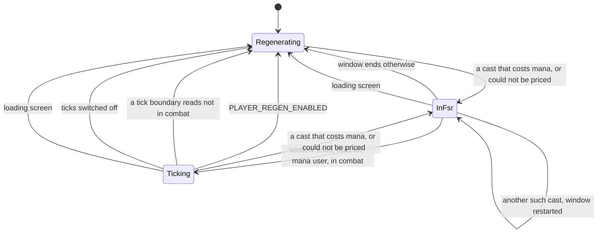

# PersonalAddon — Patch 03: Player names by faction, regen ticks, and tank colours

**Date:** November 22, 2026
**API version:** 1.60.1 (WoW Forever), game type `camelot`
**Client:** 1.60.1.71037, UI export 2026-11-22 10:26, accepted 2026-11-22 12:16:48 after review. `patch_check
status` reads **`UpToDate`** (§2). Every citation below is read from the 71037 export; export paths are
relative to its `Interface/AddOns`.
**Status:** drafted 2026-11-22; revision 3 took the audit's dispositions (§18). **Built** 2026-11-22 (revision 4,
§19); not committed, and the in-game checks of §14.3 are pending.
**Implements:** the user's three requests of 2026-11-22, with the decisions of two question rounds and the
addition of an Auto choice (§1.1):
1. Phase 22's player name colours split by faction: the other faction keeps red and light orange, and your own
   faction keeps the game's white (§3);
2. after the five-second window, the line keeps a 2-second regen rhythm (§4);
3. tank colours, chosen in a small box under the skills panel: Tank, DPS, or Auto, which follows the game's own
   tank test. A mob you hold turns green, and a mob on your group turns red (§5, §6).

**Depends on:**
- `20260919-Phase01.md` §11, §11.1a: the window indicator, and why the game's ticks cannot be read;
- `20260924-Patch01.md` §0.2: SmartNavigation's `CreateFrame` hook, and why frames are made at enable;
- `20260927-Phase08.md` §5: the skills panel;
- `20261002-GAPBugs01.md` §2, §2.9: G1, and the pad cursor as its carrier;
- `20261005-Phase11.md` §2: one colour decision for the plates and the threat panel;
- `20261021-Phase20.md` §2: which casts open the window;
- `20261122-Phase22.md` §3–§5: player name colours;
- README "Rules for future development".

**Revision:** 4 (history at the end; audit dispositions and corrections in §18; build record in §19).

---

## 0. Summary

- **Names (§3).**
  - One new read, `UnitFactionGroup`, made once per player plate. It carries no secrecy predicate on 71037.
  - A player of your own faction who cannot fight you is no longer written at all, so the game's white stands.
  - Red still wins over faction (D2).
- **Ticks (§4).**
  - A third tracker state, `Ticking`. The line runs on its own 2-second clock from the window's end until your
    next mana-costing cast or the end of the fight.
  - Nothing is read beyond one combat test per tick. The rhythm is WoW Classic's, by the user's decision, and
    claims nothing about Forever (D4).
- **Tank colours (§5).**
  - The role becomes the third input of `Threat.ResolveVerdict`, so the plates and the threat panel change
    together.
  - Threat statuses 2 and 3 are told apart for the first time.
  - Three tank verdicts borrow the existing six colours: no new picker.
  - **Auto (§5.7)** takes the role from the game's own tank test, `UnitHasEffectivelyTankAura("player")`, read
    once per sweep pass, in and out of combat. It is one plain read of a C function: no Blizzard Lua runs, nothing
    is written, and nothing is subscribed. Premises 118–120 pin the three flags that would change that.
- **The box (§6).** PersonalAddon's first clickable frame: three buttons under the skills panel, a child of that
  panel.
  - The mouse selects it. The pad cannot, and the design keeps it that way: a pad-reachable addon button is G1's
    documented carrier (GAPBugs01 §2.9).
  - Premises 116 and 117 pin both halves.
- **Considered and not taken (§1.3):** reading the game's own ticks, round one's tank detection, Blizzard's
  composite tank test, and a pad route to the box.

---

## 1. Scope

### 1.1 Decisions

| # | Question | Answer (2026-11-22) | Where |
|---|---|---|---|
| D1 | Players of your own faction | **No write.** The name is the game's own: white, or the class colour when Blizzard's friendly class-colour option is on (off on this account) | §3.1 |
| D2 | Your own faction, and able to fight you: a duel, a free-for-all area, mind control | **Red.** "Can fight you" outranks faction (Q1 A) | §3.3 |
| D3 | The other-player picker | **Relabelled "The other faction".** The key `nameColourOtherPlayer` and the verdict `OtherPlayer` are kept, so nothing migrates | §8.2 |
| D4 | What a tick is | **WoW Classic's 2-second rhythm, not Forever's ticks.** In the user's words: "an arbitrary feature … for my WoW Classic mindset … a visual cue but not directly tied to the mana bar" (Q5). No game read decides when a tick lands | §4.1 |
| D5 | How ticks show | **A sweep per tick:** the same line, in the tick colour, crossing the bar once every 2 s (Q2 A) | §4.4 |
| D6 | Switch and colour | **"Show regen ticks"** on the Combat page, default on; colour `ffd100` (A3) | §8.2 |
| D7 | When the first tick lands | **2 s after the window ends.** The gold line starts at the left edge as the white one reaches the right (B1) | §4.3 |
| D8 | Ticks inside the window | **Not drawn.** The window line has the bar (A4) | §4.2 |
| D9 | When ticks stop | **At the next mana-costing cast or at the end of the fight, whichever comes first.** A window that ends out of combat starts no ticks (Q6 A) | §4.3 |
| D10 | Tank colours | **Held securely: green. On you but out-threatened: orange. On your group: red.** Orange means "about to change hands" for both roles (Q3 B) | §5.3 |
| D11 | The threat panel | **Follows the plates** (Q4 A) | §5.5 |
| D12 | Tank pickers | **None.** The three tank verdicts take the existing six colours, swapped (A7) | §5.4 |
| D13 | Tank colours and tagged grey | **A mob on your group outranks grey,** as a mob on you does for DPS (A8) | §5.3 |
| D14 | Solo | **Tank colours apply solo too.** The choice decides, not the group (A9) | §5.3 |
| D15 | A second tank | **Their mobs show red for you.** Nothing tells PersonalAddon who else is tanking (A10) | §15 |
| D16 | Who decides the role | **The user, in the box: Tank, DPS or Auto, with DPS the default.** Round one's detection is dropped (round two); Auto is added (D26) | §6 |
| D17 | Input | **The mouse, plus `/pa role` from the keyboard.** No pad route (Q7 A) | §6.3 |
| D18 | Storage | **Per account,** as a `nameplates` setting (Q8 B) | §6.6 |
| D19 | Ownership | **The skills panel.** The box is its child, shown and hidden with it (Q9 A) | §6.2 |
| D20 | Layout | **Tank and DPS side by side, Auto beneath them at full width:** the chosen one lit and the others dimmed; under Auto its label shows the test's answer; no tooltip; the skills panel's chrome and width (B3, revised for D26) | §6.2 |
| D21 | In combat | **Clickable** (B4) | §6.4 |
| D22 | Commands | **`/pa role` reads and sets the choice,** `auto` included. `/pa plates` and `/pa threat` print the role and whether Auto chose it (B5) | §9 |
| D23 | A malformed stored role | **Reads as DPS** (B6) | §5.4 |
| D24 | The 2.0 s constant | **The user's decision, not a fact about Forever** (B2). A review must not "correct" it to game data | §8.1 |
| D25 | Build 71037 | **Already accepted.** No accept step | §2 |
| D26 | A third choice | **Auto: the role follows the game's own tank test, `UnitHasEffectivelyTankAura("player")`, and nothing else.** Not round one's Righteous Fury, spec or bear-form detection. The user will judge it in game, provided it raises no taint concern (§5.7.4: it raises none) | §5.7 |
| D27 | Blizzard's composite test | **Not used.** `PlayerUtil.IsPlayerEffectivelyTank` adds the group-finder role and the spec's role to the same aura test, and the spec half is what D26 excludes | §5.7.3 |
| D28 | When the test is read | **Live:** once per sweep pass of each consumer, in and out of combat, and only under Auto | §5.7.2 |
| D29 | A test that does not read | **DPS colours,** counted; the box reads "Auto: ?" | §5.7.2 |
| D30 | How the choice is stored | **One key, `threatRole`: a `Choice` of `Dps`, `Tank` or `Auto`,** default `Dps`. It replaces revision 1's boolean `tankColours`; nothing shipped, so nothing migrates | §6.6 |

The A and B items were round-one and round-two assumptions. The user's answers did not object to them, so they are
recorded as decided (Phase 21's convention). Two were overtaken: A5 (ticks stop when an expected tick fails to
arrive) by D4, and A6 (a settings switch for tank colours) by D16.

D26 is the user's addition of 2026-11-22. D27–D30 are revision 2's consequences of it, stated for the audit; the
user has not answered them.

**Each decision's cost is named where it is paid:**
- D4: the gold line does not coincide with your real mana gains, and does not stop when the bar is full (§4.1);
- D9: a window that ends out of combat gets no ticks, buffing in town included (§4.3);
- D12: the six pickers' labels describe what each colour means for DPS. The "Colour nameplates" description gains
  the tank meaning (§5.6);
- D15: an off-tank's mobs read as loose (§15);
- D17: a player using only a controller cannot change the role without a mouse or keyboard (§6.3);
- D18: Tank chosen on one character applies to every character. Auto avoids this cost, since each character's
  own test decides (§6.6);
- D19: with the skills panel off there is no box, though the stored choice still applies (§6.7);
- D26: Auto is only as good as the auras Forever counts as tanking, which nothing offline shows (§14.3 check 8);
- D27: Blizzard's own tank border and aggro flash use the composite test, so they can disagree with Auto. If you
  queue as tank without a tank aura, Blizzard says tank and Auto says DPS (§5.7.3).

### 1.2 What ships

| Item | Kind | Section | File |
|---|---|---|---|
| Player names by faction | Feature change | §3 | `Features/Nameplates.lua` |
| Regen ticks: `Ticking`, the stop rule, the tick colour | Feature change | §4 | `Features/FiveSecondRule.lua` |
| Role and choice, Auto's test, the status split, three tank verdicts, palette aliases | Seam change | §5 | `Core/Threat.lua` |
| Plates and panel resolve and pass the role | Feature change | §5.5 | `Features/Nameplates.lua`, `Features/ThreatPanel.lua` |
| The role box: Tank, DPS, Auto | Feature change | §6 | `Features/EquippedSkills.lua` |
| `PanelChrome.Build` takes a parent | Seam | §6.2 | `Core/PanelChrome.lua` |
| Two constants, one state, four settings, one relabel | Substrate | §8 | `Core/Constants.lua`, three schemas |
| `/pa role`; new `/pa fsr`, `/pa plates` and `/pa threat` lines | Command | §9 | `Core/Debug.lua` |
| Premises 113–120 | Tooling | §10 | `Tools/patchcheck/premises.toml` |
| `stubsPatch03.lua`, `testsPatch03.lua`, one session | Tooling | §14.1 | `Tools/harness/` |
| README | Housekeeping | §11 | `README.md`, `Tools/README.md` |
| TOC `1.12.1`, `VERSION` `1.12.1-patch03` | Housekeeping | §17 | `PersonalAddon.toc`, `Core/Constants.lua` |

### 1.3 Not possible, or out of scope

- **The game's own regen ticks** (D4).
  - `UnitPower` is still `SecretWhenUnitPowerRestricted` (`Blizzard_APIDocumentationGenerated/UnitDocumentation.lua`,
    entry `UnitPower`): secret for every power type not flagged never-secret, in or out of combat.
  - Round one found a route that never reads the amount. `UNIT_POWER_FREQUENT` carries only
    `(unitTarget, powerType)` and no secrecy flag (`UnitDocumentation.lua:4532-4538`), so the *time* of a mana
    change is readable.
  - Locking onto the regen cadence from timing alone is inference, and the user declined it: the cue is meant as
    Classic's rhythm.
  - Phase 01 Appendix A stays the restart point if mana ever becomes readable.
- **Round one's tank detection** (D16, D26).
  - Round one designed detection from the spec's role, the druid's power type and Righteous Fury.
  - It found a trap: `GetPlayerAuraBySpellID` is `RequiresNonSecretAura`, so in combat it "will return no values"
    (`SecretPredicatesDocumentation.lua:28-31`). That looks exactly like "no aura".
  - The user chose a manual switch, then added Auto on the game's own test instead (§5.7). Round one's design is
    not revived.
- **Blizzard's composite tank test** (D27). `PlayerUtil.IsPlayerEffectivelyTank`
  (`Blizzard_SharedXML/UnitUtil.lua:109-121`) is what Blizzard's own plates ask. It adds the group-finder role
  and, under the `ChrSpecialization` system, the spec's role to the aura test Auto uses (§5.7.3).
- **A finer tank warning.** `UnitThreatLeadSituation` grades your lead over the second-highest threat, and reads
  red when you are not first (`UnitDocumentation.lua:3244-3258`). It would warn before anyone passes you, where D10
  warns once someone has. The cost is one more read per mob per sweep. Not taken.
- **A pad route to the box** (D17, §6.3).
- **A per-character role** (D18). The store stays per account, Phase 01's rule.
- **A role control on the settings page.** Not asked for (D17), and not possible as one control: the settings page
  draws a `Choice` only when it has two values, as a checkbox
  ([SettingsPanel.lua:210-219](../Features/SettingsPanel.lua#L210-L219), README rule 1), and `threatRole` has
  three. So `threatRole` is declared not curated.
- **What the game already does.**
  - Blizzard's plates carry their own threat display (`nameplateThreatDisplay`,
    `Blizzard_NamePlates/Blizzard_NamePlateUnitFrame.lua:648-654`), a tank border and an aggro flash
    (`Blizzard_UnitFrame/Shared/CompactUnitFrame.lua:599-626`, `:978-984`, `:1010-1024`).
  - All three follow Blizzard's composite tank test (D27), not the box.
  - Where PersonalAddon paints a bar, its post-hooks re-assert its colour, as they have since Phase 2. The border
    and the flash stay Blizzard's.

### 1.4 Types

```
Nothing           = no value
UnitToken         = string
Counters          = Map<string, integer>
ReadKind          = enum { Plain, Absent, Withheld }
Reading<T>        = { kind: ReadKind, value: Optional<T> }
Colour            = { red: number, green: number, blue: number }
Timestamp         = number                           # GetTime's clock, seconds
Duration          = number                           # seconds
Fraction          = number                           # in [0, 1]
SettingsTable     = Map<string, boolean | number | string>

FactionTag        = string                           # UnitFactionGroup's first return
PlateRecord       = Phase 22's record, gaining faction: Optional<FactionTag>
NameColourSkip    = Phase 22's nine reasons, gaining SameFaction and FactionUnreadable
NameColourVerdict = enum { CanFight, OtherPlayer }   # OtherPlayer now means "the other faction" (D3)
NameAnchorReading = Phase 22's enum { AboveSpanning, AboveCentred, InsideBar, Unreadable }
NameColourDecision = Phase 22's Paint(verdict: NameColourVerdict) | Leave(reason: NameColourSkip)

TrackerState      = enum { Regenerating, InFsr, Ticking }
TickOutcome       = enum { Started, SkippedOff, SkippedNotManaUser, SkippedOutOfCombat, SkippedCombatUnread }
TickStop          = enum { Cast, FightEnded, Backstop, SwitchedOff, LoadingScreen }
FsrSettings       = { lineWidth: number, lineAlpha: number, showTicks: boolean, tickColour: Colour }
TickClock         = { anchor: Timestamp, period: Duration, lastCycle: integer }

RoleChoice        = enum { Dps, Tank, Auto }        # what the user chose, stored as threatRole
Role              = enum { Dps, Tank }              # what the colours are for now
AutoReading       = enum { NotAsked, Tank, NotTank, Unread }
RoleResolution    = { role: Role, auto: AutoReading }
Aggro             = enum { OnPlayerSecure, OnPlayerInsecure, AboutToPull, OnGroupOrPet, Elsewhere, Unknown }
Disposition       = enum { TapDenied, Neutral, Hostile, Unreadable }
Verdict           = enum { OnPlayer, AboutToPull, TapDenied, OnGroupOrPet, Neutral, Elsewhere, Ceded,
                           TankHolding, TankSlipping, TankLoose }
Palette           = Map<Verdict, Colour>             # every verdict but Ceded
RoleWrite         = Written | Unchanged | Refused(reason: string)
RoleBoxView       = { wanted: boolean, shown: boolean, choice: RoleChoice, auto: AutoReading, created: boolean }
```

- **`Aggro` loses `OnPlayer`.** Nothing outside `Core/Threat.lua` reads an aggro value.
  - The threat panel stores one only to hand it back ([ThreatPanel.lua:221-231](../Features/ThreatPanel.lua#L221-L231),
    [:551](../Features/ThreatPanel.lua#L551)).
  - `/pa threat` prints the verdict, not the aggro value ([Debug.lua:462-463](../Core/Debug.lua#L462-L463)).
  - `Verdict.OnPlayer` stays.
- **`TickClock.lastCycle`** is the index of the last tick boundary checked (§4.3). It bounds the combat read to one
  per tick.
- **Nothing is written onto a Blizzard frame or table.**

---

## 2. Build 71037

- `status` reads `UpToDate`: 71037 was accepted on 2026-11-22 at 12:16:48, after review (Phase 22 §2). No check is
  due.
- Every premise in §10 was evaluated against this export with the patch check's own evaluator.

---

## 3. Player names by faction

### 3.1 What changes

Phase 22 painted every player who cannot fight you light orange (Phase 22 D1). From here, only a player of the other
faction is.

A player of your own faction who cannot fight you is not written: the name is the game's own. On Forever that is
white, or the class colour when `nameplateUseClassColorForFriendlyPlayerUnitNames` is on (Phase 22 §3.1, D10). That
option is off on this account.

| Player | Can fight you, either way | Phase 22 | Patch 03 |
|---|---|---|---|
| Other faction | yes | red | red |
| Other faction | no | light orange | light orange |
| Your faction | yes: a duel, a free-for-all area, mind control | red | red (D2) |
| Your faction | no | light orange | **the game's: white** |
| Faction unreadable | no | light orange | **the game's** (rule 10) |

- **Leaving the name is cheaper than painting it white.** It writes nothing on most player plates in a capital
  city: no `NameColour` record and no hook re-assert. Blizzard's class-colour option also keeps working for your
  own faction.
- **A left name looks like "your faction".** An unreadable faction and your own faction both show the game's white.
  - The difference shows in `/pa plates` (`left: sameFaction=` against `unreadable: faction=`), not on screen.
  - Premises 113 and 114 make the unreadable case a patch-check finding, not a silent one.

### 3.2 The faction read

- **The API reads everywhere.** `UnitFactionGroup(unitName, checkDisplayRace)` returns `factionGroupTag` and
  `localized`, both non-nilable `cstring`, with only `SecretArguments = "AllowedWhenUntainted"`
  (`UnitDocumentation.lua`, entry `UnitFactionGroup`). It has no secrecy predicate, so it reads in battlegrounds
  and on restricted maps. Premises 113 and 114 pin the two predicates that would change that.
- **A plate's faction is read once per occupancy,** like its identity (Phase 22 §3.2). A unit cannot change faction
  while its plate is up.
  - A Plain, non-empty tag is kept on the record.
  - Anything else is not kept; it is counted and asked again next batch.
  - A recycled plate is a new occupancy.
- **Your own faction is read once per batch:** an attach, a sweep pass, a faction flush or a settings change. These
  are the batches that already share one `read_name_anchor` (Phase 22 §3.4). It is not cached across batches: one
  read per batch needs no invalidation rule.
- **Faction is read only while colours are active.** With `playerNameColours` off, or the capability Refused or
  Unverifiable, nothing is read (check F9).

```
# A plate's faction, read once per occupancy.
# pre:  plate is tracked; resolve_player_identity answered Player
# post: plate.faction held: returned as Plain, nothing read.
#       Otherwise UnitFactionGroup(plate.unitToken)'s first return through ClientRead:
#         Plain and non-empty -> kept as plate.faction and returned;
#         anything else -> returned as read, not kept, counted nameColourFactionUnread
# raises: never
function resolve_plate_faction(plate: PlateRecord, counters: Counters) -> Reading<FactionTag>

# Your own faction, for one batch.
# pre:  player name colours are active: on, and the capability NotYetProbed or Verified
# post: UnitFactionGroup("player")'s first return through ClientRead; not cached.
#       Anything but Plain and non-empty counts nameColourFactionUnread once
# raises: never
function read_your_faction(counters: Counters) -> Reading<FactionTag>
```

### 3.3 The decision

Phase 22 §3.5's decision gains one step, after the attack reads and before the class-colour field.

```
# What one plate's name should show, from the client's answers now.
# pre:  playerNameColours is on; the capability is NotYetProbed or Verified; plate is tracked;
#       anchor is this batch's read_name_anchor(); yourFaction is this batch's read_your_faction()
# post: Paint(CanFight) for a player who is not you, on an eligible plate, when either attack
#       read is Plain true, whatever either faction (D2).
#       Leave(FactionUnreadable) when both attack reads are Plain false or Absent and either
#       faction is not Plain and non-empty.
#       Leave(SameFaction) when the two factions are equal (D1).
#       Paint(OtherPlayer) when they differ and Blizzard is not colouring the name by class.
#       Every other outcome is Phase 22 §3.5's
# raises: never
function decide_name_colour(
    plate: PlateRecord,
    anchor: NameAnchorReading,
    yourFaction: Reading<FactionTag>,
    counters: Counters
) -> NameColourDecision:
    identity: PlayerIdentity = resolve_player_identity(plate, counters)
    if identity == Unreadable:
        return Leave(PlayerUnreadable)
    if identity == NotAPlayer:
        return Leave(NotPlayer)
    if identity == You:
        return Leave(Yourself)
    ineligible: Optional<NameColourSkip> = name_ineligibility(plate, anchor)
    if ineligible.isPresent():
        return Leave(ineligible.value)
    youAttack: Reading<boolean> = ClientRead.Call(UnitCanAttack, "boolean", "player", plate.unitToken)
    theyAttack: Reading<boolean> = ClientRead.Call(UnitCanAttack, "boolean", plate.unitToken, "player")
    if youAttack.isPlainTrue() or theyAttack.isPlainTrue():
        return Paint(CanFight)
    if youAttack.kind == Withheld or theyAttack.kind == Withheld:
        counters.bump("nameColourAttackWithheld")
        return Leave(AttackUnreadable)
    theirFaction: Reading<FactionTag> = resolve_plate_faction(plate, counters)
    if not yourFaction.isPlainNonEmpty() or not theirFaction.isPlainNonEmpty():
        return Leave(FactionUnreadable)
    if theirFaction.value == yourFaction.value:
        return Leave(SameFaction)
    byClass: Reading<boolean> = ClientRead.Field(plate.unitFrame, "colorNameWithClassColor", "boolean")
    if byClass.kind == Withheld:
        return Leave(ClassColourUnreadable)
    if byClass.isPlainTrue():
        return Leave(ClassColourWins)
    return Paint(OtherPlayer)
```

- **Red comes before faction.** That is D2, and also the cheap order: the attack reads already run for every
  player plate (Phase 22 §3.3), and the faction is read only for a player who cannot fight you.
- **Phase 22's D10 still applies, now to the other faction only.** Blizzard sets `colorNameWithClassColor` on
  friendly players (Phase 22 §3.1), and a player of the other faction is rarely friendly.
- **Everything after a decision is Phase 22's:** `apply_name_colour`, the probe, the hook and the restore. A plate
  painted light orange under Phase 22 that now decides `Leave(SameFaction)` is released on its next batch: its
  colour is restored and its record dropped (`nameColourReleased`).

### 3.4 Where your faction is passed

- **Every caller of `decide_name_colour` already makes one `read_name_anchor` per batch** (Phase 22 §3.4's table).
  Each makes one `read_your_faction` beside it, under the same "colours active" gate:
  - `trackPlate`;
  - the sweep's name pass;
  - `flush_faction_changes` ([Nameplates.lua:1846-1869](../Features/Nameplates.lua#L1846-L1869));
  - `onConfigChanged` for `playerNameColours`.
- **The hook never decides** (Phase 22 §4.3), so it makes neither read.
- **Cost.** One `UnitFactionGroup` per player plate per occupancy, plus one per batch for you: about four reads a
  second, plus one per new player plate. Phase 22 counted about 500 C calls a second at 25 player plates (§5.3);
  this adds fewer than ten.
- **Fewer writes.** A same-faction plate holds no record, and the hook returns at once for it, because
  `namePainted` is absent.

---

## 4. Regen ticks

### 4.1 What the line is

After the five-second window ends, the same line keeps moving, in the tick colour. It crosses the mana bar once
every 2 seconds and reaches the right end as each tick lands. It stops at your next mana-costing cast or at the end
of the fight.

- **2 seconds is WoW Classic's regen interval, chosen by the user** (D4, D24). It is a rhythm for a Classic habit,
  not a reading of Forever:
  - nothing tells the line when mana actually arrives: `UnitPower` is secret (§1.3), and the user declined round
    one's timing inference;
  - so the gold line does not coincide with your real mana gains, and it does not stop when the bar is full.
- **What it reads:** `GetTime`, as the window does, and `UnitAffectingCombat("player")` once at the window's end
  and once per tick (§4.3). No power value and no power event.

### 4.2 States



- **A free cast,** such as a wand shot or a potion, changes nothing in any state: Phase 20 §2's rule (check T8).
- **Visibility works as before:** the line shows while the state is `InFsr` or `Ticking` and the player is a mana
  user ([FiveSecondRule.lua:139-141](../Features/FiveSecondRule.lua#L139-L141)). A druid who shifts into a
  non-mana form mid-tick hides the line. The state stays `Ticking`, and shifting back shows it again (check T13).
- **`InFsr` takes priority** (D8). A cast during `Ticking` restarts the window, and the line turns white again.
- **`TRACKER_STATE` gains `TICKING`** ([Constants.lua:51-56](../Core/Constants.lua#L51-L56)). Its comment, "Two
  states, not three", becomes three, with the reason.

### 4.3 Starting and stopping

```
# What follows the five-second window.
# pre:  the window timer fired; state == InFsr; now >= windowEndsAt
# post: Ticking, with clock.anchor = windowEndsAt, clock.lastCycle = 0 and the line in the
#       tick colour, when showTicks is on, the player is a mana user, and
#       UnitAffectingCombat("player") reads Plain true: Started (ticksStarted).
#       Otherwise Regenerating, the line hidden, by outcome:
#         SkippedOff (ticksSkippedOff); SkippedNotManaUser (ticksSkippedNotManaUser);
#         SkippedOutOfCombat for Plain false or Absent (ticksSkippedOutOfCombat);
#         SkippedCombatUnread for Withheld (ticksSkippedCombatUnread)
# raises: never
function on_window_end(now: Timestamp, settings: FsrSettings) -> TickOutcome

# The line's place during ticks, from our own clock only.
# pre:  clock.anchor is set
# post: ((now - clock.anchor) mod clock.period) / clock.period, in [0, 1); 0 when now < clock.anchor
# raises: never
function tick_fraction(now: Timestamp, clock: TickClock) -> Fraction

# The backstop: once per tick, checks that the fight is still on.
# pre:  state == Ticking; called by the OnUpdate driver
# post: cycle = floor((now - clock.anchor) / clock.period). When cycle > clock.lastCycle:
#       clock.lastCycle = cycle, then UnitAffectingCombat("player") through ClientRead;
#       anything but Plain true -> stop_ticks(Backstop). Otherwise nothing is read
# raises: never
function check_fight_at_tick(now: Timestamp, clock: TickClock) -> Nothing

# Ends a run of ticks.
# pre:  state == Ticking
# post: Regenerating, the line hidden and white again, the clock cleared, the driver stopped,
#       counted tickStops<Reason>. A Cast stop is the window's existing start, which leaves
#       InFsr instead and is counted tickStopsCast
# raises: never
function stop_ticks(reason: TickStop) -> Nothing
```

- **Why a combat event and a backstop.** `PLAYER_REGEN_ENABLED` ends ticks the moment the fight ends. The backstop
  catches an end that event never announced, within one tick, at one read per tick, never per frame (check T6).
- **Withheld never counts as "in combat," in either direction.** An unreadable test starts no ticks and stops
  running ones.
  - A line that keeps sweeping after a fight is what D9 exists to prevent.
  - A missing tick in a fight is the quieter error: Phase 01 §11.4 made the same choice for loading screens.
  - `UnitAffectingCombat` carries no secrecy predicate on 71037 (`UnitDocumentation.lua`, entry
    `UnitAffectingCombat`; premise 115), so neither path should occur.
- **The clock is anchored at the window's end** (D7). The first tick lands 2 s after the window ends, and the gold
  line starts at the left edge as the white one reaches the right. A cast restarts the window, and that window's
  end re-anchors the clock, so ticks never run from a stale anchor.
- **Disable resets the ticks uncounted,** as it resets the window today
  ([FiveSecondRule.lua:471-491](../Features/FiveSecondRule.lua#L471-L491)). No `TickStop` names it (audit finding 6).

### 4.4 Rendering

- **One texture, the existing one.** The line is recoloured on each state change, never per frame: white for
  `InFsr`, the tick colour for `Ticking`. It is the same `SetColorTexture` call the texture was created with
  ([FiveSecondRule.lua:110-115](../Features/FiveSecondRule.lua#L110-L115)). README's known exception (the texture
  on Blizzard's mana bar) is unchanged.
- **One driver** (audit finding 7). The existing `OnUpdate`
  ([FiveSecondRule.lua:164-189](../Features/FiveSecondRule.lua#L164-L189)) runs while the state is `InFsr` and
  the line is shown, as today, and for as long as the state is `Ticking`, shown or not.
  - Its position is `window_elapsed_fraction` in `InFsr` and `tick_fraction` in `Ticking`, written only while
    the line is shown.
  - In `Ticking` it calls `check_fight_at_tick` on every frame, shown or not, so the backstop keeps running while
    a non-mana form hides the line.
  - No new timer: the window timer still ends the window, and nothing schedules a tick.
- **No flash on the way back.** When the line is about to be shown in `Ticking`, after a shift back into a mana
  form, the fight is checked first with one `UnitAffectingCombat` read. Anything but Plain true stops the ticks
  (`Backstop`) and nothing is shown. So a fight that ended unannounced while the line was hidden never flashes the
  gold line (check T15).
- **Width and opacity** (`lineWidth`, `lineAlpha`) apply to both colours.

### 4.5 Signals

Phase 01 §11.2's table gains one row. Nothing else is subscribed.

| Signal | | Role | If refused |
|---|---|---|---|
| `UNIT_SPELLCAST_SUCCEEDED` | required | Opens or restarts the window; ends ticks | The feature faults, as today |
| `UNIT_DISPLAYPOWER` | refinement | Re-checks whether the player is a mana user | As today |
| `PLAYER_ENTERING_WORLD` | refinement | Clears the window and the ticks | As today |
| `PLAYER_REGEN_ENABLED` | refinement | Ends ticks when the fight ends | Ticks end at the next tick's backstop instead, up to 2 s late; one line says so, once |

`PLAYER_REGEN_ENABLED` is `SynchronousEvent` with no payload (`UnitDocumentation.lua:3893-3894`). Its handler
changes only our state and hides only our texture, as `PLAYER_ENTERING_WORLD`'s does today
([FiveSecondRule.lua:406-413](../Features/FiveSecondRule.lua#L406-L413)).

### 4.6 Settings changes

- **`showTicks` turned off while ticking:** `stop_ticks(SwitchedOff)` at once. Turned on: ticks start from the next
  window's end.
- **`tickColour` changed while ticking:** the line is recoloured at once.
- **`lineWidth` and `lineAlpha`:** as today ([FiveSecondRule.lua:493-500](../Features/FiveSecondRule.lua#L493-L500)).

---

## 5. Tank colours

### 5.1 Where the role enters

- `Threat.ResolveVerdict` is "the one place a mob's colour is decided, for both features"
  ([Threat.lua:275-304](../Core/Threat.lua#L275-L304)). The role becomes its third input.
- Both callers pass it (§5.5), so the plates and the threat panel cannot disagree (D11, Phase 11 §2).

### 5.2 Statuses 2 and 3, told apart

`UnitThreatSituation`'s statuses 2 and 3 both mean "you are its target" (`ns.TANKING_STATUS = 2`,
[Constants.lua:92-94](../Core/Constants.lua#L92-L94)). Today `ClassifyAggro` folds them into one `OnPlayer`
([Threat.lua:157-159](../Core/Threat.lua#L157-L159)). Tank colours need them apart:
- **3:** you are its target and hold the most threat (`ns.SECURELY_TANKING_STATUS`, new): `OnPlayerSecure`;
- **2:** you are its target and someone else holds more, short of pulling it: `OnPlayerInsecure`.

Nothing else in `ClassifyAggro` changes. It makes the same reads, and they stop at the first unit found tanking. For
DPS both statuses still resolve to `OnPlayer` (§5.3), so every existing verdict, count and colour stands (check K1).

### 5.3 The verdict

```
# The one place a mob's colour is decided, for the plates and the threat panel.
# pre:  aggro from ClassifyAggro; disposition from Disposition; role from resolve_role (§5.7.2)
# post: Dps: Phase 11's order, unchanged; OnPlayerSecure and OnPlayerInsecure are both OnPlayer.
#       Tank: OnPlayerSecure -> TankHolding; OnPlayerInsecure -> TankSlipping;
#       OnGroupOrPet -> TankLoose, ahead of TapDenied (D13); AboutToPull -> AboutToPull.
#       Then, for both roles: TapDenied, Ceded for Unknown, Neutral, Elsewhere
# raises: never
function resolve_verdict(aggro: Aggro, disposition: Disposition, role: Role) -> Verdict:
    if role == Tank:
        if aggro == OnPlayerSecure:
            return TankHolding
        if aggro == OnPlayerInsecure:
            return TankSlipping
        if aggro == OnGroupOrPet:
            return TankLoose
    if aggro == OnPlayerSecure or aggro == OnPlayerInsecure:
        return OnPlayer
    if aggro == AboutToPull:
        return AboutToPull
    if disposition == TapDenied:
        return TapDenied
    if aggro == OnGroupOrPet:
        return OnGroupOrPet
    if aggro == Unknown:
        return Ceded
    if disposition == Neutral:
        return Neutral
    return Elsewhere
```

| Situation (your threat status) | DPS | Tank |
|---|---|---|
| You hold it securely (3) | `OnPlayer`, red | `TankHolding`, green |
| You hold it, but someone out-threatens you (2) | `OnPlayer`, red | `TankSlipping`, orange |
| You out-threaten whoever holds it (1) | `AboutToPull`, orange | `AboutToPull`, orange |
| Your group or your pet holds it | `OnGroupOrPet`, green, below grey | `TankLoose`, red, above grey (D13) |
| Tagged by a player outside your group, on nobody | `TapDenied`, grey | `TapDenied`, grey |
| A threat read was withheld | `Ceded` | `Ceded` |
| Neutral, or hostile and on nobody | yellow, white | yellow, white |

- **Orange means "about to change hands" in both roles** (D10). For DPS, you are about to pull it. For a tank, you
  are about to lose it (2) or win it back (1).
- **Solo** (D14), a tank sees green on whatever attacks them and white on the rest. With no group, only your pet
  can make a mob loose.
- **Grey never hides a mob your group is fighting in tank mode** (D13), just as it never hides one on you for DPS
  ([Threat.lua:275-283](../Core/Threat.lua#L275-L283)).

### 5.4 Palette and role

```
# Every verdict's colour but Ceded's, from the nameplates feature's colour settings.
# pre:  settings may be nil or hold malformed values
# post: PALETTE_KEYS' six verdicts as today, a malformed value taking its default;
#       TankHolding takes OnGroupOrPet's colour, TankSlipping AboutToPull's, TankLoose
#       OnPlayer's (D12). PALETTE_KEYS itself is unchanged, so PaletteDefaults, the settings
#       page and the threat panel's change detection still see six keys
# raises: never
function palette_from(settings: Optional<SettingsTable>) -> Palette

# The choice the user made.
# pre:  settings is the nameplates feature's stored settings, or nil
# post: settings.threatRole when it is exactly "Tank" or "Auto"; Dps otherwise, nil, missing and
#       malformed included (D23)
# raises: never
function role_choice_from(settings: Optional<SettingsTable>) -> RoleChoice
```

- **The alias table is data in `Core/Threat.lua`,** beside `PALETTE_KEYS`: `TANK_COLOUR_SOURCE = { TankHolding →
  OnGroupOrPet, TankSlipping → AboutToPull, TankLoose → OnPlayer }`. A later phase that wants tank pickers adds
  keys and drops an alias; no verdict changes.
- **`Threat.ROLE` and `Threat.ROLE_CHOICE`** join `AGGRO`, `VERDICT` and the rest as exported enums.
- **The role itself comes from `resolve_role`** (§5.7.2): the choice, for Dps and Tank; the game's test, for Auto.

### 5.5 The two consumers

- **Nameplates.**
  - `readSettings` sets `state.roleChoice = role_choice_from(settings)`
    ([Nameplates.lua:162-178](../Features/Nameplates.lua#L162-L178)).
  - **Each sweep pass resolves the role once,** `state.role = resolve_role(state.roleChoice, counters).role`,
    before its plates, and `verdictFor` passes it ([:270-282](../Features/Nameplates.lua#L270-L282)). The attach
    and the hooks use the last pass's role, so they make no test read.
  - **A change of `threatRole` needs no new branch.** It falls through `onConfigChanged` to the palette branch,
    which clears every plate's `lastVerdict` and sweeps at once
    ([:2337-2343](../Features/Nameplates.lua#L2337-L2343)).
  - **Under Auto the role can change with no settings change,** when the test's answer does. The next pass
    computes every plate's verdict with the new role, and the existing `lastVerdict` comparison repaints the plates
    that changed.
  - `Inspect().verdicts` counts by verdict string, so the three tank verdicts are counted as they occur.
- **Threat panel.**
  - `refreshPalette` already reads the nameplates feature's stored settings on every sweep
    ([ThreatPanel.lua:304-320](../Features/ThreatPanel.lua#L304-L320)). It adds `threatRole` to the values it
    compares, keeps `state.roleChoice`, and resolves `state.role` once per sweep, as the plates do.
  - **Out of combat the panel does not sweep** ([ThreatPanel.lua:753-755](../Features/ThreatPanel.lua#L753-L755)),
    so its resolved role can be a fight old (audit finding 4). It paints nothing then, so nothing on screen is
    stale. `enable` calls `refreshPalette`, so `roleChoice` is set from the start.
  - `Inspect()` reports `roleChoice` read from the store at the call, with no client read, and `role` and `auto`
    as the last sweep left them: absent before the first sweep. `/pa threat` prints the role resolved live (§9).
  - `drawRow` passes the role ([:551](../Features/ThreatPanel.lua#L551)). A role change shows on the panel's next
    sweep.
  - **The preview is unchanged:** it cycles the six DPS verdicts
    ([:667-670](../Features/ThreatPanel.lua#L667-L670)), and the tank verdicts have no colours of their own (D12).

### 5.6 Where the tank meaning is explained

- The box carries no tooltip (D20).
- The "Colour nameplates" description ([Nameplates.lua:2385-2388](../Features/Nameplates.lua#L2385-L2388)) gains
  one sentence (§8.2).
- README's colour table gains a Tank column (§11).

### 5.7 Auto: the game's own tank test (D26–D29)

#### 5.7.1 The test

`UnitHasEffectivelyTankAura(unit)` returns one non-nilable boolean (`UnitDocumentation.lua:1365-1379`). Its flags
decide everything that matters here:
- **`SecretWhenUnitIdentityRestricted`:** secret only "when the unit isn't player-controlled or in the
  party/raid" (`SecretPredicatesDocumentation.lua:130-133`). `"player"` is both, so the test is never secret for
  us;
- **no `SecretWhenUnitAuraRestricted`:** unlike every aura getter (Phase 21 §3.1), it is not made secret by
  combat, an encounter, a challenge mode or a PvP match. Premise 118;
- **no `RequiresNonSecretAura`:** unlike `GetPlayerAuraBySpellID`, it does not go silent while auras are secret,
  which was round one's trap. Premise 119;
- **no `HasRestrictions`:** it is not a protected call. Premise 120;
- **`SecretArguments = "AllowedWhenUntainted"`** concerns a secret argument. Ours is the literal `"player"`.

Which auras count as tanking is the game's data, and the export does not show it. The test's one caller in the
export is Blizzard's composite test (`Blizzard_SharedXML/UnitUtil.lua:110`).

#### 5.7.2 When it is read

```
# The role the colours are for now.
# pre:  choice from role_choice_from; counters is the caller's own Diagnostics table
# post: Dps -> (Dps, NotAsked) and Tank -> (Tank, NotAsked), with nothing read.
#       Auto -> UnitHasEffectivelyTankAura("player") through ClientRead, once:
#         Plain true -> (Tank, Tank), and Plain false -> (Dps, NotTank), counted autoRoleReadsPlain;
#         Absent, Withheld, a failed call or a missing function -> (Dps, Unread), counted
#         autoRoleReadsUnread. A missing function also says one line, once
# raises: never
function resolve_role(choice: RoleChoice, counters: Counters) -> RoleResolution
```

- **Live, at one read per pass** (D28).
  - The plates resolve the role once per sweep pass, four times a second at the default interval. The threat panel
    resolves it once per sweep, and the box once per relight (§6.5).
  - Each counts in its own table, the convention `Core/Threat.lua` already keeps
    ([Threat.lua:7-10](../Core/Threat.lua#L7-L10)).
- **In combat too.** A form, stance or buff change the test sees reaches the colours within one pass. That is what
  the user will judge in game.
- **Under Dps and Tank, nothing is read** (check A5).
- **An unread test gives DPS colours** (D29).
  - DPS is the default the user chose, and the colours every user saw before this patch.
  - The box says "Auto: ?" rather than "Auto: DPS", so an unread test never passes for an answer.
  - The plates have no such label; `/pa role` and the counters report it instead.
- **Absent is unread, never "not a tank."** The function's return is non-nilable, so a nil means it said nothing.
  That is exactly round one's trap, and it is kept apart from a Plain false (check A7).

#### 5.7.3 Why not Blizzard's composite (D27)

`PlayerUtil.IsPlayerEffectivelyTank()` (`Blizzard_SharedXML/UnitUtil.lua:109-121`) is what Blizzard's own plates
ask for their tank border and aggro flash. It answers tank when:
1. the same aura test answers true; or
2. you have no assigned group role, the specialization system is `ChrSpecialization`, and your spec's role is
   `TANK`; or
3. your assigned group role is `TANK`.

It is not used, for two reasons:
- **Its second branch is a spec test,** the kind of detection the user excluded in D26.
- **It is Blizzard Lua.** Called from our code, it would run in our execution. It only reads, so it would not taint
  Blizzard's state. But its body is Blizzard's to change, so the design would rest on a function's text rather than
  an API's documented flags.

The cost: where branch 2 or 3 decides, Blizzard's border says tank and Auto says DPS. For example, you queue as tank
but are not in a tank form, stance or buff. In-game check 8 shows how often that happens. If it matters, a later
patch can add the composite as a separate choice.

#### 5.7.4 Taint

None. That was the condition for adding Auto.
- **No Blizzard Lua runs:** the read is a C function, called from our own code through `ClientRead`.
- **Nothing is written:** no Blizzard field, table or widget.
- **Nothing is subscribed or hooked:** the read happens in passes that already run, our sweeps and the box's poll.
- **No protected call:** premise 120.
- **No secret value is compared:** the answer goes through `ClientRead`, and only a Plain boolean decides a role.

---

## 6. The role box: Tank, DPS, Auto

### 6.1 What the user sees

While the bags are open, a small box sits directly under the skills panel, the same width. It holds `Tank` and
`DPS` side by side, with `Auto` beneath them at full width. The chosen one is lit and the others dimmed. Under
Auto, its label shows what the game's test answers now: "Auto: Tank", "Auto: DPS", or "Auto: ?" when the test
does not read.

A mouse click on another button changes the choice. The plates change during the click, and the threat panel at
its next sweep. Under Auto, a change in the test's answer reaches the plates within one pass and the label within
one poll.

### 6.2 Placement and lifecycle

- **A child of the skills panel.** The panel is our own frame, so rule 6 allows it. The box therefore:
  - shows and hides with the panel, with no bag tracking of its own (D19);
  - inherits the panel's strata, and appears in its preview, where its buttons still set the real role.
- **Not the panel's opacity** (audit finding 1).
  - `PanelChrome` puts the opacity on the background texture and holds the frame at 1
    ([PanelChrome.lua:162-166](../Core/PanelChrome.lua#L162-L166)), so a child does not follow the "Panel
    opacity" slider.
  - The box keeps its own chrome, and the three places that set the panel's background opacity set the box's
    too: `render`, `showPlaceholders` and `onConfigChanged("panelAlpha")`
    ([EquippedSkills.lua:609](../Features/EquippedSkills.lua#L609), [:679](../Features/EquippedSkills.lua#L679),
    [:865-866](../Features/EquippedSkills.lua#L865-L866)).
- **An empty panel hides the box.** `render` hides the panel when it has no rows
  ([EquippedSkills.lua:579-581](../Features/EquippedSkills.lua#L579-L581)), and the box goes with it. A cost of
  D19, found while revising (§18); `/pa role` still works.
- **Anchors.** Its top-left sits at the panel's bottom-left and its top-right at the panel's bottom-right,
  `ROLE_BOX_GAP` below. So it takes the panel's width and follows its height as rows come and go. The panel's own
  anchor to the bag is unchanged ([EquippedSkills.lua:504-511](../Features/EquippedSkills.lua#L504-L511)).
- **Built at the skills feature's enable,** beside the panel
  ([EquippedSkills.lua:515-540](../Features/EquippedSkills.lua#L515-L540)). Nothing is created while a bag is open
  (Patch 01 §0.2), and nothing is created again on later opens (check B7).
- **`PanelChrome.Build` gains an optional `parent`.**
  - A nil parent means `UIParent`, as today ([PanelChrome.lua:60-66](../Core/PanelChrome.lua#L60-L66)); otherwise
    the parent must be one of our own frames.
  - Its border children are already made under the panel ([:86-89](../Core/PanelChrome.lua#L86-L89)).
- **`roleChoice`** (on `equippedSkills`, default on) shows or hides the box. With it off, the stored role still
  applies.
- **Three `Button`s of our own,** with no Blizzard template.
  - Each has a label, a lit and a dimmed look, `RegisterForClicks("LeftButtonUp")`, and an `OnClick`.
  - None has an `OnEnter` or an `OnLeave` (D20; §6.3's defence in depth).
  - The box frame itself stays click-through (`EnableMouse(false)`, as `PanelChrome` sets it,
    [PanelChrome.lua:146](../Core/PanelChrome.lua#L146)), so only the three buttons take clicks.
- **Two rows.**
  - At the skills panel's narrowest, 74 px (`ns.SKILL_PANEL_MINIMUM_WIDTH`,
    [Constants.lua:182](../Core/Constants.lua#L182)), three buttons in one row would be about 19 px each, too
    narrow for "Auto" or "Tank".
  - So Tank and DPS share the first row, and Auto takes the second at full width, where "Auto: Tank" fits.
- **Sizes** (audit finding 9). The box is 42 px tall: `ROLE_BOX_PADDING`, 4 px, inside each edge; two rows of
  `ROLE_BUTTON_HEIGHT`, 16 px; and `ROLE_BUTTON_GAP`, 2 px, between the rows and between Tank and DPS.
- **Widths come from anchors, with no code in `applyWidth`.**
  - Tank runs from the box's left edge to its top centre (`TOP`), and DPS from the top centre to the right edge,
    each `ROLE_BUTTON_GAP / 2` short of the centre.
  - Auto runs from Tank's bottom-left to DPS's bottom-right.
  - Anchoring to the box's `TOP` point splits any width in two, so the buttons follow "Window width" through the
    panel. The audit's fix, widths recomputed in `applyWidth`, is not needed.

### 6.3 The mouse, never the pad (D17)

This is the section the patch check guards.

- **The pad cursor cannot reach the box.**
  - SmartNavigation collects candidate buttons by walking the tracked panel's descendants and its extra panels
    (`Blizzard_GamepadSmartNavigation/Utility.lua:279-336`, called from `FindButtonGroups` at `:338-358`). Extra
    panels are Blizzard's own (`Blizzard_GamepadTargeting/GroupTargeting.lua:87`).
  - Any `Button` qualifies as a candidate (`Utility.lua:263-277`), so that walk is the only gate.
  - The box descends from `UIParent` through our panel, never from a container frame. Premise 116 pins this.
  - SmartNavigation also turns the free stick cursor off (`SmartNavigation.lua:380`, `:408`).
- **A mouse click moves no pad state.**
  - `GLOBAL_REGION_MOUSE_DOWN` reaches Blizzard's own EventRegistry callback
    (`Blizzard_GamepadSharedUtility/FrameControlsManager.lua:225`).
  - That callback walks the clicked region's parents and asks `FocusFrame` of each (`:708-724`).
  - `FocusFrame` answers false for any frame not in `shownFrames` (`:339-344`). Our frames never enter that list,
    because rule 3 keeps `ShowUIPanel` off them. So nothing is focused and no button is selected. Premise 117 pins
    this.
  - The callback runs in Blizzard's execution; our `OnClick` runs afterwards, in ours.
- **Why the box must never become reachable.**
  - Reachability means parenting the box into a container frame, which breaks rule 6.
  - `SelectButton` would then run the previous button's leave script inside its own execution, before writing
    `currentButton` (`SmartNavigation.lua:649-675`).
  - The pad's A button would run our `OnClick` inside `SmartNavigation:Click` (`:1646`).
  - That is G1's documented carrier (GAPBugs01 §2.9, where BugSack's button was the writer), and it breaks rule 1.
- **Defence in depth.** The buttons carry only `OnClick`. If premise 116 ever failed, a cursor passing over them
  would still run none of our code; only a press would. Premise 116's consequence turns `roleChoice` off by default
  before the next build.
- **The keyboard route is `/pa role`** (§9), but not from a pad-bound macro. A macro on a gamepad action bar would
  run our slash handler inside the press's execution (rule 1). README says so (§11).

### 6.4 The click

```
# Stores the user's choice, for the box and /pa role alike.
# pre:  choice is a RoleChoice
# post: choice already stored: Unchanged, nothing written, nothing counted.
#       Otherwise ConfigStore.Set("nameplates", "threatRole", choice), then
#       Registry.NotifyConfigChanged("nameplates", "threatRole"): the /pa set path
#       (Core/Debug.lua:191-201). Written: roleWrites counted.
#       Set refused: Refused(reason), roleWritesRefused counted, one line said once.
#       Both counters are the nameplates feature's, looked up at the write through
#       Diagnostics.CountersFor, which answers whether or not any feature is enabled.
#       No client read happens before NotifyConfigChanged. With nameplates enabled, that call runs
#       the nameplates sweep at once (§5.5), and the sweep makes its own reads, one resolve_role
#       under Auto included. Nothing of Blizzard's is touched beyond what that sweep writes
#       (README's known exception)
# raises: never
function write_role_choice(choice: RoleChoice) -> RoleWrite

# One click on the box.
# pre:  choice is the clicked button's; the engine dispatched the click to our own button
# post: write_role_choice(choice); then, when it answers Written, relight_role_box.
#       Under Auto the relight makes a second resolve_role read, after the sweep's (audit finding 10)
# raises: never
function on_role_clicked(choice: RoleChoice) -> RoleWrite
```

- **`write_role_choice` lives in `Core/Threat.lua`** as `Threat.WriteRoleChoice` (audit finding 5). The box and
  `/pa role` both call it. So `/pa role` works with the skills feature off or never enabled, and touches no box.
- **In combat** (D21) nothing changes: our buttons are not protected, and the click makes no protected call.
- **With the nameplates feature off,** `NotifyConfigChanged` stores the value and calls nothing
  ([Registry.lua:243-247](../Core/Registry.lua#L243-L247)). The threat panel reads the value at its next sweep.

### 6.5 Keeping the lit button true

```
# Lights the button of the stored choice and, under Auto, shows the test's answer.
# pre:  the box exists; counters is the skills feature's table
# post: the button of role_choice_from(the nameplates feature's stored settings) lit, the other two
#       dimmed. Under Auto the Auto button reads "Auto: Tank", "Auto: DPS" or "Auto: ?" from
#       resolve_role's AutoReading (Tank, NotTank, Unread); otherwise it reads "Auto".
#       Reads our own store, and under Auto the test, once
# raises: never
function relight_role_box(counters: Counters) -> Nothing
```

`relight_role_box` runs only while the skills feature is enabled and the box exists (audit finding 5). It is
called:
- when the panel shows;
- after an accepted click;
- on each of the panel's poll ticks while the bag is open
  ([EquippedSkills.lua:741-760](../Features/EquippedSkills.lua#L741-L760));
- when the preview draws the panel's sample rows (`showPlaceholders`), where no poll runs;
- when `roleChoice` turns on.

So a `/pa role` or `/pa set` made with the bag open shows within one poll (check B9). Under Auto, so does a
change in the test's answer (check A9).

### 6.6 Storage (D18)

- **The setting** (D30). `threatRole` is a `Choice` on the `nameplates` feature: `Dps`, `Tank` or `Auto`, default
  `Dps`. That feature owns the six colours, and the threat panel already reads its stored settings.
- **Per account,** so one choice serves every character. Under Auto each character's own test decides, so Auto is
  the one choice that suits a tank and its alts alike.
- **Declared not curated,** so it appears on no settings page (D17). It could not appear as one control anyway: the
  page draws only two-value choices (§1.3).
- **Three writers, one path.** The box, `/pa role` and `/pa set nameplates threatRole` all write it through
  `ConfigStore.Set`. That call validates the value against the schema and refuses any other as `NOT_A_CHOICE`
  ([ConfigStore.lua:205-219](../Core/ConfigStore.lua#L205-L219),
  [ConfigSchema.lua:281-292](../Core/ConfigSchema.lua#L281-L292)).

### 6.7 With the skills panel off (D19)

- There is no box: the skills feature's disable hides the panel, and the box with it.
- The stored choice still drives both colour consumers, Auto included, and `/pa role` still changes it
  (check B10).
- `/pa role` says when the box is unavailable, and why.

---

## 7. Taint

```mermaid
flowchart TD
    subgraph Box["The role box"]
        M["Mouse down on our button"] --> G["Blizzard: GLOBAL_REGION_MOUSE_DOWN callback<br/>FocusFrame false for every ancestor: nothing focused"]
        M --> C["Engine dispatches OnClick to our button"]
        C --> S["ConfigStore.Set, then NotifyConfigChanged<br/>our store; no client event"]
        S --> P["Nameplates: lastVerdict cleared, sweep<br/>bar colours (known exception)"]
        S --> T["Threat panel: next sweep reads the stored role"]
        X["Pad cursor"] -.->|"never: not a descendant of a tracked panel"| C
    end
    subgraph Fsr["Regen ticks"]
        W["Window timer, our execution"] --> K["on_window_end: one combat read"]
        U["OnUpdate on our driver frame"] --> L["SetPoint on our texture; one combat read per tick"]
        R["PLAYER_REGEN_ENABLED via Dispatch<br/>SynchronousEvent"] --> H["stop_ticks: our state, our texture"]
    end
    subgraph Names["Player names"]
        B["Attach, pass, flush: paths that exist"] --> F["UnitFactionGroup through ClientRead"]
    end
    subgraph Auto["Auto"]
        Q["A plates pass, a panel sweep, a box relight<br/>our own execution"] --> V["UnitHasEffectivelyTankAura(player)<br/>a C read through ClientRead"]
    end
```



| Hazard (README rules) | On these paths |
|---|---|
| Blizzard calls our code inline (1) | Nothing new. The box's `OnClick` is the engine's dispatch to our own button, and the pad cannot reach it (§6.3). `PLAYER_REGEN_ENABLED` arrives through Dispatch and changes only our state and texture. The faction read and Auto's test join paths that already exist |
| We write Blizzard state (2) | No new Blizzard field or table. The properties written are the bar colour and the FSR texture, as before |
| Blizzard reads a value we wrote | Blizzard's mouse-down callback reads our frame's parent chain (`GetParent`, from the engine) and compares it with `shownFrames`. It reads no value of ours. Only our code reads `threatRole` |
| Hooks (4) | None new |
| Defer one frame (5) | Not applicable: no new path starts in a Blizzard interaction. The click is on our own frame |
| Parent and anchor (6) | The box is parented to our skills panel. The panel stays anchored, never parented, to Blizzard's bag. `PanelChrome`'s `parent` is limited to our frames by contract |
| Protected calls (7) | None. `RegisterForClicks`, `SetScript`, `Show`, `Hide`, `SetPoint` and `SetColorTexture` are called on our own objects. `UnitFactionGroup`, `UnitAffectingCombat` and `UnitHasEffectivelyTankAura` are reads; premise 120 pins the last as unrestricted |
| Calls that run listeners (9) | `ConfigStore.Set` and `NotifyConfigChanged` are ours and deliver no client event. The repaint writes bar colours, as every colour change does |
| Secret values (10) | Every new read goes through `ClientRead`, and a Withheld read is never taken as false. `FactionUnreadable` leaves the name to the game; an unreadable combat test starts no ticks and ends running ones; an unread tank test gives DPS colours and "Auto: ?" |

**What is left is G1,** Blizzard's own gamepad-focus taint (GAPBugs01 §2). In-game check 7 reads `/pa blocked` after
clicking the box and then using the pad. Any new record fails the patch.

---

## 8. Constants and settings

### 8.1 Constants (`Core/Constants.lua`)

| Constant | Value | Why |
|---|---|---|
| `FSR_TICK_PERIOD` | `2.0` | D4, D24: WoW Classic's regen interval, by the user's decision. Its comment says it is not a fact about Forever |
| `SECURELY_TANKING_STATUS` | `3` | §5.2: the client's threat scale, beside `TANKING_STATUS` |
| `TRACKER_STATE.TICKING` | `"TICKING"` | §4.2 |
| `VERSION` | `"1.12.1-patch03"` | Patch 02's numbering (`"1.10.1-patch02"`) |

Four locals in `Features/EquippedSkills.lua` are layout values, not settings, like `ROW_SPACING`
([EquippedSkills.lua:24](../Features/EquippedSkills.lua#L24)), all in pixels (§6.2):
- `ROLE_BOX_GAP = 2`, between the panel and the box;
- `ROLE_BOX_PADDING = 4`, inside the box;
- `ROLE_BUTTON_HEIGHT = 16`, each button;
- `ROLE_BUTTON_GAP = 2`, between the rows, and between Tank and DPS.

### 8.2 Settings

| Feature | Key | Default | Kind | Label | Order | Curated |
|---|---|---|---|---|---|---|
| `fiveSecondRule` | `showTicks` | true | Toggle | "Show regen ticks" | 3 | yes |
| `fiveSecondRule` | `tickColour` | `"ffd100"` | Colour | "Tick line colour" | 4 | yes |
| `nameplates` | `threatRole` | `"Dps"` | Choice: `Dps`, `Tank`, `Auto` | "Threat colours for" | — | **no** (D17, §1.3) |
| `equippedSkills` | `roleChoice` | true | Toggle | "Show the Tank / DPS / Auto choice" | 4 | yes |
| `nameplates` | `nameColourOtherPlayer` | unchanged | Colour | **"The other faction"** (was "Every other player") | 19 | yes |

Descriptions:
- **`showTicks`:** *"After the five-second window, a gold line keeps WoW Classic's two-second regen rhythm until
  your next mana-costing cast or the end of the fight. A rhythm for the Classic habit, not the game's own ticks."*
- **`roleChoice`:** *"A Tank / DPS / Auto switch under this window, clicked with the mouse. Tank: a mob you hold
  turns green, one about to change hands orange, one on your group red, on nameplates and the threat panel. Auto:
  Tank whenever the game counts you as tanking."*
- **`playerNameColours` becomes:** *"Red: a player who can fight you, or whom you can fight, of either faction.
  Light orange: a player of the other faction who can't. Your own faction and NPC names stay the game's. Not on the
  Large and Block styles, where the name sits inside the bar."*
- **`aggroColouring` gains:** *"Tank (the switch beside your bags, or Auto while the game counts you as tanking):
  green when you hold it, orange when it is about to change hands, red when it is on your group."*

- **No group for the two FSR keys.** They follow "Line opacity" under the five-second rule's own switch (check G1).
- **No migration.** The four new keys take their defaults, and the relabel renames nothing.

---

## 9. Commands and diagnostics

- **`/pa role`:** `role: DPS | Tank | Auto, now Tank | Auto, now DPS | Auto, unread (per account); box: shown |
  hidden (bags closed) | off (roleChoice) | unavailable (skills window off)`. Under Auto a second line follows:
  `  the game's tank test: true | false | unread; reads plain=<n> unread=<n>`.
  - **The role is resolved live** (audit finding 3): one `ResolveRole` at the command, counted in a scratch table
    that is then dropped, so the readout never moves a counter. It needs neither nameplates nor the skills panel
    enabled.
  - **`plain` and `unread` are sums** over the three consumers' tables (nameplates, threat panel, skills panel)
    for this UI load, each read through `Diagnostics.CountersFor`.
- **`/pa role tank`, `/pa role dps`, `/pa role auto`:** call `write_role_choice` (§6.4) and print the new choice.
  Any other word prints the usage line and writes nothing.
- **`/pa fsr`:**
  - the first line's `state` can read `TICKING`, with `tick=<0-100>%`;
  - a new line: `  ticks: on|off, every 2.0s; started=<n>; skipped: off=<n> notMana=<n> outOfCombat=<n>
    unread=<n>; stops: cast=<n> fightEnded=<n> backstop=<n> off=<n> loading=<n>`.
- **`/pa plates`:**
  - the verdicts line gets `holding=<n> slipping=<n> loose=<n>` added after `aboutToPull`, so its earlier part
    reads as before ([Debug.lua:319-322](../Core/Debug.lua#L319-L322));
  - a new line, `  colours for: DPS | Tank`, with ` (Auto)` added when Auto chose it;
  - player names: `left:` gains `sameFaction=<n>`. Its `unreadable` sum gains `FactionUnreadable`, so the
    `unreadable:` line, which gains `faction=<n>`, prints when only a faction failed to read (audit finding 11).
- **`/pa threat`:** the first line gains `role=DPS|Tank`, with ` (Auto)` added when Auto chose it, resolved live
  as `/pa role` resolves it (audit finding 4). `autoRoleReadsPlain` and `autoRoleReadsUnread` join the end of
  `COUNTER_NAMES` ([ThreatPanel.lua:58-64](../Features/ThreatPanel.lua#L58-L64)), so its counters lines print
  them (audit finding 11).
- **`/pa help`:** gains a `/pa role` line.

New counters:

| Counter | Feature | Rises by one when |
|---|---|---|
| `nameColourFactionUnread` | nameplates | a faction read, the plate's or yours, is not Plain and non-empty |
| `nameColourDecidedToSameFaction`, `nameColourDecidedToFactionUnreadable` | nameplates | a decision changes to that reason (Phase 22's on-change rule) |
| `ticksStarted` | fiveSecondRule | a window ends into `Ticking` |
| `ticksSkippedOff`, `ticksSkippedNotManaUser`, `ticksSkippedOutOfCombat`, `ticksSkippedCombatUnread` | fiveSecondRule | a window ends without ticks, by outcome |
| `tickStopsCast`, `tickStopsFightEnded`, `tickStopsBackstop`, `tickStopsSwitchedOff`, `tickStopsLoadingScreen` | fiveSecondRule | ticks end, by reason |
| `roleWrites`, `roleWritesRefused` | nameplates, the setting's owner | `write_role_choice` writes the choice, or the write is refused |
| `autoRoleReadsPlain`, `autoRoleReadsUnread` | nameplates, threatPanel, equippedSkills, each its own | `resolve_role` reads the game's test under Auto: Plain, or anything else |

`Inspect()` gains fields:
- **`FiveSecondRule`:** `tickFraction`, which is 0 unless the state is `Ticking` (audit finding 8), `tickAnchor`,
  `showTicks` and the counters above;
- **`Nameplates`:** `roleChoice`, `role` and `auto` (the last pass's `AutoReading`);
- **`ThreatPanel`:** `roleChoice` from the store, and `role` and `auto` as the last sweep left them (§5.5);
- **`EquippedSkills`:** `roleBox: RoleBoxView`.

---

## 10. Premises

Eight new premises, numbered 113–120 after Phase 22's 100–112, take the register from 108 to 116.

**All eight hold on the 71037 export.** Each was evaluated while drafting with the patch check's own evaluator
(`premises.evaluate_premise` over `views.build_view` of the export), and both Pattern files are in the load set.

| # | Id | Statement | Check | If it stops holding |
|---|---|---|---|---|
| 113 | `UNIT-FACTION-GROUP-PVP-READABLE` | A unit's faction is not secret in a PvP match | FlagAbsent, entry `UnitFactionGroup`, flag `SecretInActivePvPMatch` | In battlegrounds every player name reads `FactionUnreadable` and stays the game's white |
| 114 | `UNIT-FACTION-GROUP-IDENTITY-READABLE` | A unit's faction is not secret for units outside your group | FlagAbsent, entry `UnitFactionGroup`, flag `SecretWhenUnitIdentityRestricted` | No name turns light orange anywhere |
| 115 | `UNIT-AFFECTING-COMBAT-READABLE` | Whether the player is in combat is never secret | FlagAbsent, entry `UnitAffectingCombat`, flag `SecretReturns` | No tick line is ever drawn (`ticksSkippedCombatUnread`); the window is unaffected |
| 116 | `PAD-NAV-PANEL-DESCENDANTS-ONLY` | The pad cursor collects buttons only from the tracked panel's descendants and its extra panels | Pattern, `Blizzard_GamepadSmartNavigation/Utility.lua`: `function Utility\.FindButtons\(inFrame, extraPanels, includeInFrame\)[\s\S]{0,1600}?local children = \{ frame:GetChildren\(\) \};[\s\S]{0,700}?FindButtons\(inFrame, buttonsFound\);\s*if extraPanels then\s*for _, panel in pairs\(extraPanels\) do\s*FindButtons\(panel, buttonsFound\);`, Present | The box's buttons may become pad targets: G1's carrier. Default `roleChoice` off and re-read §6.3 before the next build |
| 117 | `PAD-MOUSE-FOCUS-MANAGED-ONLY` | A mouse click moves pad focus only to a frame the Gamepad UI manages | Pattern, `Blizzard_GamepadSharedUtility/FrameControlsManager.lua`: `function GamepadFrameControlsManagerMixin:FocusFrame\(frame\)\s*local index = ArrayIndexOf\(self\.shownFrames, frame\);\s*if \(index == 0\) then\s*return false;`, Present | A click on the box may select its button as the pad's current button. Re-read §6.3 before the next build |
| 118 | `TANK-AURA-TEST-READS-IN-COMBAT` | The game's tank test is not made secret by combat or encounter restrictions | FlagAbsent, entry `UnitHasEffectivelyTankAura`, flag `SecretWhenUnitAuraRestricted` | Auto reads Withheld in every fight and shows DPS colours there; `autoRoleReadsUnread` climbs |
| 119 | `TANK-AURA-TEST-ANSWERS-IN-COMBAT` | The game's tank test does not go silent while auras are secret | FlagAbsent, entry `UnitHasEffectivelyTankAura`, flag `RequiresNonSecretAura` | In combat the test returns nothing, round one's trap: Auto shows DPS colours in every fight |
| 120 | `TANK-AURA-TEST-UNRESTRICTED` | The game's tank test is not a restricted call | FlagAbsent, entry `UnitHasEffectivelyTankAura`, flag `HasRestrictions` | Rule 7: every Auto read would be a refusal. Remove Auto from the box and re-read §5.7 before the next build |

- **116 and 117 are sharper than `G1-PATH`.** That premise watches both files and fires on any change to them
  ([premises.toml:29-46](../Tools/patchcheck/premises.toml#L29-L46)). These two fail only when the facts §6.3 relies
  on fail.
- **The derived surface gains `UnitFactionGroup` and `UnitHasEffectivelyTankAura`.** `UnitAffectingCombat`, `PLAYER_REGEN_ENABLED` and
  `UnitThreatSituation` are already on it. The build records the exact count.
- **No premise pins what threat status 3 means.** It is an engine fact with no line in the export to anchor to; it
  is verified in game (check 4).

---

## 11. README

- **Visual tour, Nameplates, "Player Name Colours":** *"Red for a player who can fight you, light orange for the
  other faction; your own faction keeps the game's white."*
- **Visual tour, Combat, "Five-Second Rule":** add *"After the window, a gold line keeps WoW Classic's two-second
  regen rhythm."*
- **Core Features → Combat → Five-Second Rule:** replace *"Mana values remain masked by the client, so discrete
  regeneration ticks cannot be surfaced."* with *"After the window, a gold line keeps WoW Classic's two-second regen
  rhythm until your next mana-costing cast or the end of the fight. It is a rhythm for the Classic habit, not the
  game's own ticks: mana stays masked from addons. Its own switch turns it off."*
- **Core Features → Nameplates → Nameplate Threat Colors:** a Tank column in the table, taken from §5.3's, and:
  *"Tank, DPS or Auto is chosen with the mouse in a small box under the skills window while your bags are open.
  Auto follows the game's own test for whether you are tanking. DPS is the default, and the threat panel
  follows."*
- **Core Features → Nameplates → Player Name Colours:** red as now; light orange *"for a player of the other faction
  who can't"*; *"your own faction keeps the game's white, or its class colour with the game's friendly class-colour
  option on."*
- **Bags & Loot → Equipped Skills Panel:** *"Under it, a Tank / DPS / Auto switch for the threat colours. Mouse
  only: the controller's cursor never reaches addon buttons, on purpose."*
- **Command Reference:** `/pa role`.
- **Troubleshooting:**
  - *"The role switch won't take the controller."* By design (Patch 03 §6.3). Use the mouse, or type
    `/pa role tank` in chat. Do not put `/pa role` in a macro on a controller bar.
  - *"Auto shows DPS while I tank."* The game's own test does not count that form, stance or buff on Forever.
    Choose Tank instead. `/pa role` shows what the test answers (Patch 03 §5.7).
  - *"Player names stay white"* gains: *"players of your own faction stay white by design."*
  - *"Tank colours on every character":* the choice is stored per account.
- **Tried and Not Possible**, two rows:
  - *"Regen Ticks from the Game | Mana is secret to addons in and out of combat; the tick line is a fixed two-second
    rhythm instead | Patch 03 §1.3, §4, build 1.60.1.71037"*;
  - *"Controller-Selectable Addon Buttons | The pad cursor runs an addon button's scripts inside its own execution
    and keeps the button as its current one: G1's carrier | Patch 03 §6.3, GAPBugs01 §2.9"*.
- **Known Exceptions:** *"The role switch's three buttons are PersonalAddon's only clickable frames. They stay out
  of the pad's navigation and carry no enter or leave scripts (Patch 03 §6.3)."*
- **`Tools/README.md`:** the session and check totals become the build's.

---

## 12. Corrections to earlier documents

| Document | What it said | What is true | Action |
|---|---|---|---|
| Phase 01 §11.1a | Ticks are dropped | The game's ticks still cannot be read; a fixed rhythm now follows the window (§4) | A one-line pointer under §11.1a |
| Phase 22 D1 | Every player who is not red is light orange | Only the other faction is (§3) | A one-line pointer in Phase 22 §1.1 |
| README *Combat* | "discrete regeneration ticks cannot be surfaced" | See §11 | §11 |
| [Constants.lua:51-52](../Core/Constants.lua#L51-L52) | "Two states, not three" | Three (§4.2) | The comment is updated with the state |
| [FiveSecondRule.lua:1-20](../Features/FiveSecondRule.lua#L1-L20) | The header describes the window only | It covers the ticks too, and says they are a rhythm | The header is updated |

---

## 13. Rule compliance

| Rule | Names | Ticks | Tank colours and the box |
|---|---|---|---|
| 1 Blizzard never calls us inline | Paths unchanged (Phase 22 §13) | `PLAYER_REGEN_ENABLED` via Dispatch changes only our state | The click is the engine's dispatch to our own button; the pad cannot reach it (§6.3) |
| 2 Never mutate Blizzard variables or tables | No new write | Our texture only | None; `threatRole` is ours |
| 3 Outside panel management | — | — | No `ShowUIPanel` or `HideUIPanel`. That is also what keeps `FocusFrame` false (§6.3) |
| 4 Post-hooks only | No new hook | No hook | No hook |
| 5 Defer one frame | As in Phase 22 | No Blizzard interaction starts a path | The click is on our own frame |
| 6 Parent to ours | No frame | No frame | The box's parent is our skills panel; the panel stays anchored to the bag |
| 7 No protected calls | `UnitFactionGroup` is a read | `UnitAffectingCombat` is a read | None. Auto's `UnitHasEffectivelyTankAura` is a read, pinned unrestricted (premise 120) |
| 8 Panel modifications spiked first | No Blizzard panel | No panel | No Blizzard panel is modified; the box sits beside the bag, outside it |
| 9 Synchronous events | No call delivers an event | None | `ConfigStore.Set` delivers none |
| 10 Secret values through `ClientRead` | Faction reads; Withheld leaves the name | The combat read; Withheld starts no ticks and stops running ones | No client read in the click. Auto's test goes through `ClientRead`, and an unread test gives DPS colours |
| 11 Premises | 113, 114 | 115 | 116, 117; 118–120 for Auto |

No lint allowlist entry is needed: every new read goes through `ClientRead`.

---

## 14. Verification

### 14.1 Harness: `stubsPatch03.lua`, `testsPatch03.lua`

**`stubsPatch03.lua`** loads in every session, after `stubs22.lua`, and **wraps, never replaces** (Phase 19's
lesson).
- **`UnitFactionGroup(token)`:**
  - `"player"` answers `HARNESS.playerFaction`, default `"Alliance"`;
  - a unit answers its `faction` field. A unit without one answers the other faction, `"Horde"`, so every Phase 22
    player reads as the other faction and `tests22` keeps its meaning;
  - `faction = HARNESS.SECRET` and `HARNESS.playerFactionSecret` answer the secret;
  - each token keeps a call count.
- **Clickable buttons.**
  - stubs8's frames answer an unknown capitalised method with a silent no-op
    ([stubs8.lua:121-128](../Tools/harness/stubs8.lua#L121-L128)), so a click check against them would pass for the
    wrong reason.
  - The wrap gives every frame `EnableMouse`, `IsMouseEnabled`, `RegisterForClicks` (recorded) and `GetScript`, and
    gives `Button` frames `Click()`, which runs the `OnClick` script with `"LeftButton"`.
  - `HARNESS.click(button)` calls it, and counts.
- **Combat.**
  - `HARNESS.playerInCombat` already drives `UnitAffectingCombat("player")`
    ([stubs.lua:227-229](../Tools/harness/stubs.lua#L227-L229)). Its default, nil, reads Absent, so no older
    session's window ends in ticks.
  - `HARNESS.combatSecret` makes it answer the secret. A count of `UnitAffectingCombat("player")` calls is kept.
- **`UnitHasEffectivelyTankAura(token)`:**
  - `"player"` answers `HARNESS.effectivelyTank`, default false;
  - `HARNESS.effectivelyTankSecret` makes it answer the secret, and `HARNESS.effectivelyTankSilent` makes it return
    nothing;
  - `HARNESS.removeTankTest()` removes the function until `HARNESS.restoreTankTest()`;
  - calls are counted.
- **`PlayerUtil.IsPlayerEffectivelyTank()`** is defined with a call count, answering `HARNESS.compositeTank`, so
  check A13 can show that Auto never asks it.
- **`ShowUIPanel` and `HideUIPanel`** are wrapped to count calls. The box's calls must stay at zero (check B12).
- **`HARNESS.setStoredRole(value)`** writes `nameplates.threatRole` straight into the store, bypassing
  `ConfigStore.Set`, to test a malformed stored value (checks K10, A11).

**Session:** `patch03`, with everything present. That makes 36 sessions.
- `WATCHED` already lists `nameplates`, `fiveSecondRule`, `threatPanel` and `equippedSkills`.
- `run.py`'s docstring and `run_session`'s stub list gain the new file and the session.

| Group | Checks |
|---|---|
| **F** faction names | F1 a same-faction player neither of you can attack: no write in its region's log, no `NameColour` record, `left: sameFaction=1`. F2 the same player with `canAttack`: red (D2). F3 an other-faction player neither can attack: `ffc04d`. F4 the plate's faction is secret: no write, `FactionUnreadable`, and the next pass asks again (its call count rises by one). F5 your faction is secret: every player plate that pass is `FactionUnreadable`, and none is written. F6 a light-orange plate removed and re-added as your faction: released, its region reads white, no record. F7 four passes add no `UnitFactionGroup(token)` call for a plate read Plain; removing and re-adding the plate asks again. F8 `UnitFactionGroup("player")` is called once per pass, not once per plate: three player plates over four passes make four calls. F9 with `playerNameColours` off, no `UnitFactionGroup` call at all across an attach, a pass and a faction flush. F10 `/pa plates` prints `sameFaction=1`, and prints `faction=` in the `unreadable:` line only when it is above zero |
| **T** ticks | T1 a mana cast in combat, then the window ends: `TICKING`, `ticksStarted = 1`, the line in `ffd100` at the left edge. T2 at +1.0 s the line sits at half the bar's width; at +2.0 s it is back at the left edge; at +2.5 s it sits at a quarter. T3 out of combat when the window ends: `REGENERATING`, hidden, `ticksSkippedOutOfCombat = 1`. T4 `combatSecret` when the window ends: no ticks, `ticksSkippedCombatUnread = 1`. T5 `PLAYER_REGEN_ENABLED` while ticking: `REGENERATING`, hidden, white again, `tickStopsFightEnded = 1`. T6 `playerInCombat` set false with no event: still `TICKING` until the next boundary, then stopped with `tickStopsBackstop = 1`; between boundaries, ten `OnUpdate`s inside one cycle make no `UnitAffectingCombat` call. T7 a mana cast while ticking: `IN_FSR`, the line white, the window restarted, `tickStopsCast = 1`. T8 a free cast (a wand shot) while ticking: still `TICKING`. T9 `showTicks` turned off while ticking: stopped at once, `tickStopsSwitchedOff = 1`; off when a window ends: `ticksSkippedOff = 1`. T10 `tickColour` set to `00ff00` while ticking: recoloured at once. T11 `PLAYER_ENTERING_WORLD` while ticking: `REGENERATING`, `tickStopsLoadingScreen = 1`. T12 disable while ticking: no `OnUpdate` script on the driver, and no timer pending. T13 `UNIT_DISPLAYPOWER` to rage while ticking: hidden but still `TICKING`; back to mana: shown. T14 `/pa fsr` prints `state=TICKING` and the ticks line |
| **K** tank colours | K1 DPS: a mob at status 3 and one at status 2 both read `OnPlayer`, `ff4040`. K2 Tank: status 3 reads `TankHolding`, in `colourOnGroup`'s colour. K3 Tank: status 2 reads `TankSlipping`, in `colourAboutToPull`'s. K4 Tank: status 1 reads `AboutToPull`. K5 Tank: `party1` at status 2 reads `TankLoose`, in `colourOnPlayer`'s. K6 a tapped mob on `party1`: `TankLoose` for a tank, `TapDenied` for DPS (D13). K7 Tank: a tapped mob on nobody reads `TapDenied`; a withheld threat read, `Ceded`; a neutral mob on nobody, `Neutral`. K8 Tank: `colourOnGroup` set to `00ffff` repaints a held plate in the same call. K9 the threat panel's row and the plate for the same mob carry the same colour, in both roles. K10 a raw stored `"tank"`, in lower case, reads as DPS (D23); `ConfigStore.Set` accepts only `Dps`, `Tank` and `Auto` (A11). K11 a role change shows on the panel at its next sweep. K12 `/pa plates` prints `holding=1 slipping=1 loose=1` and `colours for: Tank`; `/pa threat` prints `role=Tank` |
| **A** Auto | A1 Auto with the test false: a mob at status 3 reads `OnPlayer`, red. A2 the test true: the same mob reads `TankHolding`, green, and the threat panel's row matches. A3 in combat, the test turned false between passes: the next pass repaints that plate red, with no settings change. A4 five held plates over four passes make four test reads from the plates, not twenty. A5 under Dps and under Tank, no test read across passes, panel sweeps and box polls. A6 the test secret: DPS colours, `autoRoleReadsUnread` rises, and the box reads "Auto: ?". A7 the test returning nothing: as A6, and never counted as a Plain read. A8 the function removed: DPS colours, one line said once over two passes, and "Auto: ?". A9 the box under Auto: Auto lit and reading "Auto: Tank", Tank and DPS dimmed; with the test turned false, "Auto: DPS" within one poll. A10 `/pa role auto` stores `Auto`; `/pa role` then prints `Auto, now Tank` and the test's line. A11 `/pa set nameplates threatRole Bear` is refused (`NOT_A_CHOICE`); a raw stored `"auto"`, in lower case, reads as DPS (D23). A12 `/pa plates` prints `colours for: Tank (Auto)`, and `/pa threat` prints `role=Tank (Auto)`. A13 `PlayerUtil.IsPlayerEffectivelyTank` stubbed to answer true while the test answers false: Auto reads DPS, and the stub is never called (D26, D27) |
| **B** the box | B1 bags open: the box is shown, its top-left anchored `ROLE_BOX_GAP` below the skills panel's bottom-left, and as wide as the panel; Tank and DPS share its first row, and Auto spans its second. B2 bags closed: hidden with the panel. B3 a fresh profile: DPS lit, Tank and Auto dimmed, Auto reading "Auto", `threatRole` `Dps`. B4 `HARNESS.click(tank)`: `threatRole` `Tank`, Tank lit, and a plate held at status 3 reads green in the same call. B5 clicking the active button writes nothing: the `ConfigStore.Set` count and `roleWrites` are unchanged. B6 each button has an `OnClick` and no `OnEnter` or `OnLeave`; the box frame is not mouse-enabled. B7 the box's parent is the skills panel; `HARNESS.descendsFrom(box, ContainerFrameCombinedBags)` is false; opening and closing the bags creates no frame (`HARNESS.createdFrames` unchanged). B8 `roleChoice` off: hidden with the bags open; on: shown. B9 `/pa role tank` with the bags open: Tank lit within one poll. B10 the skills feature off: no box, but `/pa role tank` still sets the role, the plates follow, and `/pa role` says the box is unavailable. B11 the preview on: the box shows with the skills panel's sample rows. B12 no `ShowUIPanel` or `HideUIPanel` call from any of the box's paths. B13 `ConfigStore.Set` made to refuse: nothing relit, `roleWritesRefused = 1`, and one line, said once over two refusals. B14 `HARNESS.click(auto)` with the test true: `threatRole` `Auto`, Auto lit and reading "Auto: Tank", and a plate held at status 3 reads green in the same call |
| **R** `/pa role` | R1 `/pa role` prints DPS on a fresh profile. R2 `/pa role tank` sets and prints Tank. R3 `/pa role bear` prints the usage line and writes nothing |
| **G** the pages | G1 Combat: "Show regen ticks" and "Tick line colour" follow "Line opacity" under the five-second rule's switch. G2 Nameplates: no "Tank colours" control. G3 Bags & loot: "Show the Tank / DPS / Auto choice" under the skills switch. G4 "The other faction" replaces "Every other player". G5 a stored `tickColour` of `"zzzzzz"` is refused (`NOT_A_COLOUR`), and the default stands |

**Cross-phase amendments.** One is expected (audit finding 2):
- **`tests8.lua:57-75`.** `rowsText` takes the last shown child of the skills panel that is anchored to it, and
  reads its `level`. The box is such a child, made after the row pool, so `rowsText` would take the box and raise.
  `rowsText` filters for skill rows by `rawget(frame, "level")`, as `breakdownRows` filters on `share`
  ([tests20.lua:290](../Tools/harness/tests20.lua#L290)). `shownChildren` itself stays as it is: it also serves
  the toast checks (`tests8.lua:90`).

No other is expected:
- `tests22`'s players read as the other faction, so Phase 22's light-orange checks keep their meaning;
- the harness player is out of combat by default, so no older session's window ends in ticks;
- the `/pa threat` row prints the verdict, which stays `OnPlayer` for status 2
  ([tests11.lua:393](../Tools/harness/tests11.lua#L393));
- the verdict counts in [tests.lua:134](../Tools/harness/tests.lua#L134) count verdicts, which are unchanged for DPS.

The build records any further amendment, with its reason, as Phase 21 §21 did. **The build found one:** `tests22`
G3 (§18, corrections, item 1).

**Checks the audit added** (§18), in their groups:
- **F11** (finding 11): only a plate's faction unreadable: `/pa plates` prints the `unreadable:` line with
  `faction=1`.
- **T15** (finding 7): ticking in combat, then `UNIT_DISPLAYPOWER` to rage: hidden, with the driver still running.
  `playerInCombat` set false with no event: stopped at the next boundary (`tickStopsBackstop = 1`). Separately:
  hidden while ticking, the fight ended unannounced, then back to mana before a boundary: the marker is never
  shown, and the ticks stop with `Backstop`.
- **T16** (finding 8): `Inspect().tickFraction` is 0 in `REGENERATING` and in `IN_FSR`.
- **K13** (finding 4): out of combat, after `/pa role tank`, `/pa threat` prints `role=Tank`, and
  `ThreatPanel.Inspect().roleChoice` is `Tank`.
- **B15** (finding 1): `panelAlpha` set to 0.5: the box's background reads 0.5, as the panel's does; a later render
  and a preview keep it.
- **B16** (finding 5): `roleChoice` turned off and on with the bags open: the box relights at once. With the
  preview on, the box shows the stored choice.
- **B17** (finding 9): Tank's right edge and DPS's left edge are anchored to the box's `TOP` point; Auto to Tank's
  bottom-left and DPS's bottom-right; the box is 42 px tall.
- **R4** (findings 3 and 5): with the skills feature and the nameplates feature both off, `/pa role tank` stores
  Tank and counts `roleWrites` in the nameplates table, and `/pa role` prints Tank and the summed counters.

**Mutation pass.** One breakage at a time, each restored afterwards. Each is made with Write or Edit, matching the
file's own line endings: `Features/Nameplates.lua` and `Core/Debug.lua` are CRLF in the working tree. Each must turn
at least one check red:
1. faction checked before the attack reads — F2
2. your own faction painted white rather than left — F1
3. a Withheld faction taken as the other faction — F4
4. the plate's faction read every pass — F7
5. your faction read once per plate — F8
6. a faction read with colours off — F9
7. ticks started out of combat — T3
8. a Withheld combat read starting ticks — T4
9. `PLAYER_REGEN_ENABLED` ignored — T5
10. the backstop removed — T6
11. the combat read made every frame — T6
12. a free cast ending ticks — T8
13. `showTicks` ignored — T9
14. the clock anchored at the cast, not the window's end — T2
15. the line left white while ticking — T1
16. the two roles inverted — K1
17. status 2 held green for a tank, round one's literal swap — K3
18. a loose mob ranked below tagged grey — K6
19. `TankHolding` given `OnPlayer`'s colour — K2
20. the panel ignoring the role — K9
21. `role_choice_from` accepting anything but exactly `Tank` or `Auto` — K10
22. the buttons given `OnEnter` and `OnLeave` — B6
23. the box parented to the bag — B7
24. the box created when the bag opens — B7
25. a click on the active role writing — B5
26. the box not relit after an outside change — B9
27. `roleChoice` ignored — B8
28. the role tied to the skills feature being enabled — B10
29. a refused write relighting the box — B13
30. Auto's test read once per plate, not once per pass — A4
31. the test read under Dps or Tank — A5
32. an unread test taken as Tank — A6
33. a silent test taken as a Plain false — A7
34. Auto's role resolved only on a settings change, not each pass — A3
35. the box not showing Auto's answer — A9
36. Blizzard's composite asked instead of the test — A13
37. the box's background left at its built opacity — B15
38. the backstop skipped while the line is hidden — T15
39. the gold line shown before the fight check — T15
40. `tickFraction` computed outside `Ticking` — T16
41. `/pa role` writing through the box — R4
42. `FactionUnreadable` missing from the unreadable sum — F11

### 14.2 The patch check

1. **Before the build:** `status` reads `UpToDate`. If the client patches first, follow Phase 20 §16.2's order:
   check, review, accept, then build.
2. **The register:** add premises 113–120 under a `# Patch 03` header. `check` must hold all 116.
3. **The patch-check suite:**
   - T18's count moves from 108 to 116 ([test_patch_check.py:446](../Tools/patchcheck/tests/test_patch_check.py#L446)),
     and its comment is extended;
   - **T31** is added for this patch's premises, as T30 was for Phase 22's.

### 14.3 In game

1. **Names.** Use the Thin or Cast Focus style, with "Colour player names" on.
   - Your own faction's players are white, and the other faction's light orange.
   - Flag yourself: the other faction's unflagged players turn red.
   - Duel a player of your own faction: red when the duel starts, white when it ends.
2. **Battleground.** Teammates are white and enemies red. In `/pa plates`, the `unreadable:` line shows no
   `faction=`.
3. **Ticks** (a mana user, in a fight).
   - Cast: the white line sweeps for 5 s, then a gold line sweeps every 2 s.
   - A mana-costing cast turns it white again; a wand shot doesn't.
   - The fight ends: the gold line goes at once.
   - Buffing out of combat: the white window only, no gold.
   - "Show regen ticks" off: the window only.
   - `/pa fsr` reads `stops: backstop=0` after normal fights. Above zero means `PLAYER_REGEN_ENABLED` missed a
     fight's end; record it.
4. **Tank colours** (a dungeon, the box set to Tank).
   - The mobs you hold are green. A DPS out-threatening you without pulling: orange. A mob on the healer: red. The
     threat panel matches.
   - Back to DPS: everything as before.
   - This is the only verification that status 3 means "held securely" and status 2 "out-threatened" on Forever.
5. **The box.**
   - Open the bags: the box sits under the skills panel, Tank and DPS above Auto. A mouse click on Tank recolours
     the plates at once, and so does a click on Auto while the game counts you as tanking.
   - Navigate the bags with the pad: the cursor never lands on the box, and bag navigation works as before.
   - Close and reopen the bags: the choice stands. After `/reload`: it stands.
6. **Another character.** Log into an alt: the role is the same (D18).
7. **Regression.**
   - Click the box, then use the pad: open and close the Game Menu, jump, open and close Options. `/pa blocked`
     shows only G1's known signature, and BugGrabber holds no new entry. **A new record fails the patch.**
   - DPS threat colours, bar height, name alignment, guild names, NPC roles, quest markers, rare alerts and the
     five-second window work as before.
8. **Auto** (the box set to Auto; reported, not gated). This is the evaluation the user asked for.
   - On each character you tank with, in each form, stance or buff you tank in, the box reads "Auto: Tank" and
     `/pa role` reports the test as true. Out of it, the box reads "Auto: DPS".
   - Change into and out of that state in a fight: the plates follow within a quarter second.
   - If Forever has a group finder, queue as tank without the tank state, and note whether Blizzard's tank border
     shows while Auto reads DPS (§5.7.3).
   - Record which states the test counts. If a state you tank in reads DPS, Tank by hand still works.
   - `/pa role`'s `unread` stays 0. Above zero contradicts premises 118 and 119; record it.

---

## 15. Failure modes

| Failure | Where | Behaviour | Surfaced by |
|---|---|---|---|
| A plate's faction unreadable | §3.2 | The name is left to the game and asked again next batch | `nameColourFactionUnread`, `unreadable: faction=` |
| Your faction unreadable | §3.2 | Every player name is left to the game for that batch | The same |
| `UnitFactionGroup` turns secret | §3.2 | As above, everywhere or in matches | Premises 113, 114 |
| An other-faction teammate in a mixed-faction match | §3.1 | Light orange: the client's answer | Assumptions |
| Combat unreadable when a window ends | §4.3 | No ticks | `ticksSkippedCombatUnread`; premise 115 |
| `PLAYER_REGEN_ENABLED` missed | §4.3 | Ticks end at the next tick's backstop | `tickStopsBackstop` |
| `PLAYER_REGEN_ENABLED` not delivered | §4.5 | The same, every fight; one line said once | The line; `/pa fsr` |
| The gold line out of step with real mana gains | §4.1 | By design (D4) | README |
| A second tank in the group | §5.3 | Their mobs show red for you | Accepted (D15) |
| The game's test does not count a state you tank in | §5.7.1 | Auto reads DPS there | In-game check 8; Tank by hand still works |
| Auto's test unread | §5.7.2 | DPS colours; the box reads "Auto: ?" | `autoRoleReadsUnread`; premises 118, 119 |
| The test missing on this client | §5.7.2 | DPS colours; one line, said once | The line; "Auto: ?" |
| The test becomes restricted | §5.7.1 | Every read would be a refusal | Premise 120 fails `check` before a build |
| Blizzard's border says tank while Auto says DPS | §5.7.3 | By design (D27) | In-game check 8 |
| Status 3 not meaning "held securely" on Forever | §5.2 | Tank colours wrong between green and orange | In-game check 4 |
| The box reachable by the pad | §6.3 | Would be G1's carrier | Premise 116 fails `check` before a build |
| A mouse click moving pad focus | §6.3 | Would select our button | Premise 117 |
| The role write refused | §6.4 | Nothing relit; one line | `roleWritesRefused` |
| The skills panel off | §6.7 | No box; the role still applies | `/pa role` |
| The skills panel has no rows | §6.2 | The panel hides, and the box with it | Accepted (D19); `/pa role` still works |
| The box below the screen's bottom edge | §6.2 | The panel is clamped and the box is not, so it can drop off-screen when the bag sits low | Accepted; the skills panel's offsets move both |
| Tank chosen on one character, playing another | §6.6 | Tank colours there too | Accepted (D18) |
| A `/pa role` macro on a pad bar | §6.3 | Our handler runs inside a pad press | README's warning |

---

## 16. Exit criteria

1. **Build order:** `status` reads `UpToDate` before the build (§14.2).
2. **Harness:**
   - the 35 existing sessions pass, with no amendment beyond those the build records with reasons;
   - `patch03` passes;
   - all forty-two mutations are caught.
3. **Lint:** 0 hits, and no new allowlist entry.
4. **Patch check:** `check` holds all 116 premises, and the suite passes with T18 at 116 and T31 added.
5. **In game:** checks 1, 3, 4, 5 and 7 of §14.3 pass, and check 7's `/pa blocked` result is a gate. Checks 2, 6
   and 8 are reported.
6. **Documents:** README and `Tools/README.md` are updated as in §11, and §12's pointers are added.

---

## 17. Files

| File | Change |
|---|---|
| `Features/Nameplates.lua` | §3: the faction read and decision, the batch callers, the `left:` reasons. §5.5: the role. §8.2: the relabel and descriptions. `Inspect` |
| `Features/FiveSecondRule.lua` | §4: `Ticking`, the stop rule, the tick colour, `PLAYER_REGEN_ENABLED`, two settings, `Inspect` |
| `Core/Threat.lua` | §5: `ROLE`, `ROLE_CHOICE`, the status split, three verdicts, `TANK_COLOUR_SOURCE`, `ResolveVerdict`'s role, `RoleChoiceFrom`, and `ResolveRole` with Auto's read (§5.7) |
| `Features/ThreatPanel.lua` | §5.5: the role, read from the stored settings |
| `Features/EquippedSkills.lua` | §6: the three-button box, `roleChoice`, relighting with Auto's answer, `Inspect` |
| `Core/PanelChrome.lua` | §6.2: the optional parent |
| `Core/Constants.lua` | §8.1 |
| `Core/Debug.lua` | §9 |
| `PersonalAddon.toc` | `## Version: 1.12.1`. `## X-Phase` stays 22, as Patch 02 kept 20 |
| `Tools/patchcheck/premises.toml` | Premises 113–120 under a `# Patch 03` header |
| `Tools/patchcheck/tests/test_patch_check.py` | T18 to 116; T31 |
| `Tools/harness/stubsPatch03.lua`, `testsPatch03.lua`, `run.py` | New files; one session; the stub list and docstring |
| `README.md`, `Tools/README.md` | §11 |
| `Architecture/20260919-Phase01.md`, `Architecture/20261122-Phase22.md` | §12's pointers |
| `Tools/harness/tests8.lua` | §14.1's expected amendment (audit finding 2) |
| `Tools/harness/tests22.lua` | G3's label, amended at build (§18, corrections, item 1) |

---

## 18. Audit dispositions

`20261122-Patch03Audit.md` raised eleven findings. Each claim that names code was checked against it before a
verdict.
- **Eight are accepted as written.**
- **Three are accepted with a different fix** (5, 6 and 9).

| # | Finding | Verdict | Change |
|---|---|---|---|
| 1 | The box does not inherit the panel's opacity | **Accepted.** Verified: `PanelChrome.lua:162-166` holds the frame at 1, and `SetAlpha` touches only the background (`:204-208`) | The box keeps its chrome; `render`, `showPlaceholders` and `onConfigChanged("panelAlpha")` set its background too (§6.2). B15 |
| 2 | `tests8`'s row helper would read the box | **Accepted.** Verified: `rowsText` takes every shown child anchored to the panel (`tests8.lua:57-75`) | `rowsText` filters for skill rows; recorded as the expected amendment. `shownChildren` stays, because the toast checks use it (§14.1) |
| 3 | `/pa role`'s source and counters are unspecified | **Accepted** | Resolved live with a scratch table; the counters printed are sums over the three consumers (§9). R4 |
| 4 | The threat panel's role is stale out of combat | **Accepted.** Verified: `sweep` returns unless in combat (`ThreatPanel.lua:753-755`) | `enable` refreshes the palette and the choice; `Inspect` reads the choice from the store and the role as last swept; `/pa threat` resolves live (§5.5, §9). K13 |
| 5 | Role writes have no counters table, the box no guard, and the relight too few callers | **Accepted, different fix.** Verified: the skills feature binds no counters table; it uses `CountersFor` on demand (`EquippedSkills.lua:275`) | One write path, `Threat.WriteRoleChoice`, counted in the nameplates table at the write. `/pa role` never touches the box. The relight is guarded, and gains the preview and `roleChoice` (§6.4, §6.5). R4, B16 |
| 6 | `tickStopsDisabled` is in the enum but not in §9 | **Accepted, different fix** | `Disabled` leaves the enum: disable resets the ticks uncounted, as it resets the window (§1.4, §4.3) |
| 7 | Hidden ticks run no backstop, and showing them again can flash | **Accepted.** Verified: the driver runs only while the line is shown (`FiveSecondRule.lua:168-189`) | The driver runs for as long as the state is `Ticking`, and the fight is checked before the line shows again (§4.4). T15 |
| 8 | `tickFraction` outside `Ticking` | **Accepted** | 0 unless `Ticking` (§9). T16 |
| 9 | Button sizes unspecified; widths would not follow "Window width" | **Accepted, different fix.** The sizes are now given. The widths need no code: Tank and DPS anchor to the box's `TOP` point, which splits any width in two | §6.2, §8.1. B17 |
| 10 | §6.4 misstates the click's reads | **Accepted** | The contract says `NotifyConfigChanged` runs the nameplates sweep, with its reads, before the relight's own (§6.4) |
| 11 | Two types undefined; the unreadable sum; `COUNTER_NAMES` | **Accepted.** Verified: `Debug.lua:239-248` prints the breakdown only when the sum is above zero | Both types are named in §1.4; `FactionUnreadable` joins the sum; the two Auto counters join `COUNTER_NAMES` (§9). F11 |

The audit added eight checks and six mutations (§14.1); the exit criteria count forty-two mutations.

**Found while revising.** An empty skills panel hides the box: `render` hides the panel when it has no rows
([EquippedSkills.lua:579-581](../Features/EquippedSkills.lua#L579-L581)), and the box is its child. It is recorded
as a cost of D19 (§6.2, §15). `/pa role` still works.

### Corrections found while implementing

1. **`tests22` G3 is amended** ([tests22.lua:638-641](../Tools/harness/tests22.lua#L638-L641)). §14.1 said no
   older check would move. G3 asserts the pickers' labels in order, and D3 relabels the second one "The other
   faction". The key is unchanged, and a comment at the check gives the reason.
2. **The box's shown state is read through `ClientRead.Call`,** by `ownFrameShown`
   ([EquippedSkills.lua:1121-1132](../Features/EquippedSkills.lua#L1121-L1132)), not by a bare `IsShown`.
   - The lint counts `IsShown` as secret-capable on any frame, our own included.
   - Routing the read keeps §13's "no lint allowlist entry". `RoleBoxState` and `Inspect` use it.
3. **`/pa fsr`'s `driverRunning` reads the driver frame's `OnUpdate` script,** not the `updating` flag that
   mirrors it ([FiveSecondRule.lua:788](../Features/FiveSecondRule.lua#L788)). T12 therefore checks the frame
   itself. `GetScript` joins the derived surface for it (§19). `Inspect` also reports `lineShown`.
4. **`stubsPatch03`'s button wrap is smaller than §14.1 says.**
   - stubs8 already gives every frame working `EnableMouse`, `IsMouseEnabled` and `GetScript`
     ([stubs8.lua:71](../Tools/harness/stubs8.lua#L71), [:92-93](../Tools/harness/stubs8.lua#L92-L93)).
   - So the wrap adds only `RegisterForClicks` (recorded) and `Click` to `Button` frames.
   - B6 compares `GetScript("OnClick")` with nil, so a silent no-op would turn it red.
5. **Check details that follow the session's order.** No behaviour changed.
   - K12 prints `loose=2`, because K5's and K6's loose mobs are both up.
   - B13 counts each refusal: two clicks raise `roleWritesRefused` by two, with one line.
   - T16's in-window check runs one second into the window. At the cast the window's own fraction is still 0, so
     a fraction leaking from the window would pass there (mutation 40).
   - A3 also turns the test back to true. Without that, a role resolved only on a settings change passes A3, and
     mutation 34 turned only A2 red.
   - T12 also disables inside the window and runs past its end: no timer is left to end it into ticks.
   - B5 counts `ConfigStore.Set` calls as well as `roleWrites`.
6. **Three mutations needed a sharper form than §14.1's wording.** §19's table names each form.
   - **29:** the click lights the button it was given. A plain relight after a refused write reads the unchanged
     store and draws exactly what was there.
   - **40:** `Inspect` reports the line's fraction. Removing only `tickFraction`'s state guard changes nothing,
     because the anchor is zeroed on every exit from `Ticking`.
   - **41:** `/pa role` writes only while the box is available.

---

## 19. Build record

Built 2026-11-22 on 1.60.1.71037. Not committed.

**Harness:** 36 sessions, **1,629 checks, all passing**.
- **New:** `patch03`, 151 checks.
- **The 35 older sessions** pass with 1,478 checks, under two amendments:
  - `tests8`'s `rowsText` filter (audit finding 2, expected);
  - `tests22` G3's label (§18, corrections, item 1).
- **Before the amendments,** exactly those two failed. `rowsText` raised on the box's missing `level`, and G3
  read the old label.
- `phase22`'s player checks read `FactionUnreadable` until `stubsPatch03` answered `UnitFactionGroup`. Every unit
  without a `faction` field now answers the other faction, as §14.1 specifies; no `tests22` line changed for it.
- No session printed an error line.

**Lint:** 0 hits, 6 allowlisted (none new), 0 stale.

**Mutation pass: all forty-two caught,** each by the check §14.1 names.
- Each mutation is an exact, counted replacement, written in its file's own line ending.
- Each file was restored byte for byte, with its SHA-256 compared after every run. At the end, all six sources
  matched a snapshot taken before the pass.

| # | Breakage | Named check | Also red |
|---|---|---|---|
| 1 | faction checked before the attack reads | F2 | F4, F10 |
| 2 | your own faction painted white, through a `SameFaction` paint | F1 | F6, F10 |
| 3 | a Withheld faction returned as a tag | F4 | F11 |
| 4 | the plate's faction read every pass | F7 | — |
| 5 | your faction read once per plate | F8 | — |
| 6 | your faction read before the colours-on test | F9 | — |
| 7 | the out-of-combat skip removed | T3 | — |
| 8 | an unread combat read taken as in combat | T4 | — |
| 9 | `PLAYER_REGEN_ENABLED` ignored | T5 | T16 |
| 10 | the backstop removed | T6 | T15 |
| 11 | the cycle guard removed: a combat read every frame | T6 | — |
| 12 | a free cast stopping ticks | T8 | T5, T10, T13, T14, T15 |
| 13 | `showTicks` read as always on | T9 | — |
| 14 | the clock anchored at the cast | T2 | T1 |
| 15 | the line left white while ticking | T1 | T10 |
| 16 | the two roles inverted | K1 | K2, K3, K5, K6, K8, K9, K12, A1–A3, A6–A8, A13, B4, B10, B14 |
| 17 | status 2 held green for a tank | K3 | K12 |
| 18 | `TankLoose` moved below `TapDenied` | K6 | K12 |
| 19 | `TankHolding` given `OnPlayer`'s colour | K2 | K8, K9, A2, A3, B4, B10, B14 |
| 20 | the panel passing no role | K9 | A2 |
| 21 | `RoleChoiceFrom` matching case-insensitively | K10 | A11 |
| 22 | the buttons given `OnEnter` and `OnLeave` | B6 | — |
| 23 | the box parented to the bag | B7 | — |
| 24 | a new box made at each bag open | B7 | B9, B14, B15, B16 |
| 25 | the `Unchanged` early return removed | B5 | — |
| 26 | the poll's relight removed | B9 | A9, B13 |
| 27 | `roleChoice` read as always on | B8 | — |
| 28 | `WriteRoleChoice` refusing while the skills panel is off | B10 | R4 |
| 29 | a click lighting the clicked button, whatever the write | B13 | B14 |
| 30 | the role resolved per plate in `verdictFor` | A4 | — |
| 31 | the test read before the choice is looked at | A5 | A4 |
| 32 | an unread test taken as Tank | A6 | A7 |
| 33 | an Absent test counted as a Plain false | A7 | — |
| 34 | the role resolved in `readSettings`, not in the sweep | A3 | A2, A4, A6, A7, A8, A13 |
| 35 | the Auto label never showing the answer | A9 | A6, A7, A8, B14, B16 |
| 36 | `PlayerUtil.IsPlayerEffectivelyTank` read instead of the test | A13 | A2–A4, A6–A10, A12, B14, B16, R4 |
| 37 | `applyRoleBoxAlpha` a no-op | B15 | — |
| 38 | the driver wanted only while the line renders | T15 | — |
| 39 | the pre-show fight check removed | T15 | — |
| 40 | `Inspect` reporting the line's fraction | T16 | — |
| 41 | `/pa role` writing only while the box is available | R4 | B10 |
| 42 | `FactionUnreadable` left out of the unreadable sum | F11 | — |

**Patch check:**
- 71037 was accepted after review before the build, and `status` read `UpToDate` before and after it.
- `check`: **Pass.** All 116 premises hold, 113–120 as evaluated while drafting.
- **The derived surface** holds 264 names (257 before), with 0 changed. The seven new names:
  - `UnitFactionGroup` and `UnitHasEffectivelyTankAura` (§10);
  - `SimpleButtonAPI:RegisterForClicks` and `registry OnClick`, from the box's buttons;
  - three `GetScript` entries (`SimpleScriptRegionAPI`, `SimpleAnimAPI`, `SimpleAnimGroupAPI`), from `/pa fsr`'s
    driver read (§18, corrections, item 3).
- **`check` rewrote today's report,** `reports/2026-11-22-1.60.1.71037.md`. It was the Review this build was
  accepted on; it is now a Pass with 116 premises.
  - The Review report stays in commit `7c5549c`, as Phases 17 and 18 left theirs.
  - `verified.json` is unchanged.
- **Suite:** 37 tests; 36 pass and 1 is skipped (T2, as since Phase 12). T18 counts 116, and T31 holds the
  eight.
- `verified.json` was not re-accepted after the build, as in Phase 21, so the new names' flags are first recorded
  at the next patch's accept.

**Documents:**
- README (§11) and `Tools/README.md`: 36 sessions, 1,629 checks;
- the Phase 01 §11.1a and Phase 22 §1.1 pointers (§12);
- `PersonalAddon.toc` 1.12.1, with `X-Phase` still 22, and `ns.VERSION` `1.12.1-patch03`.

**Not done:** the in-game checks of §14.3 (exit criterion 5), and the commit.

---

## Revision history

- **1** — 2026-11-22. Drafted after two question rounds.
  - **Round one:**
    - red outranks faction;
    - ticks show as a sweep per tick, every 2 seconds;
    - tank colours carry an orange warning;
    - the threat panel follows the plates.
  - **Round two:**
    - ticks are a Classic rhythm, not the game's;
    - the role is chosen by hand in a box under the skills panel, with the mouse, and stored per account;
    - ticks stop at the next mana-costing cast or at the fight's end.
  - **Found while drafting:** the client's own combat-safe tank test, `UnitHasEffectivelyTankAura` (§1.3). It is
    recorded, not taken.
- **2** — 2026-11-22. Auto added at the user's request, before the audit.
  - **A third choice in the box:** Auto follows the game's own tank test, `UnitHasEffectivelyTankAura("player")`,
    and nothing else (D26). Round one's Righteous Fury, spec and bear-form detection stays dropped. Blizzard's
    composite test is recorded and not used (D27).
  - **How Auto behaves:** read live, once per pass, in and out of combat; an unread test gives DPS colours and
    "Auto: ?" (D28, D29). The taint review finds nothing (§5.7.4).
  - **Storage:** `threatRole`, a three-value `Choice`, replaces the boolean `tankColours` (D30).
  - **The box** has two rows, and under Auto its label shows the test's answer.
  - **Verification:** three premises (118–120), fourteen checks (group A and B14), seven mutations (30–36) and
    in-game check 8 are added.
- **3** — 2026-11-22. Audit dispositions (§18).
  - **Eleven findings:** eight accepted as written, three with a different fix.
  - **The rules that changed:**
    - the box keeps its own chrome, and follows the panel's opacity wherever the panel's is set;
    - one write path, `Threat.WriteRoleChoice`, serves the box and `/pa role`, counted in the nameplates table;
    - `/pa role` and `/pa threat` resolve the role live, and the threat panel's choice is set at enable;
    - the five-second driver runs for as long as ticks do, and checks the fight before showing them again;
    - Tank and DPS split the box at its top centre, at sizes now given.
  - **Verification:** eight checks and six mutations added; `tests8`'s `rowsText` amendment is expected.
- **4** — 2026-11-22. Built.
  - **Corrections** (§18, "Corrections found while implementing"): six. One amends a second older check
    (`tests22` G3). None changes a contract.
  - **The build record** is in §19:
    - the harness, 36 sessions and 1,629 checks, is green;
    - all forty-two mutations are caught by their named checks;
    - the patch check passes with 116 premises.

## Assumptions

- **The build follows `status` reading `UpToDate`** (§2). That holds as drafted.
- **Threat status 3 means "you are its target and hold the most threat," and 2 means "its target, but
  out-threatened."** That is the client's threat scale, and nothing in the export states it. In-game check 4
  verifies it.
- **A player's faction cannot change while their plate is up** (§3.2). A change of your own faction comes with a
  loading screen, after which every plate is read again anyway.
- **In a battleground, your teammates share your faction.** If Forever mixes factions on a team, an other-faction
  teammate reads light orange, which is the client's answer.
- **Only the engine's mouse dispatch reaches the box's buttons** (§6.3). Premises 116 and 117 pin the two Blizzard
  facts that keep it so. No live test can prove a path is absent, so in-game checks 5 and 7 are the confirmation.
- **Recolouring the FSR line on Blizzard's mana bar has no consequence.** `SetColorTexture` on our own texture is
  the call it was created with ([FiveSecondRule.lua:110-115](../Features/FiveSecondRule.lua#L110-L115)).
- **`ROLE_BOX_GAP` and the button height are layout values, not settings,** like `ROW_SPACING`.
- **The game's tank test answers for Forever's tanking states.** Which forms, stances or buffs count is the game's
  data, and nothing offline shows it. In-game check 8 is the evaluation the user asked for, and Tank by hand remains
  when the test falls short.
- **The test reads Plain for `"player"` in combat,** as its flags say (premises 118–120). Should it not, the cost is
  DPS colours, never taint (§5.7.4).
