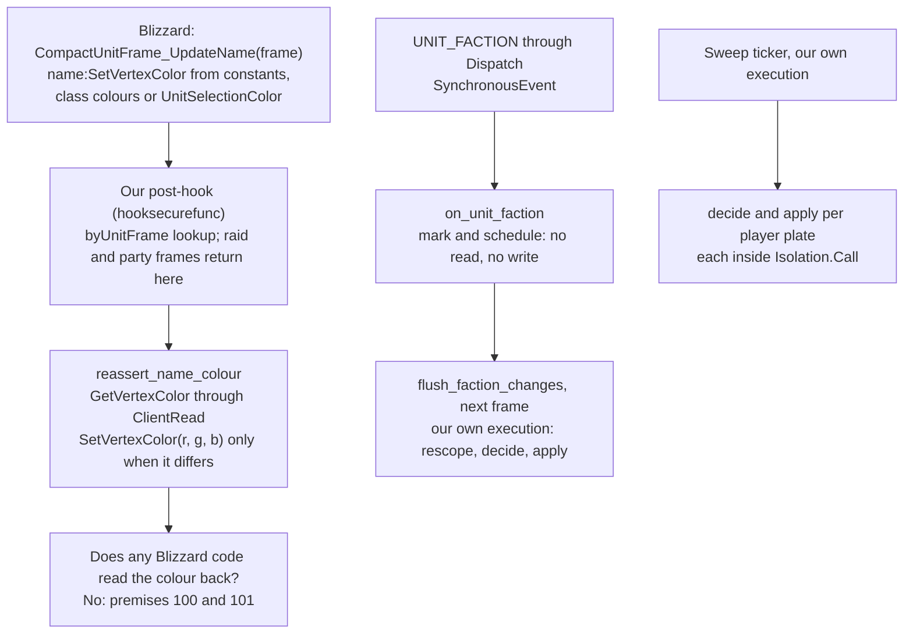

# PersonalAddon — Phase 22 Design: Player name colours, and the draw distance

**Date:** November 22, 2026
**API version:** 1.60.1 (WoW Forever), game type `camelot`
**Client:** 1.60.1.71037 (`Wow.exe` of 2026-11-20 15:21), UI export 2026-11-22 10:26. `patch_check
check` returned **Review**: one premise was touched by a two-line change, and none of the 254 surface
names changed (§2). The premise was re-read and holds. The user approved accepting the build (D5), but
**`accept --reviewed` has not run**: this session's permission layer refused it, so `status` still reads
`CheckDue`. Every citation below is read from the 71037 export; paths are relative to its
`Interface/AddOns`.
**Status:** built 2026-11-22, not committed. The harness, the mutation pass, the lint and the patch check
are green (§19). **Built before 71037's acceptance,** which the user approved and this session could not
run (§2); that and the in-game checks of §14.3 are outstanding.
**Implements:** the user's two requests of 2026-11-22, with the decisions of one question round (§1.1):
1. nameplate names red for a player of the opposite faction with PvP on, in the open world or a
   battleground, and light orange otherwise. This is **player name colours** (§3–§6);
2. "Is there a way to extend the distance for the nameplates to be drawn further out?" **Not on
   Forever** (§7). Both distance settings are secure, and PersonalAddon reports them read-only.

**Depends on:**
- `20260919-Phase02.md` §5: the style ledger, and restyling Blizzard's plate in place;
- `20261002-Phase09.md` §2, §4: `ClientRead`, and one plate's fault never stopping the sweep;
- `20261006-Phase12.md` §3.4: settings pages, indentation and group headers;
- `20261010-Phase14.md`: re-asserting a plate property from Blizzard's post-hooks, and reading
  `NamePlateSetupOptions`;
- `20261010-Phase15.md` §3.3: `UnitIsPlayer` as the player test;
- `20261021-Phase20.md` §8: the name region, the anchor-style read and probe-then-trust; §7.6: the
  label pool's measured basis;
- `20261112-Phase21.md` §8.1: the generation-guarded, coalesced flush (`RareAlerts`);
- `20261002-GAPBugs01.md` §2: G1;
- README "Rules for future development".

**Revision:** 3 — built; audit dispositions in §18, the build record in §19.

---

## 1. Scope

One feature change and one read-only report, both in `Features/Nameplates.lua`, plus one property in
the style ledger. No new module, no new frame, no new pool.

### 1.1 Decisions

| # | Question | Answer (2026-11-22) | Where |
|---|---|---|---|
| D1 | Which names turn light orange | **Players only:** every player who is not red. NPC names keep Blizzard's white, and grey when tapped or dead | §3.2 |
| D2 | When a name is red | **When either of you can attack the other,** by the client's own `UnitCanAttack`, asked both ways. That covers the request's "opposite faction with PvP on", and also duels, arenas, free-for-all areas, mind control, and an unflagged enemy while you are flagged | §3.3 |
| D3 | Who sets the draw distance | **The user; PersonalAddon only reports it** | §7 |
| D4 | Which plates go further out | **Player plates** (`nameplatePlayerMaxDistance`). **Moot:** both distance settings are secure on Forever, and nothing in game can change them (§7.2) | §7 |
| D5 | Build 71037 | **Accept after review.** Approved; `accept --reviewed` has not run yet | §2 |
| D6 | An enemy-player alert | **Declined** | §1.3 |
| D7 | Default | **Off,** like guild names, NPC roles and name alignment | §8.2 |
| D8 | Colours | **Two pickers:** red `ff4040`, the palette's "it is attacking you"; light orange `ffc04d` | §8.2 |
| D9 | Styles | **Not where the name sits inside the bar** (Large, Block), except on a name-only plate, which has no bar behind its name | §3.4 |
| D10 | Blizzard's class colour for friendly player names | **Blizzard's wins** on a player who would be light orange; red still wins over it. Off on this account: `nameplateUseClassColorForFriendlyPlayerUnitNames` reads `"0"`, default `"0"` | §3.2 |
| D11 | Who is a player | **`UnitIsPlayer`.** The pets, totems and guardians of enemy players are not, and keep Blizzard's colour | §3.2 |
| D12 | Where it lives | **`Features/Nameplates.lua`.** The name colour is a fourth restyled property of Blizzard's plate, beside the bar colour, the bar height and the name's alignment, and shares their ledger, hooks and lifecycle | §1.2 |

D7–D12 were stated as round-one assumptions. The user's answers did not object to them, so they are
recorded as decided (Phase 21's convention).

**Pointer, 2026-11-22:** Patch 03 narrows D1. Only players of the other faction turn light orange; your own
faction's players keep Blizzard's white ([20261122-Patch03.md](20261122-Patch03.md) §3).

**Each decision's cost is named where it is paid:**
- D2: one more unit read per player plate per decision (§3.3);
- D4: the second request cannot be met, and a readout is all that ships for it (§7);
- D9: a user on Large or Block sees no colours, and the setting's description says so (§8.2);
- D12: `Features/Nameplates.lua`, at 1,967 lines, passes 2,200.

### 1.2 What ships

| Item | Kind | Section | File |
|---|---|---|---|
| Player name colours: decision, paint, re-assert, restore | Feature change | §3–§5 | `Features/Nameplates.lua` |
| `NameColour`, the ledger's second property | Seam | §4.1 | `Core/StyleLedger.lua` |
| `UNIT_FACTION` handled a frame later, `"player"` included | Behaviour change | §5.2 | `Features/Nameplates.lua` |
| `read_name_anchor`, shared by alignment and colours | Refactor | §3.4 | `Features/Nameplates.lua` |
| The draw-distance readout | Diagnostics | §7.3 | `Features/Nameplates.lua`, `Core/Debug.lua` |
| One constant and three settings | Substrate | §8 | `Core/Constants.lua`, the nameplates schema |
| `/pa plates` lines | Command | §9 | `Core/Debug.lua` |
| Premises 100–112 | Tooling | §10 | `Tools/patchcheck/premises.toml` |
| `stubs22.lua`, `tests22.lua`, two sessions; `tests12` and `tests20` amended | Tooling | §14.1 | `Tools/harness/` |
| README | Housekeeping | §11 | `README.md`, `Tools/README.md` |
| TOC `1.12.0`, `X-Phase: 22` | Housekeeping | §17 | `PersonalAddon.toc` |
| The 71037 report and acceptance | Tooling | §2 | `Tools/patchcheck/` |

### 1.3 Not possible, or out of scope

- **Changing the draw distance** (D3, D4). Both settings are secure; no addon, console or Options
  route reaches them (§7.2).
- **The names the client draws above characters' heads** (Options → Names). The client draws them, not
  a frame, so there is nothing to recolour.
- **Taking over the name through `UpdateNameOverride`.** `CompactUnitFrame_UpdateName` returns early for
  a frame that carries one (`Blizzard_UnitFrame/Shared/CompactUnitFrame.lua:827-829`). Setting it is a
  field on a Blizzard frame (rule 2), and Blizzard would then run our function inline on every name
  update (rule 1).
- **`SetTextColor` instead of `SetVertexColor`.** Blizzard writes the vertex colour (`:859-887`). A
  second property would combine with Blizzard's, and Blizzard's grey or class colour would tint ours.
  Writing the same property gives one value with two writers, the shape the bar colour already has.
- **NPC names** (D1), **names inside the bar** (D9), and **an enemy-player alert** (D6).
- **What the game already does,** recorded for README (§11):
  - class colour for friendly player names (Options → Nameplates,
    `nameplateUseClassColorForFriendlyPlayerUnitNames`);
  - colouring names by reaction, on the Legacy style only, which Camelot does not offer (§3.1);
  - Blizzard's plate PvP indicator marks battleground objectives (flag, cart and orb carriers,
    bounties), not a player's PvP flag (`Blizzard_NamePlates/Blizzard_NamePlateClassificationFrame.lua:4-14`).

### 1.4 Types

```
Nothing          = no value
Frame            = opaque                       # any compact unit frame Blizzard updates
UnitToken        = string
Counters         = Map<string, integer>         # this UI load's Diagnostics table
ReadKind         = enum { Plain, Absent, Withheld }         # ClientRead's three answers
Reading<T>       = { kind: ReadKind, value: Optional<T> }
Colour           = { red: number, green: number, blue: number }
StyleLedger      = Phase 2's ledger
PlateRecord      = Phase 2's record with Phase 20's unitFrame and nameRegion, gaining
                   identity: Optional<PlayerIdentity>,
                   nameDecision: Optional<NameColourDecision>,
                   namePainted: Optional<NameColourVerdict>
PlayerIdentity   = enum { Player, You, NotAPlayer, Unreadable }
NameAnchorReading = enum { AboveSpanning, AboveCentred, InsideBar, Unreadable }
NameColourVerdict = enum { CanFight, OtherPlayer }
NameColourSkip   = enum { NotPlayer, Yourself, PlayerUnreadable, NoNameRegion, InsideBar,
                          StyleUnreadable, AttackUnreadable, ClassColourWins,
                          ClassColourUnreadable }
NameColourDecision = Paint(verdict: NameColourVerdict) | Leave(reason: NameColourSkip)
NameColourPalette = Map<NameColourVerdict, Colour>
NameColourCapability = enum { NotYetProbed, Verified, Refused, Unverifiable }
NameColourOutcome = enum { Painted, Unchanged, Released, LeftAlone, Refused, Unreadable }
FactionWork      = { plates: Set<PlateRecord>, all: boolean, scheduled: boolean,
                     generation: integer }
DistanceCVar     = { name: string, label: string }           # one PLATE_DISTANCE_CVARS entry
DistanceSetting  = { name: string, label: string, readable: boolean,
                     yards: Optional<number>, defaultYards: Optional<number>,
                     perAccount: Optional<boolean>, perCharacter: Optional<boolean>,
                     locked: Optional<boolean>, secure: Optional<boolean> }
PlayerNamesView  = { on: boolean, capability: NameColourCapability, hookInstalled: boolean,
                     red: integer, lightOrange: integer, recorded: integer,
                     left: Map<NameColourSkip, integer>, flushPending: boolean,
                     counters: Counters }        # recorded: names holding a NameColour record
```

- **`nameDecision` and `namePainted` are different facts** (audit findings 1 and 2).
  - `nameDecision` is what `decide_name_colour` last answered. It feeds the on-change counters and
    the view's `left` counts.
  - `namePainted` is the verdict whose colour is on the name now. **It is held only while a
    `NameColour` ledger record is held,** and only a write or a read-back that succeeded sets it.
  - The hook re-asserts `namePainted`, never `nameDecision`. So a decision whose write did not land
    (an unreadable first read, a refused write) can never send the hook after a record that does not
    exist.
  - `red` and `lightOrange` in the view count `namePainted`: what is on screen, not what was meant.
- **`FactionWork.plates` is bounded.** It holds tracked plates only, and `untrackPlate` removes its
  plate, so the set never outgrows the plate count.
- **Nothing is written onto a Blizzard frame or table.**

---

## 2. Build 71037

The client patched on 2026-11-20. The user exported the UI on 2026-11-22 at 10:26, and `check` gave
**Review** with one reason:
- **`G1-PATH` holds; G1 is not fixed.**
  - The only watched change is `SmartNavigationMixin:SelectFirstButton` testing `IsButtonValid` before
    it reselects `lastButton` or `targetButton`
    (`Blizzard_GamepadSmartNavigation/SmartNavigation.lua:949-955`).
  - G1's carrier write is `SelectButton`'s, made after it runs the previous button's leave script
    (GAPBugs01 §2.9). That code is untouched.
  - `G1-SOLE-CALLER` holds at `MainActionBarFrame.lua:373`. BlockWatch's hint and README's known issue
    stay.

**Everything else:**
- surface: 254 names, 0 changed;
- lint: 0 hits, 6 allowlisted, 0 stale;
- export: 1 file added (`Blizzard_Tutorials/Camelot/Blizzard_TutorialsOverrides.lua`), 21 modified. No
  nameplate, CompactUnitFrame or settings file is among them. `Blizzard_UnitFrame/Camelot/TargetFrame.lua`
  only hides the level text behind the high-level icon;
- docs: `C_BattleNet.IsGameAccountOnSameRealm` and `C_Mail.IsCODEnabled` added, no flag changed.

**Not accepted yet.** The user approved it (D5). This session's `accept --reviewed` was refused by its
permission layer, so `status` still reads `CheckDue`, and Tools/README forbids building until it reads
`UpToDate`. The user runs:

```
python Tools/patchcheck/patch_check.py accept --reviewed
```

The report, `Tools/patchcheck/reports/2026-11-22-1.60.1.71037.md`, is new and uncommitted;
`verified.json` changes with the accept. Both go in with this phase.

---

## 3. Which names, and which colour

### 3.1 What Blizzard draws today

`CompactUnitFrame_UpdateName` decides a plate name's colour on every call
(`Blizzard_UnitFrame/Shared/CompactUnitFrame.lua:859-887`). The first match wins:
1. the options' mouseover colour, while the mouse is over the unit (`:859-861`);
2. grey for a tapped or dead NPC (`:862-864`). Never a player: `CompactUnitFrame_IsTapDenied` requires a
   unit that is not player-controlled (`:560-562`), and the dead test excludes players;
3. class colour, when the plate has set `colorNameWithClassColor` (`:865-877`): a friendly player while
   `nameplateUseClassColorForFriendlyPlayerUnitNames` is on
   (`Blizzard_NamePlates/Blizzard_NamePlateUnitFrame.lua:614-628`);
4. the reaction colour, when the options set `colorNameBySelection` (`:878-884`);
5. white (`:886`).

On Forever, (1) and (4) never apply:
- `colorNameBySelection` is true only on the Legacy style, and `nameMouseoverColor` is set only on
  Classic (`Blizzard_NamePlates/Blizzard_NamePlates.lua:482-488`, assigned at `:594-595` and
  `:604-605`);
- Camelot offers Thin, Large, Block and Cast Focus
  (`Blizzard_SettingsDefinitions_Frame/Camelot/NameplatesOverrides.lua:7-14`).

**So every player's name is white today, or its class colour when friendly and that option is on.** On
this account the option is off (D10).

### 3.2 Which plates (D1, D10, D11)

A plate's name is decided while `playerNameColours` is on and the capability is not Refused or
Unverifiable (§4.2). Then the name is coloured only when it is:
- **a player's:** `UnitIsPlayer(token)` reads Plain true. NPCs, and the pets, totems and guardians of
  enemy players (D11), are never written;
- **not yours:** `UnitIsUnit(token, "player")` reading Plain true excludes your own plate.
  - A Withheld comparison counts as "not you" for that pass and is asked again.
  - It is Withheld only on restricted maps (`SecretWhenUnitComparisonRestricted`,
    `Blizzard_APIDocumentationGenerated/SecretPredicatesDocumentation.lua:120-122`).
  - The personal display hides its name anyway (`ShouldShowName`), so a wrong paint there is never
    seen;
- **eligible by style** (§3.4).

**Light orange gives way to Blizzard's class colour** on a plate where Blizzard sets
`colorNameWithClassColor` (D10). Red does not: a player who can fight you is red whatever that option
says, because that is the signal the feature exists for. The field is read through `ClientRead.Field`.
Reading a Blizzard field is allowed by rule 2, and Phase 20 reads `showOnlyName` the same way.

**The identity is read once per occupancy.** A unit does not stop being a player, or you, while its plate
is up. A Plain answer is kept on the record (`identity`), so later passes read nothing; a Withheld one is
asked again next pass. A recycled plate is a new occupancy and is asked again.

### 3.3 Red (D2)

`UnitCanAttack("player", unit)` asks whether you can attack them; `UnitCanAttack(unit, "player")` asks
whether they can attack you. **A name is red when either reads Plain true.**

| Situation | Red? | The request's literal rule (opposite faction and flagged) |
|---|---|---|
| Enemy player, flagged | yes | yes |
| Enemy player unflagged, **you** flagged: they can attack you | yes | no |
| Battleground enemy | yes | yes |
| Duel, arena, free-for-all area | yes | no |
| Mind-controlled groupmate | yes | no |
| Flagged enemy in a no-PvP area | no | yes |

- **The client's attackability, not the flag.** `UnitIsPVP` reads the flag alone and gets every row
  marked "no" wrong. It is also `SecretWhenUnitIdentityRestricted`
  (`Blizzard_APIDocumentationGenerated/UnitDocumentation.lua:2225`): harmless for players, but one more
  thing to pin.
- **Both reads work in a battleground.** Neither `UnitCanAttack` nor `UnitIsPlayer` carries a secrecy
  predicate on 71037 (`UnitDocumentation.lua:763`, `:2271`). The PvP-match predicate,
  `SecretInActivePvPMatch` (`SecretPredicatesDocumentation.lua:60-62`), is on `C_PvP.GetScoreInfo` and
  `C_PvP.GetScoreInfoByPlayerGuid` only. Premises 106 and 107 pin it.
- **Rule 10.** A Withheld read is never taken as false. One Withheld read with the other not Plain true
  leaves the name to Blizzard (`AttackUnreadable`), which claims nothing; light orange would claim
  "cannot fight you".
- **Cost:** two reads per player plate per decision, one more than the bar's scope read. The scope's read
  is not reused: a decision reads its own facts, and `plate.scope` can be a pass old.

### 3.4 Styles (D9)

| Style | Where the name is | Coloured |
|---|---|---|
| Thin (Camelot's default), Cast Focus | above the bar, spanning it (`AboveHealthBar`) | yes |
| Large ("Modern"), Block | inside the bar (`InsideHealthBar`) | no, unless the plate shows the name only |
| Classic (not offered on Camelot) | above, centred (`CenteredAboveHealthBar`) | yes |

The three constants are Camelot's own (`Blizzard_NamePlates/Camelot/Blizzard_NamePlateConstants.lua:80-85`).
The Style picks one (`Blizzard_NamePlates.lua:452-460`, stored at `:578`).
- **Inside the bar,** light orange on a yellow, orange or class-coloured bar has no contrast. The bar's
  colour varies per plate, so no single name colour is legible there.
- **A name-only plate is eligible on every style:** it shows the name with no bar behind it
  (`Blizzard_NamePlateUnitFrame.lua:741-750`; Phase 20 §8.2).
- **`showOnlyName` is provisional while Blizzard's `OnUnitSet` runs** (Phase 20 audit finding 14).
  Eligibility is judged at attach in `trackPlate` and on every pass; a hook never judges it (§4.3).

One read serves alignment and colours:

```
# Where the client lays plate names out for the current Style.
# pre:  the caller wants the answer: name alignment is on, or player name colours are active
#       (on, and the capability NotYetProbed or Verified)
# post: Unreadable when NamePlateSetupOptions.unitNameAnchorStyle or
#       NamePlateConstants.NAME_ANCHOR_STYLES does not read Plain.
#       Otherwise the style is compared with whichever of AboveHealthBar,
#       CenteredAboveHealthBar and InsideHealthBar read Plain numbers: AboveSpanning,
#       AboveCentred or InsideBar for the one it equals, Unreadable when it equals none.
#       A constant that does not read is skipped, never fatal: Camelot never uses
#       CenteredAboveHealthBar, and no premise pins it (audit finding 4).
#       Replaces Phase 20's readNameAnchorStyle (Nameplates.lua:664-675). Alignment's
#       "above the bar" is exactly AboveSpanning, and both its skips land on one counter,
#       so alignment does not change
# raises: never
function read_name_anchor() -> NameAnchorReading

# Why a player's name may not be coloured on this plate, or nothing when it may (D9).
# pre:  anchor is this pass's read_name_anchor()
# post: NoNameRegion when the record has no name region.
#       A plate whose showOnlyName reads Plain true is eligible on every style.
#       Otherwise: InsideBar for InsideBar, StyleUnreadable for Unreadable, eligible for
#       AboveSpanning and AboveCentred.
#       showOnlyName is read only when anchor is InsideBar or Unreadable, so on Thin and
#       Cast Focus the test costs nothing
# raises: never
function name_ineligibility(plate: PlateRecord, anchor: NameAnchorReading) -> Optional<NameColourSkip>
```

**Who reads the anchor, and when** (audit finding 5). Today `trackPlate` and `reassertPlate` call
`readNameAnchorStyle()` before `alignPlateName` checks its own switch
([Nameplates.lua:1169](../Features/Nameplates.lua#L1169), [:1293](../Features/Nameplates.lua#L1293)).
They therefore read the options on every attach and every hook fire, even with alignment off. That
ends here:

| Caller | Reads the anchor when | Shares it with |
|---|---|---|
| `trackPlate` | alignment is on, or player name colours are active | `alignPlateName` and `decide_name_colour`: one read |
| `reassertPlate`, from the four post-hooks | alignment is on | `alignPlateName` only: the colour is re-asserted by its own hook, which judges nothing (§4.3) |
| the sweep | alignment is on, or player name colours are active | the alignment pass and the name pass: one read per pass |
| `flush_faction_changes` | player name colours are active | every plate in the flush: one read per flush |
| `onConfigChanged` for either name feature | that feature is on and, for colours, active | every tracked plate: one read |

With both name features off, nothing reads the anchor (check Y8).
### 3.5 The decision

```
# Whether a plate shows a player, and whether that player is you.
# pre:  plate is tracked
# post: plate.identity already held: returned, and nothing is read.
#       Otherwise UnitIsPlayer(token):
#         Plain false or Absent -> NotAPlayer, kept;
#         Withheld -> Unreadable, not kept (nameColourPlayerWithheld), asked again next pass;
#         Plain true -> UnitIsUnit(token, "player"): Plain true -> You, kept; Plain false or
#           Absent -> Player, kept; Withheld -> Player for this pass, not kept (§3.2)
# raises: never
function resolve_player_identity(plate: PlateRecord, counters: Counters) -> PlayerIdentity

# What one plate's name should show, from the client's answers now.
# pre:  playerNameColours is on; the capability is NotYetProbed or Verified; plate is
#       tracked; anchor is this pass's read_name_anchor()
# post: Paint(CanFight) for a player who is not you, on an eligible plate (§3.4), when either
#       attack read is Plain true (§3.3).
#       Paint(OtherPlayer) when both attack reads are Plain false or Absent and Blizzard is
#       not colouring this name by class (D10).
#       Leave(reason) otherwise. A Withheld read is never taken as false (rule 10):
#       PlayerUnreadable, AttackUnreadable and ClassColourUnreadable leave the name to Blizzard
# raises: never
function decide_name_colour(
    plate: PlateRecord,
    anchor: NameAnchorReading,
    counters: Counters
) -> NameColourDecision:
    identity: PlayerIdentity = resolve_player_identity(plate, counters)
    if identity == Unreadable:
        return Leave(PlayerUnreadable)
    if identity == NotAPlayer:
        return Leave(NotPlayer)
    if identity == You:
        return Leave(Yourself)
    ineligible: Optional<NameColourSkip> = name_ineligibility(plate, anchor)
    if ineligible.isPresent():
        return Leave(ineligible.value)
    youAttack: Reading<boolean> = ClientRead.Call(UnitCanAttack, "boolean", "player", plate.unitToken)
    theyAttack: Reading<boolean> = ClientRead.Call(UnitCanAttack, "boolean", plate.unitToken, "player")
    if youAttack.isPlainTrue() or theyAttack.isPlainTrue():
        return Paint(CanFight)
    if youAttack.kind == Withheld or theyAttack.kind == Withheld:
        counters.bump("nameColourAttackWithheld")
        return Leave(AttackUnreadable)
    byClass: Reading<boolean> = ClientRead.Field(plate.unitFrame, "colorNameWithClassColor", "boolean")
    if byClass.kind == Withheld:
        return Leave(ClassColourUnreadable)
    if byClass.isPlainTrue():
        return Leave(ClassColourWins)
    return Paint(OtherPlayer)
```

The order is the cheap one: an NPC costs nothing after its first pass, and the class-colour field is
read only for a player who would be light orange.

---

## 4. Writing and keeping the colour

### 4.1 The ledger property

`Core/StyleLedger.lua` gains `PROPERTY.NameColour` beside `BarColour`
([StyleLedger.lua:36-47](../Core/StyleLedger.lua#L36-L47)):
- **read:** `ClientRead.CallMany(region.GetVertexColor, 3, "number", region)`, giving
  `{ red, green, blue }`;
- **write:** `region:SetVertexColor(red, green, blue)`. Three components, as Blizzard writes them, so the
  name's alpha is never ours.

Records live for one occupancy, as the bar's do (Phase 2 §5.1).

`GetVertexColor` turns secret only when the aspect was set from a secret: `SecretReturnsForAspect`
(`Blizzard_APIDocumentationGenerated/SimpleRegionAPIDocumentation.lua:66`), with `SetVertexColor`
adding the aspect from secret arguments (`:191`). Every Blizzard write of a name colour is Plain on 71037:
constants, `RAID_CLASS_COLORS` and `UnitSelectionColor`. So the read is Plain, and a Withheld one is
handled anyway (§4.3).

### 4.2 Probe once, then trust or stand down

Nothing of ours has written a plate name's colour before. Phase 2 learned that confirming the call, or
even the stored value, does not confirm the effect
([Nameplates.lua:952-955](../Features/Nameplates.lua#L952-L955)). Phase 20 §8.4 answered it with a probe,
and this is the same shape.

```
# Whether this client lets us set a plate name's colour, and lets us see it.
# pre:  capability NotYetProbed; plate decided Paint(verdict) and eligible
# post: StyleLedger.Apply(nameRegion, "NameColour", palette[verdict]) reads the original and
#       writes ours. The probe makes no read of its own before it (audit finding 3).
#         The original did not read Plain (ORIGINAL_WITHHELD, NOT_READABLE, READ_REFUSED):
#           Unverifiable, and nothing was written.
#         Apply's write raised (WRITE_REFUSED): Refused, and nothing was recorded
#           (nameColourWriteFailed).
#         Apply wrote (nameColourWrites), then a read-back:
#           Plain and within COLOUR_TOLERANCE of the colour: Verified. namePainted becomes
#             verdict, and the record is kept;
#           Plain and different: Refused. Not Plain: Unverifiable. Either way the record is
#             restored and dropped, so the name reads what it read before.
#       At most two reads (Apply's and the read-back) and two writes (Apply's and the restore).
#       The verdict goes to note_name_capability (§4.5), which counts it and, for Refused and
#       Unverifiable, says one line and stands the setting down
# raises: never
function probe_name_colour(
    plate: PlateRecord,
    verdict: NameColourVerdict,
    palette: NameColourPalette,
    ledger: StyleLedger,
    counters: Counters
) -> NameColourCapability
```

What a probe's verdict means to `apply_name_colour` (audit finding 2b):

| Probe verdict | `apply_name_colour` returns | Counted |
|---|---|---|
| Verified | Painted | `nameColourCapabilityVerified`, `nameColourWrites` |
| Unverifiable | Unreadable | `nameColourCapabilityUnverifiable`; `nameColourWrites` too when Apply wrote before a read-back that was not Plain |
| Refused | Refused | `nameColourCapabilityRefused`; `nameColourWriteFailed` when Apply's write raised, `nameColourWrites` when it wrote and did not stick |

### 4.3 One more post-hook

**Every Blizzard write of a name colour is inside `CompactUnitFrame_UpdateName`.** Every caller reaches
it through the global, which nothing captures as a local, and the plate's own code never touches the
name's colour (premises 100–102). The callers:

| Caller | When | Already followed by one of our four hooks? |
|---|---|---|
| Target, soft-friend and soft-enemy change (`CompactUnitFrame.lua:79-83`) | constantly with a pad: soft targeting re-picks as the camera turns | no |
| Mouseover (`:84-86`) | every mouseover | no |
| Threat list (`:136-139`) | in combat | no: `UpdateHealthColor`'s hook runs **before** `UpdateName` there |
| `UpdateHealth` (`:736`) | every health change | yes, `UpdateHealth`'s |
| Faction, simplified, widgets-only, class colour, realm, forced name (`Blizzard_NamePlateUnitFrame.lua:249-255, 370-383, 539-542, 614-628, 630-644, 662-667`) | on change | some |

Every plate registers the first two in `CompactUnitFrame_OnLoad` (`CompactUnitFrame.lua:34-37`, called
at `Blizzard_NamePlateUnitFrame.lua:34`, events forwarded at `:108`), and the threat list per unit
(`CompactUnitFrame.lua:350`). Without a hook on the function itself, every soft-target change would put
every coloured name back to white until the next sweep: a quarter-second flash, repeated as the camera
turns.

**So `CompactUnitFrame_UpdateName` is hooked, with a body of its own.** The existing hooks run
`reassertPlate`: bar height, alignment and bar colour
([Nameplates.lua:1286-1299](../Features/Nameplates.lua#L1286-L1299)). Running that from this hook too
would triple a health tick's work, because `UpdateHealth` → `UpdateName` → `UpdateHealthColor` passes
three of our hooks.

```
# Blizzard's name update, followed in the same call.
# pre:  hooksecurefunc's post-hook on CompactUnitFrame_UpdateName; frame is whatever Blizzard
#       passed
# post: returns at once when the feature is disabled, playerNameColours is off, or the
#       capability is not Verified.
#       frame not a tracked plate's unit frame (byUnitFrame): returns with nothing read,
#       written or flagged. Raid and party frames pass through here on every health tick.
#       A plate with no namePainted: returns. Its decision may be Paint while its write has
#       not landed, and then there is no record to re-assert against (audit finding 1).
#       Otherwise reassert_name_colour(plate, plate.namePainted). A Refused outcome stands the
#       setting down through note_name_capability (§4.5). No unit read and no style read:
#       eligibility is for the attach and the sweep to judge (§3.4). O(1)
# raises: never
function on_name_updated(frame: Frame) -> Nothing

# Keeps a painted name painted, or moves it to another verdict's colour.
# pre:  capability Verified; a NameColour record held
# post: GetVertexColor not Plain: Unreadable (nameColourReadsWithheld). Nothing is written and
#       namePainted is unchanged. A write we cannot check is a contest we cannot see, the
#       bar's rule (Nameplates.lua:986-988).
#       Plain and within COLOUR_TOLERANCE of palette[verdict]: Unchanged (nameColourUnchanged),
#       and namePainted becomes verdict.
#       Plain and different: StyleLedger.Reapply.
#         It wrote: Painted (nameColourWrites), and namePainted becomes verdict.
#         NOT_RECORDED: LeftAlone, namePainted cleared, the capability untouched. The
#           precondition makes this unreachable. It is told apart so that a lost record can
#           never stand the setting down (audit finding 1).
#         WRITE_REFUSED: Refused (nameColourWriteFailed). The caller stands the setting down,
#           so a refusing client is never retried four times a second.
#       The target colour comes from verdict, never from nameDecision (audit finding 2a). O(1)
# raises: never
function reassert_name_colour(
    plate: PlateRecord,
    verdict: NameColourVerdict,
    palette: NameColourPalette,
    ledger: StyleLedger,
    counters: Counters
) -> NameColourOutcome
```

- **Installed once,** like the others ([Nameplates.lua:1414-1455](../Features/Nameplates.lua#L1414-L1455)),
  and listed in `hookTargets`.
- **Missing on a client:** the sweep re-asserts every pass (§5.3), and the cost is a white flash of up
  to one pass after each Blizzard write. One line names the missing function, said only while
  `playerNameColours` is on, so sessions and users that never turn it on hear nothing.
- **No contest driver.** The bar colour has a per-frame driver because Blizzard writes it on its own
  initiative between our hooks ([Nameplates.lua:1232-1240](../Features/Nameplates.lua#L1232-L1240)).
  Every name write passes through the hooked function, so a correction lands in the same call. If a
  second writer appears, the name flashes until the next pass, and `nameColourWrites` climbs out of
  proportion to decisions (§15).

### 4.4 Applying a decision

```
# Brings one plate's name to its decision.
# pre:  decision is decide_name_colour's for this pass; palette from the two colour settings
# post: player name colours not active (off, or the capability Refused or Unverifiable):
#       LeftAlone, with nothing read or written and nameDecision untouched (audit finding 2c).
#       Otherwise nameDecision becomes decision, and a change counts
#       nameColourDecidedTo<Verdict or Reason> once (on change, Phase 9 §4.3). Then:
#       Paint(verdict):
#         NotYetProbed: probe_name_colour, mapped as the table in §4.2 says;
#         Verified with a NameColour record held: reassert_name_colour(plate, verdict). Painted,
#           Unchanged, Unreadable or LeftAlone as it says; Refused stands the setting down;
#         Verified with no record: StyleLedger.Apply.
#           It wrote: Painted (nameColourWrites), and namePainted becomes verdict.
#           The original did not read Plain (ORIGINAL_WITHHELD, NOT_READABLE, READ_REFUSED):
#             Unreadable (nameColourReadsWithheld). Nothing is written, no record is made,
#             namePainted stays absent, the capability is untouched, and the next pass tries
#             again (audit finding 1).
#           The write raised (WRITE_REFUSED): Refused (nameColourWriteFailed), and the setting
#             stands down.
#       Leave(reason): a record held is restored and dropped, Released (nameColourReleased);
#         with no record, LeftAlone. namePainted is cleared either way.
#       Only an outcome that leaves a record held sets namePainted: Painted or Unchanged
# raises: never
function apply_name_colour(
    plate: PlateRecord,
    decision: NameColourDecision,
    palette: NameColourPalette,
    ledger: StyleLedger,
    counters: Counters
) -> NameColourOutcome
```

### 4.5 Restore

```
# Hands every painted name back to Blizzard.
# pre:  playerNameColours turned off, the feature disabling, or a stand-down
# post: every tracked plate holding a NameColour record has it restored (the colour read
#       before our first write) and dropped. Every plate's nameDecision and namePainted are
#       cleared. Blizzard's next CompactUnitFrame_UpdateName paints by its own rules. A restore
#       that raises is the ledger's widgetGone, never a capability change. Returns how many
#       were restored, each counted nameColourReleased
# raises: never
function restore_name_colours(
    plates: Collection<PlateRecord>,
    ledger: StyleLedger,
    counters: Counters
) -> integer

# Records a capability verdict, and stands the setting down on a refusal.
# pre:  verdict from probe_name_colour, or Refused from a later write
# post: the capability becomes verdict, counted nameColourCapability<Verdict>.
#       Verified: nothing more.
#       Refused or Unverifiable: one line, said once per verdict, and restore_name_colours at
#       once, so no record and no painted name outlives the stand-down (audit finding 7).
#       Only disable, which returns the capability to NotYetProbed, or /reload lifts a
#       stand-down. Turning the setting off and on does not
# raises: never
function note_name_capability(verdict: NameColourCapability, counters: Counters) -> Nothing
```

- **On untrack,** the name's record is restored and dropped with the bar's, before the client can
  recycle the frame (Phase 2 §5.1). `untrackPlate` gains it. `unstylePlate` stays bar-only, because
  `rescopePlate` calls it when a plate leaves the bar's colouring scope, and the name colour does not
  follow that scope.
- **The original is the colour read before our first write,** which for a player is Blizzard's white. A
  Leave that follows a paint shows white until Blizzard's next name update. An example is Blizzard's
  class-colour option turned on mid-session. With a pad, that update is the next soft-target change.
  The ledger promises "non-permanent, not exact" ([StyleLedger.lua:12-14](../Core/StyleLedger.lua#L12-L14)).
  Restoring exactly would mean re-implementing Blizzard's colour rules, the coupling this design avoids.

---

## 5. When a name is decided

### 5.1 The triggers

| Trigger | What runs | Reads |
|---|---|---|
| **Attach,** in `trackPlate` after the label | one anchor read shared by alignment and the colour (§3.4); decide, apply | identity once per occupancy; two attack reads |
| **`UNIT_FACTION`,** a frame later | rescope; then decide and apply, the plate it names or every plate on `"player"` | as at attach |
| **Every sweep** | decide, apply: every player plate not waiting for a faction flush | as at attach, identity already held |
| **Settings** | see below | as at attach |

**Every trigger but the rescope runs only while player name colours are active:** on, with the
capability NotYetProbed or Verified (audit findings 6 and 7). The settings paths in full:
- **turned on:** while active, every tracked plate is decided and applied at once, against one anchor
  read. While Refused or Unverifiable, nothing happens: no probe, no anchor read, no write. The missing
  hook's line (§4.3) is said either way;
- **turned off:** `restore_name_colours`. The capability is left as it is, so off and on again never
  re-probes;
- **either colour changed:** while Verified, every plate holding `namePainted` goes through
  `reassert_name_colour(plate, plate.namePainted)`, which repaints it in the new colour; the first
  Refused stops the loop and stands the setting down. Otherwise, nothing: NotYetProbed has painted
  nothing yet, and a stand-down holds no record.

Between them, the hook re-asserts (§4.3).

```mermaid
sequenceDiagram
    participant B as Blizzard plate code
    participant N as CompactUnitFrame_UpdateName
    participant H as Our name hook
    participant E as Our UNIT_FACTION handler
    participant F as Our flush (next frame)
    participant S as Our sweep (4 Hz)
    Note over B,N: soft target, target, mouseover, threat list, health tick
    B->>N: CompactUnitFrame_UpdateName(plate)
    N->>N: name:SetVertexColor(white)
    N-->>H: returns, and the post-hook runs
    H->>H: Paint held? read, compare, write ours (no unit read)
    Note over B,E: a player flags, or you do
    B->>E: UNIT_FACTION(token or "player")
    E->>E: mark the plate, or all; schedule one flush
    F->>F: rescope, decide, apply each marked plate
    S->>S: decide, apply every player plate not marked
```

### 5.2 `UNIT_FACTION`, a frame later

Blizzard's plate re-evaluates its name and bar colour on `UNIT_FACTION` for its own unit **and for
`"player"`** (`Blizzard_NamePlateUnitFrame.lua:116-117`, `:144`), because your own PvP state changes who
is attackable. Today's handler matches plate tokens only, so a `"player"` event does nothing, and it
rescopes inline ([Nameplates.lua:1488-1498](../Features/Nameplates.lua#L1488-L1498)).

The handler now marks and schedules; the work runs a frame later, in our own execution:

```
# UNIT_FACTION, delivered inline by Dispatch: a unit's faction or PvP state changed.
# pre:  unitToken is the event's payload
# post: "player" sets work.all; a tracked plate's token adds that plate to work.plates; any
#       other token changes nothing. When work changed and no flush is scheduled, one is
#       scheduled for the next frame under work.generation (rule 5). No client read, no write.
#       With no C_Timer.After, the flush runs at once, inside the event, and one line says so
#       once: SettingsPanel's trade (Features/SettingsPanel.lua:360-373), because a faction
#       change that never takes effect is worse than one handled inline (audit finding 6c)
# raises: never
function on_unit_faction(unitToken: UnitToken, work: FactionWork) -> Nothing

# Settles every plate a frame's faction events named.
# pre:  scheduled by on_unit_faction under generation
# post: a no-op when generation is no longer work.generation or the feature is disabled.
#       Otherwise work is emptied first (all, plates and scheduled cleared). Each named plate,
#       or every tracked plate when all was set, still tracked, then gets two isolated steps
#       (audit finding 6b):
#         1. rescopePlate, unchanged (Nameplates.lua:1192-1210), in its own Isolation.Call. A
#            fault there is the bar's: plateFaults, cedeFaultedPlate, one fault note and the
#            existing "plates:fault" line, exactly as the sweep's paint fault
#            (Nameplates.lua:1362-1369);
#         2. while player name colours are active, decide_name_colour and apply_name_colour in
#            a second Isolation.Call, against one read_name_anchor made for the whole flush
#            (audit finding 6a). A fault there is the name's: the plate's name released (§4.5),
#            nameColourFaults, one fault note and the "plates:namefault" line, said once.
#       A rescope fault never costs the name step, and a name fault never cedes the bar.
#       factionFlushes counts the flush, factionFlushAll one that covered every plate
# raises: never
function flush_faction_changes(generation: integer, work: FactionWork) -> Nothing
```

`disable` bumps `work.generation` and empties `work`, so a flush scheduled before it does nothing
(Phase 21 audit finding 8's lesson).

**Why a frame later.** `UNIT_FACTION` is `SynchronousEvent` (`UnitDocumentation.lua:4259-4260`). So are
`NAME_PLATE_UNIT_ADDED` and `PLAYER_ENTERING_WORLD` (`NamePlateManagerDocumentation.lua:120-121`,
`SystemDocumentation.lua:136-137`), and the attach path has restyled inline since Phase 2 under README's
known exception. The flag alone is not the reason. These are:
- **`"player"` fans out to every plate.** Your own flag changes from Blizzard's UI, the PvP toggle, and
  rule 5 defers work that a Blizzard interaction triggers. Re-deciding every plate inside that dispatch
  is the case rule 5 exists for;
- **bursts coalesce:** entering a battleground changes many units at once, and one flush settles them;
- **one path:** the per-unit rescope moves into the same flush, so a plate is never rescoped by one path
  and recoloured by another.

The cost is one frame, about 16 ms, of a stale colour after a change.

**The bar's scope follows `"player"` too.** When your attackability changes, at a duel's start or in a
free-for-all area, a plate moves in or out of the bar colouring's scope a frame later rather than never.
Blizzard's own plate does the same.

### 5.3 The sweep

While player name colours are active (audit finding 6a), every pass, after `read_name_anchor` and
alignment, each tracked plate whose identity is not Plain `NotAPlayer` is decided and applied inside its
own `Isolation.Call` (Phase 9 §4.6). While they are not, the pass makes no name read at all, and reads
the anchor only for alignment.
- **A plate waiting for a faction flush is left to the flush,** and the whole name pass is skipped while
  a flush covers every plate. A change the sweep finds is therefore one no event announced, and it is
  counted `nameColourChangedBySweep`. In-game check 4 reads it.
- **Cost per pass,** per player plate: two `UnitCanAttack`, at most two field reads and one
  `GetVertexColor`. At 25 player plates and four passes a second that is about 500 C calls a second, of
  the order of alignment's 160 (Phase 20 §8.3).
- **NPC plates cost nothing:** their identity is held as `NotAPlayer` from their first pass.
- **A plate that raises** is released (§4.5), counted `nameColourFaults` with one fault note and the
  "plates:namefault" line said once, and tried afresh next pass, as `cedeFaultedPlate` does for the bar
  ([Nameplates.lua:1332-1339](../Features/Nameplates.lua#L1332-L1339)). The flush's name step uses the
  same path.
- **A stand-down mid-pass** (a refused write on one plate) leaves the rest of the pass with nothing to
  do: each plate's step checks "active" before it reads anything.

---

## 6. Taint



| Hazard (README rules) | On these paths |
|---|---|
| Blizzard calls our code inline (1) | One new `hooksecurefunc` post-hook. `UNIT_FACTION` arrives inline through Dispatch and only marks and schedules. The attach decides inline on `NAME_PLATE_UNIT_ADDED` under README's known exception, as alignment and height already do |
| We write Blizzard state (2) | One widget property, the name's vertex colour: the same class as the bar colour and the name's alignment. Four Blizzard fields are read (`colorNameWithClassColor`, `showOnlyName`, `unitNameAnchorStyle`, `NAME_ANCHOR_STYLES`) and none is written |
| Blizzard reads a value we wrote | Never: no code in the export reads a name's colour (premises 100, 101) |
| Hooks (4) | Post-hook only, and O(1): one table lookup, at most one read and one write |
| Defer one frame (5) | `UNIT_FACTION`'s work runs a frame later (§5.2) |
| Parent and anchor (6) | No frame is created or anchored |
| Protected calls (7) | None. `SetVertexColor` lacks `HasRestrictions` (premise 108); so does `C_CVar.GetCVarInfo` |
| Calls that run listeners (9) | `SetVertexColor`, `GetVertexColor` and `GetCVarInfo` deliver no event. Nothing calls `SetCVar` or `ConsoleExec` |
| Secret values (10) | Every read goes through `ClientRead`. A Withheld read is never false (§3.3), and a Withheld colour read writes nothing (§4.3) |

**What is left is G1,** Blizzard's own gamepad-focus taint, which needs no help from us. In-game check 9
reads `/pa blocked`, and any new record fails the phase.

---

## 7. The draw distance (D3, D4)

### 7.1 What the client has

The UI export never reads a distance setting. The client binary carries the CVars and their help text,
and the user's `C_CVar.GetCVarInfo` dumps of 2026-11-22 give their state (the seven returns,
`Blizzard_APIDocumentationGenerated/CVarDocumentation.lua:82-101`):

| CVar | Help text (binary) | Value / default | Per character | Secure | Locked | Read-only |
|---|---|---|---|---|---|---|
| `nameplateMaxDistance` | "The max distance to show nameplates." | 45 / 45 | yes | **yes** | no | no |
| `nameplatePlayerMaxDistance` | "The max distance to show player nameplates." | 40 / 40 | yes | **yes** | no | no |

Players' plates stop at 40 yards, while other plates reach 45. The binary also carries
`nameplateMaxVerticalDistance`, `nameplateMaxVerticalDistanceAtMaxRange`,
`nameplateTargetBehindMaxDistance`, `nameplateCheckDistanceForTarget`, and the scale and alpha by
distance. None was dumped, and none matters while the two above cannot change.

### 7.2 Why nothing in game can change them

| Route | What stops it | Where |
|---|---|---|
| PersonalAddon, through `C_CVar.SetCVar` | `RequiresNonSecureCVar` | `CVarDocumentation.lua:131-136` (premise 112) |
| Typed `/console` | the handler calls `forceinsecure()` before `ConsoleExec`, under "Non-secure commands" | `Blizzard_ChatFrameBase/Shared/SlashCommands.lua:838-843` (premise 110) |
| The developer console (`-console`) | `forceinsecure(); -- Just to be safe` before `ConsoleExec` | `Blizzard_Console/Blizzard_Console.lua:335-343`, `:552-553` (premise 111) |
| Options | Camelot's hook adds nothing: "Used by Classic for some Classic-only settings, such as Nameplate Distance." | `Camelot/NameplatesOverrides.lua:28-30` (premise 109) |

- **A lock, not an omission.** Blizzard made both CVars secure, forces both consoles insecure, and left
  Classic's slider out of Camelot. Together that says Blizzard chose these distances for Forever.
- **One link is inferred.** `ConsoleExec`'s own entry carries no `RequiresNonSecureCVar`
  (`Blizzard_APIDocumentationGenerated/ConsoleDocumentation.lua:43-57`), so "an insecure `ConsoleExec`
  refuses a secure CVar" follows from the flag, not from a line of Lua. In-game check 1 confirms it. If
  it fails:
  - README's row becomes "type `/console …`";
  - the label pool's measured basis (§7.4) must be re-measured before anyone extends the distance.
- **The client's config files are outside PersonalAddon.** The values are stored per character on the
  server, which may overwrite a local edit. This phase does not pursue it.
- **Had an addon route existed, D3 would still have kept PersonalAddon out.**
  - `CVAR_UPDATE` is `SynchronousEvent` (`ConsoleDocumentation.lua:174-177`), and 40 files in the
    export listen for it.
  - `CVarCallbackRegistry` forwards every update to its all-CVar subscribers
    (`Blizzard_SharedXMLBase/CvarUtil.lua:132-142`).
  - Each write of ours would run all of them inside our execution (rule 9).

### 7.3 The readout

D3 keeps one thing: PersonalAddon reports the two settings. **The secure flag lives in the client, not in
the UI export, so the patch check cannot see Blizzard unlock them; `/pa plates` can.**

```
# The two draw-distance settings, as the client reports them.
# pre:  called by /pa plates through ns.Nameplates.DistanceSettings(); never by a sweep, a
#       hook, an event or Inspect
# post: one DistanceSetting per entry of PLATE_DISTANCE_CVARS, in that order, carrying its name
#       and label. Each field is its own ClientRead.CallNth(C_CVar.GetCVarInfo, index, type,
#       name): value (1) and default (2) as strings, kept only when tonumber parses them;
#       perAccount (3), perCharacter (4), locked (5) and secure (6) as booleans, each absent
#       when it does not read Plain.
#       readable is false, with every other field absent, when GetCVarInfo is missing or its
#       first return is not Plain.
#       Nothing is written: no SetCVar, no C_CVar.SetCVar, no ConsoleExec (§7.2)
# raises: never
function read_distance_settings() -> List<DistanceSetting>
```

- **Values print as numbers** (`45`), never as the raw strings, so nothing the client returns is echoed
  into chat unparsed.
- **Each setting prints on its own line** (audit finding 8b), so one unreadable setting never hides the
  other. The formats are in §9.

### 7.4 What stays as it is

- **The pools keep their basis.** The label pool (64) and the quest-marker pool (48) were sized from a
  measured peak of 40 plates at these distances (`Core/Constants.lua:196-202`, `:356-359`; Phase 20
  §7.6). The user's last five sessions on 71037 peaked at 40, 7, 40, 29 and 36.
- **`Core/CVarSteward.lua` keeps no consumer.**

---

## 8. Constants and settings

### 8.1 Constants (`Core/Constants.lua`)

| Constant | Value | Why |
|---|---|---|
| `PLATE_DISTANCE_CVARS` | `{ { name = "nameplateMaxDistance", label = "all plates" }, { name = "nameplatePlayerMaxDistance", label = "players" } }` | §7.3, in the order printed |
| `VERSION` | `"1.12.0-phase22"` | |

In `Features/Nameplates.lua`, as locals: `NAME_HOOK_TARGET = "CompactUnitFrame_UpdateName"`. The colour
comparison reuses `COLOUR_TOLERANCE`, 0.01 ([Nameplates.lua:963](../Features/Nameplates.lua#L963)).

### 8.2 Settings

Three keys on the existing **`nameplates`** feature:

| Key | Default | Kind | Label | Order | Group |
|---|---|---|---|---|---|
| `playerNameColours` | false | Toggle | "Colour player names" | 7 | — |
| `nameColourCanFight` | `"ff4040"` | Colour | "Can fight you, or you them" | 18 | "Player names" |
| `nameColourOtherPlayer` | `"ffc04d"` | Colour | "Every other player" | 19 | "Player names" |

- **The toggle's description:** *"Red: a player who can fight you, or whom you can fight: an enemy with
  PvP on, a battleground enemy, a duel. Light orange: every other player. NPC names stay the game's. Not
  on the Large and Block styles, where the name sits inside the bar."*
- **The group's description:** *"Used by "Colour player names"."*
- **Order 7** is the first of the four slots Patch 02 freed, beside the other name toggles (alignment 3,
  guild names 4, roles 5).
- **The pickers go last, under their own header.** A key with no group does not close the header above
  it (`Features/SettingsPanel.lua:619-621`). Pickers placed before order 11 would therefore put "Leave
  your target's colour alone" under their header. After the threat colours, the page reads
  "Nameplates", the six threat colours, then "Player names" with its two (§14.1's amendments).
- **No migration:** the three new keys hydrate from their defaults, and none is renamed.
- **D7, off:** an existing user sees nothing change until the toggle is turned on.

---

## 9. Commands and diagnostics

`/pa plates` gains, after the alignment lines:

```
  player names: off
  player names: on, capability=<Capability> hook=<yes/no>; red=<n> lightOrange=<n>
    left: notPlayer=<n> you=<n> insideBar=<n> classColour=<n> noRegion=<n> unreadable=<n>
    unreadable: player=<n> style=<n> attack=<n> classColour=<n>
    writes=<n> unchanged=<n> released=<n> bySweep=<n> flushes=<n> (all <n>) faults=<n> writeFailed=<n>
  draw distance, <label>: <yards> yd (default <yards>); <secure|not secure>, <storage><, locked>
  draw distance, <label>: <name> is not registered on this client
```

- **`left:` covers all nine reasons** (audit finding 8a). `you` is Yourself and `noRegion` is
  NoNameRegion. `unreadable` sums the four unreadable reasons, and the `unreadable:` line breaking them
  down is printed only when that sum is above zero.
- **The distance lines, one per setting** (audit finding 8b):
  - `<yards>` is the number, or `?` when the value did not parse; the same for the default;
  - `<storage>` is `per character` when `perCharacter` is true, else `per account` when `perAccount`
    is true, else `this computer`; `unknown storage` when neither read Plain;
  - `, locked` is added only when `locked` reads Plain true;
  - `not secure`, or a `secure` that did not read Plain (printed `secure?`), adds one more line under
    it: *"not secure on this client: /console <name> <yards> changes it"*, with *"for this character"*
    when stored per character.
- `/pa help`: the plates line becomes *"nameplate tracking, ledger, capability state, player name
  colours and the draw distance"*.

New counters (`nameplates`, per UI load), all numbers, each with one increment condition:

| Counter | Rises by one when | Where |
|---|---|---|
| `nameColourDecidedTo<Outcome>` | a plate's decision changes to that Paint verdict or Leave reason (on change only) | §3.5, §4.4 |
| `nameColourPlayerWithheld` | `UnitIsPlayer` reads Withheld | §3.5 |
| `nameColourAttackWithheld` | a decision ends `AttackUnreadable` | §3.3 |
| `nameColourCapability<Verdict>` | the capability becomes that verdict: the probe's, or Refused after a later write raised | §4.2, §4.5 |
| `nameColourWrites` | a write of ours lands: the probe's, an Apply's or a Reapply's | §4.2–§4.4 |
| `nameColourUnchanged` | a re-assert finds the name already ours | §4.3 |
| `nameColourReadsWithheld` | a re-assert's read, or an Apply's read of the original, is not Plain outside the probe | §4.3, §4.4 |
| `nameColourWriteFailed` | a write raises (the ledger's `WRITE_REFUSED`), in the probe or after | §4.2–§4.4 |
| `nameColourReleased` | a record is restored on Leave, off, untrack or disable | §4.5 |
| `nameColourChangedBySweep` | the sweep changes a decision | §5.3 |
| `nameColourFaults` | one plate's name work raises in the sweep or a flush | §5.2, §5.3 |
| `factionFlushes` / `factionFlushAll` | a flush runs / covers every plate | §5.2 |

`Inspect()` gains `playerNames: PlayerNamesView` (§1.4). The distance readout is not in `Inspect`, which
the harness calls constantly. It is its own accessor, `ns.Nameplates.DistanceSettings()`.

---

## 10. Premises

Thirteen new premises take the register from 95 to 108. They are numbered 100–112, after Phase 21's
87–99. **All thirteen hold on the 71037 export as written:** each was evaluated while drafting, with the
patch check's own regex mode and docs index.

| # | Id | Statement | Check | If it stops holding |
|---|---|---|---|---|
| 100 | `PLATE-NAME-COLOUR-UNTOUCHED-BY-PLATE` | The plate's own code neither writes nor reads its name's colour | Pattern, `Blizzard_NamePlates/Blizzard_NamePlateUnitFrame.lua`: `name:(Set\|Get)(Vertex\|Text)Color`, **Absent** | A second writer (a flash until the next pass) or a reader (a taint path). Re-read §4.3 and §6 |
| 101 | `CUF-NAME-COLOUR-NEVER-READ` | No compact-frame code reads a name's colour | Pattern, `Blizzard_UnitFrame/Shared/CompactUnitFrame.lua`: `name:Get(Vertex\|Text)Color`, **Absent** | Our colour may reach Blizzard's execution. Re-read §6 before the next build |
| 102 | `CUF-UPDATENAME-WRITES-COLOUR` | `CompactUnitFrame_UpdateName` is where the name's colour is written | Pattern, same file: `function CompactUnitFrame_UpdateName\(frame\)[\s\S]{0,2500}?frame\.name:SetVertexColor\(`, Present | The hook follows a function that no longer colours the name: flashes on every soft-target change. Re-read §4.3 |
| 103 | `PLATE-NAME-COLOURED-LEGACY-ONLY` | Blizzard colours plate names by reaction on the Legacy style only | Pattern, `Blizzard_NamePlates/Blizzard_NamePlates.lua`: `local function IsUnitNameColored\(namePlateStyle\)\s*if namePlateStyle == Enum\.NamePlateStyle\.Legacy then\s*return true;\s*end\s*return false;`, Present | Our colours would override a meaningful Blizzard colour, and README's "white today" is wrong. Re-read §3.1 |
| 104 | `PLATE-CLASS-COLOUR-NAME-FIELD` | A plate records Blizzard's class-colour choice in `colorNameWithClassColor` | Pattern, `Blizzard_NamePlateUnitFrame.lua`: `self\.colorNameWithClassColor = colorNameWithClassColor;`, Present | D10 reads a field nothing sets: friendly players lose their class colour to light orange. Re-read §3.2 |
| 105 | `PLATE-FACTION-LISTENS-FOR-PLAYER` | Blizzard's plate re-evaluates on `UNIT_FACTION` for its unit and for `"player"` | Pattern, `Blizzard_NamePlateUnitFrame.lua`: `self:RegisterUnitEvent\("UNIT_FACTION", self\.unit, "player"\);`, Present | Our event choice may be stale; the sweep still finds changes within a pass. Re-read §5.2 |
| 106 | `UNIT-CAN-ATTACK-PVP-READABLE` | Attackability is not secret in a PvP match | FlagAbsent, entry `UnitCanAttack`, flag `SecretInActivePvPMatch` | In battlegrounds every attack read is Withheld: names go to Blizzard's white, and `nameColourAttackWithheld` climbs |
| 107 | `UNIT-IS-PLAYER-PVP-READABLE` | Whether a unit is a player is not secret in a PvP match | FlagAbsent, entry `UnitIsPlayer`, flag `SecretInActivePvPMatch` | Every battleground name is `PlayerUnreadable`, so none is coloured |
| 108 | `NAME-COLOUR-WRITE-UNRESTRICTED` | Setting a region's vertex colour is not a restricted call | FlagAbsent, entry `SimpleRegionAPI:SetVertexColor`, flag `HasRestrictions` | **Rule 7:** every paint would be a refusal. Default `playerNameColours` off and re-read §4 before the next build |
| 109 | `CAMELOT-NO-DISTANCE-SETTING` | Camelot's Options leave out Classic's Nameplate Distance | Pattern, `Blizzard_SettingsDefinitions_Frame/Camelot/NameplatesOverrides.lua`: `function NameplatesOverrides\.AdjustNameplateSettings\(category\)\s*-- Used by Classic for some Classic-only settings, such as Nameplate Distance\.\s*end`, Present | Camelot may now offer the slider. README's row and §7 are wrong: point users to Options |
| 110 | `CONSOLE-FORCES-INSECURE` | Typed `/console` runs `ConsoleExec` insecurely | Pattern, `Blizzard_ChatFrameBase/Shared/SlashCommands.lua`: `SLASH_COMMAND\.CONSOLE[^\n]*\n\s*forceinsecure\(\);\s*ConsoleExec\(msg\);`, Present | A typed `/console` may now set the secure CVars. Repeat in-game check 1 |
| 111 | `DEV-CONSOLE-FORCES-INSECURE` | The developer console runs `ConsoleExec` insecurely | Pattern, `Blizzard_Console/Blizzard_Console.lua`: `function DeveloperConsoleMixin:ExecuteCommand\(text\)\s*forceinsecure\(\);`, Present | As 110, for the developer console |
| 112 | `SETCVAR-REFUSES-SECURE` | `C_CVar.SetCVar` refuses a secure CVar | FlagEquals, entry `C_CVar.SetCVar`, flag `RequiresNonSecureCVar`, value `true` | An addon could now write the distance. D3 stands, but §7.2's first row changes |

- **The derived surface gains three names,** 254 to 257: `CompactUnitFrame_UpdateName`, a hook target;
  `C_CVar.GetCVarInfo`; and `SimpleRegionAPI:GetVertexColor`, the ledger's read of a name (§4.1).
  `UnitCanAttack`, `UnitIsPlayer`, `UnitIsUnit` and `UNIT_FACTION` are on it already.
- **Every file the Pattern premises name is in the load set** (3,355 files on 71037), so none reads
  Unknown (Phase 21 audit finding 11).

---

## 11. README

- **Nameplates & Target Awareness:** add the bullet *"Player Name Colours: red for a player who can
  fight you, light orange for every other player."*
- **Core Features → Nameplates:** a new entry **Player Name Colours
  ([`Features/Nameplates.lua`](Features/Nameplates.lua))**:
  - red when a player can fight you, or you them: an enemy with PvP on, a battleground enemy, a duel,
    an arena, a free-for-all area. Light orange for every other player. Both colours are pickers;
  - NPC names stay the game's, as do the pets and totems of players;
  - off by default. Not on the Large and Block styles, where the name sits inside the bar; a name-only
    plate is still coloured;
  - with the game's class colour for friendly names on, friendly players keep it;
  - only the plate's name: the names the game draws above characters' heads are its own.
- **Command Reference:** `/pa plates` also reports player name colours and the draw distance.
- **Troubleshooting:** *"Player names stay white."* The setting is off by default. On Large and Block
  the name sits inside the bar and is left alone. With the game's class colour for friendly names on,
  friendly players keep it. `/pa plates` says which (`left:`).
- **Tried and Not Possible:** add the row *"Nameplate Draw Distance | Both distance settings are secure
  on Forever: all plates 45 yards, players 40. Addons are refused, Blizzard runs typed `/console` and
  the developer console insecurely, and Camelot leaves out the slider Classic offers. `/pa plates` shows
  both | [Phase 22](Architecture/20261122-Phase22.md) §7, build 1.60.1.71037"*.
- **Known Exceptions:** the plate restyling bullet becomes *"…; the bar height, the name's left
  alignment and the player name colour are re-asserted on the same hooks, and the name colour also on
  `CompactUnitFrame_UpdateName`."*
- **`Tools/README.md`:** the totals (*"thirty-three sessions, 1,371 checks"*) become the build's.

---

## 12. Corrections to earlier documents

| Document | What it said | What is true | Action |
|---|---|---|---|
| Phase 20 §8.2–§8.3 | `readNameAnchorStyle` answers whether the Style puts names above the bar | `read_name_anchor` now serves alignment and colours; alignment's test is unchanged (§3.4) | One-line pointer in Phase 20 |
| README *Known Exceptions* | The plate post-hooks re-assert the bar colour, height and alignment | They also re-assert the name colour, on one more hook | §11 |

---

## 13. Rule compliance

| Rule | Player name colours | Distance readout |
|---|---|---|
| 1 Blizzard never calls us inline | One post-hook; `UNIT_FACTION` marks and schedules; settings through the registry as every feature's; the attach under the known exception (§6) | Called by our slash command |
| 2 Never mutate Blizzard variables or tables | Four Blizzard fields read, none written; one widget property written (the known exception) | Reads only |
| 3 Outside panel management | No panel | — |
| 4 Post-hooks only | Post-hook, O(1) | No hook |
| 5 Defer one frame | `UNIT_FACTION`'s work a frame later | — |
| 6 Parent to ours | No frame | No frame |
| 7 No protected calls | `SetVertexColor` unrestricted (premise 108) | `GetCVarInfo` unrestricted; no CVar is ever written |
| 8 Panel modifications spiked first | No Blizzard panel touched | — |
| 9 Synchronous events | No call delivers an event | `GetCVarInfo` delivers none |
| 10 Secret values through `ClientRead` | Every read; a Withheld read is never false | `CallNth` per field |
| 11 Premises | 100–108 | 109–112 |

No lint allowlist entry: every new read goes through `ClientRead`.

---

## 14. Verification

### 14.1 Harness: `stubs22.lua`, `tests22.lua`

**`stubs22.lua`** loads in every session and **wraps, never replaces** (Phase 19's lesson).
- **The name region gains colour.** `HARNESS.newNameRegion` (stubs20) is wrapped so every region has
  `GetVertexColor` and `SetVertexColor`, starts white, and logs each write. stubs8's regions answer
  unknown methods with a silent no-op (the Phase 12, 18–20 note), so a check against them would pass for
  the wrong reason. `HARNESS.nameColourRefuse` selects a failure:
  - `"read"` makes `GetVertexColor` return `HARNESS.SECRET`;
  - `"write"` makes `SetVertexColor` a silent no-op;
  - `"raise"` makes it error.

  `region.colourSecret` does what `"read"` does for that one region (C6, C7), and each region counts
  its reads and writes (C8).
- **Anchor reads are counted.** `HARNESS.countAnchorReads()` puts a proxy in front of
  `NamePlateSetupOptions` that counts reads of `unitNameAnchorStyle` in `HARNESS.anchorReads`. Writes
  pass through, so `tests20`'s direct assignments still land (Y8, Y9).
- **The three unit reads below are installed by `HARNESS.installPlayerUnits()`,** which `tests22` calls
  before login, not when the file loads. testsPatch02 turns roles on with no `UnitIsPlayer` defined, so a
  global one would change what an older session reads.
- **`UnitCanAttack` honours direction.** stubs.lua's ignores its first argument (`stubs.lua:217`), so
  `UnitCanAttack(token, "player")` would read the player's own row. The wrap:
  - `("player", X)` reads `X.canAttack`, and `(X, "player")` reads `X.attacksPlayer`;
  - `X.canAttackSecret` and `X.attacksPlayerSecret` return the secret;
  - each direction keeps a call count.
- **`UnitIsPlayer`** answers from `unit.isPlayer`, and from `unit.isPlayerSecret` with the secret, with a
  call count. It is defined here so `tests22` does not lean on `tests15`'s or `tests20`'s local ones.
- **`UnitIsUnit(token, "player")`** is true for a unit with `isYou`; `youSecret` returns the secret.
- **`CompactUnitFrame_UpdateName(frame)`** emulates Blizzard's write: white, or the plate's fixed class
  colour when `frame.colorNameWithClassColor` is true, appended to the region's log. It is defined before
  login in `phase22`, so the hook installs, and absent in `phase22-nohook`.
- **`NamePlateConstants.NAME_ANCHOR_STYLES` gains `CenteredAboveHealthBar = 3`.** stubs20 defines only
  the other two (`stubs20.lua:286`, audit finding 4). stubs22 adds the third key to the same table and
  replaces nothing.
- **`HARNESS.setPlateStyle(style)`** sets `NamePlateSetupOptions.unitNameAnchorStyle` from that table:
  `"Above"`, `"Inside"`, `"Centred"`, or `"Unreadable"` (the field set to `HARNESS.SECRET`). It calls
  stubs20's `installNameOptions` first, so the table exists.
- **`C_CVar.GetCVarInfo(name)`** answers from `HARNESS.cvarInfo[name]`, the seven returns, preset to the
  user's dumps (§7.1). A name not in the table returns nothing. `SetCVar`, `C_CVar.SetCVar` and
  `ConsoleExec` record calls, which must stay at zero.
- **`HARNESS.addPlayerPlate(token, fields)` fires `NAME_PLATE_UNIT_ADDED` once, after every field is
  set** (audit finding 9). stubs20's `addPlate20` fires the event before it returns (`stubs20.lua:275`).
  So `addPlayerPlate` swaps `HARNESS.fire` for a no-op around its call and restores it even if the call
  raises. It then sets `isPlayer = true`, `attacksPlayer`, the two secret knobs, `isYou` and `youSecret`
  on the unit, and `colorNameWithClassColor` on the unit frame, and only then fires the event once.
  `addPlate20` itself is unchanged.

**Sessions:**
- `phase22`: everything present; every group but H5;
- `phase22-nohook`: no `CompactUnitFrame_UpdateName` before login; H5 alone, as Phase 21's `noapi`
  session ran only its missing-API checks.

That makes 35 sessions. `WATCHED` already lists `nameplates`; `run.py`'s docstring gains the two.

| Group | Checks |
|---|---|
| **N** names | N1 an enemy player you can attack (`canAttack`) reads `ff4040` after attach: (1.0, 0.251, 0.251) within 0.01. N2 one who can attack you while you cannot attack them (`attacksPlayer` only) reads red. N3 a player neither can attack reads `ffc04d`, (1.0, 0.753, 0.302). N4 an attackable NPC: no write in its region's log, no `NameColour` record, `nameColourDecidedToNotPlayer = 1`. N5 your own plate (`isYou`): no write. N6 a friendly player with `colorNameWithClassColor` true: no write; the same player with `canAttack`: red. N7 a withheld `UnitIsPlayer`: no write, `nameColourPlayerWithheld = 1`, and the next pass asks again (the call count rises by one). N8 `canAttackSecret` with `attacksPlayer` false: no write, `nameColourAttackWithheld = 1`; `canAttackSecret` with `attacksPlayer` true: red. N9 four passes add no `UnitIsPlayer` or self call for a plate read Plain; removing and re-adding the plate asks both again |
| **Y** styles | Y1 `Above` paints. Y2 `Inside`: no write; `left: insideBar`. Y3 `Inside` with `showOnlyName`: paints. Y4 `Centred` paints. Y5 `Unreadable`: no write; `StyleUnreadable`. Y6 `Above` → `Inside` with names painted: the next pass restores every painted name; back to `Above`, the next pass paints them. Y7 with alignment on as well, tests20's alignment outcomes on `Above` and `Inside` are unchanged (the `read_name_anchor` refactor). Y8 with both name features off, an attach, a pass and ten hook fires read no anchor field (`HARNESS.anchorReads` unchanged). Y9 (audit finding 5) with colours on and alignment off, ten `UpdateHealthColor` hook fires read no anchor field; with both on, one attach reads it once. Y10 (audit finding 4) `NAME_ANCHOR_STYLES` without `CenteredAboveHealthBar`: `Above` still paints and alignment still aligns |
| **H** the hook | H1 Blizzard's `UpdateName` stub on a painted plate: after it returns, the region reads red, and its log ends white then red. H2 ten `UpdateName` calls read no unit: the `UnitIsPlayer`, `UnitCanAttack` and `UnitIsUnit` counts are unchanged. H3 an untracked frame through `UpdateName`: no write, no fault, and `reassertPending` unchanged. H4 a name already ours: no write, and `nameColourUnchanged` rises. H5 (`phase22-nohook`): one line names the missing function when the toggle turns on, and none while it is off; `hookTargets` lacks it; Blizzard's white stands until `HARNESS.advance(0.25)`, then reads red. H6 `nameColourRefuse = "read"` after Verified: the hook writes nothing, and `nameColourReadsWithheld` rises. H7 (audit finding 1) the ledger's `Reapply` answering `NOT_RECORDED` once, on a painted plate Blizzard has just repainted white: the hook returns `LeftAlone`, `namePainted` is cleared, the capability stays `Verified`, and `nameColourWriteFailed` is unchanged; the next pass repaints it |
| **F** faction | F1 `UNIT_FACTION("nameplate3")` after flipping its `canAttack`: no unit read inside the handler (the counts unchanged until `HARNESS.frame()`); after one frame it is red. F2 `UNIT_FACTION("player")` after flipping three player plates: after one frame all three are re-decided, and an NPC plate whose `canAttack` flipped is in scope (`Inspect().inScope` rises by one). F3 two plate events and a `"player"` event in one frame: one flush, `factionFlushes = 1`, `factionFlushAll = 1`. F4 disable between the event and the frame: the flush does nothing, with no unit read, no write, no anchor read and no flush counted. F5 a flip no event announces: red after the next pass, `nameColourChangedBySweep = 1`. F6 an announced flip with a sweep due in the same frame: the flush decides it, and `nameColourChangedBySweep` stays 0. F7 a plate whose decision raises in a flush: the others are decided, `nameColourFaults = 1`. F8 `UNIT_FACTION("target")` schedules nothing. F9 (audit finding 6b) a rescope that raises (the ledger's `RestoreWidget` replaced by a raising one while an attackable plate turns friendly): `plateFaults` rises, `nameColourFaults` does not, and the same flush still re-decides that plate's name. F10 (audit finding 6c) `C_Timer.After` removed: `UNIT_FACTION` settles the plate inside the event, before any `HARNESS.frame()`, and one line says so, once across two events |
| **C** capability | C1 the first paint probes: `Verified`, `nameColourCapabilityVerified = 1`. C2 `nameColourRefuse = "write"`, disable, enable, attach a player: `Refused`; the region reads its original; no record; one line; no later plate written. C3 `"read"`, disable, enable: `Unverifiable`; nothing written; one line. C4 `"raise"` after Verified: `Refused`, `nameColourWriteFailed = 1`, every painted name restored at once (audit finding 7), and no write is attempted on the next pass. C5 the refusal cleared, then disable and enable: the probe runs again, `Verified`. C6 (audit finding 1) Verified, a new player plate whose region alone hides its colour (`region.colourSecret`): `Unreadable`, `nameColourReadsWithheld` rises, no record, no `namePainted`, the capability still `Verified`; ten hook fires on it write nothing; the knob cleared, the next pass paints it. C7 (audit finding 2a) a red plate turns friendly while its region hides its colour: `nameDecision` is `OtherPlayer`, `namePainted` stays `CanFight` and the name stays red, because nothing was written; the knob cleared, a hook fire before the next pass re-asserts what is painted (red), not what was decided; the next pass paints light orange. C8 (audit finding 3) C2's probe makes exactly two reads and two writes on the probing region |
| **O** on and off | O1 a fresh profile: `playerNameColours` false, no plate written, no `NameColour` record. O2 turning it on paints every eligible plate before any pass runs. O3 turning it off restores every painted name to white in the same call, and leaves no record. O4 `nameColourOtherPlayer` set to `00ff00`: every light-orange name repaints in the same call, and red names are untouched. O5 `NAME_PLATE_UNIT_REMOVED` on a painted plate: the region reads white before the record drops; the frame re-added for an NPC is never written. O6 disable: every name restored, the capability `NotYetProbed`, and no flush pending. O7 (audit finding 7) while `Refused`: turning the toggle off and on, and changing either colour, write nothing, read no anchor, and leave the capability `Refused` |
| **D** distance | D1 `DistanceSettings()` returns `nameplateMaxDistance`, then `nameplatePlayerMaxDistance`: 45 and 40 yards, defaults 45 and 40, per character, secure. D2 a name `GetCVarInfo` does not answer: `readable` false, and `/pa plates` prints "is not registered on this client". D3 `SetCVar`, `C_CVar.SetCVar` and `ConsoleExec` are never called, and no sweep, hook, event or `Inspect()` calls `GetCVarInfo`. D4 `/pa plates` prints `45 yd`, not `45.000000`; with `secure` false it prints the `/console` line. D5 (audit finding 8b) one setting unregistered and the other readable print one line each; a value `"far"` prints `? yd`; `perCharacter` false with `perAccount` true prints `per account`; `locked` true adds `, locked`. D6 (audit finding 8a) the `left:` line carries `you=` and `noRegion=`, and the `unreadable:` line appears only when its sum is above zero |
| **G** the page | G1 "Colour player names" is a checkbox under the Nameplates switch, after "Guild name and role size". G2 a "Player names" header directly precedes "Can fight you, or you them", with the group's tooltip. G3 the page's swatches end "Hostile, and attacking neither", "Can fight you, or you them", "Every other player". G4 a stored `"zzzzzz"` is refused (`NOT_A_COLOUR`) and the default stands |

**Cross-phase amendments.** Each is mechanical, and each is listed so the build cannot hide a
regression behind one:
- `tests12.lua:133-135` (A3): the headers read `"Nameplates,Colours, highest priority first,Player
  names,Rare alerts"`.
- `tests12.lua:154-164` (A4): collect swatches only between the "Colours, highest priority first" header
  and the next header, so A4 keeps testing the six threat colours in verdict order; G3 tests the new
  two.
- `tests20.lua:978-983` (R14): `HARNESS.frame()` after each `HARNESS.fire("UNIT_FACTION",
  "nameplate1")`, because the rescope runs a frame later (§5.2).
- Nothing else is expected to move. The toggle defaults off, so no older session paints a name or holds
  a `NameColour` record (O1). The anchor is read only while a name feature is on (Y8), and the missing-hook
  line is said only while the toggle is on (H5). A5 counts only `linked > 0` (`tests12.lua:191`). The
  build records any further amendment with its reason, as Phase 21 §21 did.

**Mutation pass.** One breakage at a time, each restored afterwards and each made with Write or Edit,
matching the file's own line endings (Phase 21 §21). Each must turn at least one check red:
1. one attack direction only — N2
2. a Withheld attack read taken as false — N8
3. the player test removed, so NPCs are coloured — N4
4. your own plate coloured — N5
5. the class colour ignored — N6
6. the class colour checked before red — N6
7. the inside-bar exclusion removed — Y2
8. the name-only exemption removed — Y3
9. the anchor read while both name features are off — Y8
10. the name hook not installed — H1
11. the hook re-deciding, with unit reads — H2
12. the hook acting on an untracked frame — H3
13. the faction handler deciding inline — F1
14. `"player"` ignored — F2
15. one flush per event — F3
16. the generation ignored — F4
17. the sweep deciding a plate a flush is about to — F6
18. the probe trusting a write without the read-back — C2
19. a raising write retried every pass — C4
20. off not restoring — O3
21. untrack not restoring — O5
22. defaulting on — O1
23. the identity read every pass — N9
24. an unreadable original under Verified treated as a refused write — C6
25. `reassert_name_colour` aiming at `nameDecision` instead of its verdict — C7
26. `NOT_RECORDED` treated as a refused write — H7
27. the rescope and the name step in one `Isolation.Call` — F9
28. faction work dropped when `C_Timer.After` is missing — F10
29. the settings paths acting while `Refused` — O7
30. `reassertPlate` reading the anchor with alignment off — Y9
31. `read_name_anchor` requiring all three constants — Y10

### 14.2 The patch check

1. **Before building:** 71037 accepted (§2), and `status` reads `UpToDate`. If the client patches
   first, the order is Phase 20 §16.2's: check, review, accept, then build.
2. **Add premises 100–112.** `check` must hold all 108, and the derived surface must include §10's two
   new names.
3. **Patch-check suite:**
   - T18's count moves from 95 to 108
     ([test_patch_check.py:445](../Tools/patchcheck/tests/test_patch_check.py#L445));
   - **T30** is added for this phase's premises, as T29 was for Phase 21's.

### 14.3 In game

1. **The distance lock** (one minute, any character).
   - `/pa plates`: the distance line reads 45 and 40 yards, secure, per character.
   - `/console nameplatePlayerMaxDistance 50`, then `/dump GetCVar("nameplatePlayerMaxDistance")`.
     **"40.000000" passes:** the console was refused (§7.2).
   - If it reads 50, the console can change it on Forever. Set it back with `/console
     nameplatePlayerMaxDistance 40` and record the result; README's row changes (§7.2). No code depends
     on it.
2. **Open world** (D1, D2), on Thin or Cast Focus with "Colour player names" on:
   - friendly players are light orange, and NPCs unchanged;
   - an enemy-faction player with PvP on is red, and one without is light orange;
   - flag yourself with Blizzard's PvP toggle: unflagged enemies in view turn red within a moment (the
     table's second row, §3.3).
3. **Battleground.** Every enemy is red, and teammates are light orange. `/pa plates` reads
   `unreachable=0` and `red` above zero. If enemy plates are unreachable in a match, record it: the
   battleground half cannot be built, and README says so.
4. **Duel.** The opponent turns red when the duel starts, and light orange when it ends. Read `bySweep`:
   above zero means no `UNIT_FACTION` announced the duel, which is the input for adding an event in a
   later phase.
5. **The pad.** Sweep the camera across a crowd, so the soft target changes many times a second: no
   player's name flashes white. Mouse over players and target them: no flash.
6. **NPCs.** Hostile and friendly NPC names are unchanged: white, and grey when tapped or dead.
7. **Styles.** On Large, names return to the game's within a quarter second. Back on Thin they are
   coloured; on Cast Focus too.
8. **Settings.** Off: names white at once. On: coloured at once. Changing "Every other player" in the
   picker changes every friendly name at once.
9. **Regression.**
   - Threat colours, bar height, alignment, guild names, NPC roles, quest markers and rare alerts are as
     before.
   - `/pa blocked` shows only G1's known signature, and BugGrabber holds no new entry. A new record
     fails the phase.
   - The Nameplates page shows the "Player names" header after the threat colours.

---

## 15. Failure modes

| Failure | Where | Behaviour | Surfaced by |
|---|---|---|---|
| `UnitIsPlayer` Withheld | §3.5 | Name left to Blizzard; asked again next pass | `nameColourPlayerWithheld` |
| An attack read Withheld | §3.3 | Name left to Blizzard, never light orange | `nameColourAttackWithheld`, `left: unreadable` |
| The anchor style unreadable | §3.4 | Every name left to Blizzard but name-only plates | `nameColourDecidedToStyleUnreadable` |
| Large or Block | §3.4 | Names left to Blizzard; name-only plates coloured | `left: insideBar`; the setting's description |
| Blizzard's class colour on a friendly player | §3.2 | Blizzard's colour stays; red still wins | `left: classColour` |
| The client will not show the colour | §4.2 | `Unverifiable`: nothing written; one line | `/pa plates` capability |
| The client discards the write | §4.2 | `Refused`: original restored; one line | `/pa plates` capability |
| A write raises after Verified | §4.3 | `Refused` for the UI load; no retry | `nameColourWriteFailed` |
| `CompactUnitFrame_UpdateName` missing | §4.3 | The sweep re-asserts each pass: a white flash of up to one pass; one line while the setting is on | `hook=no` |
| A second Blizzard writer of the name colour | §4.3 | Flashes until the next pass | `nameColourWrites` out of proportion; premises 100–102 |
| A change no `UNIT_FACTION` announces | §5.3 | Caught by the next pass, within 0.25 s | `nameColourChangedBySweep` |
| One plate's work raises | §5.3 | That plate released, and tried again next pass | `nameColourFaults`, one fault note |
| A rescope raises inside a flush | §5.2 | The bar is ceded; the name step still runs | `plateFaults`, F9 |
| An original that does not read, under Verified | §4.4 | `Unreadable`: no write, no record, the capability kept; tried again next pass | `nameColourReadsWithheld`, C6 |
| A record lost under a painted name | §4.3 | `LeftAlone`: `namePainted` cleared; the capability kept | H7 |
| A verdict change whose read is hidden | §4.3 | The old colour stays on screen and in `namePainted` until a read succeeds | C7 |
| No `C_Timer.After` | §5.2 | Faction work runs inside the event; one line | F10 |
| The settings touched while stood down | §5.1 | Nothing read or written | O7 |
| A disable between an event and its flush | §5.2 | The flush does nothing | F4 |
| A Leave after a paint | §4.5 | White until Blizzard's next name update | Accepted |
| Enemy plates unreachable in a battleground | §14.3 check 3 | No colour there | `/pa plates` `unreachable` |
| Blizzard colours names by reaction on Camelot's styles | §3.1 | Ours overrides a meaningful colour | Premise 103 |
| `UnitCanAttack` or `UnitIsPlayer` turns secret in a match | §3.3 | Names left to Blizzard in battlegrounds | Premises 106, 107 |
| `SetVertexColor` becomes restricted | §4.1 | Would be a refusal | Premise 108 turns `check` red before a build |
| Blizzard unlocks the distance | §7 | `/pa plates` says "not secure", with the console line | The readout; premises 109–112 for the UI side |

---

## 16. Exit criteria

1. **Build order:** 71037 accepted and `status` `UpToDate` before the build (§14.2).
2. **Harness:**
   - the 33 existing sessions pass, with only §14.1's amendments;
   - `phase22` and `phase22-nohook` pass;
   - all thirty-one mutations are caught.
3. **Lint:** 0 hits, and no new allowlist entry.
4. **Patch check:** `check` holds all 108 premises, and the suite passes with T18 at 108 and T30 added.
5. **In game:** checks 2 and 5–9 of §14.3 pass, and check 9's `/pa blocked` result is a gate. Checks 1, 3
   and 4 report: their results change README or a later phase, not this build.
6. **README** and `Tools/README.md` updated as in §11.

---

## 17. Files

| File | Change |
|---|---|
| `Features/Nameplates.lua` | §3–§5 and §7.3: the decision, the name hook, the faction flush, the sweep's name pass, restore, `read_name_anchor`, the three settings, `Inspect`'s `playerNames`, `DistanceSettings()` |
| `Core/StyleLedger.lua` | `PROPERTY.NameColour` (§4.1) |
| `Core/Constants.lua` | §8.1 |
| `Core/Debug.lua` | `/pa plates` lines and help (§9) |
| `PersonalAddon.toc` | `## Version: 1.12.0`, `## X-Phase: 22` |
| `Tools/patchcheck/premises.toml` | Premises 100–112 under a `# Phase 22` header |
| `Tools/patchcheck/tests/test_patch_check.py` | T18 to 108; T30 |
| `Tools/patchcheck/reports/2026-11-22-1.60.1.71037.md`, `Tools/patchcheck/verified.json` | **New / changed** by §2's check and accept |
| `Tools/harness/stubs22.lua`, `tests22.lua`, `run.py` | New; two sessions; docstring |
| `Tools/harness/tests12.lua`, `tests20.lua` | §14.1's amendments |
| `README.md`, `Tools/README.md` | §11 |
| `Architecture/20261021-Phase20.md` | One-line pointer to §3.4 (§12) |

---

## 18. Audit dispositions

`20261122-Phase22Audit.md` raised nine findings. Each claim that names code or the export was checked
against it before a verdict.
- **Seven are accepted as written.**
- **Two are accepted with a different fix** (1 and 2a). Both come from one root: `nameDecision` was
  doing two jobs.

| # | Finding | Verdict | Change |
|---|---|---|---|
| 1 | Apply's unreadable original reads as a refused write and stands the setting down; `nameDecision` set unconditionally sends the hook after a record that does not exist, and `NOT_RECORDED` reads as a refusal | **Accepted, different fix.** Verified: `StyleLedger.lua:104-112` refuses before writing, and `:136-139` answers `NOT_RECORDED` | The audit would set `nameDecision` only when a record is held. Instead, `nameDecision` stays the decision, which the counters need, and a new `namePainted` holds the verdict on screen, set only with a record held (§1.4). The hook re-asserts `namePainted`. Apply's read refusals are `Unreadable` with the capability untouched (§4.4); `NOT_RECORDED` is `LeftAlone` (§4.3). C6, H7 |
| 2 | `apply_name_colour` omits outcomes and the probe's mapping, and has no guard for a stood-down capability; `reassert_name_colour` takes no verdict | **Accepted;** (a) with finding 1's fix | (a) `reassert_name_colour` takes the verdict, and only Painted or Unchanged set `namePainted`. (b) §4.2's table maps each probe verdict to an outcome and its counters. (c) `apply_name_colour` returns `LeftAlone`, reading nothing, unless colours are active (§4.4). C7 |
| 3 | "Three reads and one write" ignores the restore's write | **Accepted,** with the audit's second option | The probe no longer reads before Apply: Apply's own read is the first. At most two reads and two writes (§4.2). C8 |
| 4 | `read_name_anchor` requires `CenteredAboveHealthBar`, which stubs20 lacks and no premise pins | **Accepted.** Verified at `stubs20.lua:286` | A constant that does not read is skipped; Unreadable only when the style or the table does not read, or the style matches nothing readable (§3.4). stubs22 adds the third key. Y10 |
| 5 | `trackPlate` and `reassertPlate` read the anchor with both features off | **Accepted.** Verified at `Nameplates.lua:1169, 1293` | §3.4's table names every caller and its gate. `reassertPlate` gates on alignment alone, because the colour has its own hook. `trackPlate` reads once for both. Y8, Y9 |
| 6 | The flush and the sweep lack the capability guard; the flush's fault handling is unspecified; no `C_Timer.After` fallback | **Accepted.** The fallback is SettingsPanel's (`SettingsPanel.lua:360-373`): run inline, say so once | Both gate on "active" (§5.2, §5.3). The flush isolates the rescope and the name step separately, with the bar's fault path for one and the name's for the other (§5.2). F9, F10 |
| 7 | The settings paths can probe or repaint while stood down; whether a later refusal restores is unclear | **Accepted** | §5.1 lists the settings paths with their guards. `note_name_capability` restores every painted name at once on Refused or Unverifiable (§4.5). C4, O7 |
| 8 | `left:` omits two reasons; the distance format is unspecified for mixed cases | **Accepted** | `left:` carries all nine reasons. Each distance setting prints its own line, with a format for an unparsed value, the three storage answers and `locked` (§9). D5, D6 |
| 9 | `addPlayerPlate` cannot wrap `addPlate20` and set fields before the event | **Accepted.** Verified at `stubs20.lua:275` | `addPlayerPlate` silences `HARNESS.fire` around `addPlate20`, sets every field, then fires once (§14.1) |

The audit added eight checks and eight mutations (§14.1); the exit criteria count thirty-one.

### Corrections found while implementing

1. **The unit reads are installed, not loaded** (§14.1). A global `UnitIsPlayer` in stubs22 would have
   changed what testsPatch02 reads: it turns roles on with no `UnitIsPlayer` defined. So
   `HARNESS.installPlayerUnits()` installs all three, and only `tests22` calls it.
2. **H7 drops nothing.** The ledger is private to the feature, so the test cannot drop a record. The
   ledger's `Reapply` answering `NOT_RECORDED` once is the same boundary, reached without a seam into
   production code.
3. **C7's hook claim was wrong while the read is hidden.** A hidden read writes nothing (§4.3), so
   Blizzard's white would stand. The hook keeps what is painted only once the name reads again, and that
   is what C7 now checks, before the next pass repaints. The check is also what catches mutation 25.
4. **F4 counted too little.** With the generation ignored, the flush still read the anchor and counted
   itself while reading no unit. F4 now counts both, and catches mutation 16.
5. **F2 checks the plate, not the total.** The `"player"` flush rescopes every plate, including
   nameplate16, whose attackability C7 had already changed without an event. The aggregate `inScope` moved
   by −1, correctly; the check now reads nameplate14's own scope.
6. **G1 matches the size slider by prefix.** Its label carries its unit, "Guild name and role size (px)".
7. **The view gains `recorded`,** the names holding a `NameColour` record (§1.4). The ledger is private,
   and "no record held", which C2, C4, O1 and O3 assert, could not otherwise be seen.
8. **The surface gains three names, not two** (§10): the ledger's `GetVertexColor` is the third.

---

## 19. Build record

Built 2026-11-22 on 1.60.1.71037. Not committed.

**Build order.** Exit criterion 1 is not met. 71037 was reviewed and the user approved accepting it (D5),
but this session's permission layer refused `accept --reviewed`, and the user asked for the build.
`status` reads `CheckDue`. Nothing in the build depends on the unaccepted part: the only Review reason is
`G1-PATH` (§2), and every premise this phase relies on was checked against the 71037 export. The user
runs the accept.

**Harness:** 35 sessions, **1,478 checks, all passing**; lint 0 hits, 6 allowlisted, 0 stale.
- New: `phase22` 99, `phase22-nohook` 8.
- The 33 older sessions pass with 1,371 checks, under §14.1's amendments only: `tests12` A3 and A4, and
  `tests20` R14. Before the amendments exactly those three checks failed, and nothing else did.
- No error lines in any session.

**Mutation pass:** all thirty-one caught, each applied as an exact, counted replacement and restored byte
for byte (the file's checksum was compared before and after). `Features/Nameplates.lua` is CRLF in the
working tree, so each pattern took the file's own line ending.

| # | Breakage | First check to go red |
|---|---|---|
| 1 | one attack direction only | N2 they can attack you, you not them: red |
| 2 | a Withheld attack read taken as false | N8 one attack read withheld, the other false |
| 3 | the player test removed | N4 an attackable NPC is never written |
| 4 | your own plate coloured | N5 your own plate is never written |
| 5 | the class colour ignored | N6 Blizzard's class colour wins over light orange |
| 6 | the class colour checked before red | N6 and red wins over Blizzard's class colour |
| 7 | the inside-bar exclusion removed | Y6 Above → Inside restores every painted name |
| 8 | the name-only exemption removed | Y3 Inside with showOnlyName: painted |
| 9 | the anchor read with both features off | Y8 no anchor read |
| 10 | the name hook not installed | H1 Blizzard's write corrected in the same call |
| 11 | the hook re-deciding | H2 ten name updates read no unit |
| 12 | the hook acting on an untracked frame | H3 nothing written or flagged |
| 13 | the faction handler deciding inline | F1 the handler reads nothing |
| 14 | `"player"` ignored | F2 every player plate re-decided |
| 15 | one flush per event | F3 one flush |
| 16 | the generation ignored | F4 the flush does nothing |
| 17 | the sweep deciding a pending plate | F6 the flush decides it |
| 18 | the probe without its read-back | C2 Refused |
| 19 | a raising write retried | C4 Refused, no record left |
| 20 | off not restoring | O3 off restores every painted name |
| 21 | untrack not restoring | O5 restored before its record drops |
| 22 | defaulting on | O1 off by default |
| 23 | the identity read every pass | N9 four passes ask neither again |
| 24 | an unreadable original as a refusal | C6 Unreadable, not a refusal |
| 25 | reassert aiming at the decision | C7 the hook keeps what is painted |
| 26 | `NOT_RECORDED` as a refusal | H7 LeftAlone, the capability kept |
| 27 | rescope and name step in one call | F7 counted as a name fault |
| 28 | faction work dropped without `C_Timer.After` | F10 settled inside the event |
| 29 | the settings paths acting while Refused | O7 nothing read or written |
| 30 | `reassertPlate` reading the anchor with alignment off | Y8 no anchor read |
| 31 | the anchor read requiring all three constants | Y10 Above still paints |

Mutations 7, 27 and 30 were first caught by a neighbour of the check §14.1 names (Y2, F9, Y9). Each of
those is a check on the same rule.

**Patch check:**
- `check`: **Review**, with `G1-PATH` the only reason, as before the build (§2). All 108 premises hold,
  premises 100–112 included.
- 257 names on the derived surface, 0 changed.
- Suite: 36 tests, 35 pass and 1 is skipped (T2, as since Phase 12), with T18 at 108 and T30 added.
- `verified.json` is unchanged until the user's accept.

**Not done:** the accept, the in-game checks of §14.3, and the commit.

---

## Revision history

- **1** — 2026-11-22. Drafted after one question round.
  - **Round one:**
    - players only; red when either side can attack the other;
    - the user owns the draw distance, and PersonalAddon reports it; player plates to go further out;
    - accept 71037; the enemy-player alert declined.
  - **The user's dumps settled the distance:** both settings are secure and per character, at 45 and 40
    yards. Blizzard's class colour for friendly names is off.
- **2** — 2026-11-22. Audit dispositions (§18).
  - **Nine findings:** seven accepted as written, two accepted with a different fix.
  - **The rules that changed:**
    - what is decided and what is painted are two fields, and only a held record makes a name
      painted;
    - an unreadable original is not a refusal, and a lost record is not one either;
    - every name path checks that colours are active, the settings paths included, and a refusal
      restores every painted name at once;
    - the anchor read skips a missing constant, and only callers that need it read it;
    - a flush isolates the rescope from the name step, and runs inline without `C_Timer.After`;
    - `/pa plates` prints every skip reason and one line per distance setting.
- **3** — 2026-11-22. Built.
  - **Corrections** (§18, "Corrections found while implementing"): eight. Three change a check's
    wording (C7, F2, H7), one strengthens a check (F4), and one adds a field to the view (`recorded`).
  - **The build record** is in §19: the harness, the mutation pass and the lint are green, and the patch
    check holds all 108 premises. It was built before 71037's acceptance, which is the user's to run.

## Assumptions

- **The build follows 71037's acceptance** (§2).
- **`CompactUnitFrame_UpdateName` is the only writer of a plate name's vertex colour** (premises
  100–102). `UpdateAnchors`' `SetFontObject` on the name (`Blizzard_NamePlateUnitFrame.lua:225`) sets the
  font, not the vertex colour. In-game checks 5 and 7 would show otherwise, as a flash.
- **`UNIT_FACTION` announces PvP-flag and faction changes,** as Blizzard's own plate relies on
  (`:116-117`, `:144`). The sweep finds whatever it misses within a pass (F5, in-game check 4).
- **A dead or ghost enemy player is light orange:** neither side can attack it. That is the client's
  answer, not a rule of ours.
- **The personal display hides its name,** so a Withheld self comparison costs nothing visible (§3.2).
- **An insecure `ConsoleExec` refuses a secure CVar** (§7.2). In-game check 1 confirms it.
- **Light orange is `ffc04d`.** "Close to yellow" is the user's description; the picker moves it.
