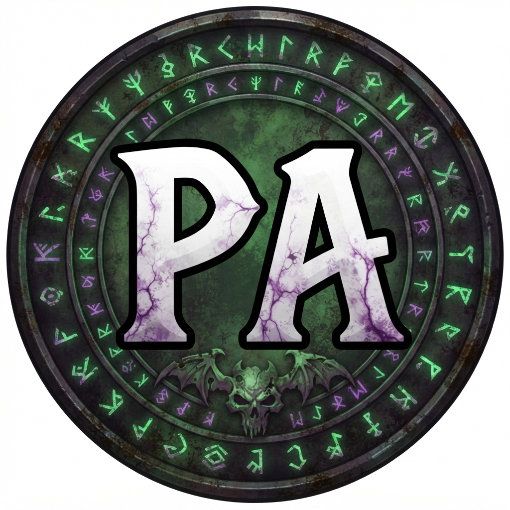
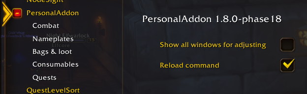
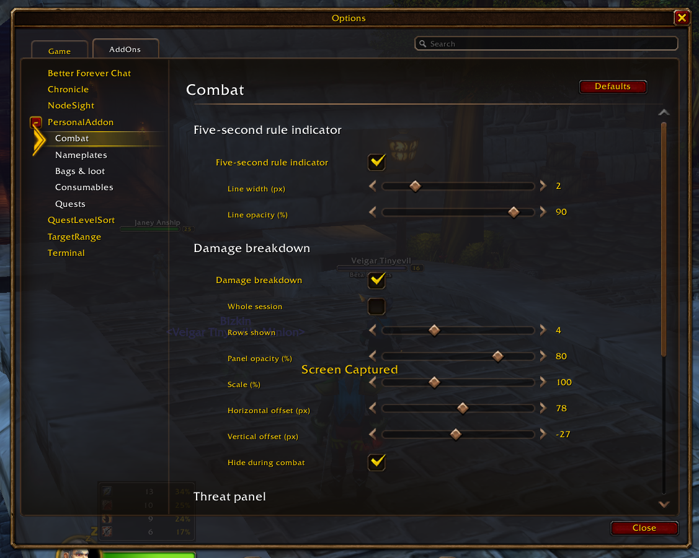
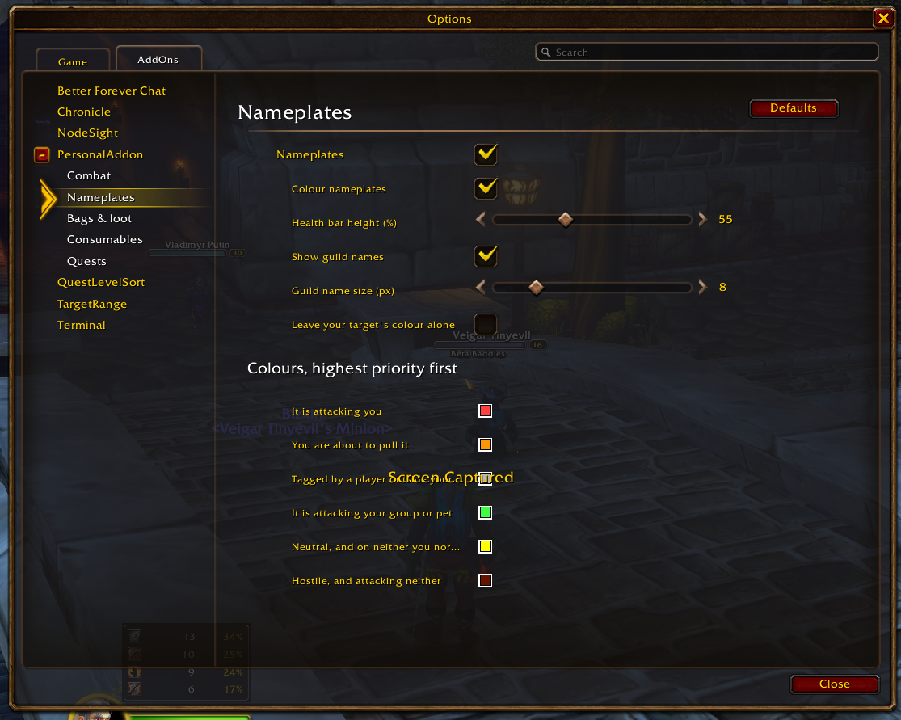
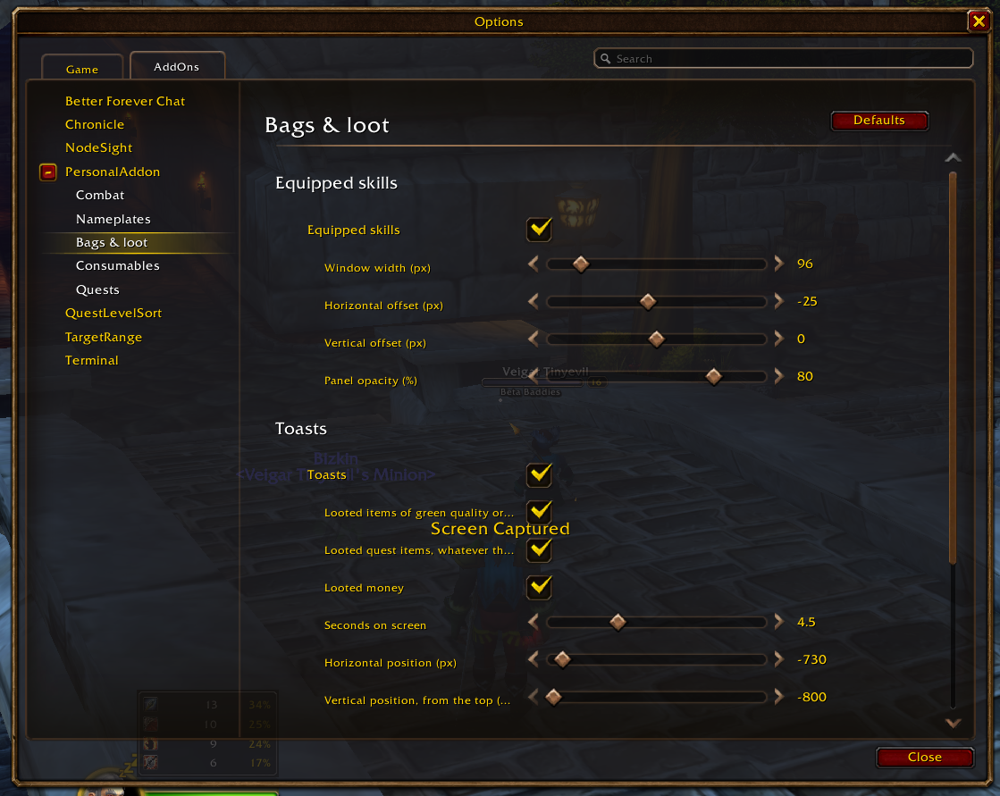
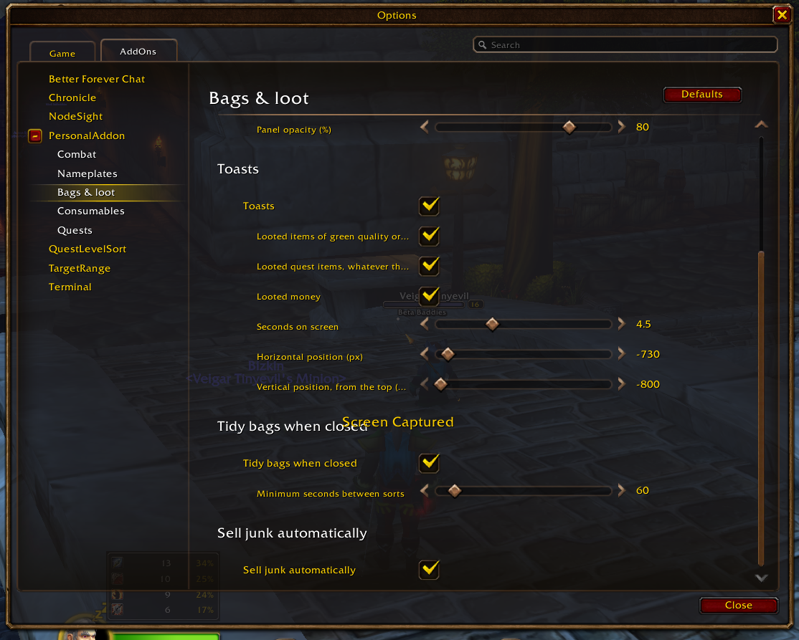
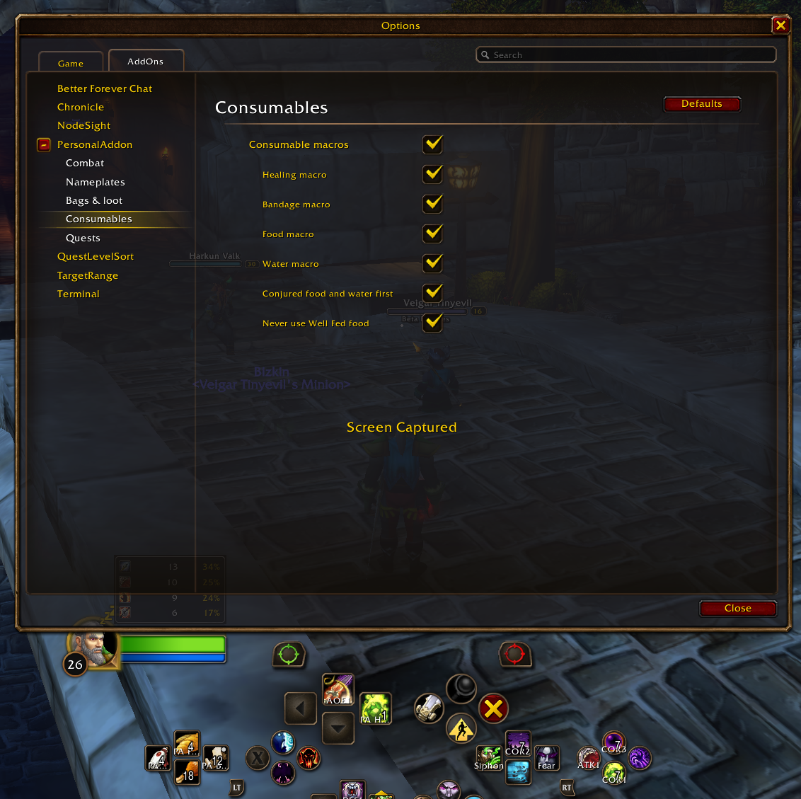
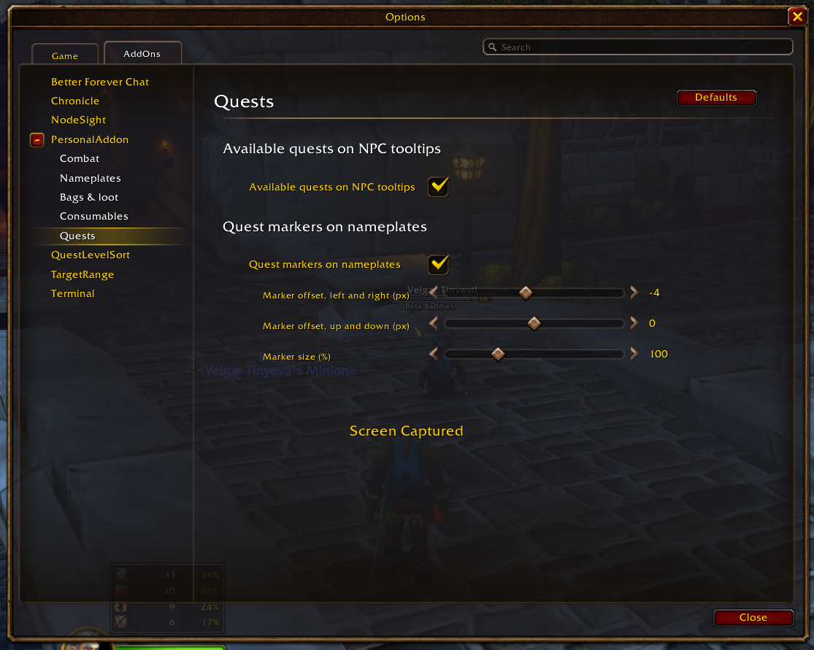

# PersonalAddon

<p align="center">
  
</p>

A modular, controller-first quality-of-life addon developed for the World of Warcraft Forever Beta (API 1.60.1). PersonalAddon selectively cherry-picks essential features from larger interface suites and rebuilds them natively to match the client's visual language and execution model. It is designed specifically for, and tested against, Blizzard's Gamepad UI (Alpha).

---

## Table of Contents

- [Visual Tour & Interface Showcase](#visual-tour--interface-showcase)
  - [Settings Navigation & Panel Chrome](#settings-navigation--panel-chrome)
  - [Combat HUD & Damage Metrics](#combat-hud--damage-metrics)
  - [Nameplates & Target Awareness](#nameplates--target-awareness)
  - [Bags, Skills & Loot Feedback](#bags-skills--loot-feedback)
  - [Consumable Macros & Gamepad Bar Integration](#consumable-macros--gamepad-bar-integration)
  - [Quests & NPC Tooltip Intelligence](#quests--npc-tooltip-intelligence)
- [Installation](#installation)
- [Core Features](#core-features)
  - [Combat](#combat)
  - [Nameplates](#nameplates)
  - [Bags & Loot](#bags--loot)
  - [Consumables](#consumables)
  - [Quests](#quests)
  - [Developer & Preview Tools](#developer--preview-tools)
- [Command Reference](#command-reference)
- [Troubleshooting & Known Issues](#troubleshooting--known-issues)
- [Native Client Capabilities](#what-the-game-already-does)
- [Attempted & Dropped Features](#tried-and-not-possible)
- [Planned Features](#planned)
- [Rules for Future Development (Taint & Isolation)](#rules-for-future-development)
  - [Documented Exceptions](#known-exceptions-kept-on-purpose)
  - [Taint Tracing Protocol](#to-trace-how-taint-reached-a-refusal)
- [Development & Verification Tooling](#development)
- [Credits & License](#credits)

---

## Visual Tour & Interface Showcase

### Settings Navigation & Panel Chrome

PersonalAddon integrates directly into the client's native Settings hierarchy using Blizzard's Settings API rather than external widget frameworks. Every setting is registered with vertical subcategories, pass-through value formatters, and parent-linked option indentations.



- **Root Navigation:** Found under **Options > AddOns > PersonalAddon**.
- **Category Tree:** Modular pages for **Combat**, **Nameplates**, **Bags & loot**, **Consumables**, and **Quests**.
- **Live Preview System:** The *"Show all windows for adjusting"* toggle renders synthetic preview frames so scales, offsets, and widths can be tuned in real time without entering combat.
- **Implementation:** [`Features/SettingsPanel.lua`](Features/SettingsPanel.lua) and [`Core/Preview.lua`](Core/Preview.lua).

---

### Combat HUD & Damage Metrics

Combat modules provide low-overhead combat telemetry while respecting Blizzard's secret-value lockdowns on restricted maps.

| In-Game Damage Breakdown HUD | Combat Configuration Panel |
| :---: | :---: |
|  |  |
| *Damage breakdown anchored above player unit frame with spell icons, DPS, and relative contribution.* | *Fine-grained controls for Five-Second Rule indicator, damage meters, and threat rows.* |

- **Damage Breakdown:** Renders active combat contributions (spells, icons, raw damage, and percentage share) directly above the player frame. Reads Blizzard's internal meter rather than processing combat log text strings.
- **Threat Panel:** Displays attacking mobs, current threat margins, target markers, and health bars in the same HUD anchor during encounters.
- **Five-Second Rule (FSR):** Smooth status sweep texture mapped across the mana bar tracking spirit regeneration windows for casters.
- **Implementations:** [`Features/DamageBreakdown.lua`](Features/DamageBreakdown.lua), [`Features/ThreatPanel.lua`](Features/ThreatPanel.lua), and [`Features/FiveSecondRule.lua`](Features/FiveSecondRule.lua).

---

### Nameplates & Target Awareness

Custom nameplate restyling prioritizes threat accountability, target hierarchy, and social context without replacing Blizzard's nameplate frames or introducing frame-creation taint.

| Nameplate Customization In-Game | Nameplate Color & Geometry Settings |
| :---: | :---: |
|  |  |
| *Nameplate with custom height scaling and sanitized guild name ("Beta Baddies") rendered beneath the health bar.* | *Settings panel showing proportional height scaling (55%) and 6-tier threat priority color pickers.* |

- **Proportional Health Bar Height:** Configured as a fractional percentage (30% to 100%) of the game's base scale to ensure cross-resolution and UI scale consistency.
- **Guild Names:** Displayed under player health bars in secondary weight with outline filtering and full escape-code neutralization ([`Core/EscapeGuard.lua`](Core/EscapeGuard.lua)).
- **Threat-Priority Color Palette:** Six prioritized color states reflecting aggro status, pull proximity, outside taps, and neutral disposition.
- **Implementation:** [`Features/Nameplates.lua`](Features/Nameplates.lua).

---

### Bags, Skills & Loot Feedback

Streamlined inventory management focused on non-disruptive automation and clear feedback.

| Skills Panel & Toast Notification Configuration | Bag Sorting & Auto-Vendor Options |
| :---: | :---: |
|  |  |
| *Geometry and opacity controls for Equipped Skills dock and toast notification triggers.* | *Throttle controls for post-close bag sorting and merchant auto-vend.* |

- **Equipped Skills Panel:** Docks adjacent to open bags displaying weapon skill ranks, defense, and primary professions.
- **Custom Loot Toasts:** Independent pop-ups for looted currency, uncommon-or-better items, and quest objects without hooking Blizzard's alert frames.
- **Safe Container Sorting:** Automatically executes Clean Up Bags on bag close with a 60-second cooldown lock, verifying no item locks are held.
- **Auto-Junk Liquidation:** Executes automated grey-item sales upon opening merchant frames with itemized earning toasts.
- **Implementations:** [`Features/EquippedSkills.lua`](Features/EquippedSkills.lua), [`Features/Toasts.lua`](Features/Toasts.lua), [`Features/AutoSortBags.lua`](Features/AutoSortBags.lua), and [`Features/AutoSellJunk.lua`](Features/AutoSellJunk.lua).

---

### Consumable Macros & Gamepad Bar Integration

Consumable automation designed specifically for controller players, ensuring optimal item assignment without risking action-bar taint or execution blocks.



- **Dynamic Macro Maintenance:** Generates and maintains four character-specific macros (`PA Heal`, `PA Bandage`, `PA Food`, `PA Water`) that dynamically target the highest-tier consumable available in bags.
- **Blizzard Gamepad Action Bar Docking:** Seamlessly placed into controller action-bar slots (shown above as `PA H1`, `PA F4`, `PA B12` in the Gamepad cross-bar).
- **Bar Writer Guard:** Checks action-bar execution context after every macro modification to ensure the addon never becomes flagged as the active action-bar writer.
- **Implementation:** [`Features/ConsumableMacros.lua`](Features/ConsumableMacros.lua).

---

### Quests & NPC Tooltip Intelligence

World quest integration built around lightweight database bridges and clean visual cues.

| NPC Unit Tooltip with Available Quests | Quest Settings Panel |
| :---: | :---: |
|  |  |
| *NPC tooltip augmented with available quest line ([30] A Noble Brew) colored by level difficulty.* | *Offsets and scale sliders for nameplate markers and tooltip quest injection switches.* |

- **NPC Tooltip Quest Lists:** Appends accepted and available quests with difficulty coloring directly into the unit tooltip during Blizzard's layout pre-calculation pass.
- **Nameplate Quest Markers:** Positions quest target indicators above relevant hostile units; automatically suspends itself in dungeons and raids where unit GUIDs are restricted by the client.
- **Bridge Architecture:** Interfaces with QuestieDB queries via [`Core/QuestieDBBridge.lua`](Core/QuestieDBBridge.lua) without requiring the full Questie interface suite.
- **Implementations:** [`Features/NPCQuests.lua`](Features/NPCQuests.lua) and [`Features/QuestMarkers.lua`](Features/QuestMarkers.lua).

---

## Installation

1. Download or clone this repository:
   ```bash
   git clone https://github.com/perceptum/PersonalAddon.git
   ```
2. Place the `PersonalAddon` directory inside your client's addon directory:
   ```text
   _classic_beta_/Interface/AddOns/PersonalAddon/
   ```
3. Launch the game and verify that **PersonalAddon** is checked in the AddOns menu.

All configuration options are accessible in-game via **Options > AddOns > PersonalAddon**, through subcategory menus (**Combat**, **Nameplates**, **Bags & loot**, **Consumables**, **Quests**), or via `/pa` slash commands.

---

## Core Features

### Combat

- **Five-Second Rule ([`Features/FiveSecondRule.lua`](Features/FiveSecondRule.lua)):**
  For mana users, a calibrated indicator sweeps across the player mana bar displaying the elapsed time until spirit-based mana regeneration resumes. Recasting resets the sweep. Mana values remain masked by the client, so discrete regeneration ticks cannot be surfaced.
- **Nameplate Threat Colors ([`Features/Nameplates.lua`](Features/Nameplates.lua)):**
  Recolors hostile and neutral nameplates based on tank/damage-dealer threat hierarchy:

  | Priority | Color | Condition |
  |---|---|---|
  | 1 | Red | Attacking you directly (overrides external tap tags) |
  | 2 | Orange | Imminent pull: your threat exceeds the active tank |
  | 3 | Grey | Tagged by an external player outside your party/raid |
  | 4 | Green | Attacking a party member or your active pet |
  | 5 | Yellow | Neutral unit |
  | 6 | White | Hostile unit attacking neither party nor player |

  Red and orange are prioritized for survival; tapped grey never masks an enemy targeting the player. Colors derive from server threat tables, functioning reliably in dungeons and raid instances.
- **Guild Names on Nameplates ([`Features/Nameplates.lua`](Features/Nameplates.lua)):**
  Draws player guild tags underneath health bars in secondary muted white with black outline shaders. Strings pass through [`Core/EscapeGuard.lua`](Core/EscapeGuard.lua) to strip formatting exploits before drawing.
- **Nameplate Health Bar Height ([`Features/Nameplates.lua`](Features/Nameplates.lua)):**
  Scales nameplate bar height from 30% to 100% of Blizzard's base layout, automatically adapting to the player's selected UI Style and Global Scale.
- **Quest Markers on Nameplates ([`Features/QuestMarkers.lua`](Features/QuestMarkers.lua)):**
  Renders an indicator beside the nameplates of monsters an active quest objective still wants. The marker **clears as soon as that objective is satisfied** — the kill count filled, or enough of the item collected — including on the creatures that drop a quest item rather than only on named kill targets. A setting keeps markers until the quest leaves the log instead, for farming a mob whose objective is already done. Requires QuestieDB and enemy nameplates enabled. **Automatically disabled in dungeons and raids** where the client withholds unit GUIDs to prevent misleading false negatives.
- **Rare and Elite Rings on Nameplates ([`Features/Nameplates.lua`](Features/Nameplates.lua)):**
  Encircles the nameplate level badge with the client's own target-frame surround: gold for an elite, silver for a rare or rare-elite, winged gold for a world boss. Drawn only on attackable units, and **off in dungeons and raids** where nearly every monster is elite and the ring would carry no information. Size and position are configurable; the artwork is resolved at runtime and the tier simply goes undrawn on a client that does not carry it.
- **Threat Panel HUD ([`Features/ThreatPanel.lua`](Features/ThreatPanel.lua)):**
  During combat, dynamically summarizes all units engaged with the player or party:
  - Unit health bar rendered in threat-priority color palette.
  - Current threat percentage relative to lead target.
  - Active target identification, level badge, and elite classification.
  - Automatically hides outside combat. Width, scale, and offset configurable in settings.
- **Damage Breakdown HUD ([`Features/DamageBreakdown.lua`](Features/DamageBreakdown.lua)):**
  Displays damage output segmented by ability, including icon, DPS, and relative percentage. Directly reads Blizzard's internal damage meter engine to maintain numerical parity. By default hides in combat to yield screen position to the Threat Panel.

### Bags & Loot

- **Equipped Skills Panel ([`Features/EquippedSkills.lua`](Features/EquippedSkills.lua)):**
  When bags are open, docks a compact skill summary against the left container frame showing primary profession ranks, equipped weapon skills, and defense as `rank / maximum`.
- **Custom Toast Alerts ([`Features/Toasts.lua`](Features/Toasts.lua)):**
  Surfaces popups for looted currency, green-or-better items, and quest objects. Does not trigger for vendor purchases, quest rewards, or crafted items. Screen duration, offset, and categories are configurable.
- **Automated Bag Consolidation ([`Features/AutoSortBags.lua`](Features/AutoSortBags.lua)):**
  Executes native `Clean Up Bags` upon closing inventory frames. Throttled to at most once per 60 seconds, blocked in combat, and suspended while item locks or Cooldown Manager updates are active.
- **Junk Liquidation ([`Features/AutoSellJunk.lua`](Features/AutoSellJunk.lua)):**
  Triggers Blizzard's `Sell All Junk` handler upon interacting with merchant frames without confirmation modals, reporting total proceeds via toast notifications or chat.

### Consumables

- **Dynamic Consumable Macros ([`Features/ConsumableMacros.lua`](Features/ConsumableMacros.lua)):**
  Generates four automated character macros that bind the optimal carried recovery item:

  | Macro | Resolution Hierarchy |
  |---|---|
  | `PA Heal` | Healthstone prioritized, followed by healing potion on subsequent press. Leading item determined by cooldown availability; resets post-combat |
  | `PA Bandage` | Applies highest-grade bandage to friendly target if alive, defaulting to self |
  | `PA Food` | Conjured food prioritized, followed by highest eligible level consumable |
  | `PA Water` | Conjured water prioritized, followed by highest eligible level drink (mana classes only) |

  Macros update **strictly out of combat** and only when bag inventory changes. They are never placed automatically; players bind them manually using the Action Bar Editor.
  
  > [!NOTE]
  > **Well Fed Filtering:** By default, food providing Well Fed is permitted because nearly all Forever Beta food applies this buff. Disabling this would invalidate food selection.

  > [!IMPORTANT]
  > **Action Bar Writer Guard:** Rewriting action-bar-docked macros triggers internal Blizzard range-check handlers. PersonalAddon monitors the Gamepad action bar's `activeBar` variable after each write. If taint attribution is detected, macro synchronization suspends for the remainder of the session to prevent controller button refusal until `/reload`.

### Quests

- **Available Quests on NPC Tooltips ([`Features/NPCQuests.lua`](Features/NPCQuests.lua)):**
  Hooks unit tooltip pre-render calculations to display all currently available quests offered by the targeted NPC, styled with difficulty level coloration. Queries [`Core/QuestieDBBridge.lua`](Core/QuestieDBBridge.lua) without requiring the full Questie addon to be running.
- **Objective-Aware Quest Markers ([`Features/QuestMarkers.lua`](Features/QuestMarkers.lua)):**
  Pairs QuestieDB's typed objective rows against the client's own objective list, honoring QuestieDB's published per-quest ordering hints (`LibQuestieDB.ObjectiveFirst`). A quest whose rows cannot be paired — by row count or by objective type — falls back to whole-quest completion rather than guessing, and `/pa quests` reports which path every quest in the log took.

### Developer & Preview Tools

- **Comprehensive Preview Mode ([`Core/Preview.lua`](Core/Preview.lua)):**
  Activating *"Show all windows for adjusting"* renders mock instances of the skills panel, damage breakdown/threat HUD, and toast notifications above the settings interface to facilitate spatial positioning. Automatically dismisses upon entering combat.
- **Fast UI Reload ([`Features/ReloadCommand.lua`](Features/ReloadCommand.lua)):**
  Provides `/rl` to reload the user interface.

---

## Command Reference

| Command | Functionality |
|---|---|
| `/pa status` | Summarizes operational state of all registered features |
| `/pa on <feature>`, `/pa off <feature>` | Toggles specific feature modules on or off |
| `/pa get <feature>`, `/pa set <feature> <k> <v>` | Reads or updates a specific configuration key |
| `/pa skills` | Dumps current skills panel layout and tracked values to chat |
| `/pa toasts`, `/pa toasts test` | Summarizes toast metrics; emits synthetic test toasts across all categories |
| `/pa bags`, `/pa vend` | Reports last container sort or vendor event, including skip reasons |
| `/pa consumables` | Summarizes active consumable bindings and assignment diagnostics |
| `/pa quests` | Displays QuestieDB bridge status, offered NPC quests, and marker targets |
| `/pa dps`, `/pa threat`, `/pa plates`, `/pa fsr` | Dumps state of damage meter, threat monitor, nameplates, and FSR tracker |
| `/pa preview [on\|off\|threat\|dps]` | Manages visual adjustment preview mode and toggles active HUD anchor |
| `/pa panel` | Inspects settings registration tree and category building diagnostics |
| `/pa blocked` | Outputs protected function refusals attributed to PersonalAddon |
| `/pa diag`, `/pa diag clear` | Inspects or clears operational diagnostic counters across previous 5 sessions |
| `/pa help` | Displays the complete slash command reference |

---

## Troubleshooting & Known Issues

> [!WARNING]
> **Defect Classification:** Any refusal recorded in `/pa blocked` represents an execution defect in PersonalAddon, with one specific exception documented below. Retain BugGrabber in your development environment to prevent Blizzard error dialogs from interfering with testing.

### Controller Taint & Refused Actions (Upstream Blizzard Defect)

- **Mechanism:** Any insecure code (third-party addons or `/run`) opening/closing frames or exiting Options via gamepad input can taint the Gamepad UI's internal focus, binding, and cursor management stacks.
- **Symptoms:** Subsequent controller inputs (such as updating interact icons via `SetPreferredGamepadInteractTarget`, jumping, or Game Menu navigation) are refused. The client attributes taint to whichever addon last modified the execution state.
- **Verification:** When this defect triggers, `/pa blocked` displays a call stack passing through Blizzard's `MainActionBarFrame.lua` or `FrameControlsManager.lua` rather than addon source files. Diagnostic counters increment `refusalsOurs` accompanied by `knownDefectHintShown`.
- **Workaround:** Enter `/reload` in chat. Detailed architectural analysis is documented in [`Architecture/20261002-GAPBugs01.md`](Architecture/20261002-GAPBugs01.md).

---

## What the Game Already Does

To eliminate redundant execution overhead, PersonalAddon intentionally omits features natively covered by the Gamepad UI:

- Full window navigation using controller sticks and panel switching via `L2` / `R2`.
- Quest acceptance, dialogue progression, and reward selection.
- Automatic distance-based sorting of tracked quests upon zone transitions.
- Underlying combat damage meter infrastructure (which [`Features/DamageBreakdown.lua`](Features/DamageBreakdown.lua) reads directly).
- Directional strafing/backpedaling angles configured via Options → Gamepad.
- Container cleanup accessible through the bag Manage menu.
- Native vendor junk selling and transaction summaries.

---

## Tried and Not Possible

Architectural decisions and experiments evaluated across development phases and dropped to avoid duplicated research:

| Feature Concept | Technical Limitation | Reference Phase & Build |
|---|---|---|
| Scrolling Combat Text | Client combat log restricted for third-party addons; events drop hits intermittently. Replaced with Damage Breakdown HUD | [Phase 4](Architecture/20260919-Phase04.md) §1.1 |
| Dynamic Camera Pitch | Client accepts CVar mutations but ignores camera pitch parameters under gamepad mode | [Phase 5](Architecture/20260919-Phase05.md) §4.5b |
| NPC Role Tags on Plates | No API provides NPC roles without scraping localized tooltip lines; nameplate text regions are restricted and cannot be measured | [Phase 15](Architecture/20261010-Phase15.md) §1.3, build 1.60.1.70338 |
| Custom Nameplate Bar Width | Nameplate width is governed by opposing layout anchors; modifying width requires re-anchoring Blizzard frames | [Phase 14](Architecture/20261010-Phase14.md) §1.3, build 1.60.1.70334 |
| Minimalist Unit Frames | Requires modifying protected Blizzard unit frames; FSR indicators anchor cleanly to native mana bars | [Phase 6](Architecture/20260919-Phase06.md) |
| Level-Sorted Quest Tracker | Re-ordering watches fires tracker updates synchronously inside the call, spreading taint into quest tracking | [Phase 7](Architecture/20260926-Phase07.md) §6.4 |
| Blizzard Native Loot Toasts | Blizzard loot alerts never trigger for normal inventory items in this UI mode; implemented via custom toast frames | [Phase 8](Architecture/20260927-Phase08.md) |
| Raid Markers on Threat HUD | Client masks raid target markers from insecure addon inspection | [Phase 11](Architecture/20261005-Phase11.md), build 1.60.1.70235 |
| Reactive Control Greying | Requires runtime modify predicates called by Blizzard on each render pass; resolved by structural subcategory indentation | [Phase 12](Architecture/20261006-Phase12.md) §3.4, build 1.60.1.70291 |
| Dungeon/Raid Quest Markers | Client withholds unit GUIDs on restricted maps; partial marker rendering would produce misleading false negatives | [Phase 17](Architecture/20261011-Phase17.md) §4.3, build 1.60.1.70338 |
| Tooltip Anchored to Plates | Moving game tooltip risks triggering empty render loops warned by Blizzard source; requires full custom tooltip framework | [Phase 18](Architecture/20261011-Phase18.md) §4, build 1.60.1.70338 |
| Nameplate Rarity Icons via Client Feature | Client ships the whole feature (`NamePlateClassificationFrameMixin`) and this flavour disables it in two places: the enemy frame option is false and the settings checkbox is hidden. Enabling it requires writing Blizzard's option table, which Rule 2 forbids; the ring is drawn as an addon-owned frame instead | [Phase 19](Architecture/20261016-Phase19.md) §1.3, build 1.60.1.70450 |
| Restoration-Ranked Consumables | Restore quantities exist only as localized tooltip strings; ranking relies on required level | [Phase 16](Architecture/20261011-Phase16.md) §4.5, build 1.60.1.70338 |
| Hidden Action Button Indirection | `/click` fails against addon frames with `ScriptedInput` constraints; macros must name items directly | [Phase 16](Architecture/20261011-Phase16.md) §6.1, build 1.60.1.70338 |
| Bandage First Aid Verification | Item APIs do not expose First Aid rank prerequisites; invalid usages report native error feedback | [Phase 16](Architecture/20261011-Phase16.md) §4.4, build 1.60.1.70338 |
| Auto-Placing Macros on Bars | `PlaceAction` triggers synchronous slot mutation events inside addon code, compromising Gamepad action bar security | [Phase 12](Architecture/20261006-Phase12.md) §1.3, build 1.60.1.70291 |

---

## Planned

Both items are currently **on hold** pending taint isolation verification under Rule 8:

- **Lower-Center NPC Windows:** Relocating gossip, quest, merchant, and trainer dialog frames to lower screen center with adjustable offsets.
- **Paragraph Paging for Gossip:** Implementing progressive dialogue text presentation inspired by Immersion.

---

## Rules for Future Development

The World of Warcraft client evaluates code trust per execution thread. When Blizzard code calls third-party code or reads a value written by an insecure caller, the execution context becomes tainted. Any protected operation performed later in that execution chain is refused. The architecture documents in [`Architecture/`](Architecture/) reference these rules by number:

1. **Blizzard Code Never Calls Addon Functions Inline:**
   Addon logic executes strictly via dedicated frame event handlers, `hooksecurefunc` post-hooks, timers, and Blizzard callback registries.
   - Event handlers are isolated only if events fire independently. Synchronous events fire inside the initiating call stack. Check `SynchronousEvent` vs `UniqueEvent` flags.
   - Settings use `Settings.RegisterAddOnSetting` with value-changed callbacks; never proxy settings with inline getters/setters.
   - No dropdown controls: dropdown generation invokes third-party closures during Blizzard render passes. Two-value selections use checkboxes.
   - No commit, default, or refresh hooks; no custom slider formatters; no inline color-picker closures.
   - No runtime layout predicates: options indent hierarchically under master toggles without dynamic disabled predicates.
2. **Never Mutate Blizzard Variables or Tables:**
   Prohibit global `print()` (routes through shared chat frames), custom fields on Blizzard frame instances, and entries in `UIPanelWindows` or `UISpecialFrames`. Slash command registration is the sole exception.
3. **Addon Frames Remain Outside Blizzard Panel Management:**
   Never call `ShowUIPanel` or `HideUIPanel` on addon frames. The panel manager drives Gamepad UI navigation and is the primary vector for action refusals.
4. **Hooks Must Be Post-Hooks Only:**
   Use `hooksecurefunc` exclusively. Replacement hooks are prohibited. All hooked logic must execute in $O(1)$ time.
5. **Blizzard-Triggered Actions Defer One Frame:**
   Operations initiated by Blizzard interface interactions must execute on the subsequent frame via `C_Timer.After(0)` through an addon-owned cancellable queue.
6. **Parent to Addon Frames, Anchor to Blizzard Frames:**
   Addon frames may anchor to Blizzard UI elements but must never be parented to them. Parenting forces Gamepad UI navigation rebuilds that contaminate container focus states.
7. **Never Invoke Protected Functions:**
   Any protected action refusal attributed to PersonalAddon is classified as a critical defect.
8. **Blizzard Panel Modifications Require Isolated Testing First:**
   Modifications affecting gossip, quest, merchant, trainer, settings, game menu, or edit mode frames require verified spike testing prior to architectural planning.
9. **Client APIs May Dispatch Synchronous Events:**
   Treat any client API that alters shared state as executing listeners inside the calling thread until empirically verified:
   - `AddQuestWatch` dispatches `QUEST_WATCH_LIST_CHANGED` synchronously.
   - `C_Container.SortBags` dispatches `ITEM_LOCK_CHANGED` synchronously.
   - `EditMacro` on an action-slotted macro dispatches `ACTION_RANGE_CHECK_UPDATE` and `ACTIONBAR_SLOT_CHANGED` synchronously.
10. **Client Returns May Contain Secret Values:**
    On restricted maps (dungeons and raids) and during combat encounters, many functions return masked values. Arithmetic or comparisons on secret values throw runtime errors. All values must be routed through [`Core/ClientRead.lua`](Core/ClientRead.lua) using `canaccessvalue`. Treat `Withheld` as indeterminate, never false.
11. **Document Premises in the Patch Check Register:**
    Any design dependent on specific Blizzard code behavior must record that premise in [`Tools/patchcheck/premises.toml`](Tools/patchcheck/premises.toml). Run patchcheck validation following every client update.

### Known Exceptions (Kept on Purpose)

- The FSR indicator texture attaches directly to Blizzard's mana bar frame ([`Features/FiveSecondRule.lua`](Features/FiveSecondRule.lua)).
- [`Core/Log.lua`](Core/Log.lua) falls back to native `print()` only when chat frames are uninitialized.
- Chat output routes through `AddMessage`, which enters Blizzard's message history and `FADEFRAMES` list.
- Settings registration stores control definitions inside Blizzard's Settings tables.
- The NPC quest tooltip block executes inside Blizzard's tooltip construction callback to ensure correct frame measurement before display ([`Features/NPCQuests.lua`](Features/NPCQuests.lua)).
- Nameplate restyling post-hooks execute inside Blizzard's draw call to prevent single-frame color flickers ([`Features/Nameplates.lua`](Features/Nameplates.lua)).

### To Trace How Taint Reached a Refusal

1. Ensure BugGrabber is active. Set `/console taintLog 1` and run `/reload`.
2. Reproduce the exact user action triggering the refusal, then quit the client.
3. Open `Logs/taint.log`. Locate the line immediately preceding *"An action was blocked"*; match that line against the Blizzard UI source export.
4. Disable logging via `/console taintLog 0`. (Never use logging level 4, which floods I/O buffers). Back up `taint.log` immediately as subsequent logins overwrite it.

---

## Development

Offline verification and analysis tools reside under [`Tools/`](Tools/) and do not load into the game client:

```bash
# Execute offline test suite across all feature phases
python Tools/harness/run.py

# Execute secret-value AST linter
python Tools/lint/secret_lint.py

# Verify Blizzard UI export premises against current client build
python Tools/patchcheck/patch_check.py status
```

- **[`Tools/harness/`](Tools/harness/):** Runs the full addon suite offline in a pure Lua 5.1 environment with mocked Blizzard APIs.
- **[`Tools/lint/`](Tools/lint/):** AST lint verifying all client API calls route through [`Core/ClientRead.lua`](Core/ClientRead.lua).
- **[`Tools/patchcheck/`](Tools/patchcheck/):** Compares code premises in [`Tools/patchcheck/premises.toml`](Tools/patchcheck/premises.toml) against Blizzard UI exports. Refer to [`Tools/README.md`](Tools/README.md) for update workflows.

---

## Credits

Inspired by architectural principles and features from Leatrix Plus, FiveSecondRule, Threat Plates, DynamicCam, and Immersion.

---

## License

PersonalAddon is distributed under the terms of the **Artistic License 2.0**. See [`LICENSE`](LICENSE) for details.
